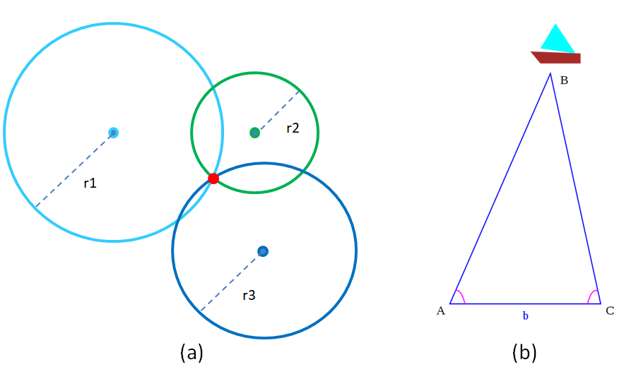
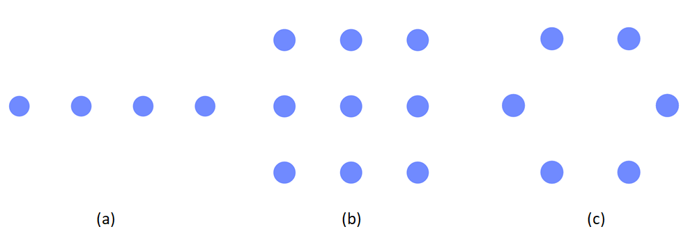
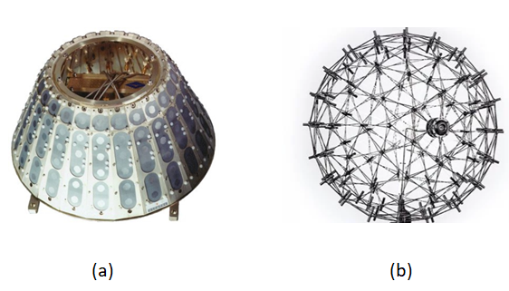
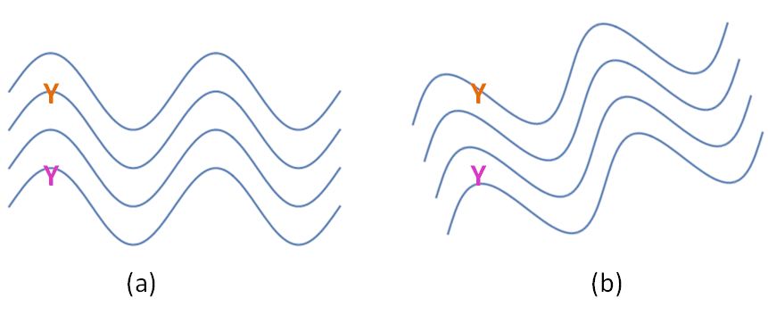
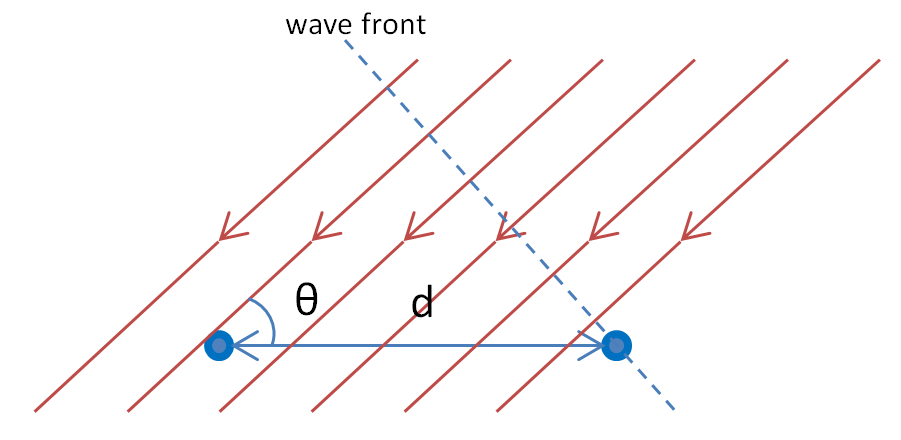
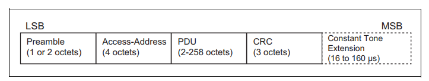
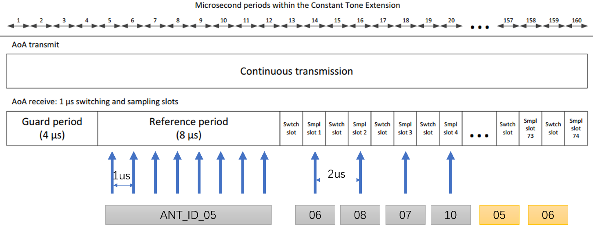

<!-- an_aoa: 3 Direction Finding Fundamentals -->

# 3 Direction Finding Fundamentals {#fundamentals}

## 3.1 Positioning {#positioning}

Positioning technologies have many useful applications, one example being GNSS (GPS, Beidou, GLONASS, Galileo, etc.), which is widely used all over the world.

Unfortunately, GNSS systems do not work very well indoors, so there is a real need for better indoor positioning technologies.

There are two conventional methods to calculate the position of an asset: trilateration and triangulation.

Trilateration uses the distance of the asset from multiple fixed-position locators to determine the position by finding the point that satisfies all distance measurements best. The distance can be deduced from Received Signal Strength Indicator (RSSI) measurement or Time of Flight measurement, for example. Unfortunately, RSSI measurement can be very inaccurate and Time of Flight measurement needs highly accurate time measurement.

Triangulation uses the angles under which the fixed-position locators see the asset (or under which the asset sees the fixed-position locators). The position of the asset is then determined by the intersection point of the lines of sight. Take two locators as an example, with the two measured angles, one can construct a unique triangle by the angle-side-angle congruence theorem within a given plane, and the asset is sitting at the third vertex of this triangle.

Figure 3.1: Trilateration (a) and Triangulation (b)

The technology to determine these angles is called Direction Finding. Direction finding, or radio direction finding, is – in accordance with International Telecommunication Union (ITU) – defined as radio location that uses the reception of radio waves to determine the direction in which a radio station or an object is located. Direction finding has a very long history, for example, in World War II, it played an important role in combating German threats during both the Battle of Britain and the long running Battle of the Atlantic. It is even a sport, and there are amateur radio direction finding events held all over the world today.

Triangulation can give a more accurate position than trilateration with RSSI measurement, and requires less expensive time measurement hardware than Time of Flight measurement.

However, triangulation needs an antenna array and a method with which the direction (angle) of the incoming signal can be determined.

## 3.2 Direction Finding Methods {#direction-finding-methods}

There are two direction finding methods available in BLE, called Angle of Arrival (AoA) and Angle of Departure (AoD) respectively.

In each method, from the received samples, phase differences can be deduced, and then, direction can be estimated.

### 3.2.1 Angle of Arrival {#angle-of-arrival}

In this method, an antenna array is deployed in the receiver. An un-modulated radio wave emitted by a single transmitter will reach different antennas in different phases.

There two methods to measure phases on antennas:

- Sampling all antennas simultaneously

  This requires separated and dedicated RF path for each antenna, which is too expensive for BLE systems.
- Sampling each antenna periodically

  This needs one or more RF switches, but only one RF path, which is much more affordable. When receiving, the receiver will sampling each antenna periodically controlled by a list which is called a *switching pattern*.

### 3.2.2 Angle of Departure {#angle-of-departure}

In this method, the setup is reversed: an antenna array is deployed in the transmitter. An single un-modulated radio wave is generated, and emitted on antennas periodically controlled by a switching pattern by the transmitter.

If multiple transmitter antennas are placed close enough to each other, and the wave is transmitting within a short duration, we can assume that the signals coming from each antenna will reach the receiver’s single antenna inheriting the same propagation path. Therefore, phases for each transmitting antenna can be measured and utilized for direction estimation, too. Obviously, the receiver needs to **know all information** about the antenna array used by the transmitter a priori.

## 3.3 Direction Finding Theory {#direction-finding-theory}

Antenna arrays and algorithm are both essential for a direction finding system. This section discusses the basics of some typical antenna arrays and estimation algorithms. Here, direction finding refers to the general problem of estimating AoA and AoD.

### 3.3.1 Antenna Arrays {#antenna-arrays}

There are several types of arrays, mounted on a line (Linear Array), on a flat surface (Rectangular Array, Circular Array, L-Array), or on a curved surface (Conformal Array, 3D Array).

Figure 3.2: Uniform Linear Array (a), Uniform Rectangular Array (b) and Uniform Circular Array (c)

By using a one-dimensional antenna array, one can measure only the azimuth angle, while with two-dimensional arrays, one can measure both azimuth (\theta) and elevation (\phi) angles in the 3D half-space splitted by the plane in which the arrays are embedded. If the array is extended to 3D, then it is possible to measure in the full 3D space.

Figure 3.3: Conformal Array on LEO satellites (a) and 3D Microphone Array in a commercial product (b)

### 3.3.2 Algorithm with A Trivial Example {#algorithm-with-a-trivial-example}

Figure [3.4](https://ingchips.github.io/application-notes/an_aoa/fundamentals.html#fig:ch1-phase-concept) shows how a change in the direction of the incoming signal causes a difference in the phase of the received signal on two antennas.

Figure 3.4: Phase Differences Between Antennas

In Figure [3.5](https://ingchips.github.io/application-notes/an_aoa/fundamentals.html#fig:ch1-phase-calc) the direction of the incoming signal is \theta, and the distance between the two antenna is d.

Figure 3.5: Phase Differences Calcuation

Then, the time difference of the incoming signal on the two antennas is:

\Delta t=\frac{d \ cos(\theta)}{c}

Where c is the speed of light. The phase difference caused by \Delta t is:

\Delta phase=2 \pi f \Delta t

Where f is the frequency of the un-modulated radio signal. From the measurement of phase difference, \theta can be deduced:

\theta = arccos(\frac{c \ \Delta phase}{2 \pi f d})= arccos(\frac{\lambda \ \Delta phase}{2 \pi d})

Where \lambda is the wave length. Note that, \Delta phase is between -\pi and \pi, which requires that d < \frac{\lambda}{2}.

Readers are recommended to read standard textbooks on advanced(array/radar) signal processing for direction estimation algorithms suitable for antenna arrays.

## 3.4 Location Finding {#location-finding}

Without knowing the accurate distance of the asset, and if the asset is moving in full 3D space, one two-dimensional antenna array can provide the direction of the asset, but not its position.

To determine the precise position of the asset in full 3D space, multiple antenna arrays (locators) must be used. By using more than one locator, the position of the asset can then be determined using triangulation. Adding RSSI measurements to the direction estimations may further enhance the position estimation.

## 3.5 Constant Tone Extension {#constant-tone-extension}

The un-modulated radio signal is introduced in Bluetooth Core Specification as *Constant Tone Extension* for uncoded PHYs (i.e. 1M & 2M PHYs), starting from Version 5.1.

Figure 3.6: Link Layer packet format for the LE Uncoded PHYs

The Constant Tone Extension has a variable length between 16 µs and 160 µs. The contents are a constantly modulated series of 1s, which is an un-modulated wave due to to nature of GFSK, and no whitening is applied to them.

The first 4 µs of the Constant Tone Extension are termed the guard period and the next 8 µs are termed the reference period. After the reference period, the Constant Tone Extension consists of a sequence of alternating switch slots and sample slots, each either 1 µs or 2 µs long as specified by the Host.

The first antenna in the switching pattern is used during the reference period. The second antenna in the pattern shall be used during the first sample slot, the third antenna during the second sample slot, and so on. For example, the switching pattern is \{5,6,8,7,10\}, slot duration is 1 µs, and the antenna selected for each sample is shown in Figure [3.7](https://ingchips.github.io/application-notes/an_aoa/fundamentals.html#fig:ch1-switching-pattern).

Figure 3.7: Antenna Switching