<!-- an_aoa: 4 Quick-Start Guide -->

# 4 Quick-Start Guide {#quick-start}

This guide walks through the offered solution to help anyone get started with Direction Finding, especially Direction Finding based on AoA.

## 4.1 Setup {#setup}

The whole demo includes 1 or more tags, 1 antenna array board and 1 PC running Windows.

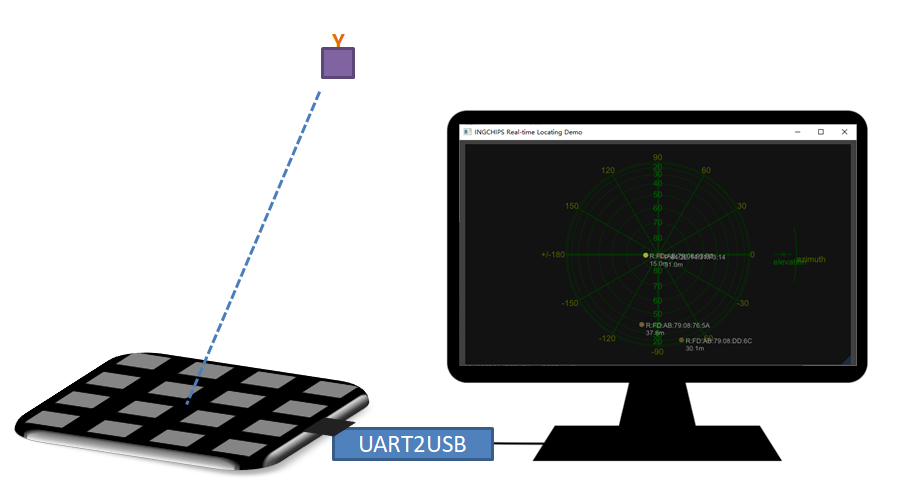

Figure 4.1: Hardware Setup

- Tags - CTE Transmitters

  All ING9188xx based boards/products can be used as tags. Just download *Peripheral LED & CTE* example in SDK.
- 4x4 Antenna Array Board (Rectangle) - CTE Receiver

  App for the 4x4 antenna array board should already have been downloaded, which is exactly the *Central CTE* example in SDK with `PRO_MODE` defined.

  The top side of the board (shown in the left of Figure [4.2](https://ingchips.github.io/application-notes/an_aoa/quick-start.html#fig:ch2-4x4-array-overview)) should face tags, but not the opposite side.

  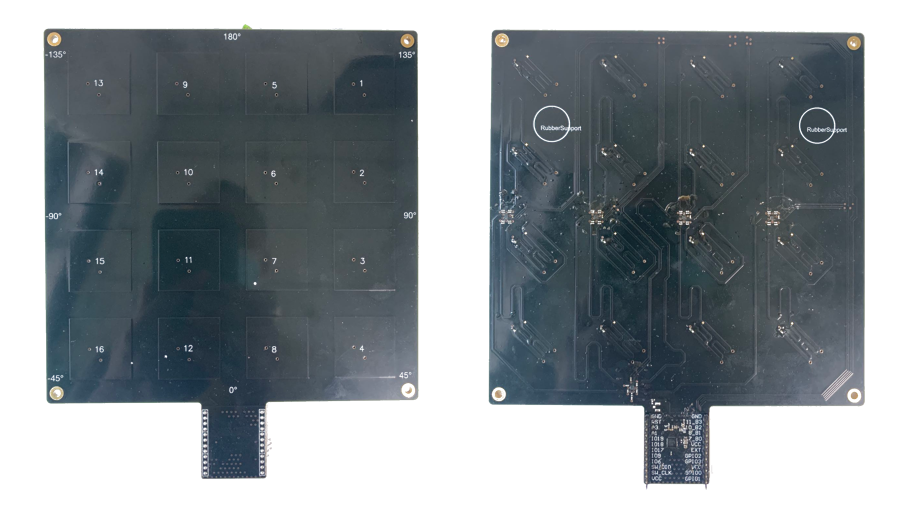

  Figure 4.2: 4x4 Antenna Array Board (Rectangle)

Or,

- 3x3 Antenna Array Board (Round) - CTE Receiver

  App for the 3x3 antenna array board should already have been downloaded, which is exactly the *Central CTE* example in SDK with `PRO_MODE` defined, and `CURRENT_ARRAY = ANTENNA_ARRAY_3x3`.

  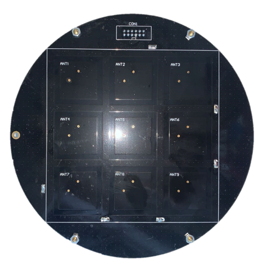

  Figure 4.3: 3x3 Antenna Array Board (Round)
- PC

  1 PC running x64 Windows 10 or newer with a mainstream desktop CPU is recommended.

  From the main menu of `Wizard`, select “Tools” -> “More” -> “Realtime Locating Demo (DX12)”. If the program could not be started, install Microsoft Visual C++ Redistributable packages[2](#fn2) for Visual Studio 2022, and try again.

  If the PC is running elder Windows version than 10, then select “Tools” -> “More” -> “Realtime Locating Demo (OpenGL)”. If the program could not be started, install Microsoft Visual C++ Redistributable packages for Visual Studio 2022, and try again.

  Python[3](#fn3) 3 is another required piece of software. It’s recommended to use a packge manager for Windows - Anaconda[4](#fn4) , Chocolatey[5](#fn5), etc. - to install Python. Use below commands to install additioal required Python libraries:

  ```shell
  pip install pyserial
  ```
- UART2USB

  A UART2USB kit is required to connect the antenna array board to PC. Hardware connection (as shown in Figure [4.4](https://ingchips.github.io/application-notes/an_aoa/quick-start.html#fig:ch2-array-uart-connection)):

  - GPIO2 is used for UART transmission
  - Antenna array board is powered through VCC & GND
  - 3.3V is recommended for VCC

  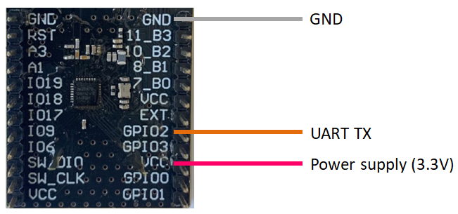

  Figure 4.4: Connect 4x4 Antenna Array Board (Rectangle) to UART2USB (PC)

## 4.2 Run the Demo {#run-the-demo}

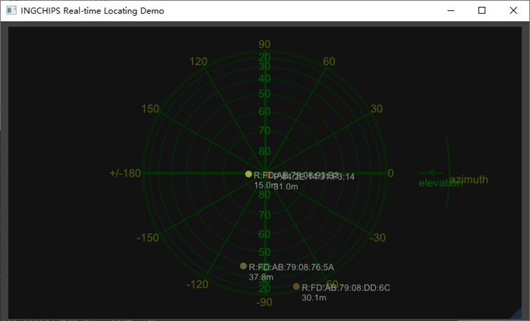

Figure 4.5: Main Window of Real-time Locating Demo

After all hardware components are ready, the demo can be started.

From the main menu of `Wizard`, select “Tools” -> “More” to start *Real-time Locating Demo*. There are two variants, one built against DirectX 12, and the other OpenGL. Both share the same functionalities, but have subtle differences on GUI appearance and system dependencies as summarized in Table [4.1](https://ingchips.github.io/application-notes/an_aoa/quick-start.html#tab:ch2-demo-tool-compare). If an array board other than the default 4x4 Antenna Array Board (Rectangle) is used, check out Table [6.3](https://ingchips.github.io/application-notes/an_aoa/futher-info.html#tab:ch4-array-type-opt-o3x3) for the corresponding parameters when launching the tool.

The *real-time* used here means that data fed to *Real-time Locating Demo* is assumed to be in real-time, and the wall clock when each CTE report is received is utilized in post processing of AoA estimations.

*Table 4.1: Comparison of DX and OpenGL Demo variants*
| Variant | Windows | Support of High DPI display |
| --- | --- | --- |
| DirectX 12 | Windows x64 (>= 10) | Excellent |
| OpenGL | Windows x64 | Not good |

Find the COM port of the UART2USB kit in Windows Device Manager. Take “COM7” as an example.

Open a console (prompt, or terminal) window, make sure that the Python executable is in the search paths, use `cd` command to change directory to “RLT” which is in SDK’s installing directory, and run following command to start feeding data to *Real-time Locating Demo*:

```shell
python serial2tcp.py --port COM7
```

Now, *Real-time Locating Demo* will start showing AoA results on its main window (Figure [4.5](https://ingchips.github.io/application-notes/an_aoa/quick-start.html#fig:ch2-demo-main)). Azimuth (\theta) and elevation (\phi) results are shown on a sky plot. The center of the plot corresponds to the zenith seen from the board, i.e., it’s right above the center of the board.

*Real-time Locating Demo* supports detection of multiple tags. To simplify the demo, *Peripheral LED & CTE* has been designed to randomly generate a new address each time it got powered on, therefore, just reset the tag, and a **new** tag will appear on *Real-time Locating Demo*. If CTE from a tag has not been received for a period of time, *Real-time Locating Demo* will forget the tag, and remove it from the plot.

## 4.3 AoA Accuracy {#aoa-accuracy}

As direction finding solutions will be deployed in different scenarios and SIG has not defined **standard** scenarios for accuracy assessment, it’s impossible to give accuracy results that can be used for evaluation/comparison of different AoA solutions.

To put it another way, we developed a low cost test platform and performed real environment testing with the following results.

### 4.3.1 Test Platform {#test-platform}

Figure [4.6](https://ingchips.github.io/application-notes/an_aoa/quick-start.html#fig:ch2-test-platform) is the overview of the test platform. The antenna array board is turned by a servo which is controlled by Controller. An OLED display is used for displaying information during the test. Data output from the array board is saved to an SD card. ING918xx development board is used to implement the Controller.

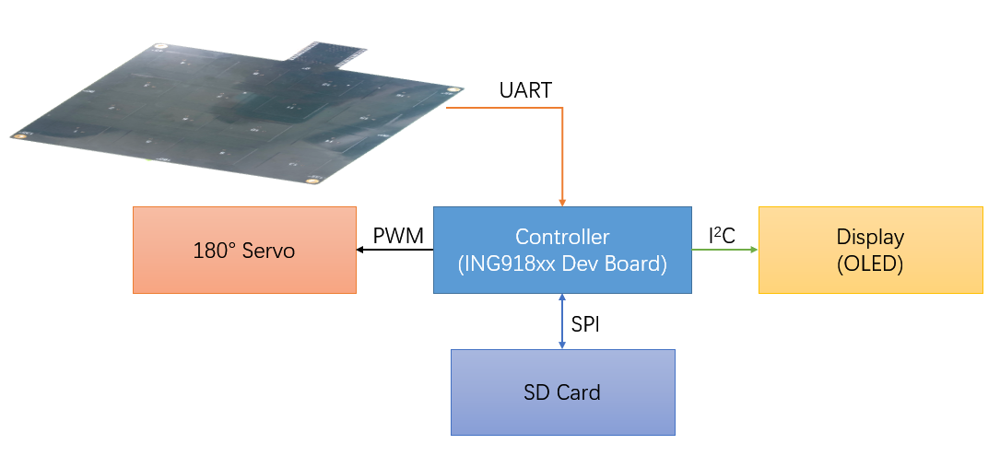

Figure 4.6: AoA Test Platform

### 4.3.2 Test Results with 4x4 Antenna Array Board (Rectangle) {#test-results-with-4x4-antenna-array-board-rectangle}

The following devices were used for all antenna array accuracy measurements in this section:

- 4x4 Antenna Array Board (Rectangle) (CTE Receiver)
- ING918xx development boards (Tags - CTE Transmitters)

#### 4.3.2.1 Environment 1 (1 locator, 1 tag) {#environment-1-1-locator-1-tag}

- Location: Indoor, office corner, lots of objects inside measurement area
- Locator height from floor: \approx 0.7 m
- Locator is placed horizontally on the test platform
- Tag height from Locator: \approx 1.5 m
- Tag is in different poses

Setup of this test is shown in Figure [4.7](https://ingchips.github.io/application-notes/an_aoa/quick-start.html#fig:ch2-vertical-test). Locator rotates between 0 \sim 360 ^ \circ. This test is carried with the tag in three different poses. Figure [4.8](https://ingchips.github.io/application-notes/an_aoa/quick-start.html#fig:ch2-pose-closeup) is a closeup of the tag with different poses.

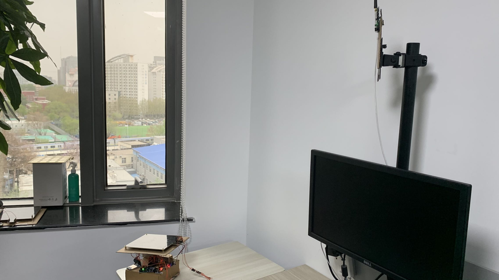

Figure 4.7: Test Setup (Environment 1)

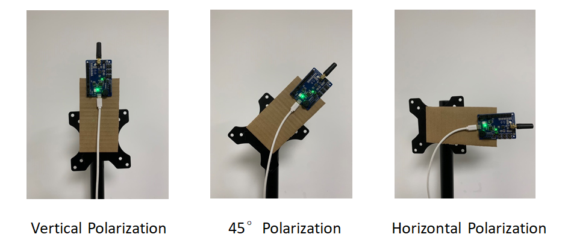

Figure 4.8: Tag Pose Closeup

Azimuth error vs. azimuth angle when tag is in vertical polarization is shown in Figure [4.9](https://ingchips.github.io/application-notes/an_aoa/quick-start.html#fig:ch2-v-azi-err). Azimuth error vs. azimuth angle when tag is in 45 ^ \circ polarization is shown in Figure [4.10](https://ingchips.github.io/application-notes/an_aoa/quick-start.html#fig:ch2-45deg-azi-err). Azimuth error vs. azimuth angle when tag is in horizontal polarization is shown in Figure [4.11](https://ingchips.github.io/application-notes/an_aoa/quick-start.html#fig:ch2-h-azi-err).

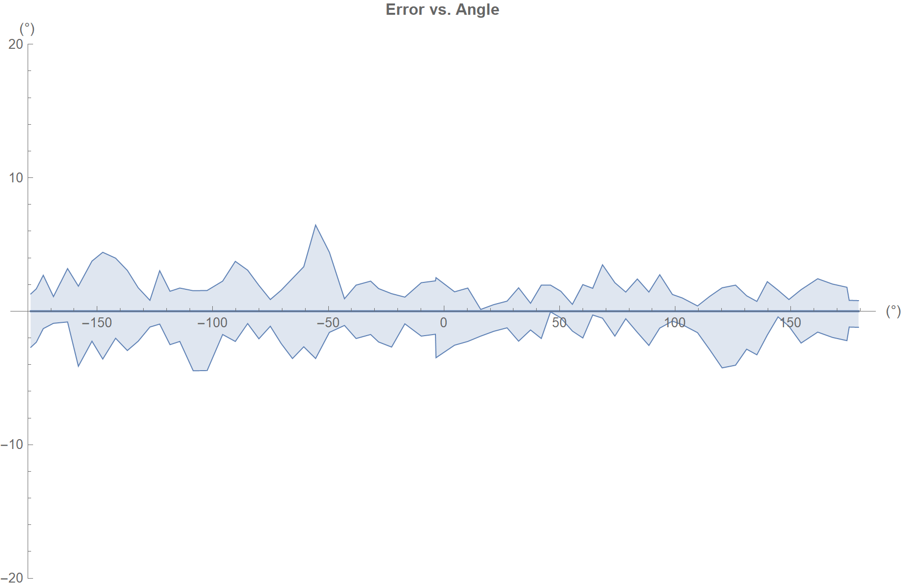

Figure 4.9: Azimuth Error vs. Azimuth Angle (Environment 1, Vertical Polarization)

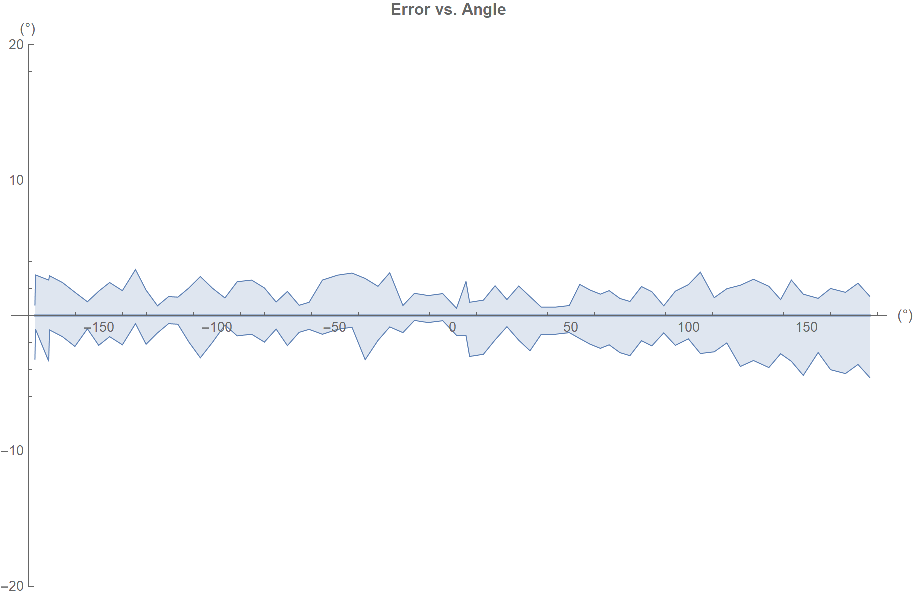

Figure 4.10: Azimuth Error vs. Azimuth Angle (Environment 1, 45 Degree Polarization)

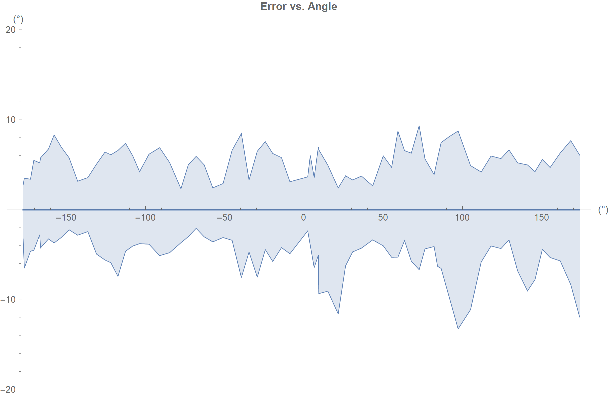

Figure 4.11: Azimuth Error vs. Azimuth Angle (Environment 1, Horizontal Polarization)

Azimuth measurements summary:

- Average azimuth errors: \pm 3.5 ^ \circ
- Worst-case azimuth errors: \pm 14 ^ \circ

#### 4.3.2.2 Environment 2 (1 locator, 1 tag) {#environment-2-1-locator-1-tag}

- Location: Indoor, office corner, lots of objects inside measurement area
- Locator height from floor: \approx 1.2 m
- Locator is placed vertically on the test platform
- Tag height from floor: \approx 1.2 m
- Tag is in different poses

Setup of this test is shown in Figure [4.12](https://ingchips.github.io/application-notes/an_aoa/quick-start.html#fig:ch2-env2-test-ele). Locator rotates between 0 \sim 180 ^ \circ. So, the elevation goes from 0^ \circ to 90^ \circ, i.e. the zenith seen from the board, and then goes back to 0^ \circ again. This test is carried with the tag in three different poses. Figure [4.8](https://ingchips.github.io/application-notes/an_aoa/quick-start.html#fig:ch2-pose-closeup) is a closeup of the tag with different poses.

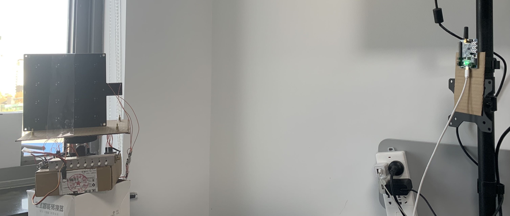

Figure 4.12: Test Setup (Environment 2)

Elevation error vs. elevation ideal angle when tag is in vertical polarization is shown in Figure [4.13](https://ingchips.github.io/application-notes/an_aoa/quick-start.html#fig:ch2-v-ele-err). Elevation error vs. elevation ideal angle when tag is in 45 ^ \circ polarization is shown in Figure [4.14](https://ingchips.github.io/application-notes/an_aoa/quick-start.html#fig:ch2-45deg-ele-err). Elevation error vs. elevation ideal angle when tag is in horizontal polarization is shown in Figure [4.15](https://ingchips.github.io/application-notes/an_aoa/quick-start.html#fig:ch2-h-ele-err).

Elevation measurements summary:

- Worst-case elevation errors in full scale: \pm 35 ^ \circ
- Worst-case elevation errors in a right cone which has an opening angle of 120 ^ \circ : \pm 5 ^ \circ

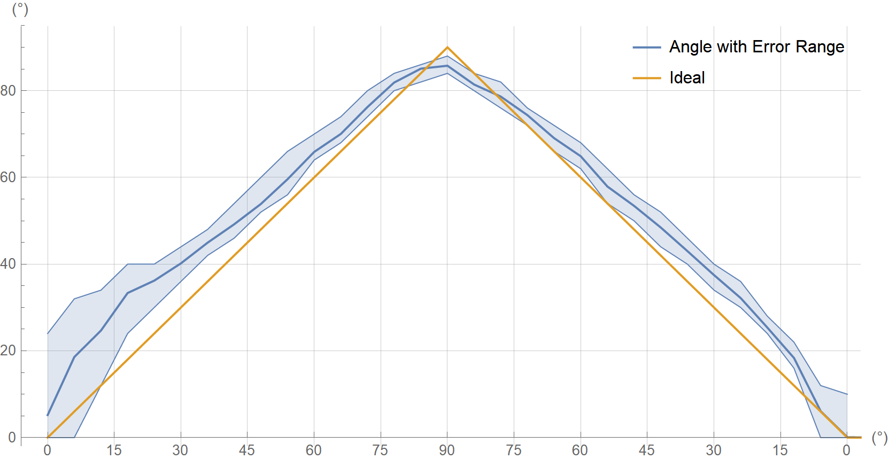

Figure 4.13: Elevation Error vs. Elevation Ideal Angle (Environment 2, Vertical Polarization)

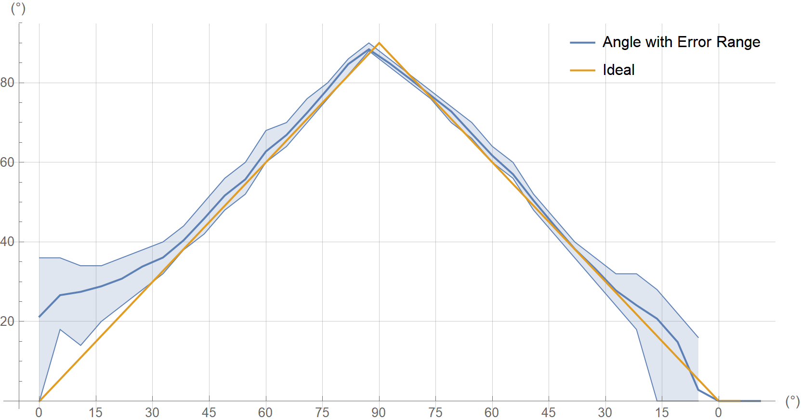

Figure 4.14: Elevation Error vs. Elevation Ideal Angle (Environment 2, 45 Degree Polarization)

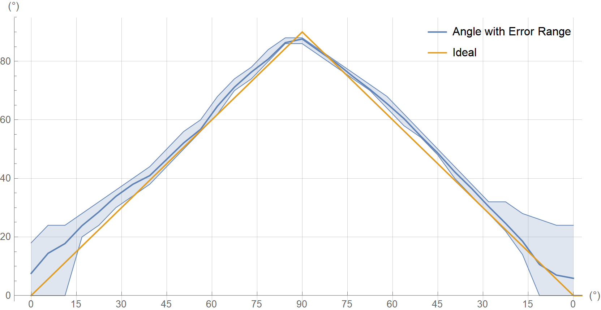

Figure 4.15: Elevation Error vs. Elevation Ideal Angle (Environment 2, Horizontal Polarization)

### 4.3.3 Test Results with 3x3 Antenna Array Board (Round) {#test-results-with-3x3-antenna-array-board-round}

The following devices were used for all antenna array accuracy measurements in this section:

- 3x3 Antenna Array Board (Round) (CTE Receiver)
- ING918xx development boards (Tags - CTE Transmitters)

#### 4.3.3.1 Environment 1 (1 locator, 1 tag) {#environment-1-1-locator-1-tag-1}

- Location: Indoor, office corner, lots of objects inside measurement area
- Locator height from floor: \approx 0.7 m
- Locator is placed horizontally with four different poses
- Tag height from floor: \approx 1.2 m
- Tag is in horizontal polarization

Azimuth & elevation are measured at four poses and summarized in Table [4.2](https://ingchips.github.io/application-notes/an_aoa/quick-start.html#tab:ch2-3x3-azimuth-results) and Table [4.3](https://ingchips.github.io/application-notes/an_aoa/quick-start.html#tab:ch2-3x3-elevation-results). Summary of the result:

- Worst-case azimuth errors: \pm 7.0 ^ \circ
- Worst-case elevation errors: \pm 8.2 ^ \circ
- Average 3 \sigma azimuth error: 6.3 ^ \circ
- Average 3 \sigma elevation error: 6.9 ^ \circ

*Table 4.2: Azimuth Results with 3x3 Antenna Array Board (Round)*
| Pose # | Mean | Standard Deviation | (Min, Max) |
| --- | --- | --- | --- |
| 1 | 0.9 ^ \circ | 1.7 ^ \circ | [-4^\circ, 6^\circ] |
| 2 | 88.5 ^ \circ | 1.5 ^ \circ | [84^\circ, 92^\circ] |
| 3 | 175.0^ \circ | 2.4 ^ \circ | [168^\circ, 178^\circ] |
| 4 | -88.1^ \circ | 2.7 ^ \circ | [-94^\circ, -82^\circ] |

*Table 4.3: Elevation Results with 3x3 Antenna Array Board (Round)*
| Pose # | Mean | Standard Deviation | (Min, Max) |
| --- | --- | --- | --- |
| 1 | 45.8 ^ \circ | 3.2 ^ \circ | [40^\circ,54^\circ] |
| 2 | 44.8 ^ \circ | 3.0 ^ \circ | [38^\circ,54^\circ] |
| 3 | 51.5 ^ \circ | 1.5 ^ \circ | [50^\circ,56^\circ] |
| 4 | 54.6 ^ \circ | 1.6 ^ \circ | [50^\circ,58^\circ] |

## 4.4 Trouble Shooting {#trouble-shooting}

- *Real-time Locating Demo* shows nothing

  Use other COM tools to check if there are lots of data received from the array board

  - If Yes, maybe there are compatibility issues between `pyserial` and the UART2USB kit.

    Try another UART2USB kit. And check tips below for a better test environment.
  - If No, check if the tag is working properly

    The chip series must be support CTE, such as ING9188xx, ING9186xx, etc, while ING9187xx won’t work.
- *Real-time Locating Demo* shows wrong results

  - Rotate & move the tags slowly to see if there are *good* positions where *Real-time Locating Demo* gives good results
  - Make sure that the array board is not upside down
  - Re-start *Real-time Locating Demo* with command line parameter `-plot`, then it will show SNR on each antenna. If SNRs are all lower than 10dB, follow below tips for a better test environment:

    - Test in a large & open environment. Desktop environment where there are lots of things reflecting or blocking radio waves will worsen AoA results significantly.
    - Use highest transmission power in tags. The highest Tx power is already used in the SDK example. The antennas in tags should be checked.

    If SNRs are all excellent, contact us for further technical support.

---

1. <a id="fn2"></a>[https://aka.ms/vs/17/release/vc_redist.x64.exe](https://aka.ms/vs/17/release/vc_redist.x64.exe)[↩︎](https://ingchips.github.io/application-notes/an_aoa/quick-start.html#fnref2)
2. <a id="fn3"></a>[https://www.python.org](https://www.python.org)[↩︎](https://ingchips.github.io/application-notes/an_aoa/quick-start.html#fnref3)
3. <a id="fn4"></a>[https://www.anaconda.com](https://www.anaconda.com)[↩︎](https://ingchips.github.io/application-notes/an_aoa/quick-start.html#fnref4)
4. <a id="fn5"></a>[https://chocolatey.org](https://chocolatey.org)[↩︎](https://ingchips.github.io/application-notes/an_aoa/quick-start.html#fnref5)