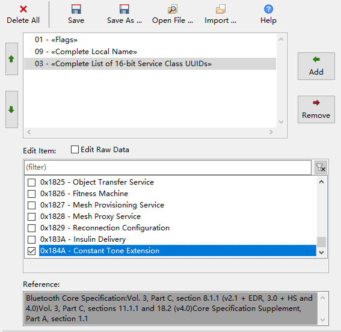
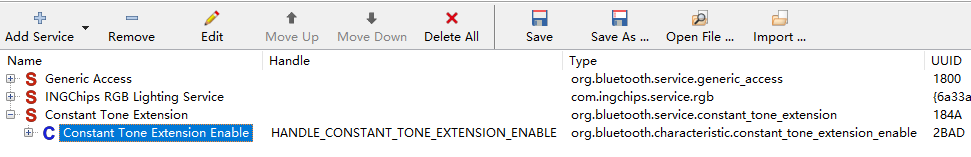

<!-- an_aoa: 5 SDK Support of Direction Finding -->

# 5 SDK Support of Direction Finding {#sdk-support}

SDK supports four types of CTE solutions, two are defined by Bluetooth SIG in Bluetooth Core Specification, and the other two are INGCHIPS proprietaries.

## 5.1 Types of Solutions {#types-of-solutions}

### 5.1.1 Connection Based Solution {#connection-based-solution}

Connection based solution is defined by Bluetooth SIG. A connection must be established between two partners, and then CTE signals are sent upon the requests from a central device. This is demonstrated in *Peripheral LED & CTE* and *Central CTE*.

In *Peripheral LED & CTE*’s advertising data, the availability of CTE service is broadcasted (Figure [5.1](https://ingchips.github.io/application-notes/an_aoa/sdk-support.html#fig:ch3-adv-cte-service)).

Figure 5.1: Advertising of CTE Service

There is an *Enable* characteristic in CTE service. A GATT client should set it to `true` before requesting the peripheral to send CTE.

Figure 5.2: Service Definition of CTE

### 5.1.2 Connectionless Solution {#connectionless-solution}

Connectionless solution is also defined by Bluetooth SIG. The CTE transmitter sends CTE in a periodic advertising set. The receiver has to establish synchronization with the periodic advertising set firstly, and then CTE can be received. This is demonstrated in *Periodic Advertiser* and *Periodic Scanner*.

### 5.1.3 Proprietary Solution #1 {#proprietary-solution-1}

This is based INGCHIPS BLE extension APIs, and provides lots of flexibilities, such as:

- More bits in IQ samples (all bits from RF can be utilized)
- More samples within a single sample slot
- Full control over access address, CRC initialization value for privacy
- Full control over channel selection

Read *Programmers’ Guide on Bluetooth Low Energy*[6](#fn6) for more information.

### 5.1.4 Proprietary Solution #2 {#proprietary-solution-2}

This type tries to provide compatibility of Silicon Labs proprietary AoA[7](#fn7), which sends CTE in extended advertisements. This is also demonstrated in *Peripheral LED & CTE* and *Central CTE*.

Compatibility status:

- A tag sending CTE with proprietary direction finding #2 can be received by Silicon Labs AoA locator
- A tag sending CTE with Silicon Labs proprietary AoA can be received by INGCHIPS AoA locator **if** the least significant byte of the tag’s device address (no matter if it is a public or random address) is **0x14** or some other proper values.

## 5.2 Recommendation {#recommendation}

It is **strongly** recommended to use proprietary direction finding solution, because of several shortcomings in the two Bluetooth SIG defined solutions:

- Scalability

  Both of the two Bluetooth SIG defined solutions do not scale very well: devices can’t support lots of connections or periodic advertising synchronizations simultaneously.
- Latency

  Both of the two Bluetooth SIG defined solutions have pre conditions before the reception of CTE, which is time consuming, especially in the case of connectionless solution.
- Robustness

  In the case of connection less solution, it’s rather difficult & tricky to keep synchronization with several periodic advertising sets.

---

1. [https://ingchips.github.io/application-notes/pg_ble_stack_cn/ch-controller.html](https://ingchips.github.io/application-notes/pg_ble_stack_cn/ch-controller.html)[↩︎](https://ingchips.github.io/application-notes/an_aoa/sdk-support.html#fnref6)
2. [https://www.silabs.com/documents/public/quick-start-guides/qsg175-direction-finding-solution-quick-start-guide.pdf](https://www.silabs.com/documents/public/quick-start-guides/qsg175-direction-finding-solution-quick-start-guide.pdf)[↩︎](https://ingchips.github.io/application-notes/an_aoa/sdk-support.html#fnref7)