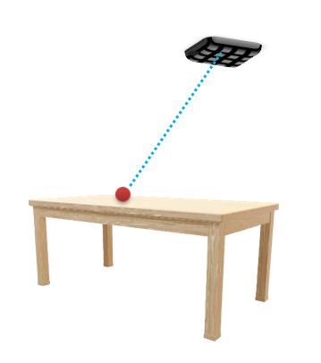
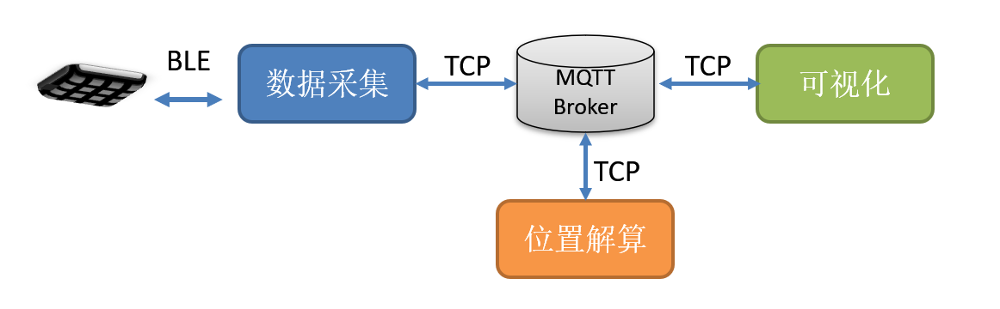
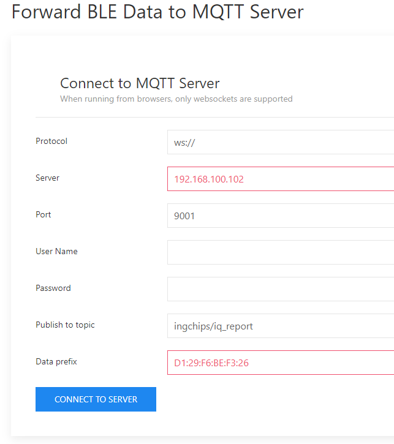
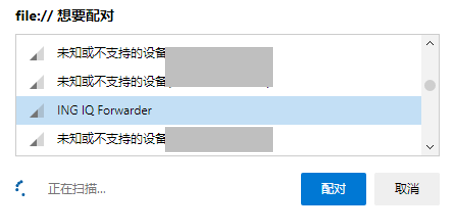
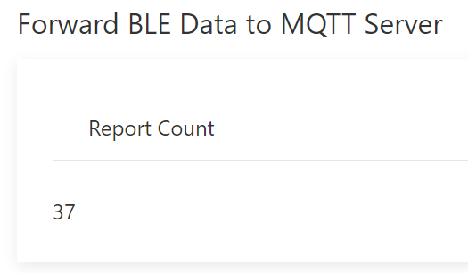
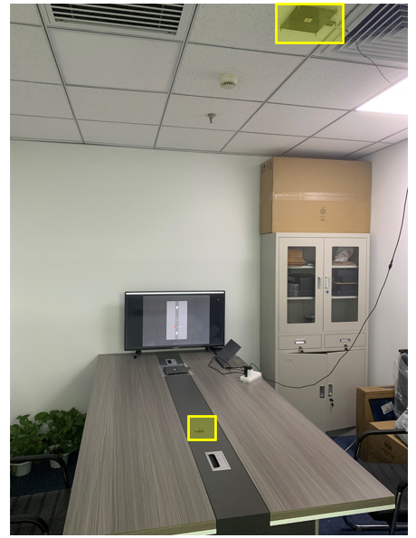
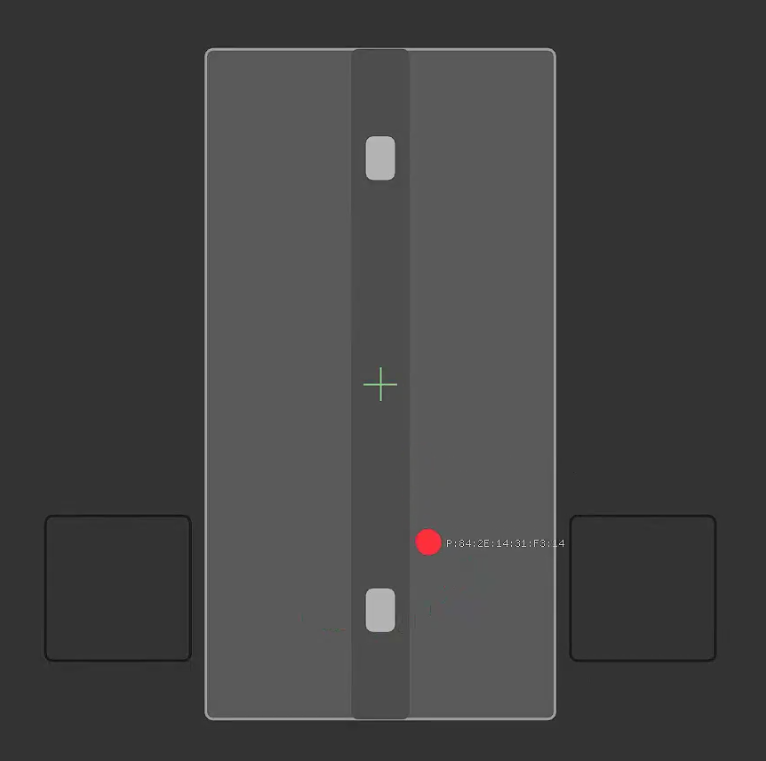

<!-- an_aoa_positioning_cn: 4 2D 定位 -->

# 4 2D 定位 {#d-定位-1}

## 4.1 定位原理 {#定位原理-1}

使用 BLE AoA 寻向功能[2](#fn2)可以计算目标到天线阵的来波方向对应的方位角、仰角。 假设目标在一个已知的二维平面（或者某些曲面，如半球面）上，根据来波方向可以推算出目标的 2D 坐标， 见图 [4.1](https://ingchips.github.io/application-notes/an_aoa_positioning_cn/d-定位-1.html#fig:ch02-dir-to-2d-position) 。



Figure 4.1: 从寻向到 2D 定位

## 4.2 整体架构 {#整体架构}

图 [4.2](https://ingchips.github.io/application-notes/an_aoa_positioning_cn/d-定位-1.html#fig:ch02-2d-arch) 是 2D 定位系统的一个参考设计。



Figure 4.2: 2D 定位整体架构（参考设计）

这个系统使用 MQTT 消息代理（服务器）作为数据中转中心，具有良好的可扩展性、伸缩性，也适合云端部署。

## 4.3 系统搭建 {#系统搭建}

### 4.3.1 资源需求及准备工作 {#资源需求及准备工作}

要测试 2D 定位系统，至少需要准备以下软硬件资源：

1. PC 机 1 台，要求：

   - Windows 10 及以上
   - 支持 BLE，具备 IP 地址（后文假设其 IP 地址为 `192.168.100.102`）
   - 新版 Edge 或者 Chrome 浏览器
   - MQTT 消息代理，如 [Eclipse Mosquitto](https://mosquitto.org/)
   - MQTT 调试工具，如 [MQTT-Explorer](https://apps.microsoft.com/store/detail/mqttexplorer/9PP8SFM082WD?hl=en-us&gl=US)
   - Python 开发环境（建议使用 Anaconda[3](#fn3)），并按需要安装以下软件包

     - [*numpy*](https://numpy.org/install/)（Anaconda 已内置）
     - [*paho-mqtt*](https://pypi.org/project/paho-mqtt/)
     - [*pyimgui*](https://pypi.org/project/pyimgui-wheels/)
   - [Git](https://git-scm.com)
2. ING9188x 开发板 1 块
3. AoX 天线阵 1 块

准备工作：

1. 下载、安装 [SDK](https://ingchips.github.io/docs/getting-started/)；
2. 使用 Git 克隆或者下载 [BLE 定位](https://github.com/ingchips/ble_positioning) 软件集；
3. 进入 SDK 安装目录，把 *RTL* 文件夹内的 *alg* 可执行文件及 *AlgDLL* 动态链接库复制到软件集的 *scripts* 目录；

### 4.3.2 标签 {#标签}

使用开发板模块代表待定位的标签，直接烧录 SDK 里的 *Peripheral LED & CTE* 示例即可。开发者也可以根据测试需要修改程序，比如使用固定蓝牙地址、更改广播名称等。

为开发板上电，保持运行状态。

### 4.3.3 天线阵 {#天线阵}

天线阵直接烧录 SDK 里的 *Central CTE* 示例即可。开发者也可以根据测试需要修改程序，比如修改蓝牙地址、更改广播名称等。

为天线阵上电，保持运行状态。

### 4.3.4 MQTT 消息代理 {#mqtt-消息代理}

需要使能消息代理的 *websockets* 接口。 以 *Mosquitto* 为例，找到安装目录下的 *mosquitto.conf* 文件， 定位到配置 *listener* 的地方，加入以下几行（IP 地址应当根据实际情况填写）：

```
listener 9001 192.168.100.102
protocol websockets
socket_domain ipv4

listener 1883 192.168.100.102
socket_domain ipv4
```

通过命令 `mosquitto -c mosquitto.conf -v` 以调试方式启动 *Mosquitto*，确认 *websockets* 接口是否打开。如果打开了，会出现类似这样的输出：

```
Opening websockets listen socket on port 9001
```

杀掉 *Mosquitto* 进程，并重新通过命令 `mosquitto -c mosquitto.conf` 以正常方式启动。

尝试用 MQTT 调试工具连接到 *Mosquitto*，检查是否正常。

### 4.3.5 数据采集 {#数据采集}

用浏览器打开软件集里的 *BLE2MQTT* 工具（*ble2mqtt/index.html*）。如图 [4.3](https://ingchips.github.io/application-notes/an_aoa_positioning_cn/d-定位-1.html#fig:ch02-ble2mqtt-server) 所示，在两个红色框里分别填写 MQTT 消息代理的 IP 地址和天线阵的蓝牙地址，然后点击 *CONNECT TO SERVER* 按钮。



Figure 4.3: 配置 MQTT 消息代理

点击 *SELECT DEVICE* 按钮，浏览器会列出可见的蓝牙设备（如图 [4.4](https://ingchips.github.io/application-notes/an_aoa_positioning_cn/d-定位-1.html#fig:ch02-ble2mqtt-select-ble)），从中找到名为 *ING IQ Forwarder* 的设备， 点击 *配对* 按钮（这个按钮上的文字随浏览器版本不同而不同，其真实含义为**连接**）。



Figure 4.4: 选择蓝牙设备

*BLE2MQTT* 工具之后就会自动从天线阵收集 CTE 数据并转发到 MQTT 消息代理。界面上会实时显示转发的消息的总数。



Figure 4.5: BLE2MQTT 工具持续转发消息

这个工具需要一直保持运行。用 MQTT 调试工具可看到消息上报。

### 4.3.6 环境模型 {#环境模型}

假定将天线阵固定在天花板下方，定位标签在一个平面内（比如桌子上）移动，桌子在天线阵下方， 如图 [4.6](https://ingchips.github.io/application-notes/an_aoa_positioning_cn/d-定位-1.html#fig:ch02-world-model)。



Figure 4.6: 2D 定位测试环境

建立一个三维直角坐标系，定位标签在 xoy 平面内移动，z 轴竖直向上，x 轴方向与天线阵的 0 ^\circ 方向相同。至于原点的位置则可以随意选取。 确立了这样一个坐标系后，我们就可以表达天线阵的位置，并绘制场景平面图。

1. 天线阵的位置

   天线阵的位置由软件集里的 *scripts/station_2d.json* 文件定义。 下面的内容表示地址为 “D1:29:F6:BE:F3:26” 的天线阵的坐标为 (0, 0, 1.5)，即位于原点之上 1.5m 处。 `min_elevation` 为仰角的最小值，当计算出的仰角超过此范围时（即标签位置距离天线板在 xoy 平面上的投影太远时），忽略它。

   ```json
   {
       "D1:29:F6:BE:F3:26": [0, 0, 1.5],
       "min_elevation": 30.0
   }
   ```
2. 场景平面图

   场景平面图由软件集里的 *scripts/scene.json* 文件定义。下面的内容表示整个场景宽度为 4m，高度为 3m， 这里的**宽度**为场景在 x 轴方向的跨度，被映射到屏幕的水平方面（即通常意义上的宽度）， **高度**为场景在 y 轴方向的跨度，被映射到屏幕的水平方面（即通常意义上的高度）。其它各个域的含义如下：

   - `center` 为屏幕中心对应的 xoy 平面上的坐标
   - `background` 为场景的背景颜色
   - `entities` 为一系列简单的图形实体，比如

     - *rect*：在场景里绘制一个矩形
     - *circle*：在场景里绘制一个圆
     - *line*：在场景里绘制一条线

     每种实体的具体参数可参考 `scene.json` 及 *scripts/vis_2d.py* 里的 `draw_scene` 函数。 颜色由红、绿、蓝、透明度等 4 个分量表示，每个分量都是属于区间 [0，1] 的小数。

   ```json
   {
       "width": 4,
       "height": 3,
       "center": [-0.2, -0.85],
       "background": [0.2,0.2,0.2,1.0],
       "entities":
       [
           {
               "type": "rect",
               "x": -0.8,
               "y": -2,
               "w": 1.2,
               "h": 2.3,
               "fill": [0.5,0.5,0.5,0.5],
               "border": [0.6,0.6,0.6,1.0]
           },
           // ...
       ]
   }
   ```

### 4.3.7 位置解算 {#位置解算}

根据 MQTT 消息代理的实际情况更新软件集里的 *scripts/server_cfg.py* 模块。

分别运行以下两个 Python 模块：

- *scripts/calc_dir.py*
- *scripts/calc_pos2d.py*

这两个模块需要一直保持运行。

### 4.3.8 可视化 {#可视化}

运行以下 Python 模块就可以可视化标签的实时位置：

- *scripts/vis_2d.py*

标签用一个彩色的圆形表示，旁边标注蓝牙地址。背景为场景平面图。



Figure 4.7: 2D 定位的可视化

---

1. <a id="fn2"></a>Application Note - Direction Finding Solution[↩︎](https://ingchips.github.io/application-notes/an_aoa_positioning_cn/d-定位-1.html#fnref2)
2. <a id="fn3"></a>[https://www.anaconda.com](https://www.anaconda.com)[↩︎](https://ingchips.github.io/application-notes/an_aoa_positioning_cn/d-定位-1.html#fnref3)