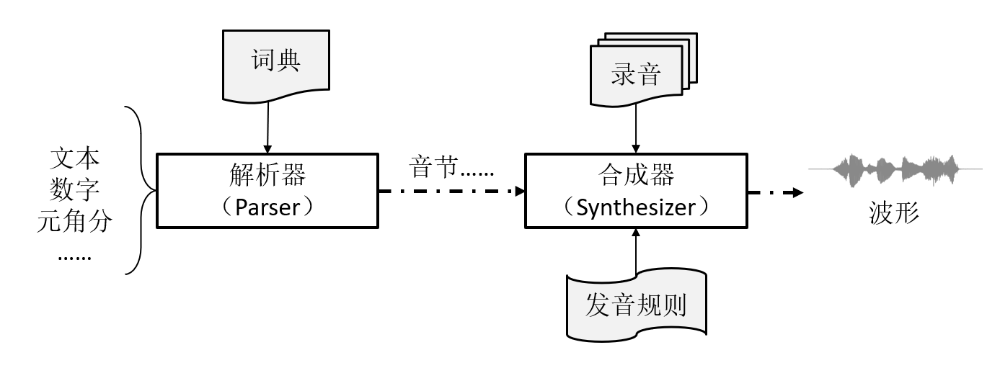

<!-- an_libaudio_cn: 8 语音合成 -->

# 8 语音合成 {#ch-tts}

请联系我们以获取相关开发资料。

## 8.1 特性 {#特性}

音频处理库包含一个为嵌入式系统设计的轻量化语音合成引擎，具有如下主要特性：

- 仅支持中文

  - 覆盖 Unicode CJK 统一表意符号基础区字符 20992 个[11](#fn11)（4E00 - 9FFF），
  - 支持少量不在 Unicode 基础区范围内的汉字（例如：〇）
  - 遇到无法识别的内容时输出短暂的静音
  - 输入文本采用 UTF-8 编码
- 支持拼音
- 英文逐个字母发音
- 整数、小数优化播报
- 流式输出
- 多音字发音自动识别
- 支持自定义语音库

当前版本基于波形拼接法，主要组成部分包括（图 [8.1](https://ingchips.github.io/application-notes/an_libaudio_cn/ch-tts.html#fig:ch-tts-overview)）：

- **解析器**（Parser）：根据词典与语法规则，将输入的内容片断（中文、英文、数字等）按顺序转换为音节列表。
- **合成器**（Synthesizer）：根据解析器输出的音节列表，结合预定义的语音库，合成波形。输出格式为单声道 16 bit，16kHz 采样。



图 8.1: TTS 引擎

### 8.1.1 工具软件 {#工具软件}

音频处理库附带了几个程序和 Python 脚本：

- `tts_demo`：在 Windows 上快速测试、演示合成效果
- `tts_firmware` 和 `tts_demo.py`：演示用固件程序，及测试脚本（通过串口发送文本、接收合成结果并回放）
- `tts_gen`：由于自定义语音库

本章文档用到的文本文件，如无特殊说明，都必须使用**无 BOM** UTF-8 编码格式。

## 8.2 使用方法 {#使用方法-5}

1. 初始化

   使用 `tts_init` 初始化 TTS 引擎对象：

   ```c
   struct tts_context *tts_init(
       const struct voice_definition *voice, // 语音库
       int max_syllables,  // 最大音节数
       void *buf);         // 用于存放上下文的内存
   ```

   语音库以 .bin 文件提供，详见“[语音库](https://ingchips.github.io/application-notes/an_libaudio_cn/ch-tts.html#ch-tts-voice-def)”。 开发者需要预估一次合成可能存在的最大音节数 `max_syllables`，可以文本字数为参考， 并保留一定的余量（如 50%）。 `buf` 的大小与 `max_syllables` 有关，可通过 `tts_get_context_size` 获得。

   ```c
   int tts_get_context_size(
       int max_syllables); // 最大音节数
   ```

   本章文档里的“音节”是广义的，对应语音库里的一段录音。一段录音可能只有一个音节，也可能包含多个音节。
2. 添加内容

   TTS 引擎支持添加多种内容：文本、数字、元角分。分别通过不同的接口添加。

   - 添加文本

     使用 `tts_push_utf8_str` 添加一段文本。

     ```c
     int tts_push_utf8_str(
         struct tts_context *ctx,    // TTS 引擎对象
         const char *utf8_str);      // UTF-8 编码的字符串
     ```

     文本支持中文、拼音、数字，以及个别符号。对于中文，解析器会尝试自动分词并判断多音字。 开发者可以通过两种方式干预中文解析，一为填加空格辅助分词[12](#fn12)， 如例 1[13](#fn13)； 一为使用“[]”手动组词，如例 2。

     例 1：`您有新的美团外卖订单，请及时 处理。`

     例 2：`介绍[锺书]做[这份工作]的是清华同学[乔冠华]同志。`

     空格不但可用来干预分词，还可以用来添加停顿。

     如果存在英文，则按照字母逐个发音。

     拼音使用 ASCII 码，用一对“[]”包围，表示一个词语。四种声调分别使用 1（阴平）、2（阳平）、3（上声）、4（去声）表示。几个示例：

     - măn: man3（调号放在末尾）
     - le: le （轻声无调号）
     - lǜ: lv4（以 v 代替 ü）
     - jú: ju2（j/q/x 后的 ü 仍写作 u）
     - 完整示例：迎着朝阳区的[zhao1 yang2]去上学。

     另外可以识别 `+`、`-`、`=`、`*`、`#`、`@` 等半角符号。其它无法识别的内容（如标点符号）一律做停顿处理。

     文本中的数字（整数或小数）默认按照繁读法合成。如果数字前面是“\”，则使用简读法，如“`在\2024年`”。 对于需要使用简读法的数字，也可以替换为对应的汉字再合成，如“`在二零二四年`”。
   - 添加整数

     使用 `tts_push_integer` 添加一个整数。`tts_push_integer(ctx, 123)` 等效于 `tts_push_utf8_str(ctx, "123")`。

     ```c
     int tts_push_integer(
         struct tts_context *ctx,    // TTS 引擎对象
         int64_t value);             // UTF-8 编码的字符串
     ```
   - 添加元角分

     使用 `tts_push_yuan_jiao_fen` 添加元角分。`tts_push_yuan_jiao_fen(ctx, x, y, z)` 等效于 `tts_push_utf8_str(ctx, "x 元 y 角 z 分")`。

     ```c
     int tts_push_yuan_jiao_fen(
         struct tts_context *ctx,    // TTS 引擎对象
         int64_t yuan,               // 元
         uint8_t jiao,               // 角
         uint8_t fen);               // 分
     ```

   以上几个接口如果成功，都将返回 0。当音节数超过 `max_syllables` 时，返回负值。
3. 合成

   提供两套 API，以两种不同的方式合成语音。

   - 方式 1：被动接收波形数据

     使用 `tts_synthesize` 将所有添加的内容按顺序一并合成语音。

     ```c
     int tts_synthesize(
         struct tts_context *ctx,    // TTS 引擎对象
         f_tts_receive_pcm_samples rx_samples,
         void *user_data,            // 传递到回调函数的用户数据
         void *scratch1,             // 临时内存 1
         void *scratch2);            // 临时内存 2
     ```

     临时内存 `scratch1` 和 `scratch2` 的大小分别通过 `tts_get_scratch_mem1_size()` 和 `tts_get_scratch_mem2_size()` 获得。`scratch1` 在 `tts_synthesize` 结束前不做他用，而 `scratch2` 可在 `rx_samples` 里任意使用。 回调函数 `rx_samples` 用以接收合成出的波形数据，其签名为：

     ```c
     typedef int (*f_tts_receive_pcm_samples)(
         struct tts_context *ctx,    // TTS 引擎对象
         const int16_t *pcm_samples, // 本次合成出的 PCM 采样
         int number,                 // 本次合成出的 PCM 采样的个数
         int acc_number,             // 已经合成出的 PCM 采样总数（不含本次）
         void *user_data);           // 用户数据
     ```

     `tts_synthesize` 每次合成少量 PCM 数据，调用 `rx_samples`，循环往复，直到合成完成。 如果 `rx_samples` 返回非 0 值，则中止。其伪代码如下：

     ```c
     tts_synthesize()
     {
         acc_number = 0
         while (!aborted && !done)
         {
             合成 n 个 samples;
             int r = rx_samples(samples, n, acc_number);
             if (r != 0) return r;
             acc_number += n;
         }
     }
     ```

     `rx_samples` 可以阻塞。由于合成需要一定的处理时间，当用 `rx_samples` 回放音频时，为了保证回放连续，必须缓存一定的数据量， 待缓存数据低于某门限时，函数返回，解除阻塞。请参考“[资源消耗](#ch-tts-resources})”并结合时延确定缓存数据门限。

     `abort` 标志可通过 `tts_abort` 异步设置。

     ```c
     void tts_abort(
         struct tts_context *ctx);   // TTS 引擎对象
     ```
   - 方式 2：主动调用获取波形数据

     使用 `tts_synthesizer_run` 将所有添加的内容按顺序一并合成语音。

     ```c
     int tts_synthesizer_run(
         struct tts_context *ctx,    // TTS 引擎对象
         f_tts_synthesizer_callback callback,
         void *user_data,            // 传递到回调函数的用户数据
         void *scratch1,             // 临时内存 1
         void *scratch2);            // 临时内存 2
     ```

     临时内存 `scratch1` 和 `scratch2` 的大小分别通过 `tts_get_scratch_mem1_size()` 和 `tts_get_scratch_mem2_size()` 获得。`scratch1` 在 `tts_synthesize` 结束前不做他用，而 `scratch2` 可在 `callback` 里任意使用。这个函数返回 `callback` 的返回值。

     回调函数 `callback` 的签名为：

     ```c
     typedef int (*f_tts_synthesizer_callback)(
         struct tts_synthesizer *synthesizer, // 合成引擎对象
         void *user_data);                    // 用户数据
     ```

     回调函数返回值的含义由开发者定义。在这个回调函数里，可调用合成引擎对象的接口来主动获取波形数据。合成引擎对象的接口有两个， 一为继续合成少量数据（`tts_synthesizer_continue`）；一为重新开始（`tts_synthesizer_restart`）。

     ```c
     const int16_t *tts_synthesizer_continue(
         struct tts_synthesizer *synthesizer, // 合成引擎对象
         int *number);                        // 本次合成出的 PCM 采样的个数
     ```

     `tts_synthesizer_continue` 返回的指针指向本次合成出的 PCM 采样。当合成结束时，返回空指针， 同时 `number` 为 0。下面的回调函数演示了如何多次调用 `tts_synthesizer_continue` 获得所有数据。

     ```c
     int tts_synthesizer_callback(
         struct tts_synthesizer *synthesizer,
         void *user_data)
     {
         int number = 0;
         const int16_t *pcm = NULL;
         while (1)
         {
             pcm = tts_synthesizer_continue(synthesizer, &number);
             if (NULL == pcm) break;

             处理数据;
         }
         return 0;
     }
     ```

     这个回调函数可以阻塞，也可以随时返回、中断合成。由于合成需要一定的处理时间，当在这个回调里回放音频时， 为了保证回放连续，必须缓存一定的数据量，待缓存数据低于某门限时，调用 `tts_synthesizer_continue` 补充数据。 请参考“[资源消耗](#ch-tts-resources})”并结合时延确定缓存数据门限。

     如果需要多次重复播放合成的内容，那么可调用 `tts_synthesizer_restart` 重新开始合成：

     ```c
     void tts_synthesizer_restart(
         struct tts_synthesizer *synthesizer); // 合成引擎对象
     ```

     注意，合成引擎对象 `synthesizer` 只存在于回调函数 `callback` 内。`callback` 一旦返回，这个对象就被销毁。
4. 复位

   使用 `tts_reset` 清空已添加的内容。

   ```c
   int tts_reset(
       struct tts_context *ctx);   // TTS 引擎对象
   ```

   `tts_synthesize` 或 `tts_synthesizer_run` 正在执行时，不可调用 `tts_reset`。

另外，可通过 `tts_tune` 微调合成效果：

```c
void tts_tune(
    struct tts_context *ctx, // TTS 引擎对象
    uint8_t tune);           // 微调值（默认：8）
```

微调值越大，则音节与音节之间的间隔越大。

## 8.3 语音库 {#ch-tts-voice-def}

语音库由语音音源（录音）、汉语字典、词典等组成，由 `tts_gen` 工具转换为单一的 .bin 文件。 这种 .bin 文件可以烧录到任意 4 字节对齐的地址。假设烧录到 0x04000000， 初始化时将此地址传入 `tts_init`：

```c
struct tts_context *tts_init(
    (const struct voice_definition *)0x04000000,
    ...);
```

### 8.3.1 内置语音库 {#ch-tts-voice-def-builtin}

音频处理库附带了两种音色的语音库，每种语音库又提供了词典缩减、音质不同的版本。各语音库的大小见表 [8.1](https://ingchips.github.io/application-notes/an_libaudio_cn/ch-tts.html#tab:ch-tts-voice-size)。

*表 8.1: 内置的各语音库*
| 名称 | 音色 | 词典 | 音质 | 大小（字节） |
| --- | --- | --- | --- | --- |
| xiaotao_full_h | 女声 | 完整 | 高 | 4823217 |
| xiaotao_full_m | 女声 | 完整 | 中 | 4150083 |
| xiaotao_full_l | 女声 | 完整 | 低 | 2755734 |
| xiaotao_lite_h | 女声 | 缩减 | 高 | 3162253 |
| xiaotao_lite_m | 女声 | 缩减 | 中 | 2489119 |
| xiaotao_lite_l | 女声 | 缩减 | 低 | 1094770 |
| xiaoxin_full_h | 男声 | 完整 | 高 | 4128000 |
| xiaoxin_full_m | 男声 | 完整 | 中 | 3614424 |
| xiaoxin_full_l | 男声 | 完整 | 低 | 2550588 |
| xiaoxin_lite_h | 男声 | 缩减 | 高 | 2467036 |
| xiaoxin_lite_m | 男声 | 缩减 | 中 | 1953460 |
| xiaoxin_lite_l | 男声 | 缩减 | 低 | 889624 |

每种语音库推荐的微调值见表 [8.2](https://ingchips.github.io/application-notes/an_libaudio_cn/ch-tts.html#tab:ch-tts-voice-tune)。

*表 8.2: 内置语音库推荐的微调值*
| 名称 | 音色 | 微调值 |
| --- | --- | --- |
| xiaotao | 女声 | 8 |
| xiaoxin | 男声 | 200 |

### 8.3.2 自定义语音库 {#ch-tts-customize-voice-def}

利于工具 `tts_gen` 可以自定义语音库，定制专属音色、优化合成效果。定制步骤如下。

1. 准备两个词库，分别称为 `dict1` 和 `dict2`。

   需要单独录音的词汇放到 `dict1` 里，只需要识别、不需要单独录音的词汇放到 `dict2` 里。 `dict1` 文件保存以 json 格式保存，如：

   ```json
   [
       "一下",
       "一个"
   ]
   ```

   `dict2` 是一个文本文件，每行一个词语，如：

   ```
   一一列举
   一一对应
   ```

   这两个词典都可以为空。当解析器识别出 `dict1` 里的词语，合成时会直接使用录音，效果较佳； 当识别出 `dict2` 里的词语，合成器输出的词语发音将比单字拼接更自然一些。

   `dict1`、`dict2` 里的每个词最多可以包含 255 个汉字，`dict1` 里每个词的录音经压缩后长度不可超过 65535 字节。
2. 使用 `tts_gen` 导出录音计划

   ```sh
   tts_gen tts_plan /path/to/dict1.json path/to/tts_plan.json
   ```

   运行这个命令，就会生成录音计划 `tts_plan.json`。
3. 进行录音

   按照录音计划完成录音。譬如将拼音“a (啊)”的录音保存为 “00000.raw”文件。

   ```json
   {
       "a (啊)": "00000.raw",
       "a1 (锕)": "00001.raw",
       "a2 (嗄)": "00002.raw",
       "ai1 (哀)": "00003.raw",
       ...
   }
   ```

   录音时使用单声道，保证音色、音量一致，音质清晰、无杂音，语气平和。

   这里的 raw 格式是指无格式的 16kHz 采样，每个采样 16 比特，小端模式。 如果录音时采用了其它格式，可以用 ffmpeg[14](#fn14) 等工具批量转换为这种 raw 格式， 如将 mp3 转换为 raw：

   ```sh
   ffmpeg -i 00000.mp3 -f s16le -ar 16000 -acodec pcm_s16le 00000.raw
   ```
4. 生成 .bin 文件

   假设录音已保存在 `path/to/recordings` 目录下，用以下命令生成 .bin 文件。

   ```sh
   tts_gen data path/to/tts_plan.json path/to/recordings output.bin 5 \
                path/to/dict2
   ```

   这里的参数 5 为编码等级，范围为 0~8，0 表示最低码率，音质最差；8 表示最高码率，音质最佳。 如果不定义 `dict2`，`path/to/dict2` 参数可省略。省略 `dict2` 参数后，编码等级也可省略（默认值 5）。 `output.bin` 即为生成的 .bin 文件。

## 8.4 资源消耗 {#ch-tts-resources}

TTS 需要较大的 Flash 存储空间，各内置语音库的大小见表 [8.1](https://ingchips.github.io/application-notes/an_libaudio_cn/ch-tts.html#tab:ch-tts-voice-size)，必须配备一定容量的外置 Flash[15](#fn15)。

当前版本音频数据使用 AMR-WB 压缩，`tts_synthesize` 函数的主要动作是 AMR-WB 解码， 其性能请参考“[AMR-WB 的解码性能](#ch-amr-wb-resources})”。

## 8.5 演示 {#演示}

### 8.5.1 Windows {#windows}

`tts_demo` 可以用来快速测试语音库和合成效果。这个程序接受两个必选参数和几个可选参数：

```sh
tts_demo /path/to/voice/bin /path/to/text/file [--speed X] [--tune V] [--save FN]
```

第一个参数是语音库 .bin 文件，第二个参数是一个文本文件名，演示程序将合成这个文件第一行的内容，并播放出来。 可选参数：`--speed X` 将语音速度设为 `X`，默认值 1.0，即不变速，详见“[语音变速](https://ingchips.github.io/application-notes/an_libaudio_cn/ch-stretch.html#ch-stretch)”； `--tune V` 将微调值设为 `V`；`--save FN` 将合成的波形数据按“[raw 格式](https://ingchips.github.io/application-notes/an_libaudio_cn/ch-tts.html#ch-tts-customize-voice-def)”保存到文件 `FN`。 当指定了 `--save` 参数时，只保存文件，不自动播放。

### 8.5.2 ING916XX {#ing916xx-5}

`tts_firmware` 是一个可以直接烧录到 ING916XX 开发板的固件。语音库需要单独烧录， 请参考关于“[语音库](#语音库-ch-tts-voice-def)”的说明。 `test_tts` 是 `tts_firmware` 程序里的主要函数， 演示了从串口读入文本、合成，再通过串口输出波形采样的全过程。

```c
void test_tts(UART_TypeDef *port)
{
    static char input[...];
    platform_printf("TTS Demo\n");

    #define MAX_SYLLABLES ...

    const struct voice_definition * voice_def = ...;

    void *context  = malloc(tts_get_context_size(MAX_SYLLABLES));
    void *scratch1 = malloc(tts_get_scratch_mem1_size());
    void *scratch2 = malloc(tts_get_scratch_mem2_size());

    struct tts_context *ctx = tts_init(voice_def,
        MAX_SYLLABLES, context);

    while (true)
    {
        // 从串口输入字符串（代码从略）
        input_from_uart(port, input, sizeof(input));

        tts_reset(ctx);
        tts_push_utf8_str(ctx, input);

        // save_pcm_samples 将 PCM 从串口输出（代码从略）
        tts_synthesize(ctx, save_pcm_samples, NULL,
            scratch1, scratch2);
    }
}
```

PC 端运行 `tts_demo.py`，允许用户输入不同的文本，收听合成效果。这个脚步依赖若干软件包， 如有缺失，运行时会给出提示信息，请按提示信息安装相应的软件包。这个脚本接受一个必选参数串口号，假设开发板串口为 COM9，则如下调用该脚本：

```sh
python tts_demo.py COM9
```

脚本还接受可选的波特率参数，默认 115200 波特。通过 `-b` 设置波特率参数：

```sh
python tts_demo.py COM9 -b 921600
```

## 8.6 局限与建议 {#局限与建议}

当前版本存在以下局限：

- 与当前最先进的 TTS 系统相比，连贯性、语气、韵律等方面存在不足，不够自然

  **分析**：受制于嵌入式系统的计算资源，无法使用当前最先进的 TTS 技术方案。

  **缓解措施**：对于较封闭（待合成的文本相对固定）的应用场景，可以通过自定义语音库的方法录制常见短语，改善效果。
- 多音字识别准确性有限

  **分析**：当前版本基于词典识别多音字。基于词典分词存在一定的错误概率，而且存在多音词（如朝阳、大夫），所以无法做到完全准确。

  **缓解措施**：1）使用拼音合成；2）将多音字替换为与正确读音同音的单音字；3）通过自定义语音库为多音词提供正确读音。
- 不支持儿化音、轻声变调

  **缓解措施**：通过自定义语音库为需要儿化、轻声的词语和短语提供正确读音。

综上，为提高合成效果，请参考以下方法或建议：

- 针对应用场景提炼词语、短语，对关键词语、短语甚至句子直接录音，创建**自定义语音库**；
- 使用空格**辅助分词**，减少分词错误；
- 使用“[]”**手动组词**；
- 使用**拼音合成**弥补多音字识别的不足；
- 避免使用的、了、吗、呢等语气词。

---

1. <a id="fn11"></a>下列 77 个字符除外：乥，乲，兺，厼， 叾，哛，唜，唟，喸，囕，夞，巼，怾，旕，朰，栍，桛，椧，烪，猠，硛，硳，穒，縇，莻，虄，襨， 迲，闏，龩，龬，龭，龳，龴，龶，龸，龼，龽，龾，龿，鿀，鿁，鿂，鿅，鿆，鿇，鿈，鿉，鿊，鿋， 鿖，鿗，鿘，鿙，鿚，鿛，鿜，鿝，鿞，鿟，鿠，鿡，鿢，鿣，鿤，鿥，鿦，鿧，鿨，鿩，鿪，鿮，鿯， 鿹，鿽，鿾，鿿。这些字符的读音暂时无法依据汉典确定。[↩︎](https://ingchips.github.io/application-notes/an_libaudio_cn/ch-tts.html#fnref11)
2. <a id="fn12"></a>只有紧跟中文字符的空格才被视作分词辅助用途。[↩︎](https://ingchips.github.io/application-notes/an_libaudio_cn/ch-tts.html#fnref12)
3. <a id="fn13"></a>当使用完整版语音库时，“及时处理”被识别为一个词语，并且多音字“处”的声调错误。添加空格后，听感流畅，而且“处”的读音也被正确判别。[↩︎](https://ingchips.github.io/application-notes/an_libaudio_cn/ch-tts.html#fnref13)
4. <a id="fn14"></a>[https://ffmpeg.org/](https://ffmpeg.org/)[↩︎](https://ingchips.github.io/application-notes/an_libaudio_cn/ch-tts.html#fnref14)
5. <a id="fn15"></a>[https://ingchips.github.io/blog/2024-02-05-external-flash/](https://ingchips.github.io/blog/2024-02-05-external-flash/)[↩︎](https://ingchips.github.io/application-notes/an_libaudio_cn/ch-tts.html#fnref15)