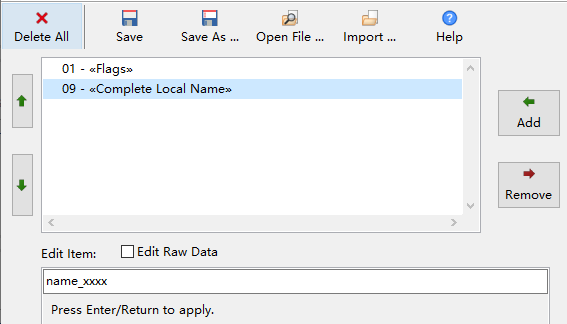

<!-- pg_ble_stack_cn: 5 GAP - 广播 -->

# 5 GAP - 广播 {#ch-adv}

## 5.1 概览 {#概览}

支持 4.0 ~ 5.1 规范定义的所有 BLE 广播类型：

- 传统广播（Legacy Adv）
- 扩展广播（Extended Adv）
- 周期广播（Periodic Adv）

传统广播的有效载荷最长为 31B，而扩展广播（包括周期广播）每个广播包的有效载荷最长接近 255B， 每个扩展广播又可包含多个广播包（广播包链条），总有效载荷最长达 1650B。

### 5.1.1 类型 {#类型}

广播有几种不同的属性：

- 可连接：接受对方发来的连接建立请求
- 可扫描：接受对方发来的扫描请求，并回复扫描响应
- 定向：只用于可连接广播，只接受特定方发来的连接建立请求
- 高占空比（High Duty）：以更高的频率[23](https://ingchips.github.io/application-notes/pg_ble_stack_cn/ch-cap.html#fn23)重复发送广播数据，常用于实现快速重连（定向可连接广播）， 最长只持续 1.28s。从 5.0 开始，高占空比广播也可用于不可连接广播。

对于传统的扫描响应包，其有效载荷最长同样为 31B；扩展的扫描响应包，其有效载荷最长同样为 1650B。 开发者可以要求协议栈收到扫描请求时上报事件。

总结起来，传统广播共有 5 种类型，见表 [5.1](https://ingchips.github.io/application-notes/pg_ble_stack_cn/ch-adv.html#tab:ch1-legacy-adv-types)。

*表 5.1: 传统广播类型*
| 类型 | PDU 类型 | 广播数据 | 扫描响应数据 |
| --- | --- | --- | --- |
| 非定向可连接可扫描广播 | ADV_IND | 支持 | 支持 |
| 定向可连接广播（非高占空比） | ADV_DIRECT_IND | 不支持 | 不支持 |
| 定向可连接广播（高占空比） | ADV_DIRECT_IND | 不支持 | 不支持 |
| 非定向可扫描广播 | ADV_SCAN_IND | 支持 | 支持 |
| 非定向不可连接不可扫描广播 | ADV_NONCONN_IND | 支持 | 不支持 |

### 5.1.2 过滤策略 {#ch1-adv-filter}

对于可连接或可扫描广播，可以只接受某些设备的连接建立请求或扫描请求，这就是所谓的过滤策略。BLE 定义了 4 种策略：

```c
typedef enum adv_filter_policy
{
    // 接受所有的连接建立请求或扫描请求
    ADV_FILTER_ALLOW_ALL    = 0x00,
    // 只接受白名单内的扫描请求，接收所有的连接建立请求
    ADV_FILTER_ALLOW_SCAN_WLST_CON_ALL,
    // 只接受白名单内的连接建立请求，接收所有的扫描请求
    ADV_FILTER_ALLOW_SCAN_ALL_CON_WLST,
    // 只接受白名单内的连接建立请求和扫描请求
    ADV_FILTER_ALLOW_SCAN_WLST_CON_WLST
} adv_filter_policy_t;
```

### 5.1.3 PHY {#phy}

对于扩展广播，既需要在主广播信道（37/38/39）上发送少量信息，也需要在其它信道（即辅广播信道）上发送，所以需要分别设置主、 辅广播信道所使用的 PHY，其中主广播信道只能使用 1M、Coded 等两种 PHY，而辅广播信道 3 种 PHY 皆可。

### 5.1.4 广播集 {#广播集}

从 5.0 开始，BLE 支持并发发送多个广播，每个广播称为一个广播集[24](https://ingchips.github.io/application-notes/pg_ble_stack_cn/ch-cap.html#fn24)，由广播集句柄指示。 每个广播使用各自独立的参数，包括地址、广播类型、PHY、数据等。 开发者可以为广播集指定一个 4 比特长的 SID。

### 5.1.5 相关事件 {#相关事件}

- `HCI_SUBEVENT_LE_ADVERTISING_SET_TERMINATED`

  一个广播集停止广播时，HCI 回调会收到 `HCI_SUBEVENT_LE_ADVERTISING_SET_TERMINATED` 事件。这个事件的触发条件如下：

  - 连接建立：此时 `status` 为 `0`，可读取广播句柄和连接句柄的对应关系；
  - 已达到预定的广播时长、次数，自动停止：此时 `status` 为 `0x43`（达到指定次数时）或 `0x3C`（达到指定的广播时长时）；
  - 极端情况：Controller 无法完成任务处理：此时 `status` 为 `0xFE`。

  注意，高占空比广播停止时不上报此事件，而是上报 `HCI_SUBEVENT_LE_ENHANCED_CONNECTION_COMPLETE` 事件。 当未能建立连接高占空比广播超时时，`status` 置为 `0x3C`（定向广播超时）。
- `HCI_SUBEVENT_LE_SCAN_REQUEST_RECEIVED`

  开发者使能扫描请求指示后，HCI 回调会收到 `HCI_SUBEVENT_LE_SCAN_REQUEST_RECEIVED` 事件。
- `HCI_SUBEVENT_PRD_ADV_SUBEVT_DATA_REQ`

  发送 PAwR 时，通过该事件向上层应用请求设置子事件数据。该事件的内容为 `le_mete_event_prd_adv_subevent_data_req_t`。应用收到该事件后，可通过 `gap_set_periodic_adv_subevent_data` 为子事件设置数据。
- `HCI_SUBEVENT_PRD_ADV_RSP_REPORT`

  收到 PAwR 的响应时，HCI 回调会收到 `HCI_SUBEVENT_PRD_ADV_RSP_REPORT` 事件，其内容为 `le_mete_event_prd_adv_rsp_report_t`。

## 5.2 使用说明 {#使用说明}

### 5.2.1 配置广播 {#gap_set_ext_adv_para}

主要用到 4 个函数，`gap_set_adv_set_random_addr`、`gap_set_ext_adv_para`、`gap_set_ext_adv_data` 和 `gap_set_ext_scan_response_data`， 分别配置随机地址、参数、广播数据和扫描响应数据。 参数最复杂的函数是 `gap_set_ext_adv_para`，其原型为：

```c
uint8_t gap_set_ext_adv_para(
    // 广播集句柄
    const uint8_t adv_handle,
    // 属性比特组合
    const adv_event_properties_t properties,
    // 广播间隔
    const uint32_t interval_min,
    const uint32_t interval_max,
    // 使用的主广播信道比特组合（0x7 表示使用全部 3 个主广播信道）
    const adv_channel_bits_t primary_adv_channel_map,
    // 使用的地址类型（随机地址来自 gap_set_adv_set_random_addr）
    const bd_addr_type_t own_addr_type,
    // 设置定向广播的对端地址
    const bd_addr_type_t peer_addr_type,
    const uint8_t *peer_addr,
    // 过滤策略
    const adv_filter_policy_t adv_filter_policy,
    // 发射功率，单位为 dBm
    const int8_t tx_power,
    // 主信道 PHY
    const phy_type_t primary_adv_phy,
    // 是否允许跳过部分辅信道的发送（填 0 表示总是发送）
    const uint8_t secondary_adv_max_skip,
    // 辅信道 PHY
    const phy_type_t secondary_adv_phy,
    // 广播集 SID
    const uint8_t sid,
    // 使能扫描请求上报
    const uint8_t scan_req_notification_enable);
```

其中，`properties` 为以下比特的组合：

```c
// 可连接广播
#define    CONNECTABLE_ADV_BIT       ...
// 可扫描广播
#define    SCANNABLE_ADV_BIT         ...
// 定向广播
#define    DIRECT_ADV_BIT            ...
// 高频广播
#define    HIGH_DUTY_CIR_DIR_ADV_BIT ...
// 传统广播
#define    LEGACY_PDU_BIT            ...
// 匿名广播
#define    ANONY_ADV_BIT             ...
// 包含发射功率
#define    INC_TX_ADV_BIT            ...
```

对于传统广播，比特组合必须符合表 [5.1](https://ingchips.github.io/application-notes/pg_ble_stack_cn/ch-adv.html#tab:ch1-legacy-adv-types) 的定义。 对于扩展广播，不能既可连接又可扫描；不支持高占空比广播。 匿名广播中不包含广播者的地址，所以称为“匿名”广播。附加 `INC_TX_ADV_BIT` 比特后， 广播内自动包含发射功率，比在载荷内通过 AD 项 “0x0A - «Tx Power Level»”发送开销更小。

Controller 执行 `gap_set_ext_adv_para()` 命令时，会重新初始化对应的广播集，数据需要重新设置。

广播数据以空口 PDU 的格式存放，重新配置参数后，PDU 格式可能改变。由于一个扩展广播集可能包含多个广播 PDU， Controller 难以逐个调整 PDU 的数据格式，所以采用了这种重新初始化、由上层应用重新配置数据的方案。

对于带广播数据的广播，使用 `gap_set_ext_adv_data` 设置广播数据：

```c
uint8_t gap_set_ext_adv_data(
  // 广播集句柄
  const uint8_t adv_handle,
  // 数据总长度（对于扩展广播，最长可达 1650）
  uint16_t length,
  // 数据
  const uint8_t *data);
```

对于可扫描广播，使用 `gap_set_ext_scan_response_data` 设置扫描响应数据：

```c
uint8_t gap_set_ext_scan_response_data(
  const uint8_t adv_handle,
  const uint16_t length,
  const uint8_t *data);
```

### 5.2.2 广播数据 {#ch1-adv-data-edit}

使用 Wizard 里的广播数据编辑器可以方便地编辑数据[25](https://ingchips.github.io/application-notes/pg_ble_stack_cn/ch-cap.html#fn25)。 广播数据编辑器同时可以生成一些常数，方便开发者编程修改广播数据。 下面的例子把蓝牙地址的最末两个字节填充到设备名称的最后 4 个字符里。

1. 用广播数据编辑器生成初始数据（图 [5.1](https://ingchips.github.io/application-notes/pg_ble_stack_cn/ch-adv.html#fig:ch0-gen-adv-data)）：

   

   图 5.1: 用广播数据编辑器生成初始数据

   ```c
   // 0x01 - «Flags»
   2, 0x01,
   0x06,

   // 0x09 - «Complete Local Name»: name_xxxx
   10, 0x09,
   0x6E, 0x61, 0x6D, 0x65, 0x5F, 0x78, 0x78, 0x78,
   0x78,

   // Total size = 14 bytes
   ```
2. 导入广播数据及常数：

   ```c
   static uint8_t adv_data[] = {
       #include "../data/advertising.adv"
   };
   // 这个文件里是编辑器生成的常数
   #include "../data/advertising.const"
   ```
3. 修改广播名称

   ```c
   void assign_name(const uint8_t *id_bytes)
   {
       char temp[5];
       sprintf(temp, "%02X%02X", id_bytes[0], id_bytes[1]);
       // ADVERTISING_ITEM_OFFSET_COMPLETE_LOCAL_NAME 是编译器自动生成的常数，
       // 表示 "name_xxxx" 在整个数据里的偏移位置
       memcpy(adv_data + ADVERTISING_ITEM_OFFSET_COMPLETE_LOCAL_NAME + 5,
              temp, sizeof(temp) - 1);
   }
   // 假设地址存放于 rand_addr
   assign_name(&rand_addr[4]);
   ```

### 5.2.3 配置周期广播 {#配置周期广播}

周期广播总是与一个不可连接、不可扫描的扩展广播绑定。使用 `gap_set_ext_adv_para` 设置了扩展广播参数后， 就可以通过 `gap_set_periodic_adv_para` 创建相关联的周期广播：

```c
uint8_t gap_set_periodic_adv_para(
  // 使用同一个广播集句柄
  const uint8_t adv_handle,
  // 广播周期
  const uint16_t interval_min,
  const uint16_t interval_max,
  // 属性（仅支持 0 或 PERIODIC_ADV_BIT_INC_TX)
  const periodic_adv_properties_t properties);
```

周期广播的数据通过 `gap_set_periodic_adv_data` 设置，而不是 `gap_set_ext_adv_para`。

### 5.2.4 起停广播 {#起停广播}

通过 `gap_set_ext_adv_enable` 控制多个广播集的使能、停止状态。

```c
uint8_t gap_set_ext_adv_enable(
  // 使能还是停止？
  const uint8_t enable,
  // 广播集数目
  const uint8_t set_number,
  // 每个广播集的使能参数
  const ext_adv_set_en_t *adv_sets);
```

这个函数支持一种快速停止所有广播的用法：`gap_set_ext_adv_enable(0, 0, NULL)`。除此以外，都需要用 `adv_sets` 数组表明每个广播集的句柄。

对于使能广播的情况，`adv_sets` 使用另外两个参数用来控制广播次数：

```c
typedef struct ext_adv_set_en
{
    uint8_t handle;
    // 广播持续时间，单位为 10ms。0ms 表示一直广播
    uint16_t duration;
    // 最大广播次数。0 表示一直广播
    uint8_t max_events;
} ext_adv_set_en_t;
```

当 `duration` 或 `max_events` 条件满足时，广播就会自动停止。

### 5.2.5 起停周期广播 {#起停周期广播}

周期广播需要使用 `gap_set_periodic_adv_enable` 控制使能、停止状态：

```c
uint8_t gap_set_periodic_adv_enable(
  const uint8_t enable,
  const uint8_t adv_handle);
```

要“完整”地开启周期广播，需要先通过 `gap_set_ext_adv_enable` 使能关联的扩展广播，再用这个 API 使能周期广播。 扩展广播可以独立地关闭[26](https://ingchips.github.io/application-notes/pg_ble_stack_cn/ch-cap.html#fn26)。

### 5.2.6 为周期广播添加 CTE {#为周期广播添加-cte}

参考“[基于周期广播的 CTE 接收和发送](https://ingchips.github.io/application-notes/pg_ble_stack_cn/ch-misc.html#misc-cte-periodic-adv)”一节。

### 5.2.7 带响应的周期广播（PAwR） {#带响应的周期广播pawr-1}

#### 5.2.7.1 配置 {#配置}

PAwR 广播也总是与一个不可连接、不可扫描的扩展广播绑定。使用 `gap_set_ext_adv_para` 设置了扩展广播参数后， 就可以通过 `gap_set_periodic_adv_para_v2` 创建相关联的 PAwR 广播，与 `gap_set_periodic_adv_para` 相比，增加了几个关于 PAwR 的参数：

```c
uint8_t gap_set_periodic_adv_para_v2(
  // 使用同一个广播集句柄
  const uint8_t adv_handle,
  // 广播周期
  const uint16_t interval_min,
  const uint16_t interval_max,
  // 属性（仅支持 0 或 PERIODIC_ADV_BIT_INC_TX)
  const periodic_adv_properties_t properties,
  // 子事件个数
  const uint8_t num_subevents,
  // 子事件间隔
  const uint8_t subevent_interval,
  // 第一个响应时隙的延迟
  const uint8_t response_slot_delay,
  // 响应时隙的间隔
  const uint8_t response_slot_spacing,
  // 每个子事件的响应时隙数
  const uint8_t num_response_slots);
```

#### 5.2.7.2 为子事件设置、更新数据 {#为子事件设置更新数据}

当收到 `HCI_SUBEVENT_PRD_ADV_SUBEVT_DATA_REQ` 事件时，通过 `gap_set_periodic_adv_subevent_data` 为子事件设置数据：

```c
uint8_t gap_set_periodic_adv_subevent_data(
  // PAwR 的广播集句柄
  uint8_t adv_handle,
  // 要设置的子事件的个数
  uint8_t num_subevents,
  // 每个子事件的数据
  const gap_prd_adv_subevent_data_t *data);
```

每个子事件的数据定义如下：

```c
typedef struct
{
    // 子事件序号
    uint8_t         subevent;
    // 本子事件的第一个响应时隙的序号
    uint8_t         rsp_slot_start;
    // 本子事件的响应时隙的个数
    uint8_t         rsp_slot_count;
    // 数据长度
    uint8_t         data_len;
    // 数据
    const uint8_t * data;
} gap_prd_adv_subevent_data_t;
```

这里设置的响应时隙应为 `gap_set_periodic_adv_para_v2` 所设置的响应时隙的子集。

#### 5.2.7.3 从 PAwR 发起连接 {#ch-adv-create-connection}

通过 `gap_ext_create_connection_v2` 在指定的子事件上向指定设备发送连接请求。 `gap_ext_create_connection_v2` 是 [`gap_ext_create_connection`](https://ingchips.github.io/application-notes/pg_ble_stack_cn/ch-conn.html#ch-scan-create-connection) 的增强版本，增加了 2 个参数： `adv_handle` 和 `subevent`。当这两个参数都是无效值（0xff）时，`gap_ext_create_connection_v2` 的功能等同于 `gap_ext_create_connection`。从 PAwR 发起连接时，这两个参数应该为有效值，此时， 忽略 `filter_policy`，以及 `phy_configs` 里的 `phy`、`scan_int`、`scan_win`。

```c
uint8_t gap_ext_create_connection_v2(
  // PAwR 的广播集句柄
  const uint8_t adv_handle,
  // 子事件序号
  const uint8_t subevent,
  const initiating_filter_policy_t filter_policy,
  const bd_addr_type_t own_addr_type,
  const bd_addr_type_t peer_addr_type,
  const uint8_t *peer_addr,
  const uint8_t initiating_phy_num,
  const initiating_phy_config_t *phy_configs
  );
```

---

1. <a id="fn23"></a>广播间隔小于 3.75ms。[↩︎](https://ingchips.github.io/application-notes/pg_ble_stack_cn/ch-adv.html#fnref23)
2. <a id="fn24"></a>在不引起混淆的前提下，本手册混用“广播”、“广播集”这两个名词。[↩︎](https://ingchips.github.io/application-notes/pg_ble_stack_cn/ch-adv.html#fnref24)
3. <a id="fn25"></a>请参阅 SDK 用户手册。[↩︎](https://ingchips.github.io/application-notes/pg_ble_stack_cn/ch-adv.html#fnref25)
4. <a id="fn26"></a>关闭之后，其它设备无法再与该周期广播建立同步。[↩︎](https://ingchips.github.io/application-notes/pg_ble_stack_cn/ch-adv.html#fnref26)