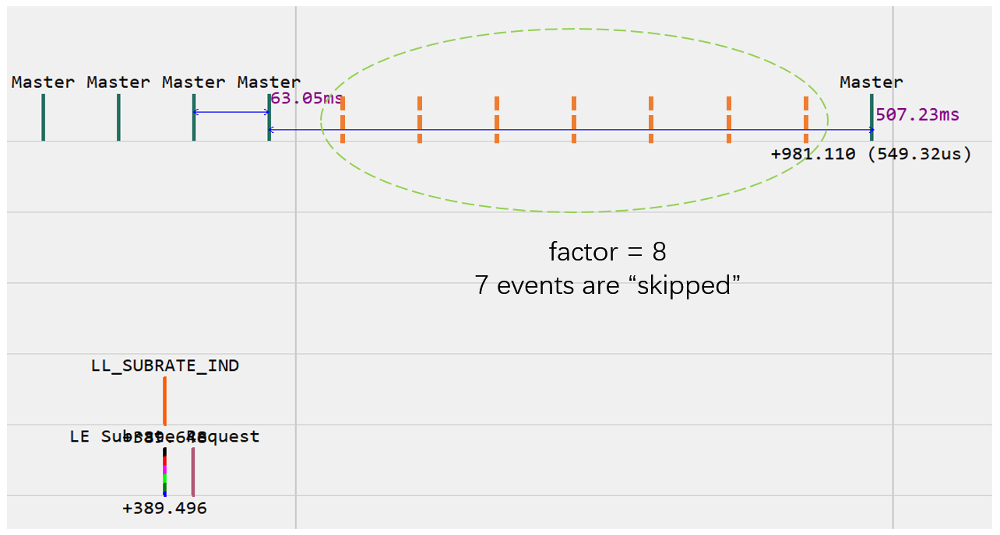
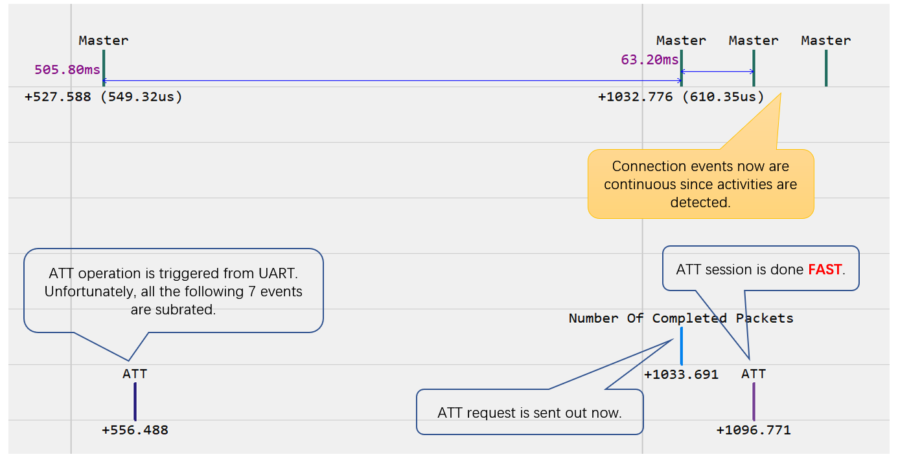
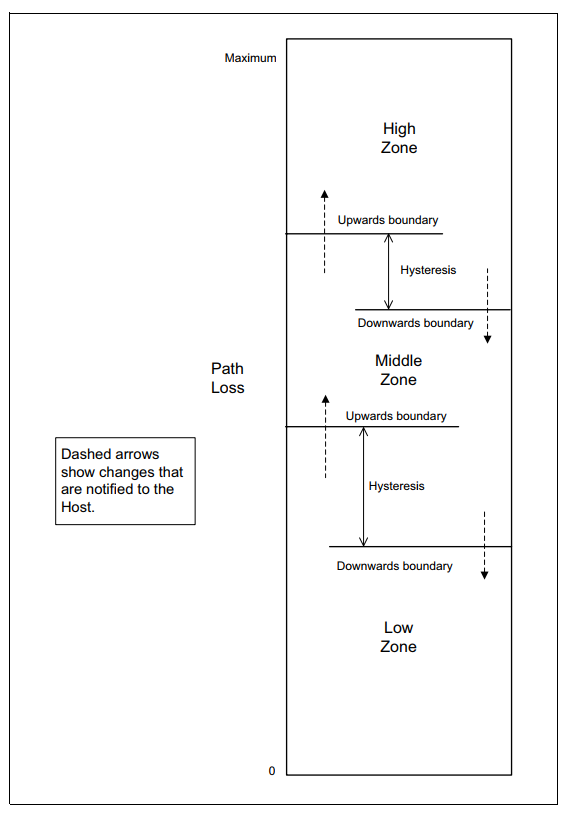

<!-- pg_ble_stack_cn: 7 GAP - 连接 -->

# 7 GAP - 连接 {#ch-conn}

## 7.1 概览 {#概览-2}

连接管理功能也由 GAP 模块提供，包含建立连接、断开连接、读取对端版本、减速模式、功率控制等。

## 7.2 使用说明 {#使用说明-2}

### 7.2.1 建立连接 {#ch-scan-create-connection}

建立连接的过程与主动扫描有相似之处：持续尝试接收某种类型的广播，主动发出一个请求。所以，蓝牙协议规定不要并发地执行这两项任务： 建立连接前要先停止扫描，反之亦然。

在建立连接之前，需要先通过 `gap_set_random_device_address` 为设备配置地址，这个地址用于扫描、发起连接等场景。 通过 `gap_ext_create_connection` 建立连接。所连接的目标可以是一个特定的地址，也可以是白名单中的任意一个地址[29](https://ingchips.github.io/application-notes/pg_ble_stack_cn/ch-cap.html#fn29)。

```c
uint8_t gap_ext_create_connection(
  // 过滤策略：目标地址来自参数还是白名单？
  const initiating_filter_policy_t filter_policy,
  // 本设备地址类型
  const bd_addr_type_t own_addr_type,
  // 目标地址来自参数时，指定目标地址类型
  const bd_addr_type_t peer_addr_type,
  // 目标地址来自参数时，指定目标地址
  const uint8_t *peer_addr,
  // 主广播信道的配置个数
  const uint8_t initiating_phy_num,
  // 主广播信道的配置
  const initiating_phy_config_t *phy_configs);
```

另见 [从 PAwR 发起连接](https://ingchips.github.io/application-notes/pg_ble_stack_cn/ch-adv.html#ch-adv-create-connection)。

主广播信道的配置 `initiating_phy_config_t` 指定了每种主广播信道 PHY 的扫描参数（此部分与扫描参数 `scan_phy_config_t` 相同）及连接参数：

```c
typedef struct {
    // 同 scan_phy_config_t
    uint16_t scan_int;
    uint16_t scan_win;
    // 最小连接间隔，单位 1.25ms
    uint16_t interval_min;
    // 最大连接间隔，单位 1.25ms
    uint16_t interval_max;
    // 从机延迟（即允许从机跳过多少个连接间隔）
    uint16_t latency;
    // LE 链路超时时间，单位 10ms
    uint16_t supervision_timeout;
    // 关于每个连接间隔内连接事件长度的提示信息，单位 0.625ms
    uint16_t min_ce_len;
    uint16_t max_ce_len;
} conn_para_t;

typedef struct initiating_phy_config
{
    phy_type_t phy;
    conn_para_t conn_param;
} initiating_phy_config_t;
```

关于每个连接间隔内连接事件长度的提示信息（`min_ce_len` 和 `max_ce_len`）不会被传递给从端。Controller 可以借助这个信息更好地调度多种任务。 从端 App 可调用 LL API `ll_hint_on_ce_len`[30](https://ingchips.github.io/application-notes/pg_ble_stack_cn/ch-cap.html#fn30) 将提示信息告知 Controller。

收到对应的 `HCI_EVENT_COMMAND_STATUS` 事件，并且 `status` 为 0，标志着开始执行连接建立任务。 `HCI_SUBEVENT_LE_ENHANCED_CONNECTION_COMPLETE` 事件标志着连接建立任务的结束。也就是说每次调用这个函数将到达 3 个互斥的终点：

1. 函数返回值非 0；
2. 上报 `HCI_EVENT_COMMAND_STATUS` 事件，并且 `status` 非 0；
3. 上报 `HCI_SUBEVENT_LE_ENHANCED_CONNECTION_COMPLETE` 事件。

在上一次调用到达终点 3 前，再次调用 `gap_ext_create_connection` 会到达终点 1 或 2。

复杂应用（如多种蓝牙任务并发）中，务必响应 `HCI_EVENT_COMMAND_STATUS` 事件检查建立连接命令是否出错（即到达终点 2）。 有时，Controller 会因为无法调度任务而上报 `status` 为 `0x07` 的 `HCI_SUBEVENT_LE_ENHANCED_CONNECTION_COMPLETE` 事件。 对于这种情况，建议 App 延后一段时间再重新尝试建立连接。

### 7.2.2 取消连接 {#取消连接}

建立连接需要一定的时间，如果决定不再继续等待，可以通过 `gap_create_connection_cancel` 取消连接建立任务。 任务取消后，同样会上报 `HCI_SUBEVENT_LE_ENHANCED_CONNECTION_COMPLETE` 事件，其中的 `status` 为 `0x02` （未知的连接句柄）。

### 7.2.3 获取对端版本 {#获取对端版本}

通过 `gap_read_remote_info` 可以读取对端协议栈版本。获得版本信息后 Controller 上报 `HCI_EVENT_READ_REMOTE_VERSION_INFORMATION_COMPLETE` 事件。版本的解析方法可参考 SDK *UART GATT Console*。

### 7.2.4 获取对端特性 {#获取对端特性}

通过 `gap_read_remote_used_features` 可以读取对端支持的 BLE 特性。获得特性信息后 Controller 上报 `HCI_SUBEVENT_LE_READ_REMOTE_USED_FEATURES_COMPLETE` 这个子事件。特性的解析方法可参考 SDK *UART GATT Console*。

### 7.2.5 设置 PHY {#设置-phy}

通过 `gap_set_phy` 可以设置偏好的 PHY。经过与对方的协商生效后，Controller 上报 `HCI_SUBEVENT_LE_PHY_UPDATE_COMPLETE` 事件。

`gap_set_phy` 参数详解：

```c
uint8_t gap_set_phy(
  // 连接句柄
  const uint16_t con_handle,
  // 置起比特 0 表示在发送方向无偏好
  // 置起比特 1 表示在接收方向无偏好
  // 其它比特保留
  const uint8_t all_phys,
  // 发送方向上的 PHY 偏好（比特 0 为 0 有效）
  const phy_bittypes_t tx_phys,
  // 接收方向上的 PHY 偏好（比特 1 为 0 有效）
  const phy_bittypes_t rx_phys,
  // PHY 的其它选项
  const phy_option_t phy_opt);
```

PHY 偏好 `phy_bittypes_t` 是几个比特的组合：

*表 7.1: PHY 比特组合*
| 比特序号 | 含义 |
| --- | --- |
| 0 | 1M PHY |
| 1 | 2M PHY |
| 2 | Coded PHY |

`phy_option_t` 目前用来指示本端 Coded PHY 采用 S2 或 S8。对于对端，可以在对端 App 里调用 `ll_set_conn_coded_scheme` 选择 S2 或者 S8。 默认为 S8。

### 7.2.6 更新连接参数 {#更新连接参数}

连接中的主从角色都可以使用 `gap_update_connection_parameters`[31](https://ingchips.github.io/application-notes/pg_ble_stack_cn/ch-cap.html#fn31)：主角色使用这个函数可以更新连接参数； 从角色使用这个函数则是请求主端更新连接参数：

```c
int gap_update_connection_parameters(
  // 连接句柄
  hci_con_handle_t con_handle,
  // 建议的最小连接间隔（单位 1.25ms）
  uint16_t conn_interval_min,
  // 建议的最大连接间隔（单位 1.25ms）
  uint16_t conn_interval_max,
  // 建议的从机延迟
  uint16_t conn_latency,
  // 建议的超时时间（单位 10ms）
  uint16_t supervision_timeout,
  // 关于每个连接间隔内连接事件长度的提示信息，单位 0.625ms
  // （从角色忽略这两个参数）
  uint16_t min_ce_len,
  uint16_t max_ce_len);
```

事件 `HCI_SUBEVENT_LE_CONNECTION_UPDATE_COMPLETE` 标志着参数更新完成。

### 7.2.7 减速模式 {#ch-conn-subrating}

减速模式的使用方法可参考 SDK *UART GATT Console*。

减速（Subrating）模式为中心设备和外围设备定义了一种统一的节奏，在保证通信的持续性前提下跳过若干连接间隔，减少射频占用、降低功耗。 调用 `gap_subrate_request`[32](https://ingchips.github.io/application-notes/pg_ble_stack_cn/ch-cap.html#fn32) 即可在主从两端协商启动减速模式。

```c
uint8_t gap_subrate_request(
  // 连接句柄
  hci_con_handle_t con_handle,
  // 最小减速比
  uint16_t subrate_min,
  // 最大减速比
  uint16_t subrate_max,
  // 最大从延迟（单位：减速后连接间隔）
  uint16_t max_latency,
  // 最小连续传输次数
  uint16_t continuation_number,
  // 超时时间（单位 10ms）
  uint16_t supervision_timeout);
```

例如，将连接 0 的减速比设置为 8，在双方无数据传输时，每 8 个连接间隔对发 1 次空包维持连接：

```c
gap_subrate_request(0, 8, 8,
  0, 0, 2000);
```

使用 BLE 空口抓包工具或者高端电流表可观察到这种减速行为，见图 [7.1](https://ingchips.github.io/application-notes/pg_ble_stack_cn/ch-conn.html#fig:ch2-subrate-8-start)。



图 7.1: 减速比为 8 时的行为

`continuation_number` 表示每个减速周期开始时，至少再连续传输多少个连接间隔。如果为 1，在上述配置下当双方无数据传输时，每 8 个连接间隔有 2 个激活； 如果为 7，则每个连接间隔有 8 个激活，即都激活。

启用减速模式后，从机延迟的单位从原来的连接间隔变为 (连接间隔 \times 减速比)。

减速参数更新后，HCI 回调函数会收到 `HCI_SUBEVENT_LE_SUBRATE_CHANGE` 事件。

当出现通信需求时，可以迅速从减速模式回到连接通信模式，**兼顾功耗与效率**，如图 [7.2](https://ingchips.github.io/application-notes/pg_ble_stack_cn/ch-conn.html#fig:ch2-subrate-8-data)。



图 7.2: 减速下出现数据通信

通过 `gap_set_default_subrate` 设置 Controller 所接受的减速模式参数范围。

```c
uint8_t gap_set_default_subrate(
  uint16_t subrate_min,
  uint16_t subrate_max,
  uint16_t max_latency,
  uint16_t continuation_number,
  uint16_t supervision_timeout);
```

### 7.2.8 路损检测与上报 {#ch-conn-pathloss}

BLE 5.2 为路径损耗定义了 3 种分类（或者分区，zone），高损耗、中损耗和低损耗。 Controller 监控损耗情况，当损耗分类发生改变时（图 [7.3](https://ingchips.github.io/application-notes/pg_ble_stack_cn/ch-conn.html#fig:ch2-path-loss-notification) 中的虚线箭头），上报 HCI_SUBEVENT_LE_PATH_LOSS_THRESHOLD 事件。



图 7.3: 路径损耗上报

- 配置路损分类参数：

  ```c
  uint8_t gap_set_path_loss_reporting_param(
    hci_con_handle_t con_handle,  // 连接句柄
    uint8_t high_threshold,       // 高路损门限
    uint8_t high_hysteresis,      // 高路损迟滞
    uint8_t low_threshold,        // 低路损门限
    uint8_t low_hysteresis,       // 低路损迟滞
    uint8_t min_time_spent);      // 最小停留时间（单位连接间隔）
  ```

  图 [7.3](https://ingchips.github.io/application-notes/pg_ble_stack_cn/ch-conn.html#fig:ch2-path-loss-notification) 中的 *upwards boundary* 为 (threshold + hysteresis)， *downwards boundary* 为 (threshold - hysteresis)。
- 使能上报：

  ```c
  uint8_t gap_set_path_loss_reporting_enable(
    hci_con_handle_t con_handle,  // 连接句柄
    uint8_t enable                // 使能
  );
  ```

### 7.2.9 功率控制 {#ch-conn-power-ctrl}

功率控制的使用方法可参考 SDK *UART GATT Console*。

- 读取发射功率

  读取本端发射功率：

  ```c
  uint8_t gap_read_local_tx_power_level(
    hci_con_handle_t con_handle, // 连接句柄
    unified_phy_type_t phy       // PHY
  );
  ```

  从对应的 `HCI_EVENT_COMMAND_COMPLETE` 事件的返回参数中取得发射功率值：

  ```c
  uint8_t Status,                 // 状态码
  uint8_t Connection_Handle,      // 连接句柄
  uint8_t PHY,
   int8_t Current_TX_Power_Level, // 当前发射功率（dBm）
   int8_t Max_TX_Power_Level      // 最大发射功率（dBm）
  ```

  读取对端发射功率：

  ```c
  uint8_t gap_read_remote_tx_power_level(
    hci_con_handle_t con_handle, // 连接句柄
    unified_phy_type_t phy       // PHY
  );
  ```

  从 `HCI_SUBEVENT_LE_TRANSMIT_POWER_REPORTING` 事件中取得发射功率值。
- 设置发射功率

  设置本端发射功率：

  ```c
  void ll_set_conn_tx_power(
    uint16_t conn_handle, // 连接句柄
    int16_t tx_power      // 发射功率（dBm）
  );
  ```

  调整对端发射功率：

  ```c
  void ll_adjust_conn_peer_tx_power(
    uint16_t conn_handle, // 连接句柄
    int8_t delta          // 调整量，正值为增大，负值为减小（dB）
  );
  ```
- 发射功率自动上报

  ```c

  uint8_t gap_set_tx_power_reporting_enable(
    hci_con_handle_t con_handle,  // 连接句柄
    uint8_t local_enable,         // 使能本端上报
    uint8_t remote_enable         // 使能对端上报
  );
  ```

---

1. <a id="fn29"></a>需要连接多个设备，使用白名单方式效率更高。[↩︎](https://ingchips.github.io/application-notes/pg_ble_stack_cn/ch-conn.html#fnref29)
2. <a id="fn30"></a>参考 《Controller API Reference》。[↩︎](https://ingchips.github.io/application-notes/pg_ble_stack_cn/ch-conn.html#fnref30)
3. <a id="fn31"></a>对于 v8.2 以下版本，这个函数仅用于主角色， 从角色需要使用 `l2cap_request_connection_parameter_update` 请求更新。[↩︎](https://ingchips.github.io/application-notes/pg_ble_stack_cn/ch-conn.html#fnref31)
4. <a id="fn32"></a>调用之前建议先检查对方是否支持此特性。此 API 无论主从角色都可以调用。[↩︎](https://ingchips.github.io/application-notes/pg_ble_stack_cn/ch-conn.html#fnref32)