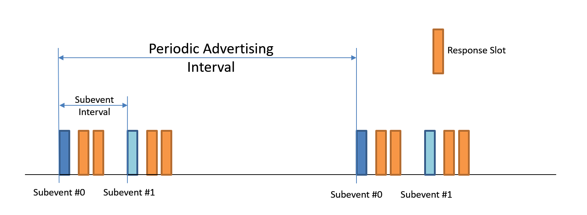

<!-- pg_ble_stack_cn: 4 特性简析 -->

# 4 特性简析 {#ch-features}

本章从应用角度简要介绍核心规范自 5.0 以来引入的主要新特性。如需了解更多细节，请参考蓝牙核心规范。

## 4.1 5.0 新特性 {#新特性}

### 4.1.1 新的 PHY {#新的-phy}

在旧规范中， GFSK 符号速率为 1 M sps，即 1M PHY。 新规范又定义了另外两种 PHY，2M 和 Coded。 2M PHY 的符号速率加倍；与 1M PHY 相比，Coded 的符号速率也是 1 M sps，但加入了 1/2 卷积编码。 直接传输卷积编码器的输出，称之为 S=2；经过 1:4 比特映射后再传输，就是 S=8。

1M PHY 传输有效载荷的速率为 1Mb/s； 2M PHY 传输有效载荷的速率为 2Mb/s； S=2 传输包头信息的速率为 125kb/s，传输有效载荷的速率为 500kb/s； S=8 传输包头信息的速率为 125kb/s，传输有效载荷的速率也为 125kb/s。

PHY 一般通过 `phy_type_t` 类型表示，这时将 S=2、S=8 统一表示为 Coded。 当需要明确区分 S=2、S=8 时，则将它们视为单独的 PHY，与 1M、2M 并列。

**用来做什么？**

在良好的信道条件下，使用 2M PHY 可以获得更高的通信速率；在较差的信道条件下，Coded PHY 误包率相对较低，可获得略好的通信效果。

### 4.1.2 扩展广播 {#扩展广播}

在旧规范中，广播只能使用 37、38、39 等 3 个信道。随着 BLE 设备的快速增长， 这 3 个信道将变得越来越拥挤。于是新规范将广播 *扩展* 到另外的 37 个信道，并将旧版广播称为传统广播 （Legacy advertising）。一个设备可以使用不同的广播参数、地址发送多组扩展广播，每组广播称为一个广播集。

扩展广播由一串广播 PDU 组成[15](https://ingchips.github.io/application-notes/pg_ble_stack_cn/ch-cap.html#fn15)，最多可携带 1650 字节的广播数据。 第 1 个 PDU 仍位于 37、38、39 等 3 个信道，相同内容重复 3 次[16](https://ingchips.github.io/application-notes/pg_ble_stack_cn/ch-cap.html#fn16)。 这些 PDU 里含有一种新的长度可变的包头，其中的 AuxPtr 用来通知扫描方何时、何地（信道）接收下一个 PDU， 如同一个指向时频域的指针。AuxPtr 包含以下字段：

- 信道号（Channel index）
- 时钟精度（CA）
- 时间偏移的单位（Offset Unit）
- 时间偏移（AUX Offset）
- PHY（AUX PHY）

**用来做什么？**

相比传统广播，可以减少 37、38、39 等 3 个信道上的碰撞、干扰，传输更大的数据量。 需要注意检查扫描方是否支持此特性。

### 4.1.3 周期广播 {#周期广播}

顾名思义，周期广播是一种时间上周期性出现的广播，同样可包含一串广播 PDU，第 1 个 PDU 严格地周期性发送，信道也按照既定参数进行跳频。这第一个 PDU 称为 AUX_SYNC_IND，其数据格式与队列中的其它 PDU 没有任何区别。

获得 AUX_SYNC_IND 参数并成功接收一次的过程称为周期广播的同步建立。规范提供两种建立同步的方法， 一是借助与周期广播关联的扩展广播；一是基于连接进行“[周期广播同步信息传递](https://ingchips.github.io/application-notes/pg_ble_stack_cn/ch-features.html#ch-feature-prd-transfer)”.

与周期广播关联的扩展广播的 PDU 队列里的最后一个 PDU 不含 AuxPtr，但是含有 SyncInfo， 携带了关于如何周期性接收 AUX_SYNC_IND 的全部信息。

**用来做什么？**

用来周期性传递广播数据。

### 4.1.4 信道选择算法 #2 {#信道选择算法-2}

旧规范里的信道选择算法仅有 1 个参数，`hopIncrement`。 假设上一个连接事件所使用的信道的原始编号[17](https://ingchips.github.io/application-notes/pg_ble_stack_cn/ch-cap.html#fn17)为 n， 那么，本次连接事件所使用的信道的原始编号就是 (n + \mathit{hopIncrement}) \mod 37。

这种跳频算法基本没有随机性，效果不佳。新的信道选择算法 #2 可粗略地写为

```c
hash(AccessAddress, EventCounter);
```

即一种类似哈希的算法。

**用来做什么？**

更好地跳频、提高抗干扰能力。此特性完全于协议栈控制，不需要开发者参与。

## 4.2 5.1 新特性 {#新特性-1}

### 4.2.1 CTE {#cte}

定频扩展（CTE）用于实现寻向，可用于 1M 和 2M PHY，不可用于 Coded PHY。从基带看，CTE 即一连串的数字 1；从射频看，CTE 即一段频率固定为 (F_t + f_d) 的电磁波， F_t 为载波频率，f_d 为 FSK 频率偏差。CTE 信号最长 160\mu s，相关信息由 CTEInfo 承载。

CTE 有两种操作方式：AoA 和 AoD。

- AoA：在接收端配置多个天线，估算单天线发送端的方向；
- AoD：在发送端配置多个天线，接收端使用单天线，采集 CTE 信号后计算方向。

CTE 既通过周期广播发送，也可以在连接模式下按需发送。

**用来做什么？**

寻向，进而定位。

### 4.2.2 周期广播同步信息传递 {#ch-feature-prd-transfer}

假设设备 A 与设备 B 之间已经建立连接。如果设备 A 正在发送周期广播或者已经与其它设备发送的周期广播建立同步， 现设备 B 也需要与这个周期广播建立了同步，那么设备 A 可以将周期广播的信息传递给设备 B， 设备 B 根据这个信息直接开始接收 AUX_SYNC_IND，迅速建立同步。 这一传递过程简称 PAST[18](https://ingchips.github.io/application-notes/pg_ble_stack_cn/ch-cap.html#fn18)，其关键在于以连接事件为参考， 描述周期广播的定时信息。

**用来做什么？**

通过直接传递参数，加快对方的周期广播同步建立过程。不需要扫描与周期广播相关联的扩展广播。

## 4.3 5.2 新特性 {#新特性-2}

### 4.3.1 LE Audio {#le-audio}

引入了同步信道及 LC3 音频编码器。暂不支持。

### 4.3.2 增强的 ATT（EATT） {#增强的-atteatt}

EATT 支持会话的并发，采用新的流控机制，更加稳健[19](https://ingchips.github.io/application-notes/pg_ble_stack_cn/ch-cap.html#fn19)。

### 4.3.3 路径损耗监测与功率控制 {#路径损耗监测与功率控制}

详见“[路损检测与上报](https://ingchips.github.io/application-notes/pg_ble_stack_cn/ch-conn.html#ch-conn-pathloss)”和“[功率控制](https://ingchips.github.io/application-notes/pg_ble_stack_cn/ch-conn.html#ch-conn-power-ctrl)”。

注意：核心规范 5.2 版本定义的功率控制存在缺陷，应以 5.3 版本为准。

**用来做什么？**

调整发射功率，兼顾通信质量和功耗。

## 4.4 5.3 新特性 {#新特性-3}

### 4.4.1 减速模式 {#减速模式}

详见“[减速模式](https://ingchips.github.io/application-notes/pg_ble_stack_cn/ch-conn.html#ch-conn-subrating)”。

**用来做什么？**

设计该特性的出发点是使用 LE Audio 时，减少常规连接所占用的射频资源。当连接的双方都没有数据需要发送时， 减速模式可以减少射频活动，降低功耗；需要数据传输时，又可尽快恢复。

## 4.5 5.4 新特性 {#新特性-4}

### 4.5.1 带响应的周期广播（PAwR） {#带响应的周期广播pawr}

PAwR 的设计目的是提供一种低功耗、双向、一对多的通信方式，适合电子价签等应用场景。 与已有的周期广播（PADVB）相比，PAwR 有以下不同之处：

- PADVB 是单向通信，而 PAwR 的接收者可以向广播者发送响应包，是一种双向的、无连接的通信机制；
- PADVB 的同步信息都包含在 SyncInfo 内；而 PAwR 的同步信息除了 SyncInfo，还需要 ACAD 里的数据；
- PADVB 通过广播事件发送，而 PAwR 又定义了子事件，接收发需要同步一个或者多个子广播事件；
- PADVB 里的数据一般变化不频繁；而 PAwR 支持数据频繁变化；
- PAwR 可以给不同的接收者发送不同的数据；
- 对于 PAwR，PAST 是必选项。

如图 [4.1](https://ingchips.github.io/application-notes/pg_ble_stack_cn/ch-features.html#fig:ch-features-pawr) 所示，PAwR 将 PADVB 的一个广播周期拆分为多个子事件， 每个子事件包含 1 个数接包[20](https://ingchips.github.io/application-notes/pg_ble_stack_cn/ch-cap.html#fn20)，及多个响应时隙。 为了确定它们之间的定时关系，增加了子事件间隔、响应时隙延迟、响应时隙间隔、响应时隙数目等参数。



图 4.1: PAwR 子事件与响应

### 4.5.2 广播数据加密 {#广播数据加密}

旧版本的规范仅定义了连接模式下的加密，一直没有涉及广播数据的加密。这一新特性为加密广播数据提供了标准化方案。

广播数据的加密、鉴权沿用 CCM 算法，密钥信息通过新定义的 Encrypted Data Key Material 特征进行交换。 加密过的数据再打包到现有的 “[AD 结构](https://ingchips.github.io/application-notes/pg_ble_stack_cn/ch-overview.html#ch-overview-comm-model)”里发送。

此特性可由 App 实现。

### 4.5.3 广播时 Coded PHY 选择 {#广播时-coded-phy-选择}

当使用 Coded PHY 发送广播时，5.4 以前的 HCI 无法指定 S=2 或者 S=8。5.4 补上了这一“漏洞”。 SDK 一直支持[21](https://ingchips.github.io/application-notes/pg_ble_stack_cn/ch-cap.html#fn21) 通过 API `ll_set_adv_coded_scheme` 选择 S=2 或者 S=8。

## 4.6 6.0 新特性 {#新特性-5}

### 4.6.1 信道探测 {#信道探测}

蓝牙信道探测是蓝牙核心规范 6.0 版本中的一项重要创新，主要用于在两个蓝牙设备之间实现安全的定位。 该技术测量精度高和安全性强，满足数字钥匙和资产追踪等应用中的高精度和安全性需求。

信道探测显著提升了测量精度，将之前的半米级别精度提升至 10 厘米以内。其核心原理包括两种测量方法：相位测距（PBR）和往返时间测距（RTT）。 PBR 利用无线电波的相位特性，通过测量相位差和频率差来计算距离，但存在相位模糊问题，信道间隔 1 MHz 时模糊距离约为 150 米。 RTT 则通过测量信号去程和返程时间差来计算距离，能够提供无模糊的长距离测量，但需要精确的计时机制。

为了确保安全性，信道探测采用了多种措施：随机化技术、信号处理防御、攻击检测系统以及 PBR 与 RTT 的交叉验证。这些安全措施有效防止了距离欺骗攻击和中间人攻击。

暂不支持。

### 4.6.2 基于决策的广告过滤（DBAF） {#基于决策的广告过滤dbaf}

基于决策的广告过滤（Decision-Based Advertising Filtering, DBAF）旨在提高扫描设备在处理扩展广告时的效率。

DBAF 引入了一种新的扩展广告PDU类型，称为 ADV_DECISION_IND，非正式地称为决策 PDU。这种 PDU 旨在替代 ADV_EXT_IND 扩展广播 PDU，并在主信道上传输。

决策 PDU 包含应用程序指定的数据，使扫描器能够更明智地决定相关的 AUX_ADV_IND 辅助数据包是否值得关注。

即将支持。

### 4.6.3 广播者监控 {#广播者监控}

这个特性所要解决的问题：当 Host 准备连接某个曾扫描到的设备时，这个设备是否还在可连接的范围内、是否已经远离？

这个特性增加了 HCI 命令和事件，用来命令 Controller 监控一个或多个广播集，并上报进入或者离开事件。

即将支持。

### 4.6.4 ISOAL 增强 {#isoal-增强}

ISOAL 引入了一种新的帧模式，能显著降低时间敏感型应用的延迟。

暂不支持。

### 4.6.5 链路层扩展特性集 {#链路层扩展特性集}

随着规范发展，功能日益复杂，原有的特性集合已经用尽。为此引入了扩展特性集以表示更多的特性。

即将支持。

### 4.6.6 帧间隔更新 {#帧间隔更新}

一直以来，相邻两个数据包之间的间隔 `T_IFS` 固定为 150 μs。现在，规范定义一套 `T_IFS` 更新机制， 允许连接双方协商在 50 μs ~ 1000 μs 范围内更新该参数。

暂不支持。

## 4.7 6.1 新特性 {#新特性-6}

### 4.7.1 随机更新 RPA {#随机更新-rpa}

旧版本 RPA 更新周期固定，通过观察更新规律，有可能将多个 RPA 关联到设备。 新版本将应有的固定周期拓展为一个区间，Controller 每次从这个区间中随机选取超时时间。

优点：

- 更好地保护设备隐私；
- 由 Controller 实现，不需要 Host 参与，功耗低[22](https://ingchips.github.io/application-notes/pg_ble_stack_cn/ch-cap.html#fn22)。

即将支持。

---

1. <a id="fn15"></a>称为一个 PDU 队列（train）。[↩︎](https://ingchips.github.io/application-notes/pg_ble_stack_cn/ch-features.html#fnref15)
2. <a id="fn16"></a>AuxPtr 里的时间偏移略有不同。[↩︎](https://ingchips.github.io/application-notes/pg_ble_stack_cn/ch-features.html#fnref16)
3. <a id="fn17"></a>将原始编号再映射到当前的信道集合得到实际的信道号。[↩︎](https://ingchips.github.io/application-notes/pg_ble_stack_cn/ch-features.html#fnref17)
4. <a id="fn18"></a>Periodic Advertising Sync Transfer。[↩︎](https://ingchips.github.io/application-notes/pg_ble_stack_cn/ch-features.html#fnref18)
5. <a id="fn19"></a>SDK v9.0.1 或更新版本。[↩︎](https://ingchips.github.io/application-notes/pg_ble_stack_cn/ch-features.html#fnref19)
6. <a id="fn20"></a>PAwR 每个子事件、每个响应都只包含一个数据包，不支持 PDU 队列。[↩︎](https://ingchips.github.io/application-notes/pg_ble_stack_cn/ch-features.html#fnref20)
7. <a id="fn21"></a>[https://github.com/ingchips/ING918XX_SDK_SOURCE/blob/75cbf9928711c39e0b234ae11796bc1696111998/bundles/typical/inc/platform_api.h#L265](https://github.com/ingchips/ING918XX_SDK_SOURCE/blob/75cbf9928711c39e0b234ae11796bc1696111998/bundles/typical/inc/platform_api.h#L265)[↩︎](https://ingchips.github.io/application-notes/pg_ble_stack_cn/ch-features.html#fnref21)
8. <a id="fn22"></a>旧版本下可以由 Host 随机更新 RPA，一般由软件实现，所以功率比用 Controller 实现功耗高。[↩︎](https://ingchips.github.io/application-notes/pg_ble_stack_cn/ch-features.html#fnref22)