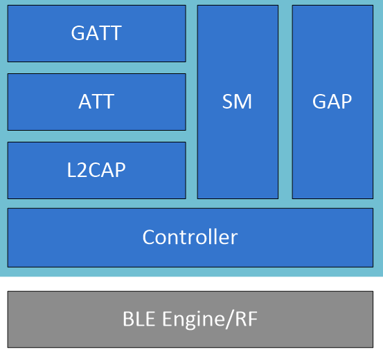
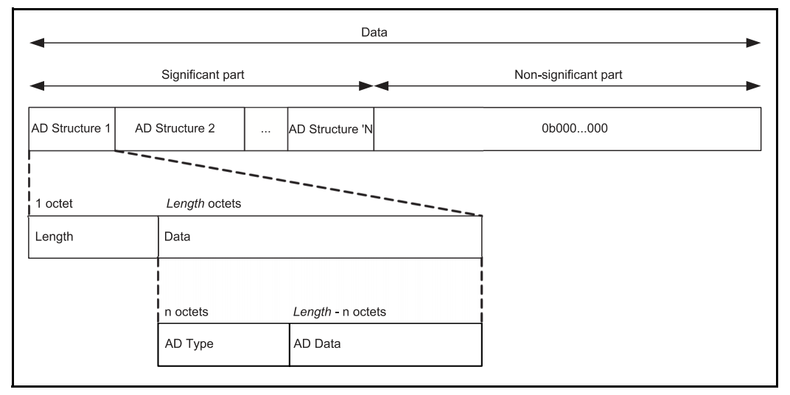

<!-- pg_ble_stack_cn: 3 概览 -->

# 3 概览 {#ch-overview}

## 3.1 基本原则 {#基本原则}

1. BLE 协议栈**尽最大努力**执行各项任务，比如

   - 将发射功率设置为 100dBm，协议栈将以最大功率进行发射
   - 广播、连接并发时，部分广播事件、连接事件可能因需要执行其它任务而被忽略（跳过）
   - 极端情况下，当协议栈可能会主动终止某些任务并上报相应的事件
2. 连接模式下已进入 BLE 协议栈的数据包不会丢失、总是可以送达，除非连接断开

## 3.2 协议栈架构 {#协议栈架构}

一般情况下[3](https://ingchips.github.io/application-notes/pg_ble_stack_cn/ch-cap.html#fn3)，Controller、Host 以两个任务（或者线程）的形式运行。Controller 的优先级较高，Host 的优先级较低。 对于内置了 RTOS 的软件包，可使用 RTOS API 查询和修改优先级[4](https://ingchips.github.io/application-notes/pg_ble_stack_cn/ch-cap.html#fn4)； 对于其它软件包，两个任务的优先级由开发者决定。

HCI 接口经过特殊设计，尽量减少内存数据的复制。 Host 的架构如图 [3.1](https://ingchips.github.io/application-notes/pg_ble_stack_cn/ch-overview.html#fig:ch0-host-overview) 所示，主要通过 GAP、ATT、GATT Client、SM 等 4 个模块为开发者提供操作接口。



图 3.1: Host 架构

Host 任务的伪代码如下：

```c
void host_task(void)
{
    host_init();
    while (true)
    {
        if (recv_msg(msg) != 0) continue;
        process_msg(msg);
    }
}
```

也就是说 Host 任务是由各种消息驱动的。这些消息既包括来自 Controller 的事件、ACL 数据， 也包含软件定时器消息和用户发送的消息（`btstack_push_user_msg` 和 `btstack_push_user_runnable`）。

`process_msg` 的伪代码如下：

```c
void process_msg(msg)
{
    switch (msg)
    {
    case HCI Event:
        调用各个回调();
        break;
    case ACL 数据:
        调用各个回调();
        break;
    case 软件定时器:
        超时处理();
        break;
    case 用户消息:
        弹出用户消息事件();
        break;
    case 用户执行体:
        运行用户执行体();
        break;
    }
}
```

各个模块（包含协议内部模块及 App[5](https://ingchips.github.io/application-notes/pg_ble_stack_cn/ch-cap.html#fn5)）通过注册回调函数以响应这些事件。 有的模块在处理这些消息时又会产生其它的新事件， 为了响应这些新事件可以再向这些模块注册回调函数。也就是说，Host 内部各个模块（以及 App）通过消息、回调函数耦合在一起。 例如：

- `hci_add_event_handler`

  通过这个函数可以注册一个能够监听所有 HCI 事件的回调；
- `att_server_init`

  向 ATT Server 模块注册用以响应特征读写的回调函数。

## 3.3 通信模型 {#ch-overview-comm-model}

通信是指由一地向另一地进行信息的传输与交换，其目的是传输信息、削减另一地的不确定性。对于 BLE 而言，主要有两种通信方式： 一对多的广播、一对一的连接。低功耗蓝牙定义了四种角色：广播发送方称为广播者（Broadcaster），接收方称为观察者（Observer）； 连接的发起方称为主角色（新名称为中心角色，Central），接受方称为从角色（新名称为外围角色，Periperhal）。

蓝牙规范定义了广播数据的格式、AD 类型，见图 [3.2](https://ingchips.github.io/application-notes/pg_ble_stack_cn/ch-overview.html#fig:ch0-adv-data-format)。如，AD 类型 `0x09` 表示设备名称，其后面的 AD 数据域是一个 UTF-8 字符串。 另请参阅“[广播数据](https://ingchips.github.io/application-notes/pg_ble_stack_cn/ch-adv.html#ch1-adv-data-edit)”一节。



图 3.2: 广播及扫描响应数据包格式

对于连接模式，低功耗蓝牙定义了特征（Characteristic）和值（Value）这两个概念，进而组织成服务（Service），再由服务组成配置（Profile）。 特征的标识用 UUI​D 标识。客户端发现了服务器支持的服务后，就可以读写特征的值，或者订阅特征[6](https://ingchips.github.io/application-notes/pg_ble_stack_cn/ch-cap.html#fn6)。 显然特征不见得支持所有这些操作，因此，蓝牙核心规范又为特征定义了属性（Property）、 描述符（Discriptor）等装饰物，以说明特征所支持的操作、需要的权限。UUID 长度为 16 字节，为了提高传输效率，BLE 定义了一系列特殊的 UUID， 它们的区别仅在于 2 个字节，另外 14 个字节相同：

```
0x0000xxxx-0000-1000-8000-00805F9B34FB
```

这两个字节就是所谓的 16-bit UUID，由蓝牙特别兴趣小组公司负责管理、分配[7](https://ingchips.github.io/application-notes/pg_ble_stack_cn/ch-cap.html#fn7)。

## 3.4 回调函数事件包 {#回调函数事件包}

协议栈的各种回调函数遵循类似的原型，其输入称为事件包：

```c
typedef void (*btstack_packet_handler_t) (
    // 事件包类型
    uint8_t packet_type,
    // 关联的信道（一般指蓝牙连接句柄）
    uint16_t channel,
    // 事件包内容
    const uint8_t *packet,
    // 事件包内容的长度
    uint16_t size);
```

包类型 `packet_type` 的取值如下：

- `HCI_EVENT_PACKET`：HCI 事件包（**常用**）

  这个类型的事件包是个“大杂烩”，多个模块弹出的事件包都会使用这个类型。
- `HCI_ACL_DATA_PACKET`：Controller 上报的 ACL 数据

  这个类型的事件包只会被通过 `hci_register_acl_packet_handler` 注册的 ACL 数据回调函数收到。
- `HCI_COMPLETED_SDU_PACKET`：来自 LE 信用信道的完整 SDU

  这个类型的事件包只会被通过 `l2cap_register_service` 注册的 L2CAP 服务回调函数收到。
- `L2CAP_EVENT_PACKET`：来自 L2CAP 的事件包

  这个类型的事件包只会被通过 `l2cap_add_event_handler` 注册的 L2CAP 事件回调函数收到。

## 3.5 事件包的解析 {#事件包的解析}

下面只介绍 `HCI_EVENT_PACKET` 事件包的解析，其它几种类型不常用。

首先使用 `hci_event_packet_get_type(packet)` 获取事件代码，根据事件代码的不同，后续的处理大不相同。 常用的几种事件代码如下。

1. `BTSTACK_EVENT_STATE`：蓝牙协议栈事件

   一般用于响应协议栈初始化：

   ```c
   if (btstack_event_state_get_state(packet) != HCI_STATE_WORKING)
       break;
   // App 初始化
   ```
2. `HCI_EVENT_LE_META`：BLE 元事件

   这个元事件下辖多个子事件。先通过 `hci_event_le_meta_get_subevent_code(packet)` 获得子事件代码，然后通过 `decode_hci_le_meta_event(packet, sub_event_type)` 宏得到子事件的内容。 `sub_event_type` 为子事件内容对应的数据类型，各字段与蓝牙核心规范里的定义一致[8](https://ingchips.github.io/application-notes/pg_ble_stack_cn/ch-cap.html#fn8)。

   协议栈的版本及初始化流程导致下列子事件不会出现，只会出现对应的扩展过的、功能更全面的事件：

   - `HCI_SUBEVENT_LE_CONNECTION_COMPLETE`

     5.3 及以下改用 `HCI_SUBEVENT_LE_ENHANCED_CONNECTION_COMPLETE`； 5.4 及以上改用 `HCI_SUBEVENT_LE_ENHANCED_CONNECTION_COMPLETE_V2`
   - `HCI_SUBEVENT_LE_ADVERTISING_REPORT`

     改用 `HCI_SUBEVENT_LE_EXTENDED_ADVERTISING_REPORT`

   协议栈可能报告的子事件及对应的 `sub_event_type` 类型如下：

   - `HCI_SUBEVENT_LE_CONNECTION_UPDATE_COMPLETE`

     连接参数更新（`le_meta_event_conn_update_complete_t`）
   - `HCI_SUBEVENT_LE_READ_REMOTE_USED_FEATURES_COMPLETE`

     读取对端特性（`le_meta_event_read_remote_feature_complete_t`）
   - `HCI_SUBEVENT_LE_LONG_TERM_KEY_REQUEST`

     请求 LTK（`le_meta_event_long_term_key_request_t`）
   - `HCI_SUBEVENT_LE_REMOTE_CONNECTION_PARAMETER_REQUEST_COMPLETE`

     远端连接参数请求（`le_meta_event_remote_conn_param_request_t`）
   - `HCI_SUBEVENT_LE_DATA_LENGTH_CHANGE_EVENT`

     数据包长度改变（`le_meta_event_data_length_changed_t`）
   - `HCI_SUBEVENT_LE_ENHANCED_CONNECTION_COMPLETE` (5.3 及以下)

     连接建立（`le_meta_event_enh_create_conn_complete_t`）
   - `HCI_SUBEVENT_LE_ENHANCED_CONNECTION_COMPLETE_V2` (5.4 及以上)

     连接建立（`le_meta_event_enh_create_conn_complete_v2_t`），与 `HCI_SUBEVENT_LE_ENHANCED_CONNECTION_COMPLETE` 相比，增加了 PAwR 的相关信息
   - `HCI_SUBEVENT_LE_DIRECT_ADVERTISING_REPORT`

     定向广播报告（`le_meta_directed_adv_report_t`）
   - `HCI_SUBEVENT_LE_PHY_UPDATE_COMPLETE`

     PHY 更新完成（`le_meta_phy_update_complete_t`）
   - `HCI_SUBEVENT_LE_EXTENDED_ADVERTISING_REPORT`

     扩展广播报告（`le_meta_event_ext_adv_report_t`）
   - `HCI_SUBEVENT_LE_PERIODIC_ADVERTISING_SYNC_ESTABLISHED` (5.3 及以下)

     周期广播同步建立（`le_meta_event_periodic_adv_sync_established_t`）
   - `HCI_SUBEVENT_LE_PERIODIC_ADVERTISING_SYNC_ESTABLISHED_V2` (5.4 及以上)

     周期广播同步建立（`le_meta_event_periodic_adv_sync_established_v2_t`），与 `HCI_SUBEVENT_LE_PERIODIC_ADVERTISING_SYNC_ESTABLISHED` 相比，增加了 PAwR 的相关信息
   - `HCI_SUBEVENT_LE_PERIODIC_ADVERTISING_REPORT` (5.3 及以下)

     周期广播报告（`le_meta_event_periodic_adv_report_t`）
   - `HCI_SUBEVENT_LE_PERIODIC_ADVERTISING_REPORT_V2` (5.4 及以上)

     周期广播报告（`le_meta_event_periodic_adv_report_v2_t`），与 `HCI_SUBEVENT_LE_PERIODIC_ADVERTISING_REPORT` 相比，增加了 PAwR 的相关信息
   - `HCI_SUBEVENT_LE_PERIODIC_ADVERTISING_SYNC_LOST`

     周期广播同步丢失（`le_meta_event_periodic_adv_sync_lost_t`）
   - `HCI_SUBEVENT_LE_SCAN_TIMEOUT`

     扫描超时
   - `HCI_SUBEVENT_LE_ADVERTISING_SET_TERMINATED`

     广播停止（`le_meta_adv_set_terminated_t`）

     如果是由于广播是由于建立了连接而停止，那么从这个事件里可以得到广播句柄和连接句柄的对应关系。
   - `HCI_SUBEVENT_LE_SCAN_REQUEST_RECEIVED`

     收到扫描请求（`le_meta_scan_req_received_t`）
   - `HCI_SUBEVENT_LE_CHANNEL_SELECTION_ALGORITHM`

     信道选择算法（`le_meta_ch_sel_algo_t`）
   - `HCI_SUBEVENT_LE_CONNECTIONLESS_IQ_REPORT`

     无连接 IQ 报告（`le_meta_connless_iq_report_t`）
   - `HCI_SUBEVENT_LE_CONNECTION_IQ_REPORT`

     有连接 IQ 报告（`le_meta_conn_iq_report_t`）
   - `HCI_SUBEVENT_LE_CTE_REQ_FAILED`

     CTE 请求失败（`le_meta_cte_req_failed_t`）
   - `HCI_SUBEVENT_LE_PRD_ADV_SYNC_TRANSFER_RCVD` (5.3 及以下)

     周期广播转移请求（`le_meta_prd_adv_sync_transfer_recv_t`）
   - `HCI_SUBEVENT_LE_PRD_ADV_SYNC_TRANSFER_RCVD_V2` (5.4 及以上)

     周期广播转移请求（`le_meta_prd_adv_sync_transfer_recv_v2_t`），与 `HCI_SUBEVENT_LE_PRD_ADV_SYNC_TRANSFER_RCVD` 相比，增加了 PAwR 的相关信息
   - `HCI_SUBEVENT_LE_REQUEST_PEER_SCA`

     对端 SCA 请求完成（`le_meta_request_peer_sca_complete_t`）
   - `HCI_SUBEVENT_LE_PATH_LOSS_THRESHOLD`

     路损门限报告（`le_meta_path_loss_threshold_t`）
   - `HCI_SUBEVENT_LE_TRANSMIT_POWER_REPORTING`

     发射功率报告（`le_meta_tx_power_reporting_t`）
   - `HCI_SUBEVENT_LE_SUBRATE_CHANGE`

     减速模式改变（`le_meta_subrate_change_t`）
   - `HCI_SUBEVENT_PRD_ADV_SUBEVT_DATA_REQ`

     PAwR 子事件数据请求（`le_mete_event_prd_adv_subevent_data_req_t`）
   - `HCI_SUBEVENT_PRD_ADV_RSP_REPORT`

     PAwR 子事件响应（`le_mete_event_prd_adv_rsp_report_t`）
   - `HCI_SUBEVENT_LE_VENDOR_CONNECTION_ABORTED`

     私有连接中止报告（`le_meta_event_vendor_connection_aborted_t`）
   - `HCI_SUBEVENT_LE_VENDOR_CHANNEL_MAP_UPDATE`

     私有信道集合更新报告（`le_meta_event_vendor_channel_map_update_t`）
   - `HCI_SUBEVENT_LE_VENDOR_PRO_CONNECTIONLESS_IQ_REPORT`

     私有无连接 IQ 报告（`le_meta_pro_connless_iq_report_t`）
3. `HCI_EVENT_DISCONNECTION_COMPLETE`：连接断开事件

   通过 `decode_hci_event_disconn_complete(packet)` 解析事件内容：

   ```c
   typedef struct event_disconn_complete
   {
       // 状态码
       uint8_t status;
       // 连接句柄
       uint16_t conn_handle;
       // 原因
       uint8_t reason;
   } event_disconn_complete_t;
   ```
4. `HCI_EVENT_COMMAND_COMPLETE`：HCI 命令完成事件

   通过 `hci_event_command_complete_get_command_opcode(packet)` 获得 HCI 命令码。 通过 `hci_event_command_complete_get_return_parameters(packet)` 获得 Controller 返回的参数，其中第 1 个字节为命令完成的状态， 0 表示没有错误，详见“[Controller 错误码](https://ingchips.github.io/application-notes/pg_ble_stack_cn/ch-overview.html#ch0-ctrl-err-code)”。其它参数需要根据命令码做具体分析。
5. `HCI_EVENT_COMMAND_STATUS`：HCI 命令状态事件

   有些 HCI 命令可以立即完成，得到结果，Controller 会上报相应的 `HCI_EVENT_COMMAND_COMPLETE`。有些 HCI 命令则需要一定时间才能完成，比如发起连接， Controller 收到这样的命令后不上报 `HCI_EVENT_COMMAND_COMPLETE`，而是上报 `HCI_EVENT_COMMAND_STATUS`。

   通过 `hci_event_command_status_get_command_opcode(packet)` 获得 HCI 命令码。 通过 `hci_event_command_status_get_status(packet)` 获得状态，0 表示没有错误，详见“[Controller 错误码](https://ingchips.github.io/application-notes/pg_ble_stack_cn/ch-overview.html#ch0-ctrl-err-code)”。
6. `BTSTACK_EVENT_USER_MSG`：来自 `btstack_push_user_msg` 的用户消息

## 3.6 Controller 错误码 {#ch0-ctrl-err-code}

表 [3.1](https://ingchips.github.io/application-notes/pg_ble_stack_cn/ch-overview.html#tab:ch0-ctrl-err-code) 列出了 Controller 使用的部分错误码。

*表 3.1: Controller 错误码*
| 错误码 | 含义 |
| --- | --- |
| 0x00 | 无错误 |
| 0x01 | 未知的命令 |
| 0x02 | 未知的连接句柄 |
| 0x03 | 硬件错误 |
| 0x05 | 鉴权失败 |
| 0x06 | PIN 或密钥缺失 |
| 0x07 | 超出内存容量 |
| 0x08 | 连接超时 |
| 0x09 | 连接数目达到极限 |
| 0x0B | 连接已存在 |
| 0x0C | 命令不允许 |
| 0x11 | 不支持的特性或参数值 |
| 0x12 | HCI 命令参数错误 |
| 0x13 | 远端用户断开连接 |
| 0x14 | 远端设备因资源紧张断开连接 |
| 0x15 | 远端设备因关机断开连接 |
| 0x16 | 本机断开连接 |
| 0x1A | 不支持的远端或 LMP 特性 |
| 0x1E | 非法的 LMP 或 LL 参数 |
| 0x1F | 未指定的错误 |
| 0x20 | 不支持的 LMP 或 LL 参数 |
| 0x22 | LMP 或 LL 响应超时 |
| 0x23 | LMP 错误（会话冲突） |
| 0x28 | 时机已过 |
| 0x2E | 不支持信道分类 |
| 0x2F | 安全特性不足 |
| 0x3A | Controller 正忙 |
| 0x3C | 定向广播超时 |
| 0x3D | 因 MIC 错误而断开连接 |
| 0x3E | 连接无法建立 |
| 0x43 | 到达极限 |
| 0x44 | Host 已取消 |
| 0x45 | 数据包太长 |
| 0x46 | 太晚了 |
| 0x47 | 太早了 |
| 0xFE | 任务调度失败（私有错误码） |
| 0xFF | 其它错误（私有错误码） |

## 3.7 ATT 错误码 {#ch0-att-err-codes}

表 [3.2](https://ingchips.github.io/application-notes/pg_ble_stack_cn/ch-overview.html#tab:ch0-att-err-code) 列出了蓝牙核心规范定义的 ATT 错误码。

*表 3.2: ATT 错误码*
| 错误码 | 宏定义 | 含义 |
| --- | --- | --- |
| 0x00 | 无错误。 |  |
| 0x01 | `ATT_ERROR_INVALID_HANDLE` | 无效句柄。 |
| 0x02 | `ATT_ERROR_READ_NOT_PERMITTED` | 指定的特征不可读。 |
| 0x03 | `ATT_ERROR_WRITE_NOT_PERMITTED` | 指定的特征不可写。 |
| 0x04 | `ATT_ERROR_INVALID_PDU` | PDU 不合法。 |
| 0x05 | `ATT_ERROR_INSUFFICIENT_AUTHENTICATION` | 身份认证不足。在读写该特征之前需要进行身份认证。 |
| 0x06 | `ATT_ERROR_REQUEST_NOT_SUPPORTED` | ATT 服务器不支持该请求。 |
| 0x07 | `ATT_ERROR_INVALID_OFFSET` | Offset 参数超出范围。 |
| 0x08 | `ATT_ERROR_INSUFFICIENT_AUTHORIZATION` | 授权不足。在读写该特征之前需要获得授权。 |
| 0x09 | `ATT_ERROR_PREPARE_QUEUE_FULL` | Prepare Write 队列已满。 |
| 0x0A | `ATT_ERROR_ATTRIBUTE_NOT_FOUND` | 未指定指定的特征。 |
| 0x0B | `ATT_ERROR_ATTRIBUTE_NOT_LONG` | 特征太长，无法通过 ATT_READ_BLOB_REQ PDU 读取。 |
| 0x0C | `ATT_ERROR_INSUFFICIENT_ENCRYPTION_KEY_SIZE` | 密钥长度太短。 |
| 0x0D | `ATT_ERROR_INVALID_ATTRIBUTE_VALUE_LENGTH` | 特征的长度不合法。 |
| 0x0E | `ATT_ERROR_UNLIKELY_ERROR` | 不常见的错误。 |
| 0x0F | `ATT_ERROR_INSUFFICIENT_ENCRYPTION` | 加密不足。在读写该特征之前需要开启加密。 |
| 0x10 | `ATT_ERROR_UNSUPPORTED_GROUP_TYPE` | 不支持的组类型。 |
| 0x11 | `ATT_ERROR_INSUFFICIENT_RESOURCES` | 资源不足，无法完成请求。 |
| 0x12 | `ATT_ERROR_DATABASE_OUT_OF_SYNC` | 数据库失步。服务器要求客户端重新发现数据库。 |
| 0x13 | `ATT_ERROR_VALUE_NOT_ALLOWED` | 特征的参数值非法。 |
| 0x80~0x9F | 应用层错误码。 |  |
| 0xE0~0xFF | Profile 或 服务的错误码[9](https://ingchips.github.io/application-notes/pg_ble_stack_cn/ch-cap.html#fn9)。 |  |

## 3.8 协议栈 API 错误码 {#协议栈-api-错误码}

表 [3.3](https://ingchips.github.io/application-notes/pg_ble_stack_cn/ch-overview.html#tab:ch0-stack-api-err-code) 列出了协议栈 API 返回的常见返回值（错误码）。

*表 3.3: 协议栈 API 常见返回值（错误码）*
| 错误码 | 宏定义 | 含义 |
| --- | --- | --- |
| 0x0 | 无错误。 |  |
| 0x55 | `BTSTACK_BUSY` | 协议栈正忙。 |
| 0x56 | `BTSTACK_MEMORY_ALLOC_FAILED` | 内存不足，协议栈对象分配失败。 |
| 0x57 | `BTSTACK_ACL_BUFFERS_FULL` | 内存不足，无法缓存 ACL 数据。 |
| 0x59 | `BTSTACK_LE_CHANNEL_NOT_EXIST` | 指定的 LE 信道句柄不存在（未连接）。 |
| 0x69 | `L2CAP_SERVICE_ALREADY_REGISTERED` | 服务已注册。 |
| 0x6A | `L2CAP_DATA_LEN_EXCEEDS_REMOTE_MTU` | 数据长度超出远端 MTU。 |
| 0x6B | `L2CAP_SERVICE_NOT_REGISTERED` | 服务未注册。 |
| 0x6C | `L2CAP_CONNECTION_INSUFFICIENT_SECURITY` | 安全性不足。 |
| 0x90 | `ATT_HANDLE_VALUE_INDICATION_IN_PROGRESS` | 上一个指示（Indiction）流程未完成。 |
| 0x93 | `GATT_CLIENT_NOT_CONNECTED` | 指定的连接句柄无效（未连接）。 |
| 0x94 | `GATT_CLIENT_BUSY` | GATT 客户端正忙。 |
| 0x95 | `GATT_CLIENT_IN_WRONG_STATE` | GATT 客户端状态错误（会话冲突）。 |
| 0x97 | `GATT_CLIENT_VALUE_TOO_LONG` | GATT 客户端：要写入的数据超过最大长度。 |
| 0x98 | `GATT_CLIENT_CHARACTERISTIC_NOTIFICATION_NOT_SUPPORTED` | GATT 客户端：待订阅的特征不支持通知（Notification）。 |
| 0x99 | `GATT_CLIENT_CHARACTERISTIC_INDICATION_NOT_SUPPORTED` | GATT 客户端：待订阅的特征不支持指示（Indiction）。 |

## 3.9 Controller 特性定义 {#controller-特性定义}

*表 3.4: BLE 链路层特性定义*
| 比特位置 | 链路层特性 |
| --- | --- |
| 0 | LE Encryption |
| 1 | Connection Parameters Request |
| 2 | Extended Reject Indication |
| 3 | Slave-initiated Features Exchange |
| 4 | LE Ping |
| 5 | LE Data Packet Length Extension |
| 6 | LL Privacy |
| 7 | Extended Scanner Filter Policies |
| 8 | LE 2M PHY |
| 9 | Stable Modulation Index - Transmitter |
| 10 | Stable Modulation Index - Receiver |
| 11 | LE Coded PHY |
| 12 | LE Extended Advertising |
| 13 | LE Periodic Advertising |
| 14 | Channel Selection Algorithm #2 |
| 15 | LE Power Class 1 |
| 16 | Minimum Number of Used Channels Procedure |
| 17 | Connection CTE Request |
| 18 | Connection CTE Response |
| 19 | Connectionless CTE Transmitter |
| 20 | Connectionless CTE Receiver |
| 21 | Antenna Switching During CTE Transmission (AoD) |
| 22 | Antenna Switching During CTE Reception (AoA) |
| 23 | Receiving Constant Tone Extensions |
| 24 | Periodic Advertising Sync Transfer - Sender |
| 25 | Periodic Advertising Sync Transfer - Recipient |
| 26 | Sleep Clock Accuracy Updates |
| 27 | Remote Public Key Validation |
| 28 | Connected Isochronous Stream - Master |
| 29 | Connected Isochronous Stream - Slave |
| 30 | Isochronous Broadcaster |
| 31 | Synchronized Receiver |
| 32 | Isochronous Channels (Host Support) |
| 33 | LE Power Control Request |
| 34 | LE Power Control Request |
| 35 | LE Path Loss Monitoring |
| 36 | Periodic Advertising ADI |
| 37 | Connection Subrating |
| 38 | Connection Subrating (Host Support) |
| 39 | Channel Classification |

两个比特位置 33 和 34 合并表示 LE 功控请求特性，只能同为 0 或同为 1。 这是因为蓝牙规范 5.2 的特性定义有误，5.3 加以修正，只得以两个比特表示同一特性。

## 3.10 蓝牙规范版本编号 {#蓝牙规范版本编号}

*表 3.5: 蓝牙链路层协议版本号*
| 编号 | 蓝牙链路层协议版本号 |
| --- | --- |
| 6 | 4.0 |
| 7 | 4.1 |
| 8 | 4.2 |
| 9 | 5.0 |
| 10 | 5.1 |
| 11 | 5.2 |
| 12 | 5.3 |
| 13 | 5.4 |

## 3.11 白名单 {#白名单}

在广播、扫描或者建立连接时，都可能用到白名单。操作白名单的 API 共有 3 个：

1. `gap_clear_white_lists`：清空白名单
2. `gap_add_whitelist`：添加一个设备地址
3. `gap_remove_whitelist`：删除一个设备地址

## 3.12 异步特性 {#异步特性}

Host API 绝大多数都是异步非阻塞操作，比如调用 `gap_set_ext_adv_enable()` 并不立即使能广播：这个函数只会给 Controller 发送一条 HCI 消息[10](https://ingchips.github.io/application-notes/pg_ble_stack_cn/ch-cap.html#fn10)，Controller 接收消息、完成处理之后才会真正开始广播。

这种异步特性可能使得实现某些功能的代码冗长、零散，开发者可以考虑使用其它语言[11](https://ingchips.github.io/application-notes/pg_ble_stack_cn/ch-cap.html#fn11)， 或者重新封装 Host API，使其变为同步操作（参考 “[同步版 API](https://ingchips.github.io/application-notes/pg_ble_stack_cn/ch-misc.html#ch-misc-synced-api)”一节）。

## 3.13 线程安全性 {#线程安全性}

Host 是线程**不安全**的，除下列函数之外的所有 API，如无特殊说明都必须在 Host 任务的上下文内调用。 当其它任务需要调用 Host API 时，必须触发一段处于 Host 任务上下文内的代码，再在这段代码里调用 Host API。 下列函数恰是为该功能设置：

- `btstack_push_user_msg`

  通过 `btstack_push_user_msg` 向 Host 发送一条消息，消息的回调处理处于 Host 任务上下文内， 在这里可以调用 Host API。
- `btstack_push_user_runnable`

  通过 `btstack_push_user_runnable` 向 Host 发送一个可执行体（函数指针及参数），Host 任务在其上下文内运行这个可执行体。这个可执行体可以自由调用 Host API。 SDK 提供的工具模块 `btstack_mt.c` 利用这个函数实现了一套“[线程安全的 API](https://ingchips.github.io/application-notes/pg_ble_stack_cn/ch-misc.html#ch-misc-thread-safe-api)”。

开发者在其它任务里直接调用 Host API，即便发现功能正常，也仅是偶然现象，无法保证总是正常。

## 3.14 BLE 设备地址 {#ch-overview-ble-addr}

BLE 设备地址长度为 6 字节，外加 1 个比特表示地址类型。BLE 规范定义了若干种地址类型：

1. 公共地址（Public Address，地址类型为 0）

   指从 IEEE 注册机构（IEEE Registration Authority）获得的全球唯一的 EUI-48 地址。
2. 随机地址（Random Address，地址类型为 1）

   以下几种随机地址类型通过最高的 2 个比特区分。

   1. 静态设备地址（最高 2 个比特为 0b11）

      可随机生成，可以每次上电后重新生成[12](https://ingchips.github.io/application-notes/pg_ble_stack_cn/ch-cap.html#fn12)，但是整个上电周期内不能改变。
   2. 私有地址

      共有两种私有地址。

      1. 可解析私有地址（最高 2 个比特为 0b01）
      2. 不可解析私有地址（最高 2 个比特为 0b00）

多数情况下四处广播设备的公共地址或者静态地址显然不是一个好主意，使用私有地址可有效地保护隐私。 有了可解析地址的概念后，设备的公共地址、静态地址就从逻辑上变成身份地址（Identity Address）。

*INGCHIPS* 918xx/916xx 系列芯片没有公共地址，只能通过编程配置随机地址。

使用蓝牙地址时要注意字节顺序。协议栈遵循下面的基本规律：

- API 使用大端模式
- BLE 元事件使用小端模式[13](https://ingchips.github.io/application-notes/pg_ble_stack_cn/ch-cap.html#fn13)

使用 `reverse_bd_addr` 可以翻转地址的字节顺序：

```c
void reverse_bd_addr(
    // 待翻转的地址
    const uint8_t *src,
    // 输出（不能与 src 相同）
    uint8_t * dest);
```

## 3.15 解析列表与隐私 {#解析列表与隐私}

当使用链路层隐私（LL Privacy）特性[14](https://ingchips.github.io/application-notes/pg_ble_stack_cn/ch-cap.html#fn14)时，需要用到解析列表。与之相关的 API 如下：

1. `gap_add_dev_to_resolving_list`：向列表中添加一条记录。一条记录包含 4 项数据：对端设备身份地址及地址类型，本端及对端的 IRK；
2. `gap_remove_dev_from_resolving_list`：删除列表中的一条记录；
3. `gap_clear_resolving_list`：清空列表；
4. `gap_read_peer_resolving_addr`：读取与某条记录关联的对端设备的可解析地址；
5. `gap_read_local_resolving_addr`：读取与某条记录关联的本端设备的可解析地址；
6. `gap_set_addr_resolution_enable`：使能或禁用地址解析功能；
7. `gap_set_resolvable_private_addr_timeout`：设置可解析地址超时时间。超过此时间后，Controller 会重新随机生成可解析地址；
8. `gap_set_privacy_mode`：设置某对端设备的隐私模式。

设备要保护自己的隐私，就必须保证不在任何广播 PDU 里发送其身份地址。使用解析列表里的某个记录时，如果本端 IRK 有效（即不是全部为 0）， 则本端使用可解析地址，隐私得到保护，反之则只能使用身份地址，泄露隐私；如果对端 IRK 有效，则只接受可解析地址， 对端可在保护了隐私的前提下与本端正常通信，反之则只能接受、识别对端的身份地址，对端为了与本端通信必须泄露隐私。 如果将隐私模式设置为 `PRIVACY_MODE_DEVICE`，那么当对端 IRK 有效时，Controller 仍会接受对端的身份地址。

也就是说，保证地址解析列表每条记录里的本端和对端的 IRK 都是有效的，并使能地址解析，可有效地保护隐私，详见 [链路层隐私](https://ingchips.github.io/application-notes/pg_ble_stack_cn/ch-misc.html#ch-misc-privacy)。 `PRIVACY_MODE_DEVICE` 仅可用于对端设备完全无法支持可解析地址的情况。

---

1. <a id="fn3"></a>特殊情况下，Controller、Host 也可以融合到一起运行，请参考 SDK 示例 *Peripheral Console (Real-time)*。[↩︎](https://ingchips.github.io/application-notes/pg_ble_stack_cn/ch-overview.html#fnref3)
2. <a id="fn4"></a>FreeRTOS 提供了 `uxTaskPriorityGet`、`vTaskPrioritySet` 等，用于查询和修改优先级。[↩︎](https://ingchips.github.io/application-notes/pg_ble_stack_cn/ch-overview.html#fnref4)
3. <a id="fn5"></a>如无特殊说明，本文档中的 App 皆指运行在芯片上的蓝牙程序。[↩︎](https://ingchips.github.io/application-notes/pg_ble_stack_cn/ch-overview.html#fnref5)
4. <a id="fn6"></a>指示服务器端主动报告特征的值。[↩︎](https://ingchips.github.io/application-notes/pg_ble_stack_cn/ch-overview.html#fnref6)
5. <a id="fn7"></a>[https://www.bluetooth.com/16-bit-uuids-for-sdos/](https://www.bluetooth.com/16-bit-uuids-for-sdos/)[↩︎](https://ingchips.github.io/application-notes/pg_ble_stack_cn/ch-overview.html#fnref7)
6. <a id="fn8"></a>私有事件（如 HCI_SUBEVENT_LE_VENDOR_PRO_CONNECTIONLESS_IQ_REPORT）除外。[↩︎](https://ingchips.github.io/application-notes/pg_ble_stack_cn/ch-overview.html#fnref8)
7. <a id="fn9"></a>Core Specification Supplement, Part B, Common Profile and Service Error Codes[↩︎](https://ingchips.github.io/application-notes/pg_ble_stack_cn/ch-overview.html#fnref9)
8. <a id="fn10"></a>更准确地说，只是把一条 HCI 消息放入消息队列。[↩︎](https://ingchips.github.io/application-notes/pg_ble_stack_cn/ch-overview.html#fnref10)
9. <a id="fn11"></a>[https://ingchips.github.io/blog/2021-01-25-zig-async/](https://ingchips.github.io/blog/2021-01-25-zig-async/)[↩︎](https://ingchips.github.io/application-notes/pg_ble_stack_cn/ch-overview.html#fnref11)
10. <a id="fn12"></a>地址改变后，曾与之配对的设备无法自动重连。[↩︎](https://ingchips.github.io/application-notes/pg_ble_stack_cn/ch-overview.html#fnref12)
11. <a id="fn13"></a>参照蓝牙核心规范。[↩︎](https://ingchips.github.io/application-notes/pg_ble_stack_cn/ch-overview.html#fnref13)
12. <a id="fn14"></a>ING918 芯片家族不支持此特性。[↩︎](https://ingchips.github.io/application-notes/pg_ble_stack_cn/ch-overview.html#fnref14)