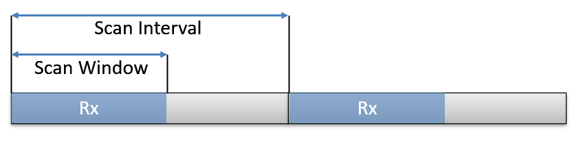

<!-- pg_ble_stack_cn: 6 GAP - 扫描 -->

# 6 GAP - 扫描 {#ch-scan}

## 6.1 概览 {#概览-1}

接收广播的过程称为扫描。

### 6.1.1 间隔与窗口 {#间隔与窗口}

接收机实际进行扫描工作的时机受扫描间隔和窗口两个参数控制，其含义如图 [6.1](https://ingchips.github.io/application-notes/pg_ble_stack_cn/ch-scan.html#fig:ch2-scan-win-interval) 所示。



图 6.1: 扫描间隔与扫描窗口

**注意**：Controller 在执行扫描任务时，遵循最大努力原则，实际真正用于扫描的时机可能并不与两个参数所指定的完全一致。

### 6.1.2 过滤策略 {#过滤策略}

与广播的“[过滤策略](https://ingchips.github.io/application-notes/pg_ble_stack_cn/ch-adv.html#ch1-adv-filter)”类似，扫描也有几种过滤策略：

```c
typedef enum scan_filter_policy
{
    // 接收所有广播（定向到其它设备的除外）
    SCAN_ACCEPT_ALL_EXCEPT_NOT_DIRECTED,
    // 只接收来自白名单内的设备的广播（定向到其它设备的除外）
    SCAN_ACCEPT_WLIST_EXCEPT_NOT_DIRECTED,
    // 接收所有广播（所定向的设备与本设备身份地址不同的除外）
    // SCAN_ACCEPT_ALL_EXCEPT_IDENTITY_NOT_MATCH,
    // 只接收来自白名单内的设备的广播（所定向的设备与本设备身份地址不同的除外）
    // SCAN_ACCEPT_WLIST_EXCEPT_IDENTITY_NOT_MATCH
} scan_filter_policy_t;
```

后两种策略[27](https://ingchips.github.io/application-notes/pg_ble_stack_cn/ch-cap.html#fn27)与前两种策略的区别在于判断是否接受定向广播的方法不同。前两种策略只接受满足以下两者之一的定向广播：

1. TargetA 与本设备的地址一致，
2. TargetA 是可解析地址，且可由本设备的 IRK 解析。

而后两种策略接受满足以下两者之一的定向广播：

1. TargetA 与本设备的地址一致，
2. TargetA 是可解析地址。

可见后两种策略对 TargetA 的要求略微宽松。

### 6.1.3 主动与被动 {#主动与被动}

所谓被动扫描（Passive Scan）指只接收广播数据包，对于可扫描广播也是如此；所谓主动扫描（Active Scan）指除了接收广播数据包之外， 对于可扫描广播会主动发送扫描请求并接收扫描响应包。

### 6.1.4 PHY {#phy-1}

由于扩展广播可在主广播信道使用两种 PHY 发送，相应地，扫描时也需要配置扫描哪种 PHY。

## 6.2 使用说明 {#使用说明-1}

### 6.2.1 配置参数 {#配置参数}

在开始扫描之前，需要先通过 `gap_set_random_device_address` 为设备配置地址，这个地址用于扫描、发起连接等场景。 使用 `gap_set_ext_scan_para` 配置扫描参数：

```c
uint8_t gap_set_ext_scan_para(
  // 本设备地址类型
  const bd_addr_type_t own_addr_type,
  // 过滤策略
  const scan_filter_policy_t filter,
  // PHY 配置个数
  const uint8_t config_num,
  // 关于每种 PHY 的参数配置
  const scan_phy_config_t *configs);
```

这里的 PHY 指的是主广播信道所使用的 PHY，只能为 1M 或 Coded。辅广播信道上所有的 PHY 类型全部支持，不需要配置。 每种 PHY 的参数配置如下：

```c
typedef struct scan_phy_config
{
    // PHY
    phy_type_t phy;
    // 扫描方式：主动或被动
    scan_type_t type;
    // 扫描间隔，单位是 625us
    uint16_t interval;
    // 扫描窗口，单位是 625us
    uint16_t window;
} scan_phy_config_t;
```

当连接、扫描并发时，由于协议栈倾向于优化传输速率，将明显降低扫描任务的调度。需要更多地调度扫描任务时， 可调用 LL API `ll_hint_on_ce_len`[1](https://ingchips.github.io/application-notes/pg_ble_stack_cn/ch-cap.html#fn1) 提示 Controller 减小连接事件的长度。

### 6.2.2 起停扫描 {#起停扫描}

使用 `gap_set_ext_scan_enable` 起停扫描：

```c
uint8_t gap_set_ext_scan_enable(
  // 开始或者停止扫描
  const uint8_t enable,
  // 是否对数据做去重处理：
  // 0 - 不去重；
  // 1 - 去重；
  // 2 - 去重，但是每个周期复位过滤器
  const uint8_t filter,
  // 持续时间，单位为 10ms
  const uint16_t duration,
  // 周期，单位为 1.28s
  const uint16_t period);
```

`duration` 和 `period` 两个参数的目的是实现每个 `period` 里扫描 `duration` 长的时间。另有两种特殊情况，从开发者的角度总结如下：

1. 持续、一直地扫描：`duration` 和 `period` 两个参数皆置为 0
2. 只扫描一段时间：`duration` 置为扫描时长，`period` 置为 0

Controller 在做数据去重时遵循最大努力原则，受限于存储空间、处理能力，去重可能失效。

### 6.2.3 处理数据 {#处理数据}

收到广播包后，HCI 回调函数将收到 `HCI_SUBEVENT_LE_EXTENDED_ADVERTISING_REPORT` 事件。利用 `decode_hci_le_meta_event` 宏可将事件转换为 `le_ext_adv_report_t` 结构体指针：

```c
const le_ext_adv_report_t *report =
  decode_hci_le_meta_event(packet, le_meta_event_ext_adv_report_t)->reports;
```

这个结构体的定义如下：

```c
typedef struct le_ext_adv_report
{
    // 事件类型比特位组合
    uint16_t        evt_type;
    // 广播者地址类型
    bd_addr_type_t  addr_type;
    // 广播者地址
    bd_addr_t       address;
    // 主信道上用的 PHY
    uint8_t         p_phy;
    // 辅信道上用的 PHY
    uint8_t         s_phy;
    // SID
    uint8_t         sid;
    // 发射功率（单位 dBm）
     int8_t         tx_power;
    // RSSI （单位 dBm）
     int8_t         rssi;
    // 周期广播的间隔（仅对周期广播有效）
    uint16_t        prd_adv_interval;
    // 定向广播的目的地址类型
    bd_addr_type_t  direct_addr_type;
    // 定向广播的目的地址
    bd_addr_t       direct_addr;
    // 广播数据长度
    uint8_t         data_len;
    // 广播数据
    uint8_t         data[0];
} le_ext_adv_report_t;
```

### 6.2.4 与周期广播同步 {#与周期广播同步}

发现周期广播后，可以通过 `gap_periodic_adv_create_sync` 与周期广播同步[28](https://ingchips.github.io/application-notes/pg_ble_stack_cn/ch-cap.html#fn28)：

```c
uint8_t gap_periodic_adv_create_sync(
  // 过滤策略：目标地址来自白名单还是参数
  const periodic_adv_filter_policy_t filter_policy,
  // SID
  const uint8_t adv_sid,
  // 目标地址类型
  const bd_addr_type_t addr_type,
  // 目标地址
  const uint8_t *addr,
  // 成功接收一次之后，可跳过的数目
  const uint16_t skip,
  // 同步超时（单位 100ms）
  const uint16_t sync_timeout,
  // 周期广播里的 CTE 类型（如果存在）
  const uint8_t sync_cte_type
);
```

成功建立同步后，HCI 回调会收到 `HCI_SUBEVENT_LE_PERIODIC_ADVERTISING_SYNC_ESTABLISHED` 事件。接收到的周期广播通过 `HCI_SUBEVENT_LE_PERIODIC_ADVERTISING_REPORT` 事件上报，其内容与 `le_ext_adv_report_t` 类似。

对于 5.4，HCI 回调会收到 `HCI_SUBEVENT_LE_PERIODIC_ADVERTISING_SYNC_ESTABLISHED_V2` 事件。 与 `HCI_SUBEVENT_LE_PERIODIC_ADVERTISING_SYNC_ESTABLISHED` 相比，事件内容增加了子事件的相关信息。

周期广播的接收可参考 SDK *Periodic Scanner*。

### 6.2.5 与 PAwR 同步 {#与-pawr-同步}

当 `HCI_SUBEVENT_LE_PERIODIC_ADVERTISING_SYNC_ESTABLISHED_V2` 携带的子事件信息显示存在存在子事件时，可通过 `gap_set_periodic_sync_subevent` 与指定的子事件同步：

```c
uint8_t gap_set_periodic_sync_subevent(
  // 同步
  uint16_t sync_handle,
  // 发送响应时的属性
  // 只能为 0 或者 PERIODIC_ADV_BIT_INC_TX
  uint16_t periodic_adv_properties,
  // 要同步的子事件数
  uint8_t num_subevents,
  // 要同步的每个子事件的序号
  const uint8_t *subevents)
```

与子事件同步后，接收到的每个子事件的数据将通过 `HCI_SUBEVENT_LE_PERIODIC_ADVERTISING_REPORT_V2` 事件上报， 其内容与 `HCI_SUBEVENT_LE_PERIODIC_ADVERTISING_REPORT` 类似，只是增加了关于子事件的信息。

#### 6.2.5.1 设置、发送响应 {#设置发送响应}

通过 `gap_set_periodic_adv_rsp_data` 在指定的子事件、响应时隙发送响应数据：

```c
uint8_t gap_set_periodic_adv_rsp_data(
  // 同步句柄
  uint16_t sync_handle,
  // 所要响应的 PAwR 所在的周期广播事件序号
  uint16_t request_event,
  // 所要响应的 PAwR 所在的子事件序号
  uint8_t request_subevent,
  // 发送响应的子事件序号
  uint8_t rsp_subevent,
  // 发送响应的时隙序号
  uint8_t rsp_slot,
  // 响应的长度
  uint8_t rsp_data_len,
  // 响应数据
  const uint8_t *rsp_data);
```

---

1. <a id="fn27"></a>后两种策略在规范中称为 Extended filter policy。ING916 和 ING918 不支持后两种策略。[↩︎](https://ingchips.github.io/application-notes/pg_ble_stack_cn/ch-scan.html#fnref27)
2. <a id="fn1"></a>[https://www.bluetooth.com/](https://www.bluetooth.com/)[↩︎](https://ingchips.github.io/application-notes/pg_ble_stack_cn/ch-intro.html#fnref1)
3. <a id="fn28"></a>即周期性地接收周期广播。[↩︎](https://ingchips.github.io/application-notes/pg_ble_stack_cn/ch-scan.html#fnref28)