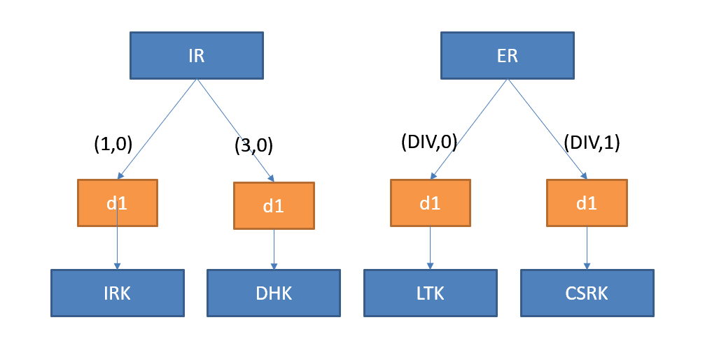

<!-- pg_ble_stack_cn: 11 安全管理 -->

# 11 安全管理 {#ch-sm}

## 11.1 概览 {#概览-5}

安全管理（Security Manager）协议负责配对、认证及加密。 连接的主角色在 SM 里扮演发起者（Initiator），从角色扮演应答者（Responder）。 SM 涉及多个密钥，其层次关系如图 [11.1](https://ingchips.github.io/application-notes/pg_ble_stack_cn/ch-sm.html#fig:ch6-ble-keys)，位于顶层的是 ER 和 IR， 长度都是 128 bits[49](https://ingchips.github.io/application-notes/pg_ble_stack_cn/ch-cap.html#fn49)，d1 是加解密工具箱里的一个工具， DIV 是一个随机数[50](https://ingchips.github.io/application-notes/pg_ble_stack_cn/ch-cap.html#fn50)。



图 11.1: BLE 密钥层次结构

SM 涉及两个重要概念：

- **绑定**：在两个连接的设备之间交换秘密和身份信息以建立相互信赖关系。

  有的设备可能不支持绑定，因此规范定义了两种绑定模式：可绑定、不可绑定。 建立绑定时需要使用**配对**流程交换秘密和身份信息。
- **配对**：是一个用户层面的概念，需要用户输入识别码（passkey）。

  两种情况下会发生配对：1) 为了绑定；2) 用于认证未绑定的设备。

## 11.2 使用说明 {#使用说明-6}

### 11.2.1 初始化 {#初始化}

1. 调用 `sm_add_event_handler` 添加 SM 模块事件回调

   ```c
   void sm_add_event_handler(
     // 回调函数
     btstack_packet_callback_registration_t * callback_handler);
   ```
2. 调用 `sm_config` 配置基础数据 ER、IR

   ```c
   void sm_config(
     // 是否使能 SM（默认为不使能）
     uint8_t enable,
     // 设备的 IO 能力
     io_capability_t io_capability,
     // 从角色时是否自动发送安全请求
     int   request_security,
     // 持久化数据
     const sm_persistent_t *persistent);
   ```

   这里的 IO 能力 `io_capability` 用于协商配对方法，跟设备的实际 IO 能力无关：

   ```c
   typedef enum {
     IO_CAPABILITY_UNINITIALIZED = -1,
     IO_CAPABILITY_DISPLAY_ONLY = 0,   // 只支持显示
     IO_CAPABILITY_DISPLAY_YES_NO,     // 可显示，可输入 YES、NO
     IO_CAPABILITY_KEYBOARD_ONLY,      // 只能输入
     IO_CAPABILITY_NO_INPUT_NO_OUTPUT, // 无输入、输出能力
     IO_CAPABILITY_KEYBOARD_DISPLAY,   // 可显示，能输入
   } io_capability_t;
   ```

   这里的输入能力指可以输入 0-9 等 10 个数字，以及 YES、NO；显示能力是指可以显示 6 位十进制识别码（000000-999999）[51](https://ingchips.github.io/application-notes/pg_ble_stack_cn/ch-cap.html#fn51)。

   持久化数据的定义如下：

   ```c
   typedef struct sm_persistent
   {
     // ER 密钥
     sm_key_t        er;
     // IR 密钥
     sm_key_t        ir;
     // 身份地址
     bd_addr_t       identity_addr;
     // 身份地址类型（BD_ADDR_TYPE_LE_PUBLIC 或 BD_ADDR_TYPE_LE_RANDOM）
     bd_addr_type_t  identity_addr_type;
   } sm_persistent_t;
   ```
3. 通过 `sm_set_authentication_requirements` 设置认证需求

   ```c
   void sm_set_authentication_requirements(
     // SM_AUTHREQ_... 的组合：是否绑定、是否需要 MITM 保护
     uint8_t auth_req);

   // 不可绑定
   #define SM_AUTHREQ_NO_BONDING       ...
   // 可绑定
   #define SM_AUTHREQ_BONDING          ...
   // 使能 MITM 保护
   #define SM_AUTHREQ_MITM_PROTECTION  ...
   // 使能 基于 LE 安全连接的配对
   #define SM_AUTHREQ_SC               ...
   ```

### 11.2.2 使用私有随机地址 {#使用私有随机地址}

如果需要使用私有随机地址，可调用 `sm_private_random_address_generation_set_mode` 启动 SM 模块的私有地址生成功能：

```c
void sm_private_random_address_generation_set_mode(
  // 私有地址的生成方式
  gap_random_address_type_t random_address_type);
```

私有地址的生成方式有三种：

```c
typedef enum {
  GAP_RANDOM_ADDRESS_OFF = 0,         // 不生成（默认值）
  GAP_RANDOM_ADDRESS_NON_RESOLVABLE,  // 生成不可解析私有地址
  GAP_RANDOM_ADDRESS_RESOLVABLE,      // 生成可解析私有地址
} gap_random_address_type_t;
```

启动后 SM 模块将尽快产生一个新的地址并弹出 `SM_EVENT_PRIVATE_RANDOM_ADDR_UPDATE` 事件， 之后周期性地重新产生并弹出事件。周期默认为 15 分钟，可通过 `sm_private_random_address_generation_set_update_period` 修改[52](https://ingchips.github.io/application-notes/pg_ble_stack_cn/ch-cap.html#fn52)：

```c
void sm_private_random_address_generation_set_update_period(
  int period_ms);
```

### 11.2.3 SM 事件回调 {#sm-事件回调}

SM 模块的事件回调函数将收到一系列事件，App 的主要工作就在于响应这些事件。

- `SM_EVENT_PRIVATE_RANDOM_ADDR_UPDATE`

  SM 生成了一个新的私有随机地址。App 此时可以更新广播地址[53](https://ingchips.github.io/application-notes/pg_ble_stack_cn/ch-cap.html#fn53)，比如：

  ```c
  // 更新广播集 0 的随机地址
  gap_set_adv_set_random_addr(0,
    sm_private_random_addr_update_get_address(packet));
  ```

与地址解析、查找有关的 3 个事件：

- `SM_EVENT_IDENTITY_RESOLVING_STARTED`：开始解析某个地址

  使用以下 API 可读取正在解析的地址等信息：

  - `sm_event_identity_resolving_started_get_handle(packet)`：连接句柄
  - `sm_event_identity_resolving_started_get_addr_type(packet)`：正在解析的地址类型
  - `sm_event_identity_resolving_started_get_address(packet, addr)`：正在解析的地址
- `SM_EVENT_IDENTITY_RESOLVING_FAILED`：解析失败

  使用以下 API 可读取解析失败的地址等信息：

  - `sm_event_identity_resolving_failed_get_handle(packet)`：连接句柄
  - `sm_event_identity_resolving_failed_get_addr_type(packet)`：正在解析的地址类型
  - `sm_event_identity_resolving_failed_get_address(packet, addr)`：正在解析的地址
- `SM_EVENT_IDENTITY_RESOLVING_SUCCEEDED`：解析成功

  使用以下 API 可读取解析成功的地址等信息：

  - `sm_event_identity_resolving_succeeded_get_handle(packet)`：连接句柄
  - `sm_event_identity_resolving_succeeded_get_addr_type(packet)`：正在解析的地址类型
  - `sm_event_identity_resolving_succeeded_get_address(packet, addr)`：正在解析的地址
  - `sm_event_identity_resolving_succeeded_get_le_device_db_index(packet)`：在“[设备数据库](https://ingchips.github.io/application-notes/pg_ble_stack_cn/ch-misc.html#ch98-le-dev-db)”里的序号

  例如，通过下面的代码获取解析出的身份地址：

  ```c
  uint16_t index =
      sm_event_identity_resolving_succeeded_get_le_device_db_index(packet);
  const le_device_memory_db_t *item =
      le_device_db_from_key(index);
  printf("RESOLVING_SUCCEEDED: (%d) ", index);
  if (item)
      printf_hexdump(item->addr, BD_ADDR_LEN);
  else
      printf("ERROR: should not happen");
  printf("\n");
  ```

与配对有关的事件：

- `SM_EVENT_JUST_WORKS_REQUEST`：JUST_WORKS 请求，等待用户接收或拒绝

  调用 `sm_just_works_confirm` 接受，`sm_bonding_decline` 拒绝。
- `SM_EVENT_PASSKEY_DISPLAY_NUMBER`：显示识别码

  App 收到此事件后显示识别码，并提示用户在对端输入此识别码。
- `SM_EVENT_PASSKEY_DISPLAY_CANCEL`：不要再显示识别码

  App 收到此事件后应该刷新显示，不再呈现识别码。
- `SM_EVENT_PASSKEY_INPUT_NUMBER`：提示用户输入识别码

  App 收到此事件后提示用户输入识别码，然后调用 `sm_passkey_input` 把用户的输入传递到协议栈。 调用 `sm_bonding_decline` 可中止配对。
- `SM_EVENT_NUMERIC_COMPARISON_REQUEST`：提示用户对比数字识别码

  仅在基于 LE 安全连接的配对时出现。调用 `sm_numeric_comparison_confirm` 确认数字无误， `sm_bonding_decline` 否认。

  请注意区分两类涉及数字识别码的配对事件，并了解 Bluetooth SIG 的安全说明[54](https://ingchips.github.io/application-notes/pg_ble_stack_cn/ch-cap.html#fn54)：

  - 对于基于 LE 安全连接的配对，配对双方同时显示数字（SM_EVENT_NUMERIC_COMPARISON_REQUEST）， 用户在两个设备上分别确认显示的数字是否一致；
  - 对于不使用 LE 安全连接的配对（即 LE 传统方式），会在具备显示能力一方显示识别码（SM_EVENT_PASSKEY_DISPLAY_NUMBER）， 另一方具备输入能力的设备会提示用户输入（SM_EVENT_PASSKEY_INPUT_NUMBER）这个数字完成配对。

SM 状态改变事件：

- `SM_EVENT_STATE_CHANGED`

  这个事件指示 SM 总状态的变化。使用 `decode_hci_event` 将其解析为 `sm_event_state_changed_t`：

  ```c
  typedef struct sm_event_state_changed {
    // 连接句柄
    uint16_t conn_handle;
    // 状态变化的原因
    uint8_t reason;
  } sm_event_state_changed_t;

  const sm_event_state_changed_t *state_changed =
    decode_hci_event(packet, sm_event_state_changed_t);
  ```

  这里的 `reason` 即 SM 的几种**主要**状态：

  ```c
  enum sm_state_t
  {
    SM_STARTED,                 // SM 启动
    SM_FINAL_PAIRED,            // 已配对
    SM_FINAL_REESTABLISHED,     // 已重新建立
    SM_FINAL_FAIL_PROTOCOL,     // 协议流程错误
    SM_FINAL_FAIL_TIMEOUT,      // 超时
    SM_FINAL_FAIL_DISCONNECT,   // 连接断开
  };
  ```

### 11.2.4 每个连接的个性化设置 {#每个连接的个性化设置}

SM API 支持为每个连接进行个性化的设置：

```c
void sm_config_conn(
  // 连接句柄
  hci_con_handle_t con_handle,
  // IO 能力
  io_capability_t io_capability,
  // SM_AUTHREQ_... 的组合：是否绑定、是否需要 MITM 保护等
  uint8_t auth_req);
```

注意，这个 API 只允许在 HCI 事件 `HCI_SUBEVENT_LE_ENHANCED_CONNECTION_COMPLETE` 的回调里调用。即使 SM 为禁用状态， 也可以使用这个 API 为单个连接使能 SM。

### 11.2.5 地址解析、查找 {#地址解析查找}

通过 `sm_address_resolution_lookup` 可以“手动”触发蓝牙设备地址的解析、查找：

```c
int sm_address_resolution_lookup(
  uint8_t addr_type,  // 地址类型
  bd_addr_t addr);    // 地址
```

这里的“查找”指是的在“[设备数据库](https://ingchips.github.io/application-notes/pg_ble_stack_cn/ch-misc.html#ch98-le-dev-db)”中查找。如果传入的地址可解析私有地址， 那么将尝试解析该地址。

这个函数将待查地址加入一个处理队列，如果成功加入，返回值为 0；反之返回非 0 值。 解析、查找的结果通过 SM_EVENT_IDENTITY_RESOLVING_FAILED、 SM_EVENT_IDENTITY_RESOLVING_SUCCEEDED 等事件上报。

### 11.2.6 P-256 椭圆曲线 {#p-256-椭圆曲线}

要在 ING916、ING918 上使用基于 LE 安全连接的配对，需要先为 Controller 安装 FIPS 186-4[55](https://ingchips.github.io/application-notes/pg_ble_stack_cn/ch-cap.html#fn55) P-256 椭圆曲线计算引擎：

```c
void ll_install_ecc_engine(
  // 用于生成一对新的公钥和私钥的回调函数
  f_start_generate_p256_key_pair start_generate_p256_key_pair,
  // 用于计算 DH 交换密钥的回调
  f_start_generate_dhkey start_generate_dhkey);
```

回调函数的实现方法可参考 SDK 里的相关示例。

当不使用 OOB 时，SM 层自动管理公钥、私钥的生成：对于每个基于 LE 安全连接的配对流程都会重新生成私钥。 当使用 OOB 时，考虑到可能存在与多个设备配对的情况，私钥的更新由开发者控制： 每次调用 `sm_sc_generate_oob_data` 时，重新生成私钥和 OOB 数据，该私钥（及对应的公钥） 将应用于后续所有的基于 LE 安全连接的配对流程。此时，为了保护设备的私钥，开发者需要及时重新调用 `sm_sc_generate_oob_data` 刷新私钥和 OOB 数据。参照蓝牙核心规范[56](https://ingchips.github.io/application-notes/pg_ble_stack_cn/ch-cap.html#fn56)， 最迟应该在 S + 3 F > 8 时刷新私钥，其中 S 表示当前私钥参与的配对成功的次数，F 表示当前私钥参与的配对失败的次数。

### 11.2.7 基于 OOB 数据的配对 {#基于-oob-数据的配对}

- 对于 LE 传统 OOB 配对：

  通过 `sm_register_oob_data_callback` 注册回调函数来为 SM 提供 OOB 数据：

  ```c
  void sm_register_oob_data_callback(
    int (*get_oob_data_callback)(
      uint8_t address_type,
      bd_addr_t addr,
      uint8_t * oob_data));
  ```

  这个回调函数的签名为：

  ```c
  // 存在与该对端设备关联的 OOB 数据时返回 1；否则返回 0.
  int (*get_oob_data_callback)(
      // 对端设备的地址类型
      uint8_t address_type,
      // 对端设备的地址
      bd_addr_t addr,
      // 输出：OOB 数据（长度与 sm_key_t 相同）
      uint8_t * oob_data)
  ```

  此 OOB 数据为随机生成。
- 基于 LE 安全连接的 OOB 配对

通过 `sm_register_sc_oob_data_callback` 注册回调函数来为 SM 提供 OOB 数据：

```c
void sm_register_sc_oob_data_callback(
  int (*get_sc_oob_data_callback)(
    uint8_t address_type,
    bd_addr_t addr,
    uint8_t *peer_confirm,
    uint8_t *peer_random));
```

这个回调函数的签名为：

```c
// 存在与该对端设备关联的 OOB 数据时返回 1；否则返回 0.
int (*get_sc_oob_data_callback)(
    // 对端设备的地址类型
    uint8_t address_type,
    // 对端设备的地址
    bd_addr_t addr,
    // 输出：OOB 数据 confirm（长度与 sm_key_t 相同）
    uint8_t *peer_confirm,
    // 输出：OOB 数据 random （长度与 sm_key_t 相同）
    uint8_t *peer_random)
```

confirm 是从 random 和公钥等数据中推算得出，通过调用 `sm_sc_generate_oob_data` 可触发生成一组新的 random、confirm 数据：

```c
int sm_sc_generate_oob_data(
  void (*callback)(
    const uint8_t *confirm,
    const uint8_t *random));
```

新的 random、confirm 数据生成后，会调用这个回调告知结果。通过带外传输将这组数据传递到对端， 对端在 `get_sc_oob_data_callback` 里将这组数据再传递到 SM 完成 OOB 配对。

`sm_sc_generate_oob_data` 函数会返回以下几种值：

- 0: 开始计算新的 OOB 数据
- -1: 上一组 OOB 数据还在计算中

---

1. <a id="fn49"></a>生成时需要保证具有足够高的熵。[↩︎](https://ingchips.github.io/application-notes/pg_ble_stack_cn/ch-sm.html#fnref49)
2. <a id="fn50"></a>IRK、DHK、LTK、CSRK 等的具体含义及作用请参考蓝牙核心规范。[↩︎](https://ingchips.github.io/application-notes/pg_ble_stack_cn/ch-sm.html#fnref50)
3. <a id="fn51"></a>以及给予用户必要的提示的能力。[↩︎](https://ingchips.github.io/application-notes/pg_ble_stack_cn/ch-sm.html#fnref51)
4. <a id="fn52"></a>没必要过于频繁地更新地址。尤其是对于可解析地址，每更新一次，就意味着泄露了一点关于 IRK 的消息。[↩︎](https://ingchips.github.io/application-notes/pg_ble_stack_cn/ch-sm.html#fnref52)
5. <a id="fn53"></a>注意：当该广播是可连接的并且正在广播时，不允许修改地址。[↩︎](https://ingchips.github.io/application-notes/pg_ble_stack_cn/ch-sm.html#fnref53)
6. <a id="fn54"></a>[https://www.bluetooth.com/learn-about-bluetooth/key-attributes/bluetooth-security/method-vulnerability/](https://www.bluetooth.com/learn-about-bluetooth/key-attributes/bluetooth-security/method-vulnerability/)[↩︎](https://ingchips.github.io/application-notes/pg_ble_stack_cn/ch-sm.html#fnref54)
7. <a id="fn55"></a>dx.doi.org/10.6028/NIST.FIPS.186-4[↩︎](https://ingchips.github.io/application-notes/pg_ble_stack_cn/ch-sm.html#fnref55)
8. <a id="fn56"></a>BLUETOOTH CORE SPECIFICATION Version 5.4 | Vol 3, Part H, 2.3.6[↩︎](https://ingchips.github.io/application-notes/pg_ble_stack_cn/ch-sm.html#fnref56)