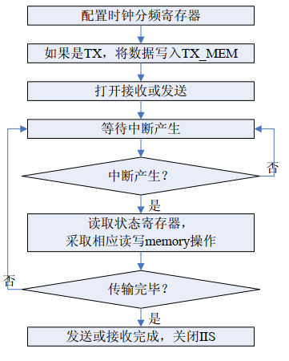

<!-- pg_ing20: 8 I2S简介 -->

# 8 I2S简介 {#ch-I2S}

I2S（inter-IC sound）总线是数字音频专用总线。它有四个引脚，两个数据引脚(DOUT和DIN)，一个位率时钟引脚(BCLK)和一个左右通道选择引脚(LRCLK)。

另外，通过ING20的MCLK输出，它可用于给外部 DAC/ADC 芯片提供时钟（可选）。

## 8.1 功能描述 {#功能描述-3}

### 8.1.1 特点 {#特点-3}

- 遵从 I2S 协议标准，支持12S标准模式和左对齐模式
- 支持PCM(脉冲编码调制)时序
- 可编程的主从模式
- 可配置的LRCLK和BCLK极性
- 可配置数据位宽
- 独立发送和接收FIFO
- TX和RX的FIFO深度分别为8*32bit
- 支持立体声和单声道模式
- 可配置的采样频率
- TX和RX分别支持DMA搬运

### 8.1.2 I2S角色 {#i2s角色}

在 I2S 总线上，提供时钟和通道选择信号的器件是 MASTER，另一方则为 SLAVER。

MASTER和SLAVE都可以进行数据收发。

### 8.1.3 I2S工作模式 {#i2s工作模式}

I2S 有两种工作模式：一种是立体声音频模式，另外一种是话音模式。

### 8.1.4 串行数据 {#串行数据}

串行数据是以高位（MSB）在前，低位（LSB）在后的方式进行传送的。

如果音频codec发送的位数多于I2S控制器的接收位数，I2S控制器会将低位多余的位数忽略掉；

如果音频codec发送的位数小于I2S控制器接收位数，I2S控制器将后面的位补零。

### 8.1.5 时钟分频 {#时钟分频}

20芯片可选用系统24MHz时钟或者PLL作为I2S时钟源。

位率时钟（BCLK）可以通过对功能时钟进行分频得到；

通道选择时钟（LRCLK）即音频数据的采样频率可以通过对BCLK进行分频得到。

音频 Codec 中对采样频率 LRCLK 要求精度比较高，我们在计算分频时应该首先根据不同的采样频率计算得到对应的 MCLK 和 BCLK。

#### 8.1.5.1 时钟分频计算 {#时钟分频计算}

计算示例：

假设当前codec采用16K采样频率，mic要求一帧64位（参考具体的mic使用手册）。

有以下关系：

- f_bclk = clk/(2*b_div)
- f_lrclk = f_bclk/(2*lr_div)

其中clk为codec时钟，f_bclk、f_lrclk分别为BCLK和LRCLK，b_div、lr_div分别为BCLK和LRCLK的分频系数。

BCLK和LRCLK之间的关系是可变的，但是BCLK必须大于等于LRCLK的48倍。即lr_div>=24。

支持lr_div = 32，DATA_LEN = 32位的配置，其他情况下lr_div - DATA_LEN > 3。

通过f_lrclk = 16000，lr_div = 32计算出f_bclk = 1.024MHz。也就是clk = 2.048*b_div。

clk通过时钟源分频得到必定是整数，b_div也同样是整数，通过计算得知在384MHz内只有当b_div = 125时clk = 256MHz为整数。

故需要将PLL时钟配置为256MHz，b_div = 125可以得到16K采样率。

### 8.1.6 I2S存储器 {#i2s存储器}

采用两个深度为8，宽度为32bit的FIFO分别存储接收、发送的音频数据。

有如下规则：

- 音频数据位宽为16bit时，每32bit存储两个音频数据，高16bit存储左声道数据，低16bit存储右声道数据。
- 音频数据位宽大于16bit时，每32bit存储一个音频数据，低地址存储左声道数据，高地址存储右声道数据。

## 8.2 使用方法 {#使用方法-3}

### 8.2.1 方法概述 {#方法概述-1}

I2S使用方法总结为：时钟配置，I2S配置（包括采样率）和数据处理。

数据发送：

**1.** I2S引脚GPIO配置

**2.** 配置外部 codec 芯片，使其处于工作模式

**3.** 写相应配置寄存器

**4.** 将数据写入TX_MEM

**5.** 使能I2S

**6.** 等待中断产生

**7.** 读取状态寄存器，将数据写入TX_MEM

**8.** 传输完毕，关闭 I2S

数据接收：

**1.** I2S引脚GPIO配置

**2.** 配置外部 codec 芯片，使其处于工作模式

**3.** 写相应配置寄存器

**4.** 使能I2S

**5.** 等待中断产生

**6.** 读取状态寄存器，读取 RX_MEM 中数据

**7.** 传输完毕，关闭 I2S

I2S控制器操作流程图如下：



图 8.1: I2S控制器操作流程图

如果需要用到DMA搬运则需要在使能I2S之前配置DMA并使能。

### 8.2.2 注意点 {#注意点-1}

- I2S时钟源可以选择晶振24M时钟和PLL时钟，要注意是选择哪一个时钟源
- I2S数据可能会进行采样，需要注意具体的数据结构以及对应的数据处理，如是否需要数据移位等
- 当前I2S支持的发送/接收数据位宽为16-32bit，需要查阅mic文档或其他使用手册来确定数据位宽，否则不能正常工作
- 配置DMA要在使能I2S之前完成，使能I2S一定是最后一步
- 建议采用DMA乒乓搬运的方式来传输I2S数据

## 8.3 编程指南 {#编程指南-4}

### 8.3.1 驱动接口 {#驱动接口-3}

- I2S_ConfigClk：I2S时钟配置接口
- I2S_Config：I2S配置接口
- I2S_ConfigIRQ：I2S中断配置接口
- I2S_DMAEnable：I2S DMA使能接口
- I2S_Enable：I2S使能接口
- I2S_PopRxFIFO、I2S_PushTxFIFO：I2S FIFO读写接口
- I2S_ClearRxFIFO、I2S_ClearTxFIFO：I2S清FIFO接口
- I2S_GetIntState、I2S_ClearIntState：I2S获取中断、清中断接口
- I2S_GetRxFIFOCount、I2S_GetTxFIFOCount：I2S获取FIFO数据数量接口
- I2S_DataFromPDM：I2S获取PDM数据接口

### 8.3.2 代码示例 {#代码示例-3}

下面将通过实际代码展示I2S的基本配置及使用代码。

#### 8.3.2.1 I2S配置 {#i2s配置}

```c
#define I2S_PIN_BCLK        21
#define I2S_PIN_IN          22
#define I2S_PIN_LRCLK       35
void I2sSetup(void)
{
    // pinctrl & GPIO mux
    PINCTRL_SetPadMux(I2S_PIN_BCLK, IO_SOURCE_I2S_BCLK_OUT);
    PINCTRL_SetPadMux(I2S_PIN_IN, IO_SOURCE_I2S_DATA_IN);
    PINCTRL_SelI2sIn(IO_NOT_A_PIN, IO_NOT_A_PIN, I2S_PIN_IN);
    PINCTRL_SetPadMux(I2S_PIN_LRCLK, IO_SOURCE_I2S_LRCLK_OUT);
    PINCTRL_Pull(I2S_PIN_IN, PINCTRL_PULL_DOWN);

    // CLK & Register
    SYSCTRL_ConfigPLLClk(6, 128, 2); // sorce clk PLL = 256MHz
    SYSCTRL_SelectI2sClk(SYSCTRL_CLK_PLL_DIV_1 + 4); // I2s_Clk = 51.2MHz
    I2S_ConfigClk(APB_I2S, 25, 32); // F_bclk = 1.024MHz, F_lrclk = 16K
    I2S_ConfigIRQ(APB_I2S, 0, 1, 0, 10);
    I2S_DMAEnable(APB_I2S, 0, 0);    
    I2S_Config(APB_I2S, I2S_ROLE_MASTER, I2S_MODE_STANDARD, 0, 0, 0, 1, 24);

    // I2s interrupt
    platform_set_irq_callback(PLATFORM_CB_IRQ_I2S, cb_isr, 0);
}
```

#### 8.3.2.2 I2S使能 {#i2s使能}

I2S使能分3种情况：I2S发送、I2S接收、使用DMA搬运

接收：

```c
void I2sStart(void)
{
    I2S_ClearRxFIFO(APB_I2S);
    I2S_Enable(APB_I2S, 0, 1);
}
```

发送：

```c
uint8_t  sendSize = 10;
uint32_t sendData[10];
void I2sStart(void)
{
    int i; 
    I2S_ClearTxFIFO(APB_I2S);
    // push data into TX_FIFO first
    for (i = 0; i < sendSize; i++) {
        I2S_PushTxFIFO(APB_I2S, sendData[i]);
    }
    I2S_Enable(APB_I2S, 0, 1);
}
```

使用DMA（接收）：

```c
#define CHANNEL_ID  0
DMA_Descriptor test __attribute__((aligned (8)));                                
void I2sStart(uint32_t data)
{
   DMA_EnableChannel(CHANNEL_ID, &test);
   I2S_ClearRxFIFO(APB_I2S);
   I2S_DMAEnable(APB_I2S, 1, 1);    
   I2S_Enable(APB_I2S, 0, 1);
}
```

无论哪种情况都必须最后一步使能I2S，否则I2S工作异常。

#### 8.3.2.3 I2S中断 {#i2s中断}

接收：

```c
uint32_t cb_isr(void *user_data)
{ 
    uint32_t state = I2S_GetIntState(APB_I2S);
    I2S_ClearIntState(APB_I2S, state);

    int i = I2S_GetRxFIFOCount(APB_I2S);

    while (i) {
        uint32_t data = I2S_PopRxFIFO(APB_I2S);
        i--;
        // do something with data
    }

    return 0;
}
```

发送：

```c
uint8_t  sendSize = 10;
uint32_t sendData[10];
uint32_t cb_isr(void *user_data)
{ 
    uint32_t state = I2S_GetIntState(APB_I2S);
    I2S_ClearIntState(APB_I2S, state);

    int i;
    for (i = 0; i < sendSize; i++) {
        I2S_PushTxFIFO(APB_I2S, sendData[i]);
    }
    return 0;
}
```

#### 8.3.2.4 I2S & DMA乒乓搬运 {#i2s-dma乒乓搬运}

下面以经典的DMA乒乓搬运I2S接收数据为例展示I2S实际使用方法。

这里我们采用16K采样率，单个数据帧固定64位，和DMA协商握手、burstSize=8、一次搬运80个数据。

```c
#include "pingpong.h"
#define I2S_PIN_BCLK        21
#define I2S_PIN_IN          22
#define I2S_PIN_LRCLK       35
#define CHANNEL_ID  0
DMA_PingPong_t PingPong;

static uint32_t DMA_cb_isr(void *user_data)
{
    uint32_t state = DMA_GetChannelIntState(CHANNEL_ID);
    DMA_ClearChannelIntState(CHANNEL_ID, state);

    uint32_t *rr = DMA_PingPongIntProc(&PingPong, CHANNEL_ID);
    uint32_t i = 0;
    uint32_t transSize = DMA_PingPongGetTransSize(&PingPong);
    while (i < transSize) {
        // do something with data 'rr[i]'
        i++;
    }

    return 0;
}
void I2sSetup(void)
{
    // pinctrl & GPIO mux
    PINCTRL_SetPadMux(I2S_PIN_BCLK, IO_SOURCE_I2S_BCLK_OUT);
    PINCTRL_SetPadMux(I2S_PIN_IN, IO_SOURCE_I2S_DATA_IN);
    PINCTRL_SelI2sIn(IO_NOT_A_PIN, IO_NOT_A_PIN, I2S_PIN_IN);
    PINCTRL_SetPadMux(I2S_PIN_LRCLK, IO_SOURCE_I2S_LRCLK_OUT);
    PINCTRL_Pull(I2S_PIN_IN, PINCTRL_PULL_DOWN);

    // CLK & Register
    SYSCTRL_ConfigPLLClk(6, 128, 2); // sorce clk PLL = 256MHz
    SYSCTRL_SelectI2sClk(SYSCTRL_CLK_PLL_DIV_1 + 4); // I2s_Clk = 51.2MHz
    I2S_ConfigClk(APB_I2S, 25, 32); // F_bclk = 1.024MHz, F_lrclk = 16K
    I2S_ConfigIRQ(APB_I2S, 0, 1, 0, 8);
    I2S_DMAEnable(APB_I2S, 0, 0);    
    I2S_Config(APB_I2S, I2S_ROLE_MASTER, I2S_MODE_STANDARD, 0, 0, 0, 1, 24);

    // setup DMA
    DMA_PingPongSetup(&PingPong, SYSCTRL_DMA_I2S_RX, 100, 8);
    platform_set_irq_callback(PLATFORM_CB_IRQ_DMA, DMA_cb_isr, 0);

    // start working
    DMA_PingPongEnable(&PingPong, CHANNEL_ID);
    I2S_ClearRxFIFO(APB_I2S);
    I2S_DMAEnable(APB_I2S, 1, 1);    
    I2S_Enable(APB_I2S, 0, 1);
}
```

DMA（乒乓搬运）的具体用法请参见本手册DMA一节。

更加系统化的I2S代码请参考SDK中voice_remote_ctrl例程。