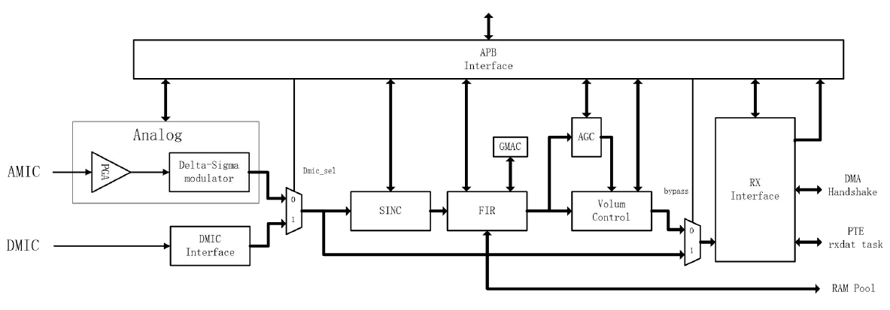

<!-- pg_ing20: 4 ASDM简介 -->

# 4 ASDM简介 {#ch-asdm}

ASDM全称，Sigma-Delta-Analog-to-Digital Converter，即Sigma-Delta模拟数字转换器。

集成一个Sigma-Delta ADC模块，通过PIN测量电压，并将采集到的电压模拟信号转换成数字信号。相较于普通ADC模块，转换精度更高，抗干扰能力更强，功耗更低。

专为数字音频采样设计，内置数字处理单元，包含AGC和HPF等数字信号处理功能，支持硬件滤波，集成音量控制，音量淡入淡出。支持DMIC输出PDM信号采样处理。

## 4.1 功能描述 {#功能描述-1}

### 4.1.1 特点 {#特点-1}

- 单端输入或全差分输入
- 支持1MIC通道，模拟电压- 20dB ~ 40dB，增益0 / 16 / 12 / 20dB
- 16位分辨率
- 电压输入范围（0~VBAT）
- 支持APB总线
- 采样频率可编程
- 可产生2.2 V到2.7 V的麦克风偏置电压， 最高输出电流2MA， 电流过载保护
- DMIC支持PDM信号采样处理，支持128和64bit两种采样类型
- 支持带淡入和淡出的独立音量控制
- 可编程时钟，支持六种典型采样频率：8/12/16/24/32/48kHz
- 支持DC阻塞的高通滤波器

### 4.1.2 性能 {#性能}

- 温度：- 40 ~ 125℃
- 电源电压( Analog )：从2.7 V到3.6 V
- SNR: > 92dB （需要使用内部偏置电压，内置参考电压需单独外接滤波电容）
- THD: <-84dB
- 最高输出电流: <2mA

### 4.1.3 引脚定义 {#引脚定义}

ASDM模块包含一对差分输入引脚ASDM_P和ASDM_N，以及一个偏置电压输出引脚MicBias，一个内置参考电压输出ASDM_Vref.

其中MicBias引脚用于输出麦克风偏置电压，用于驱动麦克风，偏置电压可以根据需求进行调整，ASDM_Vref引脚用于输出内置参考电压，如果需要获得更好的采样效果，内置参考电压需要从引脚输出并单独外接滤波电容，ASDM_P和ASDM_N引脚用于输入麦克风信号。

引脚的映射关系如表 [4.1](https://ingchips.github.io/drafts/pg_ing20/ch-asdm.html#tab:ch-asdm-connection)所示。

**注意：如果不考虑增加电容对内置参考电压滤波，请不要打开内置参考电压输出，否则会影响系统采样，电路错误甚至会损坏芯片**

*表 4.1: ASDM引脚定义*
| 引脚名称 | 连接引脚 | 连接引脚 |
| --- | --- | --- |
| ASDM_Vref | 11 | 参考电压输出 |
| MicBias | 12 | 麦克风偏置电压输出 |
| ASDM_P | 13 | 差分输入P(单端输入) |
| ASDM_N | 14 | 差分输入N |
| DMIC_CLK | 查看PINCTRL章节 | DMIC时钟输入 |
| DMIC_DATA | 查看PINCTRL章节 | DMIC数据输入 |

### 4.1.4 采样率 {#采样率-1}

模块的采样率和模块使用的输入时钟频率和内部时钟分频相关，支持的音频采样频率如表 [4.1](https://ingchips.github.io/drafts/pg_ing20/ch-asdm.html#tab:ch-asdm-connection)所示

*表 4.1: ASDM支持的采样率*
| 采样率(kHz) | 外设输入时钟频率(MHz) | 模拟AMIC时钟采样频率/数字DMIC时钟采样频率（128*fs） | 数字DMIC时钟采样频率（64*fs） |
| --- | --- | --- | --- |
| 48 | 12.288 | 6.144 | 3.072 |
| 32 | 12.288 | 3.072 | 1.536 |
| 24 | 12.288 | 2.448 | 1.224 |
| 16 | 12.288 | 1.536 | 0.768 |
| 8 | 12.288 | 0.768 | 0.384 |

外设的输入时钟频率由fast_clk分频而来，因此实现标准的声音采样需要调整对应的PLL输出和ASDM的DIV实现，推荐使用cube工具生成对应的时钟分频参数，手动配置可能无法生成合理的时钟频率。

**注意： ASDM的时钟配置下可能无法使用标准的USB采样时钟，USB时钟会出现偏差**

### 4.1.5 模块功能简述 {#模块功能简述}



上图为ASDM的整体功能框图，包含数字和模拟两个信号输入，后端集成数字信号处理。

- 模拟采样部分由PGA模块和Sigma-Delta ADC模块组成，PGA模块用于放大输入信号，Sigma-Delta ADC模块用于将模拟信号转换为数字信号。采样更加精确，采样结果可选经过硬件数字滤波输出或直接输出采样结果。
- DMIC输入接口可以采样DMIC输入的PDM信号，可以直接输出获取DMIC的数字输出或经硬件数字处理后输出滤波后的音频结果。
- 内置SINC 和 HPF硬件数字滤波器，可以对输入数字信号进行滤波。
- AGC（自动增益控制）位于信号处理链的中间环节，可选是否开启，解决输入音频信号电平不均衡的问题。AGC通过自动动态地调整增益，使输出电平保持稳定，从而维持后续处理模块输入信号。
- 音量控制模块VolCtrl位于信号处理链的末端，用于调节输出信号的音量，通过调节增益值来控制输出信号的音量大小，可实现音量的淡入淡出控制。
- 输出的结果可以直接通过FIFO输出，同时支持DMA数据搬运和PTE任务触发。

## 4.2 使用方法 {#使用方法-1}

### 4.2.1 时钟配置 {#时钟配置-1}

当前ASDM的时钟源来自于FAST_CLK，通过PLL进行分频后输出到ASDM_CLK，推荐使用CUBE工具生成分频系数，这里提供一组可选的CLK配置参数，PLL时钟源来自于RF24M时钟，PRE分频设置为5，LOOP倍频设置为64，OUT分频设置为1，ASDM分频设置为25，可获得12.288M的输出时钟。PLL输出为307.2M。由于需要调整PLL时钟源，开发者需要注意对应的时钟规划，防止外设出现时钟冲突的问题。

例如：

```c
    SYSCTRL_SelectSlowClk(SYSCTRL_SLOW_CLK_24M_RF);
    SYSCTRL_SelectHClk(SYSCTRL_CLK_SLOW);
    SYSCTRL_SelectFlashClk(SYSCTRL_CLK_SLOW);
    SYSCTRL_ConfigPLLClk(5,64,1);
    SYSCTRL_EnablePLL(1);
    SYSCTRL_SelectHClk(SYSCTRL_CLK_PLL_DIV_1);
    SYSCTRL_SelectFlashClk(SYSCTRL_CLK_PLL_DIV_2);
    SYSCTRL_UpdateAsdmClk(25);
```

### 4.2.2 设置电压偏置和Vref输出滤波 {#设置电压偏置和vref输出滤波}

ASDM模块可以输出单独的偏置电压用来驱动MIC输出，对应接口存在于`peripheral_sysctrl.c`,接口如下：

```c
void SYSCTRL_SetAdcVrefSel(uint8_t vref);
```

为了获得更好的收音效果，通常推荐打开内部VREF输出，外接单独的硬件滤波。**不外接硬件滤波一定不要使能参考电压输出，否则可能导致底噪变大**。打开VREF输出的接口如下：

```c
void SYSCTRL_EnableAsdmVrefOutput(uint8_t enable);
```

使用ASDM模块，需要使用内置的参考电压对外部信号进行采样，因此**一定要打开内部电压参考**否则可能会工作不正常。接口如下：

```c
void SYSCTRL_EnableInternalVref(uint8_t enable);
```

**注意：使能引脚偏置电压输出或参考电压输出，一定要将引脚设置为模拟输入输出模式，详细实现参考PINCTRL**

### 4.2.3 初始化配置 {#初始化配置}

对于AMIC和DMIC的数据采样应用，由于ASDM内部集成了数字信号处理逻辑，可以极大的简化数字信号处理.

通过配置对应的AGC、HPF、SINC、VOL等参数，可以快速实现数字信号处理。对比使用CPU进行数字信号滤波，降低了处理难度，加快了处理速度.

对于想要快速使用ING20系列芯片进行语音采集应用测试和加快开发速度，调整AGC参数整定选择高通滤波器参数，电压偏置调整较为复杂，不方便初学者入手.

因此在综合考虑芯片的易用性和灵活性下，初始化接口根据VOICE和MUSIC场景封装了典型的滤波参数和AGC增益参数，用户可以使用初始化接口快速初始化外设，或根据自身需求调用指定接口整定对应滤波器和其他数字信号处理单元参数。

ASDM 初始化接口配置如下：

```c
int ASDM_Config(ASDM_TypeDef *base, ASDM_ConfigTypeDef* pParam);
```

用户需要传入ASDM模块宏APB_ASDM，和需要用户配置的结构体参数内容pParam。

结构体如下：

```c
typedef struct
{
    uint32_t volume;
    uint8_t Asdm_Mode;
    ASDM_SampleRate Sample_rate;
    ASDM_AgcMode Agc_mode;
    ASDM_AgcConfigTypeDef *Agc_config;
    uint8_t Fifo_Enable;
    uint8_t Fifo_DmaTrigNum;
    uint8_t FifoIntMask;
} ASDM_ConfigTypeDef;
```

涉及参数：

volume：控制系统音量 **注意：volume设置为0时，系统会静音输出数值为0**

Asdm_Mode： 选择ASDM模块输入模式，0 选择AMIC， 1选择DMIC。

Sample_rate： 可选对应采样率。

Agc_mode： 封装了常用的AGC模式配置，可以通过模式选择载入不同的AGC默认参数配置或关闭AGC。

Agc_config： 用户选择`ASDM_AgcOff`时AGC参数无效。 当用户选择`ASDM_AgcVoice`或`ASDM_AgcMusic`模式时，用户可以通过该结构体获取默认的AGC参数信息（传入NULL指针无效），当用户选择`ASDM_AgcCustom`模式时，用户可以通过该结构体传入自定义的AGC参数信息.

具体参数如下：

```c
typedef struct
{
    uint8_t Agc_MaxLevel; //最大增益
    uint8_t Agc_NoiseThreshold; //噪声阈值
    uint8_t Agc_NoiseEn; //噪声检测使能
    uint8_t Agc_NoiseHold; //噪声检测保持时间
    uint16_t Agc_NoiseFramTime; //噪声检测帧时间
    uint16_t Agc_PgaGate; //PGA门限
} ASDM_AgcConfigTypeDef;
```

Fifo_Enable： 使能FIFO功能，0关闭，1打开。

Fifo_DmaTrigNum： FIFO触发DMA传输的阈值，当FIFO内数据量大于该值时，DMA会自动传输数据。（仅用于DMA传输）

FifoIntMask： FIFO中断使能，打开对应的中断，可使用的中断类型参考 `ASDM_FifoMask`

**注意，当FIFO关闭时 仅可开启ASDM_RX_FLG_EN中断**

## 4.3 编程指南 {#编程指南-1}

### 4.3.1 驱动接口 {#驱动接口-1}

ASDM模块控制：

- ASDM_Config ：配置ASDM模块工作参数。
- ASDM_Enable ：使能ASDM模块。

内部参数调整：

- ASDM_SetEdgeSample ：设置pdm模块采样的边沿。
- ASDM_InvertInput ：设置pdm模块输入信号是否反向。
- ASDM_SelMic ：选择输入类型，模拟输入 pdm输入。
- ASDM_SelDownSample ： PDM模块降采样（设置128 64采样率）
- ASDM_SetSampleRate ： 根据采样类型设置采样频率和高通滤波器参数
- ASDM_SetHpfCoef ： 单独设置高通滤波器参数
- ASDM_SetAgcMode ：设置AGC模式，和AGC参数
- ASDM_Reset ： 重置ASDM模块
- ASDM_MuteEn ： 设置静音使能
- ASDM_SetPgaGain ： 设置pga增益
- ADSM_VolZeroState ： 获取系统静音状态
- ASDM_SetVol ： 设置系统输出音量步进
- ASDM_GetAGCMute ： 获取AGC静音状态

数据处理：

- ASDM_GetOutData ： 获取ASDM模块输出数据

ASDM模块输出数据格式说明：

模块通过32位宽FIFO输出采样数据，每次输出包含两个16位采样值：

高16位（bit[31:16]）：当前最新采样数据（时间上较新） 低16位（bit[15:0]）：上一拍历史采样数据（时间上较旧） 即：每次从FIFO读取的32位数据 = {当前采样, 历史采样}，按时间顺序从新到旧排列。

- ASDM_ClrOverflowError ： 清除FIFO溢出错误标志位
- ASDM_ClrFifo ： 清除FIFO
- ASDM_FifoEn ： 使能FIFO
- ASDM_GetFifoCount ： 获取FIFO内数据量
- ASDM_IntMask ： 使能ASDM中断
- ASDM_GetIntStatus ： 获取ASDM中断状态
- ASDM_SetDMATrig ： 设置DMA触发条件

以上是ASDM模块的驱动接口，详细描述可以参考头文件声明。

### 4.3.2 代码示例 {#代码示例-1}

下面展示ASDM模块的基本用法，实际使用需要根据情况调整，对于大数据采样推荐使用DMA进行数据搬运减小中断频率。

**注意输入时钟的PLL和DIV配置不在此表述可参考`sysctrl`接口**,`SYSCTRL_UpdateAsdmClk`用来设置ASDM模块基于fast_clk的输入分频，以下代码示例中假设调整PLL和调用`SYSCTRL_UpdateAsdmClk`设置分频后时钟为12.288Mhz。

#### 4.3.2.1 DMIC中断获取MIC数据输出 {#dmic中断获取mic数据输出}

```c
static uint32_t ASDM_cb_isr(void *user_data)
{
    while (ASDM_GetFifoCount(APB_ASDM))
        {
            uint32_t DataGet = ASDM_GetOutData(APB_ASDM);
            uint16_t next_data = (DataGet)>>16;
            uint16_t data = (DataGet)&0xffff;
        }
}

ASDM_ConfigTypeDef AsdmConfig = {
    .Agc_config = 0,
    .Asdm_Mode = 1,
    .Agc_mode = ASDM_AgcVoice,
    .Sample_rate = ASDM_SR_16k,
    .Fifo_Enable = 1,
    .volume = 0x3fff,
    .FifoIntMask = ASDM_FIFO_FULL_EN,
};

void ASDM_InitPre(void)
{
    int ret;
    SYSCTRL_ClearClkGate(SYSCTRL_ClkGate_APB_GPIO0);
    SYSCTRL_ClearClkGate(SYSCTRL_ClkGate_APB_PinCtrl);
    SYSCTRL_ClearClkGate(SYSCTRL_ITEM_APB_ASDM);
    PINCTRL_SelAsdm(GIO_GPIO_13,GIO_GPIO_14);

    ret = ASDM_Config(APB_ASDM, &AsdmConfig);
    if (ret)
        printf("ASDM_Config error %d\n", ret);
    platform_set_irq_callback(PLATFORM_CB_IRQ_ASDM, ASDM_cb_isr, 0);

    ASDM_Enable(APB_ASDM,1);
}
```

#### 4.3.2.2 AMIC中断获取MIC数据输出 {#amic中断获取mic数据输出}

```c
static uint32_t ASDM_cb_isr(void *user_data)
{
    while (ASDM_GetFifoCount(APB_ASDM))
        {
            uint32_t DataGet = ASDM_GetOutData(APB_ASDM);
            uint16_t next_data = (DataGet)>>16;
            uint16_t data = (DataGet)&0xffff;
        }
}

ASDM_ConfigTypeDef AsdmConfig = {
    .Agc_config = 0,
    .Asdm_Mode = 0,
    .Agc_mode = ASDM_AgcVoice,
    .Sample_rate = ASDM_SR_16k,
    .Fifo_Enable = 1,
    .volume = 0x3fff,
    .FifoIntMask = ASDM_FIFO_FULL_EN,
};

void ASDM_InitPre(void)
{
    int ret;
    SYSCTRL_ClearClkGate(SYSCTRL_ITEM_APB_ASDM);
    SYSCTRL_ClearClkGate(SYSCTRL_ClkGate_APB_GPIO0);//gpio0
    SYSCTRL_ClearClkGate(SYSCTRL_ClkGate_APB_PinCtrl);

    PINCTRL_EnableAnalog(GIO_GPIO_11); // vref pad
    PINCTRL_EnableAnalog(GIO_GPIO_12); // mic bias pad
    PINCTRL_EnableAnalog(GIO_GPIO_13); // mic in p
    PINCTRL_EnableAnalog(GIO_GPIO_14); // mic in n

    SYSCTRL_SetAdcVrefSel(0x1);
    SYSCTRL_EnableAsdmVrefOutput(1);
    SYSCTRL_EnableInternalVref(1);

    ret = ASDM_Config(APB_ASDM, &AsdmConfig);
    if (ret)
        printf("ASDM_Config error %d\n", ret);
    platform_set_irq_callback(PLATFORM_CB_IRQ_ASDM, ASDM_cb_isr, 0);

    ASDM_Enable(APB_ASDM,1);
}
```

#### 4.3.2.3 AMIC DMA 配置 {#amic-dma-配置}

```c
#include "pingpong.h"

#define DMA_CHANNEL             0
static DMA_PingPong_t PingPong;

ASDM_ConfigTypeDef AsdmConfig = {
    .Agc_config = 0,
    .Asdm_Mode = 0,
    .Agc_mode = ASDM_AgcVoice,
    .Sample_rate = ASDM_SR_16k,
    .Fifo_Enable = 1,
    .volume = 0x3fff,
    .FifoIntMask = 0,
    .Fifo_DmaTrigNum = 4,
};

static uint32_t DMA_cb_isr(void *user_data)
{
    uint32_t state = DMA_GetChannelIntState(DMA_CHANNEL);
    DMA_ClearChannelIntState(DMA_CHANNEL, state);

    uint32_t *buff = DMA_PingPongIntProc(&PingPong, DMA_CHANNEL);
    uint32_t tranSize = DMA_PingPongGetTransSize(&PingPong);

    return 0;
}
void test(void)
{
    int ret;
    SYSCTRL_ClearClkGate(SYSCTRL_ITEM_APB_ASDM);
    SYSCTRL_ClearClkGate(SYSCTRL_ClkGate_APB_GPIO0);//gpio0
    SYSCTRL_ClearClkGate(SYSCTRL_ClkGate_APB_PinCtrl);

    PINCTRL_EnableAnalog(GIO_GPIO_11); // vref pad
    PINCTRL_EnableAnalog(GIO_GPIO_12); // mic bias pad
    PINCTRL_EnableAnalog(GIO_GPIO_13); // mic in p
    PINCTRL_EnableAnalog(GIO_GPIO_14); // mic in n

    SYSCTRL_SetAdcVrefSel(0x1);
    SYSCTRL_EnableAsdmVrefOutput(1);
    SYSCTRL_EnableInternalVref(1);

    ret = ASDM_Config(APB_ASDM, &AsdmConfig);
    if (ret)
        printf("ASDM_Config error %d\n", ret);

    SYSCTRL_ClearClkGateMulti((1 << SYSCTRL_ITEM_APB_DMA));
    SYSCTRL_SelectUsedDmaItems(1 << SYSCTRL_DMA_ASDM_RX);
    DMA_PingPongSetup(&PingPong, SYSCTRL_DMA_ASDM_RX, 80, 8);
    platform_set_irq_callback(PLATFORM_CB_IRQ_DMA, DMA_cb_isr, 0);
    DMA_PingPongEnable(&PingPong, DMA_CHANNEL);

    ASDM_Enable(APB_ASDM,1);
}
```