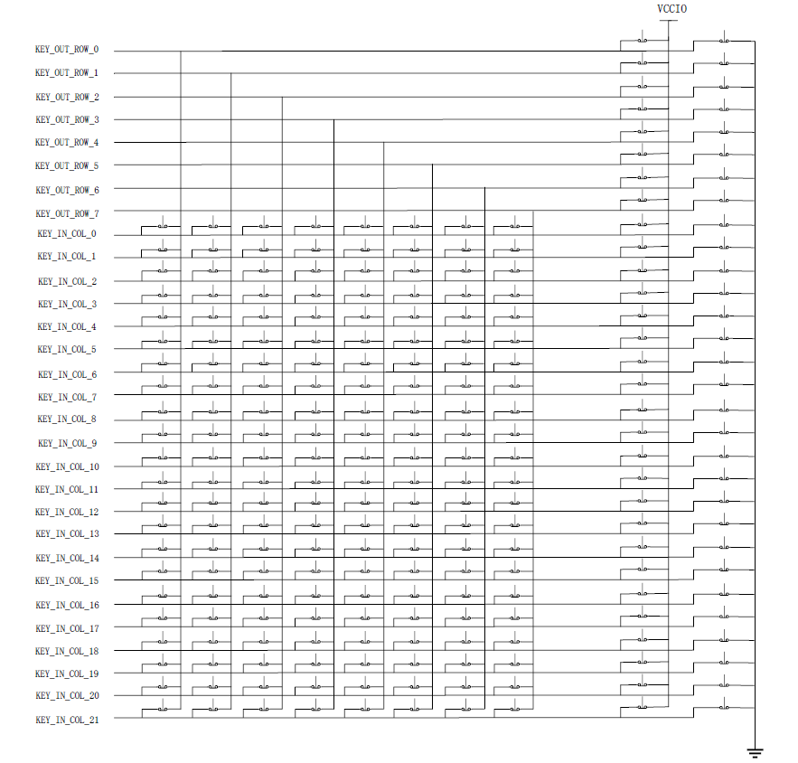
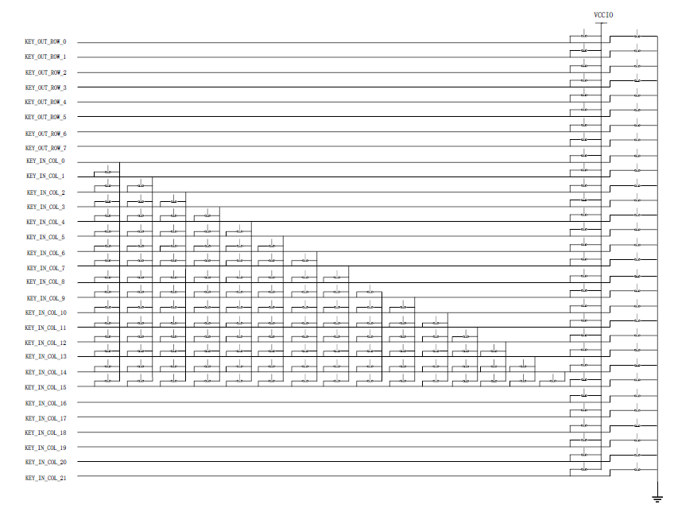
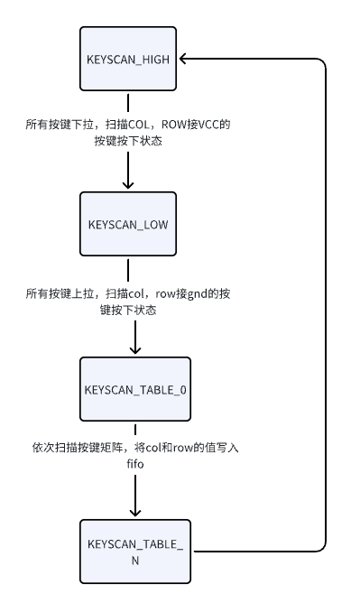
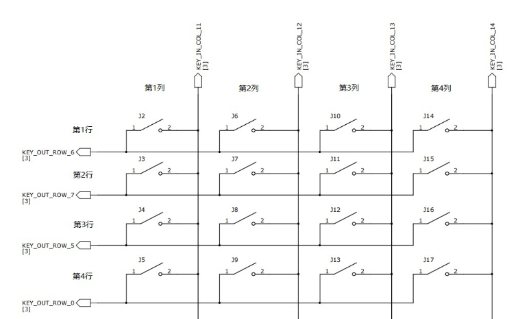

<!-- pg_ing20: 9 硬件键盘扫描控制器（KEYSCAN） -->

# 9 硬件键盘扫描控制器（KEYSCAN） {#ch-keyscan}

## 9.1 功能概述 {#功能概述-2}

### 9.1.1 特性： {#特性}

- 标准模式可配置矩阵，最大支持8列*22行的键盘矩阵。
- 每个io支持额外的两个独立按键扫描。
- LPkey模式可配置三角阵列，最大支持16个COL连接共 y*(y-1)/2+2(x+y) 按键
- 标准模式支持table（按键变化才产生中断）模式
- 每个单独的行或者列可以设置启用或者禁用。
- 可配置时钟。
- 支持输入硬件去抖动，去抖时间可配置。
- 支持配置扫描间隔和释放时间，支持多按键同时按下。
- 支持中断和DMA。

### 9.1.2 功能简述 {#功能简述}

keyscan模块支持DMA，fifo最大深度8，按键扫描支持标准和lpkey两种工作模式，其中标准模式支持table（按键按下上报变化）模式，Keyscan还提供了去抖功能，为输入过滤掉毛刺。该功能可以针对每个通道单独启用。过滤时间可单独配置。

**注意：当使用列扫描或行扫描功能时，列（行）扫描优先级较高，当某列（行）按键按下时，该列（行）的其他矩阵按键按下不在有效，即使该行（列）的矩阵按键按下，也不会上报按键按下的信息。**

**按键的硬件设计不要在行或列上外接上拉或下拉电阻，上下拉会误触按键输出扫描值**

#### 9.1.2.1 标准模式 {#标准模式}

keyscan标准模式支持x*y+2(x+y)个按键布局（x：列扫描，最高支持8列。 y：行扫描，最高支持22行）。支持的键盘扫描排列如下图所示：



标准扫描模式支持使能table模式，不需要手动获取fifo的数值并进行软件比对，硬件可以自动和上一次的采样结果进行比对，触发中断给出变化的键值。

### 9.1.3 LPkey模式 {#lpkey模式}

Lpkey模式支持y*(y-1)/2+2(x+y)个按键布局（x：列扫描，最高支持8列。 y：行扫描，最高支持22行）。支持的键盘扫描排列如下图所示：



LPkey模式提供了以更少的io数量扩展更多扫描矩阵的一种方式，相比普通模式，相同的io数量可扫描的按键数量更多，适用于小封装或io数量受限的应用场景。

Lpkey模式不支持键值比较的（table）模式，扫描流程和标准模式相同。通过DMA或直接读取fifo的方式获取周期扫描按键值。判断按键是否触发。

## 9.2 模块说明 {#模块说明}

### 9.2.1 FIFO数据含义 {#fifo数据含义}

FIFO收到的数据在不同的格式下有不同的含义，fifo位宽16bit，含义如下：

**注意：当扫描到scan_high或scan_low被按下后，硬件会停止对该行按键扫描，即该行按键有按键按下但是可能无法扫描到键值**

- normal mode no table

| mode | bit[10:8] | bit[7:5] | bit[4:0] |
| --- | --- | --- | --- |
| scan_high | 0x3 | null | key_num |
| scan_low | 0x2 | null | key_num |
| scan_key | 0x0 | row_num | col_num |
| scan_end | 0x4 | null | null |

0x400 标志位表示扫描结束，对应key_num的值，数值0-21对应col0-21，22-29对应row0-7。

高八位为0x2代表上拉到VCCIO的按键被按下，为0x2代表下拉到gnd的按键被按下。fifo内有键值数据代表该按键被按下，无数据仅仅0x400表示该扫描周期无按键按下。

- normal mode table

| mode | bit[10:8] | bit[7:5] | bit[4:0] |
| --- | --- | --- | --- |
| scan_high press | 0x7 | null | key_num |
| scan_high release | 0x3 | null | key_num |
| scan_low press | 0x6 | null | key_num |
| scan_low release | 0x2 | null | key_num |
| scan_key press | 0x8 | row_num | col_num |
| scan_key release | 0x0 | row_num | col_num |

table模式下，不存在扫描周期结束标志，只有当按键按下时才有按键数据上报，键值数据格式同normal mode no table.

- lpkey mode

| mode | bit[10:8] | bit[7:5] | bit[4:0] |
| --- | --- | --- | --- |
| scan_high | 0x3 | null | key_num |
| scan_low | 0x2 | null | key_num |
| scan_end | 0x4 | null | null |
| mode | bit[10:8] | bit[7:4] | bit[3:0] |
| scan_key | 0x0 | out_num | in_num |

因为lpkey模式下row不参与按键扫描，所以当一个按键按下时out_num和in_num代表按下按键输出引脚的col和读取到输入的col，因为所有col会扫描两次 所以一个按键按下会上报两个按键输入，例如col0和col4对应的按键按下会上报 0x04和0x40两个数据。

### 9.2.2 扫描周期 {#扫描周期}

在标准模式下，keyscan模块会根据设定的扫描周期loop值（扫描周期和loop配置以及模块输入时钟相关）周期触发keyscan的按键扫描任务并将扫描到的键值压入FIFO，在keyscan的运行过程中，扫描流程如下。



一个完整的按键扫描周期会按照该顺序进行，和扫描周期相关的有几个关键参数：

- release_time: 释放时间，硬件扫描按键是否按下是，扫描高电平的持续时间。
- scan_interval: 扫描间隔，当完成一次按键扫描周期后，硬件开启下一次自动扫描的等待时间间隔。

**注意：当走线的寄生电容较大（走线过长等因素）release时间过短可能导致扫描电平无法在预期时间上升到指定电平，可以尝试增加release time解决**

关于扫描周期计算：

- normal mode：扫描周期 =(2+使能row数量)*release_time + scan_interval。（2代表scan high和low各扫描一次）
- lpkey mode：扫描周期 =(2+使能col数量)*release_time + scan_interval。（2代表scan high和low各扫描一次）

## 9.3 关于loop_int {#关于loop_int}

当系统开启loop_int模式时，硬件会按照设定的loop_num_trig_int进行扫描每执行一个扫描周期后，会触发loop中断，每个扫描周期结束loop_num_trig_int会减1，当num递减为0时结束按键扫描，这时要重新开启扫描需先关闭keyscan再重新使能（重新使能会立即开始下一次扫描）。

当loop_num_trig_int设置为1时，可以理解为触发模式，硬件完成一个扫描周期立即结束，适用于软件触发扫描一次的场景。

## 9.4 使用说明 {#使用说明-2}

以4行*4列的键盘矩阵为例：



### 9.4.1 键盘矩阵的软件描述 {#键盘矩阵的软件描述}

```c
typedef struct {
    KEYSCAN_InColIndex_t in_col;
    GIO_Index_t gpio;
} KEYSCAN_InColList;

typedef struct {
    KEYSCAN_OutRowIndex_t out_row;
    GIO_Index_t gpio;
} KEYSCAN_OutRowList;
```

```c
KEYSCAN_OutRowList key_out_row[] = {
        {KEY_OUT_ROW_0, GIO_GPIO_24}, // 第1行
        {KEY_OUT_ROW_1, GIO_GPIO_25}, // 第2行
        {KEY_OUT_ROW_2, GIO_GPIO_26}, // 第3行
        {KEY_OUT_ROW_3, GIO_GPIO_27}, // 第4行
};
#define key_out_row_num (sizeof(key_out_row) / sizeof(key_out_row[0]))

KEYSCAN_InColList key_in_col[] = {
        {KEY_IN_COL_0, GIO_GPIO_12}, // 第1列
        {KEY_IN_COL_1, GIO_GPIO_13}, // 第2列
        {KEY_IN_COL_2, GIO_GPIO_14}, // 第3列
        {KEY_IN_COL_3, GIO_GPIO_15}, // 第4列
};
#define key_in_col_num (sizeof(key_in_col) / sizeof(key_in_col[0]))
```

第1行按键接到了GPIO24，映射到KEYSCAN模块的ROW0。第1列按键接到了GPIO12，映射到KEYSCAN模块的COL0。以此类推4行4列的键盘阵列。

注意：KEYSCAN的ROW和COL不是随意映射到GPIO，映射关系参考管脚管理（PINCTRL）说明文档。

### 9.4.2 KEYSCAN模块初始化 {#keyscan模块初始化}

```c
typedef struct {
    KEYSCAN_InColList *col;
    int col_num;

    KEYSCAN_OutRowList *row;
    int row_num;

    uint8_t fifo_num_trig_int;
    uint8_t dma_num_trig_int;
    uint8_t loop_num_trig_int;
    uint8_t dma_en;
    uint8_t int_trig_en;
    uint8_t int_loop_en;
    uint16_t release_time;
    uint16_t scan_interval;
    uint8_t debounce_counter;
#if (INGCHIPS_FAMILY == INGCHIPS_FAMILY_20)
    uint8_t table_mode_en;
    uint8_t lpkey_mode_en;
#endif
} KEYSCAN_SetStateStruct;
```

```c
/**
 * @brief Initialize keyscan module
 *
 * @param[in]keyscan_set       Initial parameter struct
 * @return                      0 if success else non-0
 */
int KEYSCAN_Initialize(const KEYSCAN_SetStateStruct* keyscan_set);

/**
 * @brief Initialize mapping table of keyboard array row and col
 *
 * @param[in]keyscan_set       Initial parameter struct
 * @param[out]ctx               keyboard array mapping table
 */
void KEYSCAN_InitKeyScanToIdx(const KEYSCAN_SetStateStruct* keyscan_set,
                              KEYSCAN_Ctx *ctx);
```

### 9.4.3 获取扫描到的按键 {#获取扫描到的按键}

KEYSCAN模块使能扫描后会按照行和列的配置开始扫描。模块有FIFO缓存扫描数据。每次扫描循环结束，FIFO中压入1个0x400标志完成一次扫描。

可以配置FIFO中数据个数触发中断或者DMA触发中断：

```c
void KEYSCAN_SetFifoNumTrigInt(uint32_t trig_num);
void KEYSCAN_SetDmaNumTrigInt(uint32_t trig_num);
```

获取FIFO是否为空的状态和数据：

```c
/**
 * @brief Check keyscan FIFO empty or not
 *
 * @return 0: FIFO have data; 1: empty
 */
uint8_t KEYSCAN_GetIntStateFifoEmptyRaw(void);

/**
 * @brief GET keyscan FIFO data
 *
 * @return 0~4 bits: col; 5~9 bits: row; 10 bit: scan cycle end flag
 */
uint16_t KEYSCAN_GetKeyData(void);
```

Normal模式下按键FIFO原始数据的0~4位是按下按键所在的KEYSCAN模块中的col，5~7位是row，Table模式下按键FIFO原始数据的0~3位是按下按键所在的KEYSCAN模块中的col，4~7位是row，扫描直接连接VCC或GND的按键FIFO原始数据的0-4BIT表示按键按下（COL按键等于FIFO 0-4BIT的值，ROW等于FIFO 0-4BIT减去22（COL的数量））。**注意这个值并不是键盘矩阵中的行和列**，可以用下面接口将原始数据解析为键盘矩阵中的行和列：

```c
/**
 * @brief Transfer keyscan FIFO raw data to keyboard array row and col
 *
 * To use this helper function, `ctx` must be initialized with `KEYSCAN_InitKeyScanToIdx`.
 *
 * @param[in]ctx              keyboard array mapping table
 * @param[out]Idx              Transfer struct, contains row and col index and keyscan mode.
 * @param[in]key_data         keyscan FIFO raw data
 * @return                      0: Success;
 *                              1: error arg or keyscan_data
 */
uint8_t KEYSCAN_HighLowDataToIdex(const KEYSCAN_Ctx *ctx, KEYSCAN_GET_Idx *Idx, uint32_t key_data);
```

## 9.5 应用举例 {#应用举例}

### 9.5.1 初始化KEYSCAN模块 {#初始化keyscan模块}

```c
KEYSCAN_OutRowList key_out_row[] = {
        {KEY_OUT_ROW_0, GIO_GPIO_24}, // 第1行
        {KEY_OUT_ROW_1, GIO_GPIO_25}, // 第2行
        {KEY_OUT_ROW_2, GIO_GPIO_26}, // 第3行
        {KEY_OUT_ROW_3, GIO_GPIO_27}, // 第4行
};
#define key_out_row_num (sizeof(key_out_row) / sizeof(key_out_row[0]))

KEYSCAN_InColList key_in_col[] = {
        {KEY_IN_COL_0, GIO_GPIO_12}, // 第1列
        {KEY_IN_COL_1, GIO_GPIO_13}, // 第2列
        {KEY_IN_COL_2, GIO_GPIO_14}, // 第3列
        {KEY_IN_COL_3, GIO_GPIO_15}, // 第4列
};
#define key_in_col_num (sizeof(key_in_col) / sizeof(key_in_col[0]))

static KEYSCAN_Ctx key_ctx = {0};

static KEYSCAN_SetStateStruct keyscan_set = {
        .col               = key_in_col,
        .col_num           = key_in_col_num,
        .row               = key_out_row,
        .row_num           = key_out_row_num,
        .loop_num_trig_int = 1,
        .int_loop_en       = 0,
        .table_mode_en     = 0, // 使用table模式时，使能该结构体变量
        .fifo_num_trig_int = 1,
        .release_time      = 0x1ff,
        .scan_interval     = 0xfff,
        .debounce_counter  = 0xff,
        .dma_num_trig_int  = 0x10,
        .dma_en            = 0,
        .int_trig_en       = 1,
        .lpkey_mode_en     = 0,
};

static uint32_t keyscan_cb_isr(void *user_data);
static void setup_peripherals_keyscan(void)
{
    SYSCTRL_ClearClkGateMulti(1 << SYSCTRL_ITEM_APB_KeyScan);
    SYSCTRL_ClearClkGateMulti(1 << SYSCTRL_ITEM_APB_PinCtrl);
    SYSCTRL_ClearClkGateMulti(1 << SYSCTRL_ITEM_APB_GPIO0);
    SYSCTRL_ClearClkGateMulti(1 << SYSCTRL_ITEM_APB_GPIO1);

    KEYSCAN_Initialize(&keyscan_set);
    KEYSCAN_InitKeyScanToIdx(&keyscan_set, &key_ctx);

    platform_set_irq_callback(PLATFORM_CB_IRQ_KEYSCAN, keyscan_cb_isr, 0);

    return;
}
```

### 9.5.2 中断数据处理 {#中断数据处理}

#### 9.5.2.1 标准模式 {#标准模式-1}

```c
uint8_t key_table[2][key_in_col_num][key_out_row_num] = { 0 };
uint8_t key_high[2][key_in_col_num+key_out_row_num] = { 0 };
uint8_t key_low[2][key_in_col_num+key_out_row_num] = { 0 };
volatile uint8_t now_index = 0;

void keyscan_printf(void)
{
    uint8_t i, last;
    if (now_index) last = 0;
    else last = 1;
    for (i=0; i<key_in_col_num+key_out_row_num; i++)
    {
        if ((key_high[now_index][i] != key_high[last][i]) && key_high[last][i])
        {
            if (i > (key_in_col_num - 1))
                printf("key high release row:0x%x\r\n", i - key_in_col_num);
            else
                printf("key high release col:0x%x\r\n", i);
        }
        if ((key_low[now_index][i] != key_low[last][i]) && key_low[last][i])
        {
            if (i > (key_in_col_num - 1))
                printf("key low release row:0x%x\r\n", i - key_in_col_num);
            else
                printf("key low release col:0x%x\r\n", i);
        }
    }
    for (i=0; i<key_in_col_num; i++)
    {
        for (uint8_t j=0; j<key_out_row_num; j++)
        {
            if ((key_table[now_index][i][j] != key_table[last][i][j]) && key_table[last][i][j])
                printf("key table release %d:%d:0x%x\r\n", i, j, key_table[now_index][i][j]);
        }
    }

    if (now_index) now_index = 0;
    else now_index = 1;

    //clear key_table
    for (i=0; i<key_in_col_num+key_out_row_num; i++)
    {
        key_high[now_index][i] = 0;
        key_low[now_index][i] = 0;
    }

    for (i=0; i<key_in_col_num; i++)
    {
        for (uint8_t j=0; j<key_out_row_num; j++)
        {
            key_table[now_index][i][j] = 0;
        }
    }
}

void KeyScan_loop(void)
{
    uint16_t key_data;
    static KEYSCAN_GET_Idx key_idx;
    KEYSCAN_GET_Idx key_row_col;
    while (KEYSCAN_GetIntStateFifoEmptyRaw() == 0)
    {
        key_data = KEYSCAN_GetKeyData();
        printf("key data:0x%x\r\n", key_data);
        KEYSCAN_HighLowDataToIdex(&key_ctx, &key_idx, key_data);
        if (key_idx.scan_mode == SCAN_LOW_PRESS)
        {
            KEYSCAN_GetColRow(&key_row_col, key_data);
            if (key_row_col.out_pin != 0xff)
            {
                key_low[now_index][key_in_col_num + key_idx.out_pin] = 1;
                printf("key low press row:0x%x\r\n", key_idx.out_pin);
            }
            else
            {
                key_low[now_index][key_idx.out_pin] = 1;
                printf("key low press col:0x%x\r\n", key_idx.out_pin);
            }
        }
        else if (key_idx.scan_mode == SCAN_HIGH_PRESS)
        {
            KEYSCAN_GetColRow(&key_row_col, key_data);
            if (key_row_col.out_pin != 0xff)
            {
                key_low[now_index][key_in_col_num + key_idx.out_pin] = 1;
                printf("key high press row:0x%x\r\n", key_idx.out_pin);
            }
            else
            {
                key_low[now_index][key_idx.out_pin] = 1;
                printf("key high press col:0x%x\r\n", key_idx.out_pin);
            }
        }
        else if (key_idx.scan_mode == SCAN_NUMBER)
        {
            key_table[now_index][key_idx.in_pin][key_idx.out_pin] = 1;
            printf("key out pin:0x%x\r\n", key_idx.out_pin);
            printf("key in pin:0x%x\r\n", key_idx.in_pin);
        }
        else
        {
            keyscan_printf();
            printf("key scan loop\r\n");
        }
    }
}

static uint32_t keyscan_cb_isr(void *user_data)
{
    KEYSCAN_LoopIntClr();
    printf("-----------------------\r\n");
    KeyScan_loop();
}
```

#### 9.5.2.2 Table 模式 {#table-模式}

```c

void KeyScan_table(void)
{
    uint16_t key_data;
    static KEYSCAN_GET_Idx key_idx;
    while (KEYSCAN_GetIntStateFifoEmptyRaw() == 0)
    {
        key_data = KEYSCAN_GetKeyData();
        printf("key data:0x%x\r\n", key_data);
        KEYSCAN_HighLowDataToIdex(&key_ctx, &key_idx, key_data);
        if (key_idx.scan_mode == SCAN_LOW_PRESS)
        {
            if ((key_data&0x1f) > (KEY_IN_COL_NUMBER - 1))
                printf("key low press row:0x%x\r\n", key_idx.out_pin);
            else
                printf("key low press col:0x%x\r\n", key_idx.out_pin);
        }
        else if (key_idx.scan_mode == SCAN_LOW_RELEASE)
        {
            if ((key_data&0x1f) > (KEY_IN_COL_NUMBER - 1))
                printf("key low release row:0x%x\r\n", key_idx.out_pin);
            else
                printf("key low release col:0x%x\r\n", key_idx.out_pin);
        }
        else if (key_idx.scan_mode == SCAN_HIGH_PRESS)
        {
            if ((key_data&0x1f) > (KEY_IN_COL_NUMBER - 1))
                printf("key high press row:0x%x\r\n", key_idx.out_pin);
            else
                printf("key high press col:0x%x\r\n", key_idx.out_pin);
        }
        else if (key_idx.scan_mode == SCAN_HIGH_RELEASE)
        {
            if ((key_data&0x1f) > (KEY_IN_COL_NUMBER - 1))
                printf("key high release row:0x%x\r\n", key_idx.out_pin);
            else
                printf("key high release col:0x%x\r\n", key_idx.out_pin);
        }
        else if (key_idx.scan_mode == SCAN_NUMBER)
        {
            printf("key out pin:0x%x\r\n", key_idx.out_pin);
            printf("key in pin:0x%x\r\n", key_idx.in_pin);
        }
        else
        {
            printf("key scan mode error\r\n");
        }
    }
}

static uint32_t keyscan_cb_isr(void *user_data)
{
    KEYSCAN_LoopIntClr();
    printf("-----------------------\r\n");
    KeyScan_table();
}
```