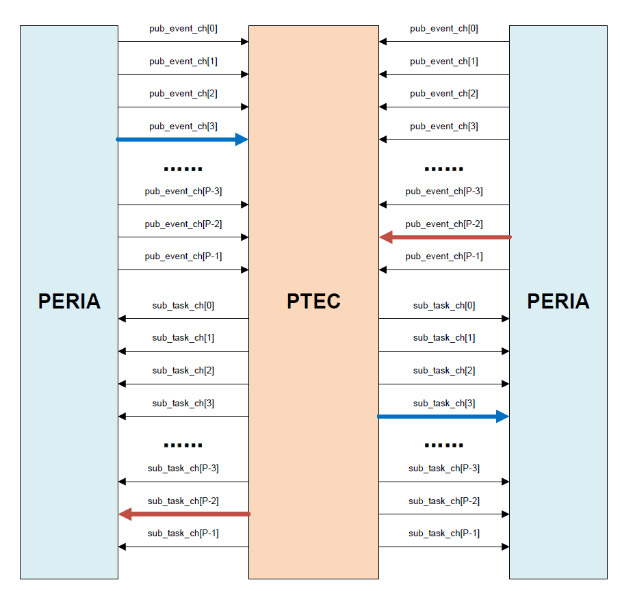
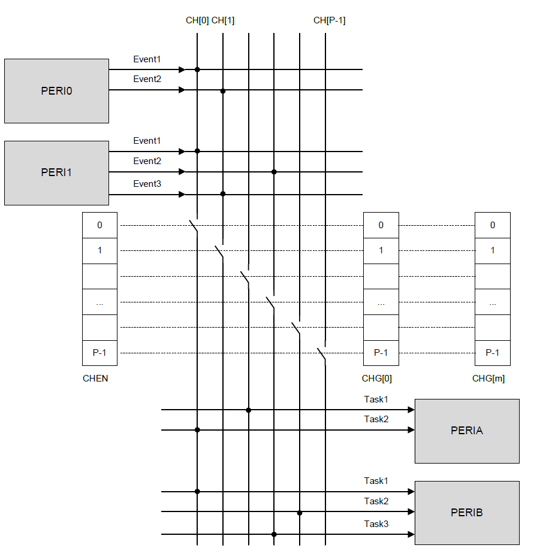

<!-- pg_ing20: 21 PTE简介 （Peripheral-Trigger-Engine） -->

# 21 PTE简介 （Peripheral-Trigger-Engine） {#ch-pte}

外设触发引擎( Peripheral trigger engine，PTE )通过事件发布和任务订阅的方式实现外设之间的连接，而不需要MCU的任何干预。通过PTE连接通道，当外设发生事件时，可以自动触发外设的预定义任务。这种逻辑联系无需 CPU 干预、降低功耗、提升实时性，可以使用PTE实现外设的预定义的行为。

## 21.1 PTE功能描述 {#pte功能描述}

PTE功能包括事件发布和任务订阅。PTE事件发布器可以发布事件，PTE任务订阅器可以订阅事件并执行相应的任务。PTE可以发布的外设任务和监听事件类型是硬件预先定义的，软件只能使用预先定义的事件类型。

**注意：部分外设的事件和任务和DMA相关，使用这些任务和事件必须配合DMA使用**

### 21.1.1 特性 {#特性-3}

- 外设作为发布者/订阅者
- 外设作为发布者可以在设定的通道上发布事件。
- 外设作为订阅者可以根据设定通道上的事件执行对应任务。
- 支持多种连接选项，包括一对一、一对多、多对一、多对多。
- 外设可以触发DMA任务，DMA可以发布生成的事件。
- 支持最高16个发布和订阅通道。
- 16个通道可以任意作为一个分组，支持最大四个通道分组。

### 21.1.2 PTE外设通道连接特性 {#pte外设通道连接特性}

PTE外设喝PTE模块之间的连接模块称之为PTEC(Peripheral-Trigger-Engine Controller)， 功能框图如下图所示：



PTE外设和PTE模块之间的连接功能框图

由该框图可以看出，外设的任务喝事件可以预先配置到任意一个或多个通道，PTEC根据通道配置，将外设的任务和事件连接起来，当注册到同一个通道的外设发生事件时，PTEC会自动触发外设的预定义任务。

例如： GPIOTE（GPIO Task Event）的按键检测事件和UART的DMA开始发送任务预先配置在一个通道0，GPIOTE模块检测到了一个按键按下的事件，发布给PTEC，PTEC根据通道配置，触发UART的DMA开始发送任务。中间无需CPU干预，提升了任务实时性。

### 21.1.3 PTE模块通道的使能和分组 {#pte模块通道的使能和分组}

PTE的外设连接功能框图如下所示：



PTE模块通道的使能和分组

根据图示，PTE的通道连接特性包括：

- PTE通道内部是一个总线矩阵。
- 每个外设的功能task和event可以通过PTEC配置到一个或多个通道。
- 每个PTE通道可以单独配置使能和关闭，外设通道功能使能前无法发布和订阅事件。
- PTE通道可以配置为分组，最多支持四个分组。
- PTE通道分组将多个通道组合为一组，监听一个通道的event触发分组内通道的多个任务。

### 21.1.4 PTE事件接收器 {#pte事件接收器}

PTE事件接收器可以在对应的通道监听事件。PTE通道会监听所有配置到当前通道的事件。 PTE支持的发布事件如下：

```c
typedef enum
{
    PTE_EVENT_QDEC_CH0_STOP_CPL = 0,            // QDEC channel 0 stop complete event
    PTE_EVENT_QDEC_CH1_STOP_CPL,
    PTE_EVENT_QDEC_CH2_STOP_CPL,

    PTE_EVENT_DMA_CH0_STOP_CPL = 0,             // DMA channel 0 stop complete event
    PTE_EVENT_DMA_CH1_STOP_CPL,
    PTE_EVENT_DMA_CH2_STOP_CPL,
    PTE_EVENT_DMA_CH3_STOP_CPL,
    PTE_EVENT_DMA_CH4_STOP_CPL,
    PTE_EVENT_DMA_CH5_STOP_CPL,
    PTE_EVENT_DMA_CH6_STOP_CPL,
    PTE_EVENT_DMA_CH7_STOP_CPL,

    PTE_EVENT_GPIOTE_CH0_INPUT_INT = 0,         // GPIOTE channel 0 input interrupt event
    PTE_EVENT_GPIOTE_CH1_INPUT_INT,
    PTE_EVENT_GPIOTE_CH2_INPUT_INT,
    PTE_EVENT_GPIOTE_CH3_INPUT_INT,
    PTE_EVENT_GPIOTE_CH4_INPUT_INT,
    PTE_EVENT_GPIOTE_CH5_INPUT_INT,
    PTE_EVENT_GPIOTE_CH6_INPUT_INT,
    PTE_EVENT_GPIOTE_CH7_INPUT_INT,

    PTE_EVENT_TIMER_CH0_TIM0_TIM_UP = 0,        // Timer 0 channel 0 timer up event
    PTE_EVENT_TIMER_CH0_TIM1_TIM_UP,
    PTE_EVENT_TIMER_CH0_TIM2_TIM_UP,
    PTE_EVENT_TIMER_CH0_TIM3_TIM_UP,
    PTE_EVENT_TIMER_CH1_TIM0_TIM_UP,
    PTE_EVENT_TIMER_CH1_TIM1_TIM_UP,
    PTE_EVENT_TIMER_CH1_TIM2_TIM_UP,
    PTE_EVENT_TIMER_CH1_TIM3_TIM_UP,

    PTE_EVENT_SPI_TX_END = 0,                   // SPI TX end event

    PTE_EVENT_I2C_TX_CPL = 0,                   // I2C TX complete event

    PTE_EVENT_ADC_DATA_CPL = 0,                 // ADC data complete event
    PTE_EVENT_ADC_DMA_STOP_TX,                  // ADC stop transfer status flag in dma mode

    PTE_EVENT_UART_TX_INT = 0,                  // UART TX interrupt event
    PTE_EVENT_UART_RX_INT,                      // UART RX interrupt event

    PTE_EVENT_PWM_CH0_PWM_STOP = 0,             // PWM channel 0 PWM stop event
    PTE_EVENT_PWM_CH0_FIFO_TRG,                 // PWM channel 0 FIFO trigger event
    PTE_EVENT_PWM_CH0_PCM_STOP,                 // PWM channel 0 PCM stop event
    PTE_EVENT_PWM_CH1_PWM_STOP,
    PTE_EVENT_PWM_CH1_FIFO_TRG,
    PTE_EVENT_PWM_CH1_PCM_STOP,
    PTE_EVENT_PWM_CH2_PWM_STOP,
    PTE_EVENT_PWM_CH2_FIFO_TRG,
    PTE_EVENT_PWM_CH2_PCM_STOP,

    PTE_EVENT_ASDM_RX_DATA = 0,                 // ASDM RX data event
}PTE_Event;
```

这些支持的事件可配置到对应的PTE通道上报对应的外设事件。

### 21.1.5 PTE任务发布器 {#pte任务发布器}

PTE任务发布器用于将任务发布到对应的外设，PTE监听到通道上的事件后会触发配置到当前通道的所有任务执行。PTE任务发布器支持以下任务：

```c
typedef enum
{
    PTE_TASK_QDEC_CH0_START = 0,            // QDEC channel 0 start
    PTE_TASK_QDEC_CH0_STOP,                 // QDEC channel 0 stop
    PTE_TASK_QDEC_CH1_START,
    PTE_TASK_QDEC_CH1_STOP,
    PTE_TASK_QDEC_CH2_START,
    PTE_TASK_QDEC_CH2_STOP,

    PTE_TASK_GPIOTE_TOGGLE_CH0 = 0,         // GPIOTE channel 0 toggle
    PTE_TASK_GPIOTE_TOGGLE_CH1,
    PTE_TASK_GPIOTE_TOGGLE_CH2,
    PTE_TASK_GPIOTE_TOGGLE_CH3,
    PTE_TASK_GPIOTE_TOGGLE_CH4,
    PTE_TASK_GPIOTE_TOGGLE_CH5,
    PTE_TASK_GPIOTE_TOGGLE_CH6,
    PTE_TASK_GPIOTE_TOGGLE_CH7,
    PTE_TASK_GPIOTE_HIGH_CH0,               // GPIOTE channel 0 high
    PTE_TASK_GPIOTE_HIGH_CH1,
    PTE_TASK_GPIOTE_HIGH_CH2,
    PTE_TASK_GPIOTE_HIGH_CH3,
    PTE_TASK_GPIOTE_HIGH_CH4,
    PTE_TASK_GPIOTE_HIGH_CH5,
    PTE_TASK_GPIOTE_HIGH_CH6,
    PTE_TASK_GPIOTE_HIGH_CH7,
    PTE_TASK_GPIOTE_LOW_CH0,                // GPIOTE channel 0 low
    PTE_TASK_GPIOTE_LOW_CH1,
    PTE_TASK_GPIOTE_LOW_CH2,
    PTE_TASK_GPIOTE_LOW_CH3,
    PTE_TASK_GPIOTE_LOW_CH4,
    PTE_TASK_GPIOTE_LOW_CH5,
    PTE_TASK_GPIOTE_LOW_CH6,
    PTE_TASK_GPIOTE_LOW_CH7,

    PTE_TASK_TIMER_CH0_TM0_START = 0,      // TIMER channel 0 timer 0 start
    PTE_TASK_TIMER_CH0_TM1_START,
    PTE_TASK_TIMER_CH0_TM2_START,
    PTE_TASK_TIMER_CH0_TM3_START,
    PTE_TASK_TIMER_CH1_TM0_START,
    PTE_TASK_TIMER_CH1_TM1_START,
    PTE_TASK_TIMER_CH1_TM2_START,
    PTE_TASK_TIMER_CH1_TM3_START,
    PTE_TASK_TIMER_CH0_TM0_STOP,            // TIMER channel 0 timer 0 stop
    PTE_TASK_TIMER_CH0_TM1_STOP,
    PTE_TASK_TIMER_CH0_TM2_STOP,
    PTE_TASK_TIMER_CH0_TM3_STOP,
    PTE_TASK_TIMER_CH1_TM0_STOP,
    PTE_TASK_TIMER_CH1_TM1_STOP,
    PTE_TASK_TIMER_CH1_TM2_STOP,
    PTE_TASK_TIMER_CH1_TM3_STOP,

    PTE_TASK_SPI_MASTER_DMA_TX_START = 0,   //  start spi master transfer in dma mode
    PTE_TASK_SPI_MASTER_DMA_TX_STOP,        //stop spi master transfer in dma mode
    PTE_TASK_I2C_MASTER_DMA_TX = 0,         //I2C start i2c master transfer in dma mode

    PTE_TASK_ADC_START = 0,                 // ADC start to sample data
    PTE_TASK_ADC_LOOP,                      // adc loop 
    PTE_TASK_ADC_DMA_STOP_TX,               // adc stop transfer in dma mode

    PTE_TASK_UART_DMA_TX_START = 0,         // UART start transmiting data in dma mode
    PTE_TASK_UART_DMA_TX_STOP,              // UART stop transmiting data in dma mode
    PTE_TASK_UART_DMA_RX_START,             // UART start receiving data in dma mode
    PTE_TASK_UART_DMA_RX_STOP,              // UART stop receiving data in dma mode

    PTE_TASK_PWM_CH0_IR_START = 0,          // PWM channel 0 IR send start
    PTE_TASK_PWM_CH0_ONE_PULSE,             //PWM channel0 one pulse pwm
    PTE_TASK_PWM_CH0_PWM_START,             //PWM channel0 start pwm
    PTE_TASK_PWM_CH0_PWM_DMA_START,         //PWM channel0 start pwm in dma mode
    PTE_TASK_PWM_CH0_PCM_START,             //PWM channel0 start pcm
    PTE_TASK_PWM_CH0_PWM_STOP,              //PWM channel0 stop pwm
    PTE_TASK_PWM_CH0_PCM_STOP,              //PWM channel0 stop pcm
    PTE_TASK_PWM_CH1_IR_START,
    PTE_TASK_PWM_CH1_ONE_PULSE,
    PTE_TASK_PWM_CH1_PWM_START,
    PTE_TASK_PWM_CH1_PWM_DMA_START,
    PTE_TASK_PWM_CH1_PCM_START,
    PTE_TASK_PWM_CH1_PWM_STOP,
    PTE_TASK_PWM_CH1_PCM_STOP,
    PTE_TASK_PWM_CH2_IR_START,
    PTE_TASK_PWM_CH2_ONE_PULSE,
    PTE_TASK_PWM_CH2_PWM_START,
    PTE_TASK_PWM_CH2_PWM_DMA_START,
    PTE_TASK_PWM_CH2_PCM_START,
    PTE_TASK_PWM_CH2_PWM_STOP,
    PTE_TASK_PWM_CH2_PCM_STOP,

    PTE_TASK_I2S_DMA_TX_START = 0,          // I2S start sending data in dma mode
    PTE_TASK_I2S_DMA_RX_START,              // I2S start receiving data in dma mode
    PTE_TASK_I2S_DMA_TX_STOP,               // I2S stop sending data
    PTE_TASK_I2S_DMA_RX_STOP,               // I2S stop receiving data

    PTE_TASK_ASDM_RX_START = 0,             //ASDM start receiving data
    PTE_TASK_ASDM_RX_STOP,                  //ASDM stop receiving data
}PTE_Task;
```

### 21.1.6 PTE分组 {#pte分组}

PTE可以将多个PTE通道映射到同一个PTE分组内，一个分组可以订阅一个PTE通道，当该PTE的时间源触发后，分组内的所有PTE通道都会执行相应的任务。

## 21.2 使用方法 {#使用方法-6}

### 21.2.1 API介绍 {#api介绍}

配置使能对应的任务到指定的PTE通道,使用该接口配置pte通道触发后要执行的任务。

```c
uint8_t PTE_ConfigTask(PTE_Module module, PTE_Task Task, PTE_Channel SetTaskChannel, uint8_t enable);
```

配置使能对应的监听事件到指定的PTE通道,使用该接口配置pte通道触发事件源。

```c
uint8_t PTE_ConfigEvent(PTE_Module module, PTE_Event Event, PTE_Channel SetEventChannel, uint8_t enable);
```

触发对应的任务，使用该接口可以通过软件方式手动触发任务运行，可以测试任务触发情况或手动触发任务运行。

```c
uint8_t PTE_TaskTrigger(PTE_Module module, PTE_Task Task);
```

使能对应的PTE通道，使用该接口使能PTE通道。PTE必须使能通道有效

```c
void PTE_ChxEnable(uint32_t items);
```

关闭对应的PTE通道使能

```c
void PTE_ChxDisable(uint32_t items);
```

获取当前的通道使能状态

```c
uint32_t PTE_ChxGetEnableState(void);
```

使能PTE分组，调用该接口相当于一直向整个GROUP所有通道发送执行对应任务的信号。

```c
void PTE_SetTaskChxGroupEN(PTEC_ChannelGroup SetChannelGroup)
```

关闭PTE分组，关闭向整个GROUP发送所有通道的执行任务信号。

```c
void PTE_SetTaskChxGroupDIS(PTEC_ChannelGroup SetChannelGroup)
```

使能对分组对指定通道事件的订阅

```c
void PTE_SetTaskSubChxGroupEn(PTEC_ChannelGroup SetChannelGroup,uint32_t SetSubChannel);
```

关闭对分组对指定通道事件的订阅

```c
void PTE_SetTaskSubChxGroupDis(PTEC_ChannelGroup SetChannelGroup,uint32_t SetSubChannel);
```

设置多个PTE通道映射到某个PTE分组

```c
void PTE_SetTaskChxGroup(PTEC_ChannelGroup SetChannelGroup,uint32_t SetChannel);
```

### 21.2.2 示例代码 {#示例代码-1}

### 21.2.3 使用示例 {#使用示例-2}

下面代码将以GPIOTE模块初始化一个IO检测这个IO的电平状态，触发另外三个GPIOTE模块翻转三个IO的电平状态这个应用场景为例，展示GPIOTE模块和PTE模块的使用。

GPIO 使用 CHANNEL1接收IO7触发事件，IO需要设置为输入模式，开启GPIO中断使能，外部IO上拉，设置中断模式为下降沿触发，使用GPIOTE的0 2 3三个通道映射GIO_GPIO_24、25、26三个IO，当GPIO7触发下降沿事件时，GPIOTE的0 2 3三个通道会翻转GIO_GPIO_24、25、26三个IO的电平状态。

```c
void pte_gpiote_test(void)
{
    SYSCTRL_ClearClkGate(SYSCTRL_ITEM_APB_GPIO0);
    SYSCTRL_ClearClkGate(SYSCTRL_ITEM_APB_GPIO1);
    SYSCTRL_ClearClkGate(SYSCTRL_ITEM_APB_GPIOTE);
    PINCTRL_Pull(GIO_GPIO_7, PINCTRL_PULL_UP);
    GIO_ConfigIntSource(GIO_GPIO_7, GIO_INT_EN_LOGIC_LOW_OR_FALLING_EDGE, GIO_INT_EDGE);
    GPIOTE_Configuration(GPIOTE_CHANNEL_0,GPIOTE_CHANNEL_TASK, GIO_GPIO_24, 0);
    GPIOTE_Configuration(GPIOTE_CHANNEL_2,GPIOTE_CHANNEL_TASK, GIO_GPIO_25, 0);
    GPIOTE_Configuration(GPIOTE_CHANNEL_3,GPIOTE_CHANNEL_TASK, GIO_GPIO_26, 0);
    GPIOTE_Configuration(GPIOTE_CHANNEL_1,GPIOTE_CHANNEL_EVENT, GIO_GPIO_7, 0);
    PTE_ConfigTask(PTE_GPIOTE_MODULE, PTE_TASK_GPIOTE_TOGGLE_CH0, PTE_CHANNEL_0, 1);
    PTE_ConfigTask(PTE_GPIOTE_MODULE, PTE_TASK_GPIOTE_TOGGLE_CH2, PTE_CHANNEL_0, 1);
    PTE_ConfigTask(PTE_GPIOTE_MODULE, PTE_TASK_GPIOTE_TOGGLE_CH3, PTE_CHANNEL_0, 1);
    PTE_ConfigEvent(PTE_GPIOTE_MODULE, PTE_EVENT_GPIOTE_CH1_INPUT_INT, PTE_CHANNEL_0, 1);
    PTE_ChxEnable(1 << PTE_CHANNEL_0);
}

void main(void)
{
    pte_gpiote_test();
    while(1);
}
```

使用该代码测试，按下GPIO7对应的按键，GPIO24、GPIO25和GPIO26会翻转状态，LED灯会亮起和熄灭。