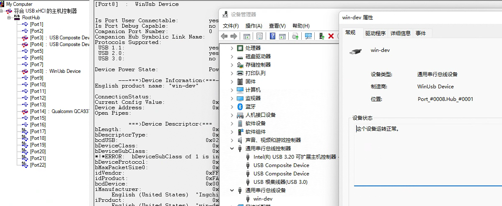
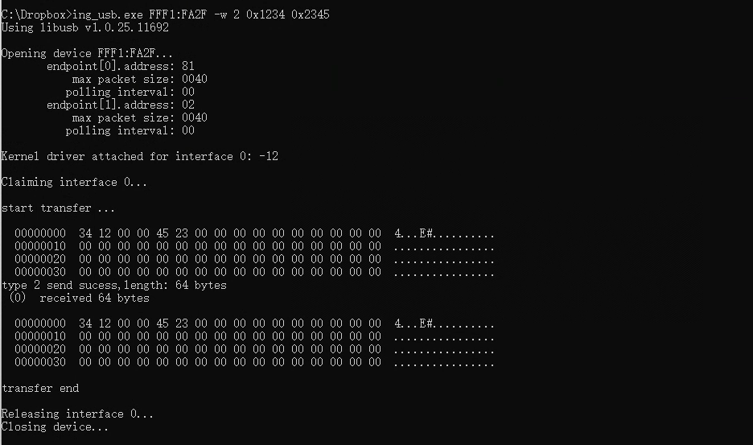

<!-- pg_ing20: 17 通用串行总线 (USB) -->

# 17 通用串行总线 (USB) {#ch-usb}

## 17.1 功能概述 {#功能概述-8}

- 支持full-speed (12 Mbps) 模式
- 集成PHY Transceiver，内置上拉，软件可控
- Endpoints:

  - Endpoints 0: control endpoint
  - Endpoints 1-5: 可以配置为in/out，以及control/isochronous/bulk/interrupt
- 支持USB suspend, resume, remote-wakeup
- 内置DMA方便数据传输

## 17.2 使用说明 {#使用说明-8}

### 17.2.1 USB软件结构 {#usb软件结构}

- driver layer，USB的底层处理，不建议用户修改。

  - 处理了大部分和应用场景无关的流程，提供了USB_IrqHandler，调用event handler。
  - 位置：`\ING\_SDK\sdk\src\FWlib\peripheral\_usb.c`
- bsp layer，处理场景相关的流程，需要用户提供event handler，并实现control和transfer相关处理。

  - 位置：`\ING\_SDK\sdk\src\BSP\bsp\_usb_xxx.c`

### 17.2.2 USB Device 状态 {#usb-device-状态}

- USB的使用首先需要配置USB CLK，USB IO以及PHY，并且初始化USB模块，此时USB为”NONE”状态，等待USB的reset中断（USB_IrqHandler）。
- reset中断的触发代表USB cable已经连接，而且host已经检测到了device，在reset中断中，USB模块完成相关的USB初始化。并继续等待中断。
- enumeration中断的触发代表device可以开始接收SOF以及control传输，device需要配置并打开endpoint 0，进入”DEFAULT”状态。
- out中断的触发代表收到了host的get descriptor，用户需要准备好相应的descriptor，并配置相关的in endpoint。
- out中断中的set address request会将device的状态切换为”ADDRESS”。
- out中断中的set configuration会将device的状态切换为”CONFIGURED”。此时device可以开始在配置的endpoint上传输数据。
- bus上的idle会自动触发suspend中断（用户需要在初始化中使能suspend中断），此时切换为”SUSPEND”状态。
- idle之后任何bus上的活动将会触发resume中断（用户需要在初始化中使能resume中断）,用户也可以选择使用remote wakeup主动唤醒。
- 唤醒之后的usb将重新进入”CONFIGURED”状态，每1ms（full-speed）将会收到1个SOF中断（用户需要在初始化中使能SOF中断）。

```c
typedef enum
{
  USB_DEVICE_NONE,
  /* A USB device may be attached or detached from the USB */
  USB_DEVICE_ATTACHED,
  /*USB devices may obtain power from an external source  */
  USB_DEVICE_POWERED,
  /*  After the device has been powered, and reset is done */
  USB_DEVICE_DEFAULT,
  /*  All USB devices use the default address when initially powered
  or after the device has been reset. Each USB device is assigned
  a unique address by the host after attachment or after reset. */
  USB_DEVICE_ADDRESS,
  /* Before a USB device function may be used, the device must be configured. */
  USB_DEVICE_CONFIGURED,
  /* In order to conserve power, USB devices automatically enter the
  Suspended state when the device has observed no bus traffic for
  a specified period */
  USB_DEVICE_SUSPENDED,
  USB_DEVICE_TEST_RESET_DONE
}USB_DEVICE_STATE_E;
```

### 17.2.3 设置 IO {#设置-io}

USB的DP/DM固定在GPIO16/17,IO初始化细节请参考`ING_SDK\sdk\src\BSP\bsp\_usb.c`中的`bsp_usb_init()`

```c
// ATTENTION ! FIXED IO FOR USB on 20 series
#define USB_PIN_DP GIO_GPIO_16
#define USB_PIN_DM GIO_GPIO_17
```

### 17.2.4 设置 PHY {#设置-phy}

使用`SYSCTRL_USBPhyConfig()`初始化PHY, 细节请参考`ING_SDK\sdk\src\BSP\bsp\_usb.c`中的`bsp_usb_init()`。

```c
/**
 * @brief Config USB PHY functionality
 *
 * @param[in]enable            Enable(1)/Disable(0) usb phy module
 * @param[in]pull_sel          DP pull up(0x1)/DM pull up(0x2)/DP&DM pull down(0x3)
 */
void SYSCTRL_USBPhyConfig(uint8_t enable, uint8_t pull_sel);
```

### 17.2.5 USB 模块初始化 {#usb-模块初始化}

细节请参考`ING_SDK\sdk\src\BSP\bsp\_usb.c`中的`bsp_usb_init()`。

- USB模块首选需要打开USB中断并配置相应接口，其中`USB_IrqHandler`由driver提供不需要用户修改。

  ```c
  platform_set_irq_callback(PLATFORM_CB_IRQ_USB, USB_IrqHandler, NULL);
  ```
- 其次需要初始化USB模块以及相关状态信息，入参结构体中用户需要提供event handler，其余为可选项

  ```c
  /**
   * @brief interface API. initilize usb module and related variables,
   must be called before any usb usage
   *
   * @param[in]device callback function with structure USB_INIT_CONFIG_T.
   *            When this function has been called your device is ready
                to be enumerated by the USB host.
   * @param[out]null.
   */
  extern USB_ERROR_TYPE_E USB_InitConfig(USB_INIT_CONFIG_T *config);
  ```

### 17.2.6 event handler {#event-handler}

USB的用户层调用通过event handler来实现， 细节请参考`ING_SDK\sdk\src\BSP\bsp\_usb.c`中的`bsp_usb_event_handler()`。

event handler需要包含对以下event事件的处理：

- USB_EVENT_EP0_SETUP

  - 该event包含EP0(control endpoint)上的所有request，包括读取/设置 descriptor，设置address，set/clear feature等request，按照USB协议， device需要支持所有协议中的标准request。
  - descriptor需要按照协议格式准备，并且放置在4bytes对齐的全局地址， 并通过`USB_SendData()`发送给host，在整个过程中，该全局地址和数据需要保持。 （4bytes对齐是内部DMA搬运的要求，否则可能出现错误）。
  - 对于没有data stage的request，event handler中不需要使用 `USB_SendData()`以及`USB_RecvData()`。
  - 对于不支持的request，需要设置status为：

    ```c
    status = USB_ERROR_REQUEST_NOT_SUPPORT;
    ```
  - 根据返回的status，driver判断当前request是否支持，否则按照协议发送stall给host。
  - 对于包含data stage的out传输，driver将继续接收数据，数据将在`USB_EVENT_EP_DATA_TRANSFER`的EP0通知用户。
  - setup/data/status stage的切换将在driver内进行。
- USB_EVENT_EP_DATA_TRANSFER

  数据相关的处理，接收和发射数据。

  参数包含ep number

  ```c
  uint8_t  ep;
  ```

  以及数据处理类型，分别代表发送和接收transfer的结束。

  ```c
  typedef enum
  {
      /// Event send when a receive transfert is finish
      USB_CALLBACK_TYPE_RECEIVE_END,
      /// Event send when a transmit transfert is finish
      USB_CALLBACK_TYPE_TRANSMIT_END
  } USB_CALLBACK_EP_TYPE_T;
  ```
- USB_EVENT_DEVICE_RESET

  USB reset 中断的event，代表枚举的开始。
- USB_EVENT_DEVICE_SOF

  SOF中断，每1m（full-speed）将会收到1个SOF中断（用户需要在初始化中使能SOF中断）。
- USB_EVENT_DEVICE_SUSPEND

  bus 进入idle状态后触发suspend，此时总线上没有USB活动。driver会关闭phy clock。
- USB_EVENT_DEVICE_RESUME

  bus 上的任何USB活动将会触发wakeup中断。resume后driver打开phy clock，USB恢复到正常状态。

#### 17.2.6.1 USB_EVENT_EP0_SETUP的实现 {#usb_event_ep0_setup的实现}

control以及枚举相关的流程实现需要通过USB_EVENT_EP0_SETUP event来进行。

- 默认的control endpoint是EP0, 所有request都会触发该event。
- 如果场景不支持某个request，则需要设置status == USB_ERROR_REQUEST_NOT_SUPPORT。driver会据此发送stall。
- 如果场景需要处理某个request，则需要将status设置为非USB_ERROR_REQUEST_NOT_SUPPORT状态。
- 用户需要将所有descriptor保存在4bytes对齐的全局地址。以device descriptor为例

  ```c
  case USB_REQUEST_DEVICE_DESCRIPTOR_DEVICE:
  {
    size = sizeof(USB_DEVICE_DESCRIPTOR_REAL_T);
    size = (setup->wLength < size) ? (setup->wLength) : size;

    status |= USB_SendData(0, (void*)&DeviceDescriptor, size, 0);
  }
  break;
  ```

  首先判断size，确保数据没有超出request要求，然后使用USB_SendData发送in transfer数据。其中DeviceDescriptor为device descriptor地址。
- set address request需要配置device地址，因此在driver layer实现。

#### 17.2.6.2 SUSPEND 的处理 {#suspend-的处理}

SUSPEND状态下可以根据需求进行power saving，默认配置只关闭了phy clock，其余的USB power/clock处理需要根据场景在应用层中的low power mode中来实现。

#### 17.2.6.3 remote wakeup {#remote-wakeup}

进入suspend的device可以选择主动唤醒，唤醒通过bsp_usb_device_remote_wakeup()连续发送10ms的resume signal来实现。

```c
void bsp_usb_device_remote_wakeup(void)
{
  USB_DeviceSetRemoteWakeupBit(U_TRUE);
  // setup timer for 10ms, then disable resume signal
  platform_set_timer(internal_bsp_usb_device_remote_wakeup_stop,16);
}
```

### 17.2.7 常用driver API {#常用driver-api}

#### 17.2.7.1 send usb data {#send-usb-data}

使用该API发送USB数据（包括setup data和应用数据），但需要在set config（打开endpoint）之后使用。

- ep: 数据发送对应的Endpoint，需要使用USB_EP_DIRECTION_IN。
- buffer：buffer地址需要是四字节对齐`c __attribute__ ((aligned (4)))`。
- size: 需要小于512*MPS，例如对于EP0，如果MPS为64bytes，则size需要小于512 \times 64。
- flag：NULL。
- 如果成功则返回U_TRUE，否则返回U_FALSE。

```c
extern USB_ERROR_TYPE_E USB_SendData(uint8_t ep, void* buffer,
                                    uint16_t size, uint32_t flag);
```

#### 17.2.7.2 receive usb data {#receive-usb-data}

使用该API接收USB数据（包括setup data和应用数据），但需要在set config（打开endpoint）之后使用。

- ep: 数据发送对应的Endpoint，需要使用USB_EP_DIRECTION_OUT。
- buffer：buffer地址需要是四字节对齐`c __attribute__ ((aligned (4)))`。
- size: 需要是MPS的整数倍，如果期望接收的数据小于MPS，参考flag设置。
- flag：

  - `1<<USB_TRANSFERT_FLAG_FLEXIBLE_RECV_LEN`: 当接收数据小于MPS时需要设置。
- 如果成功则返回U_TRUE，否则返回U_FALSE。

```c
extern USB_ERROR_TYPE_E USB_RecvData(uint8_t ep, void* buffer,
                                    uint16_t size, uint32_t flag);
```

#### 17.2.7.3 enable/disable ep {#enabledisable-ep}

正常处理中不需要使用该API，特殊情况下可以根据需求打开关闭某个特定的endpoint。

```c
/**
 * @brief interface APIs. use this pair for enable/disable certain ep.
 *
 * @param[in]ep number with USB_EP_DIRECTION_IN/OUT.
 * @param[out]null
 */
extern void USB_EnableEp(uint8_t ep, USB_EP_TYPE_T type);
extern void USB_DisableEp(uint8_t ep);
```

#### 17.2.7.4 usb close {#usb-close}

USB的disable请使用bsp layer中的`bsp_usb_disable()`。

```c
/**
 * @brief interface API. shutdown usb module and reset all status data.
 *
 * @param[in]null.
 * @param[out]null.
 */
extern void bsp_usb_disable(void);
```

#### 17.2.7.5 usb stall {#usb-stall}

```c
/**
 * @brief interface API. set ep stall pid for current transfer
 *
 * @param[in]ep num with direction.
 * @param[in]U_TRUE: stall, U_FALSE: set back to normal
 * @param[out]null.
 */
extern void USB_SetStallEp(uint8_t ep, uint8_t stall);
```

#### 17.2.7.6 usb in endpoint nak {#usb-in-endpoint-nak}

```c
/**
 * @brief interface API. use this api to set NAK on a specific IN ep
 *
 * @param[in]U_TRUE: enable NAK on required IN ep. U_FALSE: stop NAK
 * @param[in]ep: ep number with USB_EP_DIRECTION_IN/OUT.
 * @param[out]null.
 */
extern void USB_SetInEndpointNak(uint8_t ep, uint8_t enable);
```

### 17.2.8 使用场景 {#使用场景}

#### 17.2.8.1 example 0: WINUSB {#example-0-winusb}

WinUSB 是适用于 USB 设备的通用驱动程序，随附在Windows系统中。 对于某些通用串行总线 (USB) 设备（例如只有单个应用程序访问的设备），可以直接使用WINUSB而不需要实现驱动程序。如果已将设备定义为 WinUSB 设备 ，Windows会自动加载Winusb.sys。

- 参考：`\ING\_SDK\sdk\src\BSP\bsp_usb.c`

  首先调用`bsp_usb_init()`初始化USB模块,之后的USB活动则全部在`bsp_usb_event_handler()`中处理。

  ```c
  #define FEATURE_WCID_SUPPORT
  ```
- device需要在enumeration阶段提供WCID标识和相关descriptor。示例中的descriptor实现如下：

  ```c
  #define USB_WCID_DESCRIPTOR_INDEX_4 \
  { \

  #define USB_WCID_DESCRIPTOR_INDEX_5 \
  { \
  ```
- 通过修改`USB_STRING_PRODUCT`来改变产品名称iproduct

  ```c
  #define USB_STRING_PRODUCT {16,0x3,'w',0,'i',0,'n',0,'-',0,'d',0,'e',0,'v',0}
  ```

  第一个值是整个数组的长度，第二个值不变，之后是16bit unicode字符串 （每个符号占用两个字节），该示例中iproduct为’win-dev’。
- 该示例中打开了两个bulk endpoint，endpoint 1 为input，endpoint 2为output,最大包长为64：

  ```c
  #define USB_EP_1_DESCRIPTOR \
  { \
    .size = sizeof(USB_EP_DESCRIPTOR_REAL_T), \
    .type = 5, \
    .ep = USB_EP_DIRECTION_IN(EP_IN), \
    .attributes = USB_EP_TYPE_BULK, \
    .mps = EP_X_MPS_BYTES, \
    .interval = 0 \
  }

  #define USB_EP_2_DESCRIPTOR \
  { \
    .size = sizeof(USB_EP_DESCRIPTOR_REAL_T), \
    .type = 5, \
    .ep = USB_EP_DIRECTION_OUT(EP_OUT), \
    .attributes = USB_EP_TYPE_BULK, \
    .mps = EP_X_MPS_BYTES, \
    .interval = 0 \
  }
  ```
- 在set configuration(USB_REQUEST_DEVICE_SET_CONFIGURATION)之后，In/out endpoint 可以使用，通过`USB_RecvData()`配置out endpoint接收host发送的数据。 在收到host的数据后`USB_CALLBACK_TYPE_RECEIVE_END`，通过`USB_SendData()`将数据 发送给host（通过in endpoint）。
- 在WIN10及以上的系统上，该设备会自动加载winusb.sys并枚举成WinUsb Device, 设备名称为”win-dev”。 
- 通过ing_usb.exe可以对该设备进行一些简单数据测试:

  ```
  ing_usb.exe VID:PID -w 2 xxxx xxxx
  ```

  - VID:PID的数值请查看`USB_DEVICE_DESCRIPTOR`。
  - -w：代表写命令。
  - 2：传输类型，2为bulk transfer。
  - xxxx: 需要传输的数据（32bit），默认包长度为endpoint的mps。

  数据会通过out endpoint发送给USB Device并通过in endpoint回环并打印出来)：
- 使用ing_usb.exe可以读取in endpoint的数据，但是bsp layer中需要做相应的修改 （使用in endpoint发送数据给host）：

  ```
  ing_usb.exe VID:PID -r 2
  ```

  - VID:PID的数值请查看`USB_DEVICE_DESCRIPTOR`。
  - -r：代表读命令。
  - 2：传输类型，2为bulk transfer。

#### 17.2.8.2 example 1: HID composite {#example-1-hid-composite}

该示例实现了一个mouse + keyboard的复合设备， 使用了两个独立的interface，每个interface包含一个In Endpoint。

- 参考：`\ING_SDK\sdk\src\BSP\bsp_usb_hid.c`

首先调用`bsp_usb_init()`初始化USB模块, 之后的USB活动则全部在`bsp_usb_event_handler()`中处理，report的发送参考`report data 发送`。

##### 17.2.8.2.1 标准描述符 {#标准描述符}

其标准描述符结构如下，configuration descriptor之后分别是interface descriptor, hid descriptor, endpoint descriptor。

```c
typedef struct __attribute__((packed))
{
  USB_CONFIG_DESCRIPTOR_REAL_T config;
  USB_INTERFACE_DESCRIPTOR_REAL_T interface_kb;
  BSP_USB_HID_DESCRIPTOR_T hid_kb;
  USB_EP_DESCRIPTOR_REAL_T ep_kb[bNUM_EP_KB];
  USB_INTERFACE_DESCRIPTOR_REAL_T interface_mo;
  BSP_USB_HID_DESCRIPTOR_T hid_mo;
  USB_EP_DESCRIPTOR_REAL_T ep_mo[bNUM_EP_MO];
}BSP_USB_DESC_STRUCTURE_T;
```

上述描述符的示例在路径`\ING_SDK\sdk\src\BSP\bsp_usb_hid.h`，以keyboard interface为例：

```c
#define USB_INTERFACE_DESCRIPTOR_KB \
{ \
  .size = sizeof(USB_INTERFACE_DESCRIPTOR_REAL_T), \
  .type = 4, \
  .interfaceIndex = 0x00, \
  .alternateSetting = 0x00, \
  .nbEp = bNUM_EP_KB,  \
  .usbClass = 0x03, \
  /* 0: no subclass, 1: boot interface */ \
  .usbSubClass = 0x00, \
  /* 0: none, 1: keyboard, 2: mouse */ \
  .usbProto = 0x00, \
  .iDescription = 0x00 \
}
```

其中可能需要根据场景修改的变量使用宏定义，其他则使用常量。请注意：该实现中没有打开boot function。

##### 17.2.8.2.2 报告描述符 {#报告描述符}

报告描述符的示例在路径`\ING_SDK\sdk\src\BSP\bsp_usb_hid.h`

- keyboard的report描述符为：

```c
#define USB_HID_KB_REPORT_DESCRIPTOR {  \
    0x05, 0x01, /* USAGE_PAGE (Generic Desktop)                       */  \
    0x09, 0x06, /* USAGE (Keyboard)                                   */  \
    0xa1, 0x01, /* COLLECTION (Application)                           */  \
    0x05, 0x07, /*   USAGE_PAGE (Keyboard)                            */  \
    ...\ING_SDK\sdk\src\BSP\bsp_usb_hid.h
```

keyboard report descriptor包含8bit modifier input，8bit reserve, 5bit led output, 3bit reserve, 6bytes key usage id 。report本地结构为：

```c
#define KEY_TABLE_LEN (6)
typedef struct __attribute__((packed))
{
  uint8_t modifier;
  uint8_t reserved;
  uint8_t key_table[KEY_TABLE_LEN];
}BSP_KEYB_REPORT_s;
```

report中的usage id data的实现分别在以下enum中：

```c
BSP_KEYB_KEYB_USAGE_ID_e
BSP_KEYB_KEYB_MODIFIER_e
BSP_KEYB_KEYB_LED_e
```

- mouse的report描述符为：

```c
#define USB_HID_MOUSE_REPORT_DESCRIPTOR_SIZE (50)
#define USB_HID_MOUSE_REPORT_DESCRIPTOR { \
    0x05, 0x01, /* USAGE_PAGE (Generic Desktop)       */   \
    0x09, 0x02, /* USAGE (Mouse)                      */   \
    0xa1, 0x01, /* COLLECTION (Application)           */   \
    ...\ING_SDK\sdk\src\BSP\bsp_usb_hid.h
```

report包含一个3bit button(button 1 ~ button 3), 5bit reserve, 8bit x value, 8bit y value 结构为：

```c
typedef struct __attribute__((packed))
{
  uint8_t button;/* 1 ~ 3 */
  int8_t pos_x;/* -127 ~ 127 */
  int8_t pos_y;/* -127 ~ 127 */
}BSP_MOUSE_REPORT_s;
```

##### 17.2.8.2.3 standard/class request {#standardclass-request}

EP0的request处理在event：USB_EVENT_EP0_SETUP。 HID Class相关的处理在interface destination下：USB_REQUEST_DESTINATION_INTERFACE。

以其中keyboard report 描述符的获取为例：

- setup->wIndex代表了interface num，其中0为keyboard interface（参考BSP_USB_DESC_STRUCTURE_T）
- 使用USB_SendData发送report数据

```c
case USB_REQUEST_DEVICE_GET_DESCRIPTOR:
{
  switch(((setup->wValue)>>8)&0xFF)
  {
    case USB_REQUEST_HID_CLASS_DESCRIPTOR_REPORT:
    {
      switch(setup->wIndex)
      {
        case 0:
        {
          size = sizeof(ReportKeybDescriptor);
          size = (setup->wLength < size) ? (setup->wLength) : size;

          status |= USB_SendData(0, &ReportKeybDescriptor, size, 0);
          KeybReport.pending = U_FALSE;
        }break;
        ...\ING_SDK\sdk\src\BSP\bsp_usb_hid.c
```

##### 17.2.8.2.4 report data 发送 {#report-data-发送}

- keyboard key的发送,入参为一个键值以及其是否处于按下的状态，如果该键按下，则将其添加到report中并发送出去。

```c
/**
 * @brief interface API. send keyboard key report
 *
 * @param[in]key: value comes from BSP_KEYB_KEYB_USAGE_ID_e
 * @param[in]press: 1: pressed, 0: released
 * @param[out]null.
 */
extern void bsp_usb_handle_hid_keyb_key_report(uint8_t key, uint8_t press);
```

- keyboard modifier的发送，与key类似，区别是modifier是bitmap data。

```c
extern void bsp_usb_handle_hid_keyb_key_report(uint8_t key, uint8_t press);
/**
 * @brief interface API. send keyboard modifier report
 *
 * @param[in]modifier: value comes from BSP_KEYB_KEYB_MODIFIER_e
 * @param[in]press: 1: pressed, 0: released
 * @param[out]null.
 */
extern void bsp_usb_handle_hid_keyb_modifier_report(BSP_KEYB_KEYB_MODIFIER_e modifier, uint8_t press);
```

- keyboard led的获取，该示例中没有out endpoint，因此led report可能是用EP0的set report得到， 参考：USB_REQUEST_HID_CLASS_REQUEST_SET_REPORT。
- mouse report的发送,入参分别为x,y的相对值和button的组合（按下为1，释放为0）。

```c
/**
 * @brief interface API. send mouse report
 *
 * @param[in]x: 8bit int x axis value, relative,
 * @param[in]y: 8bit int y axis value, relative,
 * @param[in]btn: 8bit value, button 1 to 3,
 * @param[out]null.
 */
extern void bsp_usb_handle_hid_mouse_report(int8_t x, int8_t y, uint8_t btn);
```

#### 17.2.8.3 example 3: USB MSC {#example-3-usb-msc}

该示例提供了以下功能，通过`BSP_USB_MSC_FUNC`来选择：

- BSP_USB_MSC_FLASH_DISK： 在指定的FLASH空间内初始化一个FAT16文件系统。在成功枚举后， 可以在host端（电脑侧）以操作磁盘的形式直接读取/写入文件。
- BSP_USB_MSC_FLASH_DISK_NO_VFS：类似`BSP_USB_MSC_FLASH_DISK`但是没有提供文件系统， 适用于用户自定义的存储设备，当成功枚举后，host端（电脑侧）会提示需要格式化磁盘，选择 相应的参数，完成格式化后，即可以按照正常磁盘使用。
- BSP_USB_MSC_FLASH_DISK_DOWNLOADER：拖拽下载功能。打开磁盘后，放入bin文件，则可以 完成下载并重启。
- 参考：`\ING_SDK\sdk\src\BSP\bsp_usb_msc.c`

应用层需要调用`bsp_usb_init()`初始化USB模块, 插入电脑，完成枚举，则可以使用对应功能。