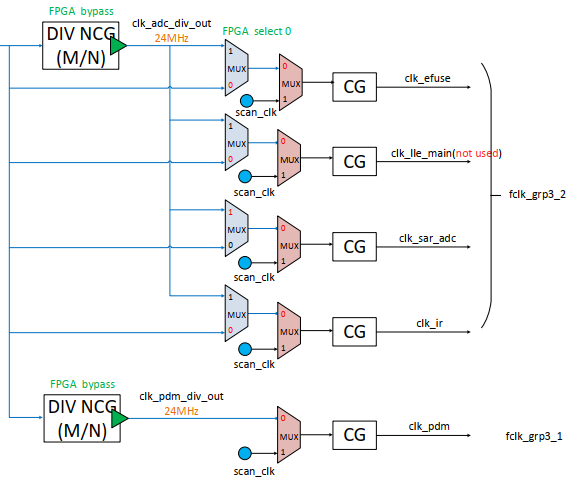

<!-- pg_ing916: 3 ADC简介 -->

# 3 ADC简介 {#ch-adc}

ADC全称Analog-to-Digital Converter，即模数转换器。

其主要作用是通过PIN测量电压，并将采集到的电压模拟信号转换成数字信号。

## 3.1 功能描述 {#功能描述}

### 3.1.1 特点 {#特点}

- 最多12个单端输入通道或4个差分输入通道
- 14位分辨率
- 电压输入范围（0~VBAT）
- 支持APB总线
- 采样频率可编程
- 支持单一转换模式和连续转换模式

### 3.1.2 ADC模式 {#adc模式}

- 校准模式（calibration）：用于校准精度，分为单端模式校准和差分模式校准；
- 转换模式（conversion）：用于正常工作状态下的模数转换。

根据ADC输入模式完成对应的模式校准，之后在转换模式下进行正常模数转换。

### 3.1.3 ADC输入模式 {#adc输入模式}

- 单端输入（single-ended）：使用单个输入引脚，采用ADC内部的参考电压；
- 差分输入（differential）：使用一组输入引脚分别作为参考电压。

一般来说，差分输入有利于避免共模干扰的影响，结果相对准确。

### 3.1.4 ADC转换模式 {#adc转换模式}

- 单次转换（single）：ADC完成单次转换后，ADC将停止，数据将被拉入 `FIFO`；
- 连续转换（continuous）：ADC经过 loop-delay 时间后循环进行转换，直到手动关闭。

### 3.1.5 ADC通道 {#adc通道}

ADC共12个channel，即ch0-ch11。

其中ch0-ch8、ch10-ch11为通用通道，ch9为1.2V内部参考电压专用通道。

具体通道的输入连接引脚如下：

*表 3.1: ADC输入连接引脚*
| 通道 | 连接引脚 |
| --- | --- |
| ch0 | GPIO7 |
| ch1 | GPIO8 |
| ch2 | GPIO9 |
| ch3 | GPIO10 |
| ch4 | GPIO11 |
| ch5 | GPIO12 |
| ch6 | GPIO13 |
| ch7 | GPIO14 |
| ch8 | GPIO35 |
| ch9 | VREF12_ADC_IN |
| ch10 | GPIO30 |
| ch11 | GPIO31 |

通道输入模式配置规则：

**1.** 通用通道ch0-ch8、ch10-ch11均可配置成单端输入通道；

**2.** ch0-ch7可以配置成4对差分输入通道，配置后对应差分通道ch0-ch3，如差分通道ch0对应ADC通道ch0和ch1，以此类推。

**注意：** 配置ADC输入模式为差分模式下则只有ch0-ch3及ch8-ch11，ch4-ch7无意义。

以下是关于ADC通道对于开发者的几点使用建议：

**1.** 在使能通道前请先配置ADC输入模式；

**2.** 如需切换ADC输入模式，建议调用ADC_DisableAllChannels关闭之前模式下所有已使能通道，重新使能新的通道；

**3.** 建议一次只使用一个差分通道，如需同时使能两个差分通道可以选择ch0和ch2；

**4.** 如需同时使用单端通道和差分通道建议进行方案优化。

对于同时使用单端通道和差分通道的情况，此处提供以下两种参考方案：

**方案1：** 单端、差分模式随配随用，即每次不同模式采样前需进行输入模式的切换；

**方案2：** 如只采用一路单端通道和一路差分通道，可以使能差分通道ch0和ch2，其中一路的VINN接0V即可模拟单端输入。

### 3.1.6 PGA {#pga}

ADC的PGA默认开启，可调用ADC_PgaEnable(0)接口关闭PGA。

ADC的PGA有6个可配值，其大小为： PGA\_PARA \in [0, 5]

目前ch0-ch7可以配置为上述任意PGA_PARA，ch8-ch11的PGA_PARA为固定值1。

若PGA设置为关闭，单端模式时PGA_PARA=1，差分模式时PGA_PARA=0。（ch8-ch11除外，仍为固定值）

**注意：** PGA_PARA是PGA的关键配置参数，PGA_PARA的选择请结合实际设备的电压范围计算获取，注意通过PGA放大后的电压极值不能超过参考电压阈值。

### 3.1.7 输入电压范围 {#输入电压范围}

不同ADC输入模式下的输入电压范围如下：

- 单端模式：V_{IN} \in [\frac{V_{REFP}}{2}-\frac{V_{REFP}}{PGA\_GAIN}, \frac{V_{REFP}}{2}+\frac{V_{REFP}}{PGA\_GAIN}]
- 差分模式：V_{INP}-V_{INN} \in [-\frac{V_{REFP}}{PGA\_GAIN}, \frac{V_{REFP}}{PGA\_GAIN}], 且 V_{INP},V_{INN}\geqslant0

其中PGA_GAIN为： PGA\_GAIN = 2^{PGA\_PARA}

**注意：** 请开发者确保输入电压满足以上范围要求，过小的输入电压可能会使ADC无法正常工作，而电压过大则可能会导致芯片损坏。

- 单端模式PGA电压范围如下表：

其中Vmin、Vmax指输入电压的最小值和最大值。

*表 3.2: 单端模式PGA电压范围表*
| PGA_PARA | Vmin | Vmax | 当Vp=3.3时Vmin | 当Vp=3.3时Vmax |
| --- | --- | --- | --- | --- |
| [000] | 0 | Vp | 0 | 3.3 |
| [001] | 0 | Vp | 0 | 3.3 |
| [010] | Vp/4 | 3Vp/4 | 0.825 | 2.475 |
| [011] | 3Vp/8 | 5Vp/8 | 1.2375 | 2.0625 |
| [100] | 7Vp/16 | 9Vp/16 | 1.44375 | 1.85625 |
| [101] | 15Vp/32 | 17Vp/32 | 1.546875 | 1.753125 |

- 差分模式PGA电压范围如下表：

其中Vmin、Vmax指两路输入电压**差值**（即VINP-VINN）的最小值和最大值。

*表 3.3: 差分模式PGA电压范围表*
| PGA_PARA | Vmin | Vmax | 当Vp=3.3时Vmin | 当Vp=3.3时Vmax |
| --- | --- | --- | --- | --- |
| [000] | -Vp | Vp | -3.3 | 3.3 |
| [001] | -Vp/2 | Vp/2 | -1.65 | 1.65 |
| [010] | -Vp/4 | Vp/4 | -0.825 | 0.825 |
| [011] | -Vp/8 | -Vp/8 | -0.4125 | 0.4125 |
| [100] | -Vp/16 | Vp/16 | -0.20625 | 0.20625 |
| [101] | -Vp/32 | Vp/32 | -0.103125 | 0.103125 |

**例1.** 输入电压在1.3-1.7V范围内波动，使用单端模式。则需要满足条件1.3>=Vmin且1.7<=Vmax，查表选择满足条件下最大PGA_PARA=3。

**例2.** 输入电压VINP在1.1-1.7V范围内波动，输入电压VINN在1.0-1.2V范围内波动，使用差分模式。计算得-0.1<=VINP-VINN<=0.7V，需要满足条件-0.1>=Vmin且0.7<=Vmax，查表选择满足条件下最大PGA_PARA=2。

选定PGA_PARA后，将其作为参数并调用接口（ADC_ConvCfg或ADC_PgaParaSet）完成配置。

差分模式下可以使VINN=0V，这时输入的VINP相当于单端输入，但注意此时测量VINP的范围为0-VBAT/2。如被测电压大于VBAT/2可考虑优化硬件方案，如分压等，或优化ADC采样策略。

### 3.1.8 采样率 {#采样率}

采样率和时钟、loop-delay大小以及使能通道个数有关，其计算关系如下：

当loop-delay=0时：SAMPLERATE = \frac{ADC\_CLK}{16\times{CH\_NUM}}

当loop-delay>0时：SAMPLERATE = \frac{ADC\_CLK}{loop\_delay+16\times{CH\_NUM}+5}

## 3.2 使用方法 {#使用方法}

### 3.2.1 时钟配置 {#时钟配置}

当前ADC所用时钟源为 `clock slow` 或其经过分频得到的ADC工作时钟，建议选用后者。

当前ADC工作时钟可以配置范围为500K-8M。

**注意：** 由于ADC工作时钟须经过 `clock slow` 分频，故在同时使用和ADC同时钟源模块时，如IR，可能出现时钟配置冲突的现象。开发者在实际使用时注意时钟规划，具体请参考916时钟树（图 [3.1](https://ingchips.github.io/drafts/pg_ing916/ch-adc.html#fig:916-clk-tree-ADC)）。



图 3.1: 916时钟树ADC模块部分截图

### 3.2.2 ADC精度初始化 & 校准 {#adc精度初始化-校准}

ADC精度初始化接口：ADC_ftInitCali。

ADC校准包含精度校准和内部参考电压校准。

ADC精度校准接口：ADC_Calibration。

内部参考电压校准接口：ADC_VrefCalibration。

有以下几点使用时的注意事项：

- ADC精度初始化和ADC精度校准先后顺序不影响采样；
- 请先进行ADC精度初始化和ADC精度校准，再进行内部参考电压校准；
- ADC精度校准需要明确ADC输入模式（单端/差分），两种模式需要分别进行精度校准；
- ADC精度初始化和精度校准只需要在初始化ADC模块时调用一次即可，如调用ADC_Reset需重新进行ADC精度校准，如调用ADC_AdcClose则需要重新完成整个初始化过程；
- 为提高参考电压可靠性，建议周期性地进行内部参考电压校准，如每次芯片唤醒后。但由于该校准过程有一定的耗时，故不宜频繁调用；
- 每次进行内部参考电压校准后，需要重新配置ADC参数和使能通道；

### 3.2.3 ADC参数配置 {#adc参数配置}

ADC参数配置接口的函数声明如下：

```c
void ADC_ConvCfg(SADC_adcCtrlMode ctrlMode, 
                 SADC_pgaPara pgaPara,
                 uint8_t pgaEnable,
                 SADC_channelId ch, 
                 uint8_t enNum, 
                 uint8_t dmaEnNum, 
                 SADC_adcIputMode inputMode, 
                 uint32_t loopDelay);
```

涉及参数有：ADC转换模式、PGA_PARA、PGA使能开关、采样通道、data触发中断数、data触发DMA搬运数、ADC输入模式和 `loop-delay`。

具体的参数取值范围请参考ADC头文件里对应的枚举定义或参数说明。

对于pgaPara的选取请参考本文档“PGA”和“输入电压范围”章节，或参考peripheral_adc.h文件中“ADC_PgaParaSet”的函数声明。

data触发中断数和data触发DMA搬运数决定了搬运ADC数据的方式。前者用触发中断的方式，后者用触发DMA搬运的方式。

**注意：** data触发中断数和data触发DMA搬运数应该一个为0，一个非0,。如果两值都非0则默认选择触发中断的方式，DMA配置不生效；

关于搬运方式的建议：

- 一般在小数据量情况下，如定时采集温度、电池电压，建议采用触发中断并CPU读数的方式。
- 一般大数据量连续采样，如模拟麦克风采样，建议采用DMA搬运方式（乒乓搬运），可以大大提高数据搬运处理效率。

**注意：** 多次调用ADC_ConvCfg则以最后一次调用为准（除通道使能，不会自动关闭之前已使能的通道），如只需使能（关闭）ADC通道可以通过ADC_EnableChannel接口完成。

### 3.2.4 ADC数据处理 {#adc数据处理}

ADC数据处理的推荐步骤为：

**1.** 调用ADC_PopFifoData（或DMA搬运buff）读取FIFO中的ADC原始数据；

**2.** 调用ADC_GetDataChannel得到原始数据中的数据所属通道（如需要）；

**3.** 调用ADC_GetData得到原始数据中的ADC数据；

**4.** 调用ADC_GetVol通过ADC数据计算得到其对应的电压值（如需要）。

也可以通过调用ADC_ReadChannelData接口直接得到指定通道的ADC数据，但这样会丢弃其他通道数据，请谨慎使用。其可以作为辅助接口使用，非主要方式。

**注意：** 单端、差分模式得到的ADC数据范围均为0-0x3fff，通过ADC数据计算得到的电压值会被限制在正/负参考电压范围内，且ADC数据在其范围内均匀分布。

另外对于单个数据的读取我们建议采用取若干数据求其平均值的方式，可以明显提高数据稳定性。

我们提供了方便开发者移植的**求平均值程序**，如有需求请参考SDK例程peripheral_battery。

## 3.3 编程指南 {#编程指南}

### 3.3.1 驱动接口 {#驱动接口}

初始化相关：

- ADC_ftInitCali：ADC精度初始化
- ADC_Calibration：ADC精度校准
- ADC_VrefCalibration：内部参考电压校准

ADC控制：

- ADC_Reset：ADC复位
- ADC_Start：ADC使能
- ADC_AdcClose：ADC关闭

ADC配置：

- ADC_ConvCfg：ADC转换参数配置
- ADC_EnableChannel：通道使能
- ADC_DisableAllChannels：关闭所有通道

数据处理相关：

- ADC_GetFifoEmpty：读取FIFO是否为空
- ADC_PopFifoData：读取FIFO原始数据
- ADC_GetDataChannel：读取原始数据中通道号
- ADC_GetData：读取原始数据中ADC数据
- ADC_ReadChannelData：读取特定通道ADC数据
- ADC_GetVol：读取ADC数据对应电压值
- ADC_ClrFifo：清空FIFO

以上是ADC常用接口，还有部分接口不推荐直接使用，在此不进行罗列，详见头文件声明。

### 3.3.2 代码示例 {#代码示例}

下面展示ADC的基本用法：

（注：以下ADC参数设置仅供参考，具体参数请结合实际需要进行配置）

#### 3.3.2.1 单次中断搬运 {#单次中断搬运}

```c
#define ADC_CHANNEL    ADC_CH_0
#define ADC_CLK_MHZ    6

static uint32_t ADC_cb_isr(void *user_data)
{
    uint32_t data = ADC_PopFifoData();
    SADC_channelId channel = ADC_GetDataChannel(data);
    if (channel == ADC_CHANNEL) {
        uint16_t sample = ADC_GetData(data);
        // do something with 'sample'
    }
    return 0;
}

void test(void)
{
    static SADC_ftCali_t Adc_FtCali;

    SYSCTRL_ClearClkGate(SYSCTRL_ITEM_APB_ADC);
    SYSCTRL_SetAdcClkDiv(24 / ADC_CLK_MHZ);
    SYSCTRL_ReleaseBlock(SYSCTRL_ITEM_APB_ADC);
    ADC_Reset();
    ADC_ftInitCali(&Adc_FtCali);
    ADC_Calibration(SINGLE_END_MODE);
    ADC_ConvCfg(SINGLE_MODE, PGA_PARA_4, 1, ADC_CHANNEL, 1, 0, SINGLE_END_MODE, 0);
    platform_set_irq_callback(PLATFORM_CB_IRQ_SADC, ADC_cb_isr, 0);
    ADC_Start(1);
}
```

以上代码展示了ADC时钟配置、ADC初始化&校准、ADC转换参数配置，并在触发的ADC中断程序里获取到最终的 `sample` 数值。

当然，由于使用单一ADC通道，可以直接获取特定通道的ADC数据，代码如下：

```c
static uint32_t ADC_cb_isr(void *user_data)
{
    uint16_t sample = ADC_ReadChannelData(ADC_CHANNEL);
    // do something with 'sample'
    return 0;
}
```

在单通道采样时或者只需要单一通道数据时可以采用以上方式，多通道采样有丢数据的风险。

#### 3.3.2.2 连续中断搬运 {#连续中断搬运}

以上代码展示的是单次采样的数据搬运，如果是连续采样，建议采用以下两种读数方案：

**1.** 读数并结合调用ADC_GetFifoEmpty接口判断FIFO状态，读数直到FIFO为空为止；

**2.** 每次读取的数据量等于配置的data触发中断数。

方案1代码示例：

```c
static uint32_t ADC_cb_isr(void *user_data)
{
    while (!ADC_GetFifoEmpty()) {
        uint16_t sample = ADC_ReadChannelData(ADC_CHANNEL);
        // do something with 'sample'
    }
    return 0;
}
```

方案2代码示例：

```c
#define INT_TRIGGER_NUM    8
static uint32_t ADC_cb_isr(void *user_data)
{
    uint8_t i = 0;
    while (i < INT_TRIGGER_NUM) {
        uint16_t sample = ADC_ReadChannelData(ADC_CHANNEL);
        // do something with 'sample'
        i++;
    }
    return 0;
}
```

CPU资源方面，方案2节省了每次读数调用接口的开销，建议优选。

#### 3.3.2.3 获取电压值&多通道采样 {#获取电压值多通道采样}

获取电压值需要对参考电压进行校准，并调用接口计算电压值。

下面我们使能ch0、ch3、ch6三个通道，并对ch3的采样值计算电压值：

```c
#define ADC_CHANNEL_NUM     3
#define ADC_CHANNEL_0       ADC_CH_0
#define ADC_CHANNEL_3       ADC_CH_3
#define ADC_CHANNEL_6       ADC_CH_6
#define ADC_CLK_MHZ         6

static uint32_t ADC_cb_isr(void *user_data)
{
    uint32_t data = ADC_PopFifoData();
    SADC_channelId channel = ADC_GetDataChannel(data);
    uint16_t sample = ADC_GetData(data);
    if (channel == ADC_CHANNEL_0) {
        // do something with 'sample' of 'ADC_CHANNEL_0'
    } else if (channel == ADC_CHANNEL_3) {
        float voltage = ADC_GetVol(sample);
    } else if (channel == ADC_CHANNEL_6) {
        // do something with 'sample' of 'ADC_CHANNEL_6'
    }
    return 0;
}

void test(void)
{
    SADC_ftCali_t Adc_FtCali;

    SYSCTRL_ClearClkGate(SYSCTRL_ITEM_APB_ADC);
    SYSCTRL_SetAdcClkDiv(24 / ADC_CLK_MHZ);
    SYSCTRL_ReleaseBlock(SYSCTRL_ITEM_APB_ADC);
    ADC_Reset();
    ADC_ftInitCali(&Adc_FtCali);
    ADC_Calibration(SINGLE_END_MODE);
    ADC_VrefCalibration();      // calibrate the referenced voltage
    ADC_ConvCfg(SINGLE_MODE, PGA_PARA_4, 1, ADC_CHANNEL_0, ADC_CHANNEL_NUM, 0, SINGLE_END_MODE, 0);
    ADC_EnableChannel(ADC_CHANNEL_3, 1);    // call ADC_EnableChannel to enable more channels
    ADC_EnableChannel(ADC_CHANNEL_6, 1);
    platform_set_irq_callback(PLATFORM_CB_IRQ_SADC, ADC_cb_isr, 0);
    ADC_Start(1);
}
```

voltage即为最终计算得到的ch3采样电压值，ch0和ch6采样值可执行其他操作。

#### 3.3.2.4 ADC & DMA搬运 {#adc-dma搬运}

对连续大量的数据推荐采用ADC & DMA搬运方式。

下面展示DMA乒乓搬运ADC数据并转换成电压的实例：

```c
#include "pingpong.h"
#define ADC_CHANNEL             ADC_CH_0
#define ADC_CLK_MHZ             6
#define SAMPLERATE              16000
#define ADC_CHANNEL_NUM         1
#define LOOP_DELAY(c, s, ch)    ((((c) * (1000000)) / (s)) - (((16) * (ch)) + (5)))
#define DMA_CHANNEL             0
static DMA_PingPong_t PingPong;

static uint32_t DMA_cb_isr(void *user_data)
{
    uint32_t state = DMA_GetChannelIntState(DMA_CHANNEL);
    DMA_ClearChannelIntState(DMA_CHANNEL, state);

    uint32_t *buff = DMA_PingPongIntProc(&PingPong, DMA_CHANNEL);
    uint32_t tranSize = DMA_PingPongGetTransSize(&PingPong);
    for (uint32_t i = 0; i < tranSize; ++i) {
        if (ADC_GetDataChannel(buff[i]) != ADC_CHANNEL) continue;
        uint16_t sample = ADC_GetData(buff[i]);
        float voltage = ADC_GetVol(sample);
    }
    return 0;
}
void test(void)
{
    static SADC_ftCali_t Adc_FtCali;

    SYSCTRL_ClearClkGate(SYSCTRL_ITEM_APB_ADC);
    SYSCTRL_SetAdcClkDiv(24 / ADC_CLK_MHZ);
    SYSCTRL_ReleaseBlock(SYSCTRL_ITEM_APB_ADC);
    ADC_Reset();
    ADC_ftInitCali(&Adc_FtCali);
    ADC_Calibration(DIFFERENTAIL_MODE);
    ADC_VrefCalibration();
    ADC_ConvCfg(CONTINUES_MODE, PGA_PARA_4, 1, ADC_CHANNEL, 0, 8, DIFFERENTAIL_MODE, 
        LOOP_DELAY(ADC_CLK_MHZ, SAMPLERATE, ADC_CHANNEL_NUM));

    SYSCTRL_ClearClkGateMulti((1 << SYSCTRL_ITEM_APB_DMA));
    SYSCTRL_SelectUsedDmaItems(1 << 9);
    DMA_PingPongSetup(&PingPong, SYSCTRL_DMA_ADC, 80, 8);
    platform_set_irq_callback(PLATFORM_CB_IRQ_DMA, DMA_cb_isr, 0);
    DMA_PingPongEnable(&PingPong, DMA_CHANNEL);

    ADC_Start(1);
}
```

更多ADC程序请参考以下SDK例程：

peripheral_battery：包括电压值采样，可移植的多次采样求平均值程序

voice_remote_ctrl：ADC模拟mic音频数据采集处理