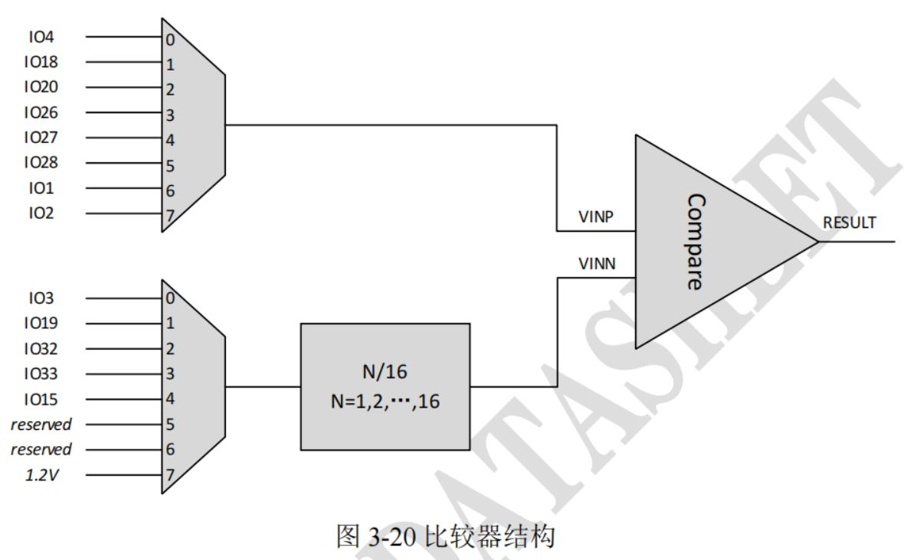

<!-- pg_ing916: 4 模拟比较器（COMPARATOR） -->

# 4 模拟比较器（COMPARATOR） {#ch-comparator}

## 4.1 功能概述 {#功能概述}

模拟比较器比较两个输入电压，输出高电平或低电平。

特性：

- 支持轨到轨输入。
- 4种功耗模式：超低功耗模式(低速超低功耗模式模块功耗低至400nA)、低功耗模式(模块典型功耗为5uA)、中等功耗模式(模块典型功耗为40uA)、高功耗模式(模块典型功耗为200uA)。
- 精确处理低至20mV电压。
- 支持8通道VINP和6通道VINN，VINN其中一个通道来自内部参考电压。
- VINN支持16级阶梯。

## 4.2 使用说明 {#使用说明}



### 4.2.1 模拟比较器模块初始化 {#模拟比较器模块初始化}

```c
typedef struct {
    COMPARATOR_Vinp_t v_in_p;
    COMPARATOR_Vinn_t v_in_n;
    COMPARATOR_Enable_t en;
    COMPARATOR_HysteresisValtage_t hysteresis;
    COMPARATOR_VinnDivision_t vinn_division;
    COMPARATOR_WorkMode_t work_mode;
    COMPARATOR_OutputPolarity_t output_polarity;
} COMPARATOR_SetStateStruct;
```

```c
/**
 * @brief Initialize comparator module
 *
 * @param[in]cmp_set           Initial parameter struct
 */
void COMPARATOR_Initialize(const COMPARATOR_SetStateStruct* cmp_set);
```

### 4.2.2 获取模拟比较器结果 {#获取模拟比较器结果}

模拟比较器模块输出结果的极性可以配置。

如果output_polarity配置为0：如果VINP电压高于VINN，比较器返回的结果是1；如果VINP电压低于VINN，比较器返回的结果是0。

如果output_polarity配置为1：如果VINP电压高于VINN，比较器返回的结果是0；如果VINP电压低于VINN，比较器返回的结果是1。

```c
/**
 * @brief Get comparator result
 *
 * @return                      comparator result
 */
uint8_t COMPARATOR_GetComparatorResult(void);
```

### 4.2.3 设置模拟比较器触发中断 {#设置模拟比较器触发中断}

模拟比较器模块有2个中断源，输出结果的上升沿中断和输出结果的下降沿中断，中断标志需要手动清除。

如果使能了模拟比较器模块的上升沿中断，当输出结果从0变为1时，会触发POSEDGE中断。

如果使能了模拟比较器模块的下降沿中断，当输出结果从1变为0时，会触发NEGEDGE中断。

上升沿或者下降沿触发中断可以单独配置，也可配成双沿触发。

```c
typedef enum
{
    COMPARATOR_DISABLE_INT_MODE          = 0,
    COMPARATOR_NEGEDGE_INT_MODE             ,
    COMPARATOR_POSEDGE_INT_MODE             ,
    COMPARATOR_POSEDGE_AND_NEGEDGE_INT_MODE ,
} COMPARATOR_INTERRUPT_MODE_t;

 /**
 * @brief Set comparator as interrupt source
 *
 * @param[in]int_mode          COMPARATOR_INTERRUPT_MODE_t
 * @return                      0:OK, other:error
 */
int COMPARATOR_SetInterrupt(COMPARATOR_INTERRUPT_MODE_t int_mode);

/**
 * @brief Get comparator interrupt status and clear interrupt flag
 *
 * @return                      interrupt status
 */
COMPARATOR_INTERRUPT_MODE_t COMPARATOR_GetIntStatusAndClear(void);
```

### 4.2.4 设置模拟比较器睡眠唤醒 {#设置模拟比较器睡眠唤醒}

模拟比较器模块可以作为唤醒源唤醒睡眠中的芯片。

根据模拟比较器模块输出结果的电平状态，可以配置成高电平或者低电平唤醒芯片；也可配置成边沿唤醒，上升沿、下降沿、双沿唤醒均可。

```c
typedef enum
{
    COMPARATOR_HIGH_LEVEL_WAKEUP = 0,
    COMPARATOR_LOW_LEVEL_WAKEUP     ,
} COMPARATOR_LEVEL_WAKEUP_t;

typedef enum
{
    COMPARATOR_LEVEL_WAKEUP_MODE            = 0,
    COMPARATOR_POSEDGE_WAKEUP_MODE             ,
    COMPARATOR_NEGEDGE_WAKEUP_MODE             ,
    COMPARATOR_POSEDGE_AND_NEGEDGE_WAKEUP_MODE ,
} COMPARATOR_WAKEUP_MODE_t;

 /**
 * @brief Set comparator as wakeup source from DEEP SLEEP mode
 *
 * @param[in]enable            0:disable, 1:enable
 * @param[in]level             COMPARATOR_LEVEL_WAKEUP_t
 * @param[in]wakeup_mode       COMPARATOR_WAKEUP_MODE_t
 * @return                      0:OK, other:error
 */
int COMPARATOR_SetDeepSleepWakeupSource(uint8_t enable,
                                        COMPARATOR_LEVEL_WAKEUP_t level,
                                        COMPARATOR_WAKEUP_MODE_t wakeup_mode);
```

## 4.3 应用举例： {#应用举例}

### 4.3.1 初始化模拟比较器模块 {#初始化模拟比较器模块}

模拟比较器模块的初始化配置如cmp_set，GPIO18作为VINP，GPIO19作为VINN，30mV的迟滞，VINN没有分压（配置为16/16），超低功耗模式，输出极性配置为0。

例子中模拟比较器模块使能了上升沿中断，使能了上升沿睡眠唤醒。

```c
static uint32_t lpc_pos_cb_isr(void *user_data)
{
    COMPARATOR_INTERRUPT_MODE_t status = COMPARATOR_GetIntStatusAndClear();
    printf("pos isr status %d %d\r\n", status, COMPARATOR_GetComparatorResult());
    return 0;
}
static uint32_t lpc_neg_cb_isr(void *user_data)
{
    COMPARATOR_INTERRUPT_MODE_t status = COMPARATOR_GetIntStatusAndClear();
    printf("neg isr status %d %d\r\n", status, COMPARATOR_GetComparatorResult());
    return 0;
}
const static COMPARATOR_SetStateStruct cmp_set = {
    .v_in_p          = COMPARATOR_VINP1_GPIO18,
    .v_in_n          = COMPARATOR_VINN1_GPIO19,
    .en              = COMPARATOR_ENABLE,
    .hysteresis      = COMPARATOR_30mV_HYSTERRESIS,
    .vinn_division   = COMPARATOR_16_16,
    .work_mode       = COMPARATOR_ULTRA_LOW_POWER,
    .output_polarity = COMPARATOR_OUT1_P_GREATE_N,
};
static void setup_peripherals_comparator(void)
{
    SYSCTRL_ClearClkGateMulti(1 << SYSCTRL_ITEM_APB_PinCtrl);
    SYSCTRL_ClearClkGateMulti(1 << SYSCTRL_ITEM_APB_GPIO0);
    SYSCTRL_ClearClkGateMulti(1 << SYSCTRL_ITEM_APB_GPIO1);
    SYSCTRL_ClearClkGateMulti(1 << SYSCTRL_ITEM_APB_LPC);

    COMPARATOR_Initialize(&cmp_set);

    platform_set_irq_callback(PLATFORM_CB_IRQ_LPC_POS, lpc_pos_cb_isr, 0);
    platform_set_irq_callback(PLATFORM_CB_IRQ_LPC_NEG, lpc_neg_cb_isr, 0);
    COMPARATOR_SetInterrupt(COMPARATOR_POSEDGE_INT_MODE);

    COMPARATOR_SetDeepSleepWakeupSource(1, COMPARATOR_HIGH_LEVEL_WAKEUP, COMPARATOR_POSEDGE_WAKEUP_MODE);
    return;
}
```