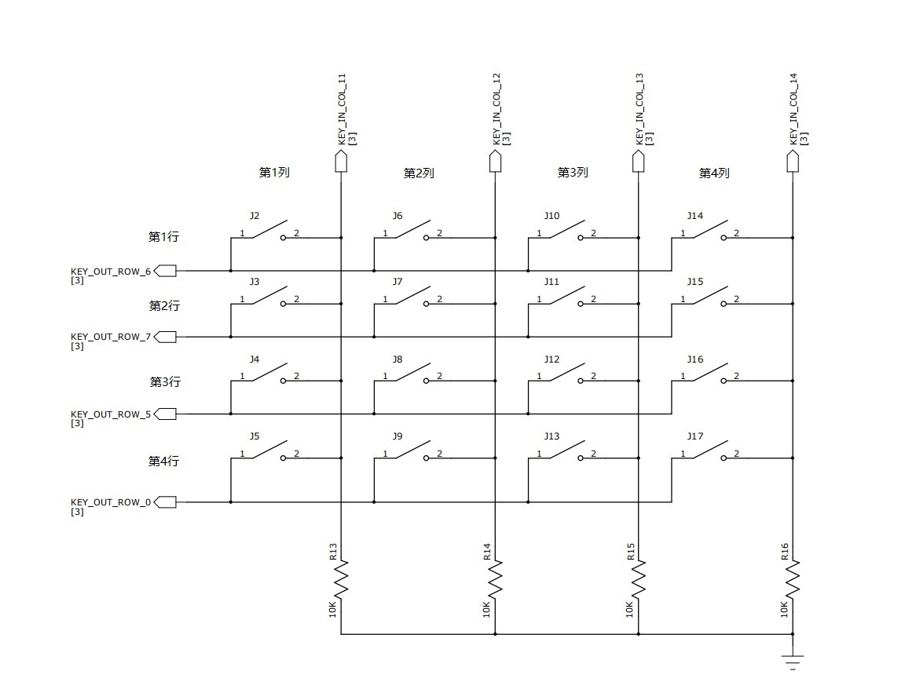
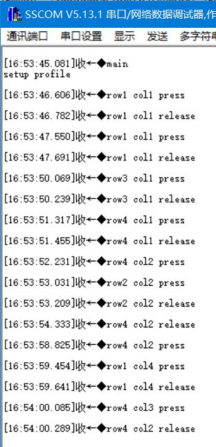

<!-- pg_ing916: 11 硬件键盘扫描控制器（KEYSCAN） -->

# 11 硬件键盘扫描控制器（KEYSCAN） {#ch-keyscan}

## 11.1 功能概述 {#功能概述-5}

特性：

- 可配置矩阵，最大支持18行*18列的键盘矩阵。
- 每个单独的行或者列可以设置启用或者禁用。
- 可配置时钟。
- 支持输入硬件去抖动，去抖时间可配置。
- 支持配置扫描间隔和释放时间，支持多按键同时按下。
- 支持中断和DMA。

## 11.2 使用说明 {#使用说明-5}

以4行*4列的键盘矩阵为例：



### 11.2.1 键盘矩阵的软件描述 {#键盘矩阵的软件描述}

```c
typedef struct {
    KEYSCAN_InColIndex_t in_col;
    GIO_Index_t gpio;
} KEYSCAN_InColList;

typedef struct {
    KEYSCAN_OutRowIndex_t out_row;
    GIO_Index_t gpio;
} KEYSCAN_OutRowList;
```

```c
KEYSCAN_OutRowList key_out_row[] = {
    {KEY_OUT_ROW_6, GIO_GPIO_32}, // 第1行
    {KEY_OUT_ROW_7, GIO_GPIO_33}, // 第2行
    {KEY_OUT_ROW_5, GIO_GPIO_31}, // 第3行
    {KEY_OUT_ROW_0, GIO_GPIO_23}, // 第4行
};
#define key_out_row_num (sizeof(key_out_row) / sizeof(key_out_row[0]))

KEYSCAN_InColList key_in_col[] = {
    {KEY_IN_COL_11, GIO_GPIO_11}, // 第1列
    {KEY_IN_COL_12, GIO_GPIO_12}, // 第2列
    {KEY_IN_COL_13, GIO_GPIO_13}, // 第3列
    {KEY_IN_COL_14, GIO_GPIO_14}, // 第4列
};
#define key_in_col_num (sizeof(key_in_col) / sizeof(key_in_col[0]))
```

第1行按键接到了GPIO32，映射到KEYSCAN模块的ROW6。第1列按键接到了GPIO11，映射到KEYSCAN模块的COL11。以此类推4行4列的键盘阵列。

注意：KEYSCAN的ROW和COL不是随意映射到GPIO，映射关系参考管脚管理（PINCTRL）说明文档。

### 11.2.2 KEYSCAN模块初始化 {#keyscan模块初始化}

```c
typedef struct {
    KEYSCAN_InColList *col;
    int col_num;

    KEYSCAN_OutRowList *row;
    int row_num;

    uint8_t fifo_num_trig_int;
    uint8_t dma_num_trig_int;
    uint8_t dma_en;
    uint8_t int_trig_en;
    uint16_t release_time;
    uint16_t scan_interval;
    uint8_t debounce_counter;
} KEYSCAN_SetStateStruct;
```

```c
/**
 * @brief Initialize keyscan module
 *
 * @param[in]keyscan_set       Initial parameter struct
 * @return                      0 if success else non-0
 */
int KEYSCAN_Initialize(const KEYSCAN_SetStateStruct* keyscan_set);

/**
 * @brief Initialize mapping table of keyboard array row and col
 *
 * @param[in]keyscan_set       Initial parameter struct
 * @param[out]ctx               keyboard array mapping table
 */
void KEYSCAN_InitKeyScanToIdx(const KEYSCAN_SetStateStruct* keyscan_set,
                              KEYSCAN_Ctx *ctx);
```

### 11.2.3 获取扫描到的按键 {#获取扫描到的按键}

KEYSCAN模块使能扫描后会按照行和列的配置开始扫描。模块有FIFO缓存扫描数据。每次扫描循环结束，FIFO中压入1个0x400标志完成一次扫描。

可以配置FIFO中数据个数触发中断或者DMA触发中断：

```c
void KEYSCAN_SetFifoNumTrigInt(uint32_t trig_num);
void KEYSCAN_SetDmaNumTrigInt(uint32_t trig_num);
```

获取FIFO是否为空的状态和数据：

```c
/**
 * @brief Check keyscan FIFO empty or not
 *
 * @return 0: FIFO have data; 1: empty
 */
uint8_t KEYSCAN_GetIntStateFifoEmptyRaw(void);

/**
 * @brief GET keyscan FIFO data
 *
 * @return 0~4 bits: col; 5~9 bits: row; 10 bit: scan cycle end flag
 */
uint16_t KEYSCAN_GetKeyData(void);
```

按键FIFO原始数据的0~4位是按下按键所在的KEYSCAN模块中的col，5~9位是row，注意这个值并不是键盘矩阵中的行和列，可以用下面接口将原始数据解析为键盘矩阵中的行和列：

```c
/**
 * @brief Transfer keyscan FIFO raw data to keyboard array row and col
 *
 * To use this helper function, `ctx` must be initialized with `KEYSCAN_InitKeyScanToIdx`.
 *
 * @param[in]ctx              keyboard array mapping table
 * @param[in]key_data         keyscan FIFO raw data
 * @param[out]row              pressed key's 0-based row index in keyboard array
 * @param[out]col              pressed key's 0-based col index in keyboard array
 * @return                      0: scan cycle end data;
 *                              1: find key pressed, *row and *col are key positions in keyboard array
 */
uint8_t KEYSCAN_KeyDataToRowColIdx(const KEYSCAN_Ctx *ctx, uint32_t key_data,
                                   uint8_t *row, uint8_t *col);
```

## 11.3 应用举例 {#应用举例-1}

### 11.3.1 初始化KEYSCAN模块 {#初始化keyscan模块}

```c
KEYSCAN_OutRowList key_out_row[] = {
    {KEY_OUT_ROW_6, GIO_GPIO_32}, // 第1行
    {KEY_OUT_ROW_7, GIO_GPIO_33}, // 第2行
    {KEY_OUT_ROW_5, GIO_GPIO_31}, // 第3行
    {KEY_OUT_ROW_0, GIO_GPIO_23}, // 第4行
};
#define key_out_row_num (sizeof(key_out_row) / sizeof(key_out_row[0]))

KEYSCAN_InColList key_in_col[] = {
    {KEY_IN_COL_11, GIO_GPIO_11}, // 第1列
    {KEY_IN_COL_12, GIO_GPIO_12}, // 第2列
    {KEY_IN_COL_13, GIO_GPIO_13}, // 第3列
    {KEY_IN_COL_14, GIO_GPIO_14}, // 第4列
};
#define key_in_col_num (sizeof(key_in_col) / sizeof(key_in_col[0]))

static KEYSCAN_Ctx key_ctx = {0};

static KEYSCAN_SetStateStruct keyscan_set = {
    .col               = key_in_col,
    .col_num           = key_in_col_num,
    .row               = key_out_row,
    .row_num           = key_out_row_num,
    .fifo_num_trig_int = 1,
    .release_time      = 110,
    .scan_interval     = 0xFFFF,
    .debounce_counter  = 50,
    .dma_num_trig_int  = 0x10,
    .dma_en            = 0,
    .int_trig_en       = 1,
};

static uint32_t keyscan_cb_isr(void *user_data);
static void setup_peripherals_keyscan(void)
{
    SYSCTRL_ClearClkGateMulti(1 << SYSCTRL_ITEM_APB_KeyScan);
    SYSCTRL_ClearClkGateMulti(1 << SYSCTRL_ITEM_APB_PinCtrl);

    KEYSCAN_Initialize(&keyscan_set);
    KEYSCAN_InitKeyScanToIdx(&keyscan_set, &key_ctx);

    platform_set_irq_callback(PLATFORM_CB_IRQ_KEYSCAN, keyscan_cb_isr, 0);

    return;
}
```

### 11.3.2 中断数据处理 {#中断数据处理}

```c
static uint8_t key_state_buf[2][key_out_row_num][key_in_col_num] = {0};
static uint8_t key_state_last_index = 0;
static uint8_t key_state_now_index = 1;
static void printf_key_state(void)
{
    int row, col;
    for (row = 0; row < key_out_row_num; row++) {
        for (col = 0; col < key_in_col_num; col++) {
            if (key_state_buf[key_state_now_index][row][col] !=
                key_state_buf[key_state_last_index][row][col]) {
                printf("row%u col%u %s\r\n",
                row + 1, col + 1,
                key_state_buf[key_state_now_index][row][col] == 0 ?
                "release" : "press");
            }
        }
    }

    if (key_state_now_index == 0) {
        key_state_now_index = 1;
        key_state_last_index = 0;
    } else {
        key_state_now_index = 0;
        key_state_last_index = 1;
    }

    for (row = 0; row < key_out_row_num; row++) {
        for (col = 0; col < key_in_col_num; col++) {
            key_state_buf[key_state_now_index][row][col] = 0;
        }
    }

    return;
}
static void key_state_clear(void)
{
    int row, col;
    for (row = 0; row < key_out_row_num; row++) {
        for (col = 0; col < key_in_col_num; col++) {
            key_state_buf[0][row][col] = 0;
            key_state_buf[1][row][col] = 0;
        }
    }
}
static uint32_t keyscan_cb_isr(void *user_data)
{
    uint32_t key_data;
    uint8_t key_scan_row;
    uint8_t key_scan_col;
    uint8_t row = 0;
    uint8_t col = 0;
    static uint8_t have_key_pressed = 0;
    static uint8_t no_key_pressed_cnt = 0;

    while (KEYSCAN_GetIntStateFifoEmptyRaw() == 0) {
        key_data = KEYSCAN_GetKeyData();
        if (KEYSCAN_KeyDataToRowColIdx(&key_ctx, key_data, &row, &col)) {
            // 扫描到有按键按下 按键位置为 row col
            key_state_buf[key_state_now_index][row][col] = 1;
            have_key_pressed = 1;
        } else {
            // 完成一次扫描 根据have_key_pressed判断该轮扫描中是否有按键按下
            if (have_key_pressed == 1) {
                have_key_pressed = 0;
                no_key_pressed_cnt = 0;
            } else {
            }

            switch (no_key_pressed_cnt) {
            case 0: // 该轮扫描中有按键按下
                no_key_pressed_cnt++;
                printf_key_state();
                break;
            case 1: // 该轮扫描中没有按键按下 上一轮扫描中有按键按下 说明按键释放
                no_key_pressed_cnt++;
                printf_key_state();
                key_state_clear();
                break;
            case 2: // 连续两轮或以上都没有按键按下
                break;
            default:
                break;
            }
        }
    }
    return 0;
}
```

### 11.3.3 效果 {#效果}

