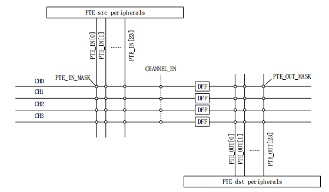

<!-- pg_ing916: 14 PTE简介 -->

# 14 PTE简介 {#ch-pte}

PTE全称Peripheral trigger engine，即外设触发引擎。

其主要作用是使外围设备可以通过其他外围设备或事件独立于CPU进行自主交互。PTE允许外围设备之间可以精确触发。

## 14.1 功能描述 {#功能描述-4}

### 14.1.1 特点 {#特点-4}

- 支持APB总线触发
- 支持4通道PTE
- 支持复用触发源或复用触发地址
- 支持产生CPU中断

### 14.1.2 PTE原理图 {#pte原理图}



图 14.1: PTE原理图

### 14.1.3 功能 {#功能}

PTE具有不同外设之间的可编程内部通道，可以从src外设触发dst外设。PTE可以不依赖CPU而通过硬件的方式触发任务，因此任务可以在同步DFF所占用的周期内启动。

src外设通过pte_in_mask配置，dst外设通过pte_out_mask配置。在SOC中集成了4个PTE通道，每个通道可以通过通道使能信号启用或禁用。

当DFF为高时PTE中断将挂起。在清除PTE中断之前，src外设中断必须被清除，否则另一个启动脉冲将发送到dst外设，这可能会产生未知的错误。

## 14.2 使用方法 {#使用方法-4}

### 14.2.1 方法概述 {#方法概述-3}

建议不使用PTE中断，在dst外设中断里清PTE中断（或关闭PTE通道）。

**1.** 配置触发外设和被触发外设以及相应中断（被触发外设中断一定要有）

**2.** 配置要使用的PTE通道寄存器以及中断（建议不使用PTE中断）

**3.** 使能触发外设，等待PTE中断（如定义）和被触发外设来中断

**4.** 在PTE中断中清PTE mask（如定义）

**5.** 在被触发外设中断中清PTE中断（如定义），如果只触发一次则直接关闭PTE通道

### 14.2.2 注意点 {#注意点-3}

- 未被清空的 src 中断会循环通过 PTE 触发 dst 外设，使程序陷入死循环
- 未被清空的 PTE 中断会循环触发 dst 外设，使程序陷入死循环
- 使用PTE中断会占用CPU资源并增加触发过程操作复杂度、增加出错风险，中断处理程序完全可以在src和dst中断中完成，所以强烈建议不要使用PTE中断

## 14.3 编程指南 {#编程指南-5}

### 14.3.1 src&dst外设 {#srcdst外设}

当前PTE支持的src外设定义在SYSCTRL_PTE_SRC_INT中：

```c
typedef enum
{
    SYSCTRL_PTE_I2C0_INT       = 0,
    SYSCTRL_PTE_I2C1_INT       = 1,
    SYSCTRL_PTE_SARADC_INT     = 2,
    SYSCTRL_PTE_I2S_INT        = 3,
    SYSCTRL_PTE_DMA_INT        = 4,
    SYSCTRL_PTE_IR_INT         = 5,
    SYSCTRL_PTE_KEYSCANNER_INT = 6,
    SYSCTRL_PTE_PWMC0_INT      = 7,
    SYSCTRL_PTE_PWMC1_INT      = 8,
    SYSCTRL_PTE_PWMC2_INT      = 9,
    SYSCTRL_PTE_TIMER0_INT     = 10,
    SYSCTRL_PTE_TIMER1_INT     = 11,
    SYSCTRL_PTE_TIMER2_INT     = 12,
    SYSCTRL_PTE_GPIO0_INT      = 13,
    SYSCTRL_PTE_GPIO1_INT      = 14,
    SYSCTRL_PTE_UART0_INT      = 15,
    SYSCTRL_PTE_UART1_INT      = 16,
    SYSCTRL_PTE_SPI0_INT       = 17,
    SYSCTRL_PTE_SPI1_INT       = 18,
    SYSCTRL_PTE_SPIFLASH       = 19,
    SYSCTRL_PTE_RCT_CNT        = 20,
    SYSCTRL_PTE_IR_WAKEUP      = 21,
    SYSCTRL_PTE_USB_INT        = 22,
    SYSCTRL_PTE_QDEC_INT       = 23,

    SYSCTRL_PTE_SRC_INT_MAX    = 24,
} SYSCTRL_PTE_SRC_INT;
```

dst外设定义在SYSCTRL_PTE_DST_EN中：

```c
typedef enum
{
    SYSCTRL_PTE_I2C0_EN        = 0,
    SYSCTRL_PTE_I2C1_EN        = 1,
    SYSCTRL_PTE_SARADC_EN      = 2,
    SYSCTRL_PTE_I2S_TX_EN      = 3,
    SYSCTRL_PTE_I2S_RX_EN      = 4,
    SYSCTRL_PTE_IR_EN          = 5,
    SYSCTRL_PTE_KEYSCANNER_EN  = 6,
    SYSCTRL_PTE_PWMC0_EN       = 7,
    SYSCTRL_PTE_PWMC1_EN       = 8,
    SYSCTRL_PTE_PWMC2_EN       = 9,
    SYSCTRL_PTE_TIMER0_CH0_EN  = 10,
    SYSCTRL_PTE_TIMER0_CH1_EN  = 11,
    SYSCTRL_PTE_TIMER1_CH0_EN  = 12,
    SYSCTRL_PTE_TIMER1_CH1_EN  = 13,
    SYSCTRL_PTE_TIMER2_CH0_EN  = 14,
    SYSCTRL_PTE_TIMER2_CH1_EN  = 15,

    SYSCTRL_PTE_DST_EN_MAX     = 16,
} SYSCTRL_PTE_DST_EN;
```

### 14.3.2 驱动接口 {#驱动接口-4}

- PTE_ConnectPeripheral：PTE外设连接接口
- PTE_EnableChannel：PTE通道使能接口
- PTE_ChannelClose：PTE通道关闭接口
- PTE_IrqProcess：PTE标准中断程序接口
- PTE_OutPeripheralContinueProcess：dst外设中断标准PTE中继触发接口
- PTE_OutPeripheralEndProcess：dst外设中断标准PTE结束接口

### 14.3.3 代码示例 {#代码示例-4}

下面以Timer0通过PTE通道0触发Timer1为例展示PTE的具体使用方法。

src外设和dst外设配置方法不在本文档介绍范围内，我们默认Timer0和Timer1已经配置好并注册好中断。

```c
#define PTE_CH0    SYSCTRL_PTE_CHANNEL_0
uint32_t Timer0Isr(void *user_data)
{
    TMR_IntClr(APB_TMR0);
    return 0;
}

uint32_t Timer1Isr(void *user_data)
{
    TMR_IntClr(APB_TMR1);
    PTE_OutPeripheralContinueProcess(PTE_CH0);
    return 0;
}

// 仅供参考，不建议注册PTE中断
uint32_t PTE0Isr(void *user_data)
{
    PTE_IrqProcess(PTE_CH0);
    return 0;
}

void PTE_Test(void)
{
    PTE_ConnectPeripheral(PTE_CH0,
                          SYSCTRL_PTE_TIMER0_INT,
                          SYSCTRL_PTE_TIMER1_CH0_EN);
    TMR_Enable(APB_TMR0);
}
```

上面示例会保留PTE通道0并等待下一次触发。如果想要触发之后直接关闭通道代码如下：

```c
uint32_t Timer1Isr(void *user_data)
{
    TMR_IntClr(APB_TMR1);
    PTE_OutPeripheralEndProcess(PTE_CH0);
    return 0;
}
```

关闭通道会断开Timer0和Timer1的连接，再次触发需要重新建立连接。