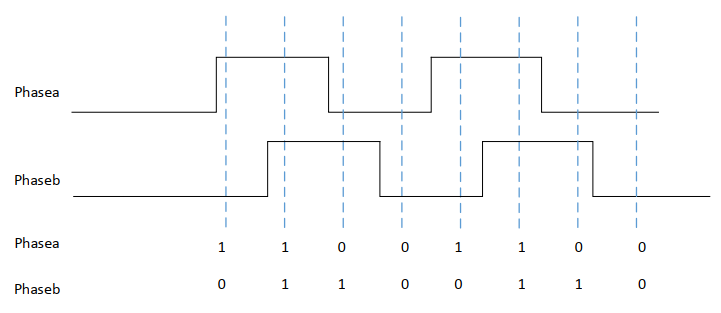
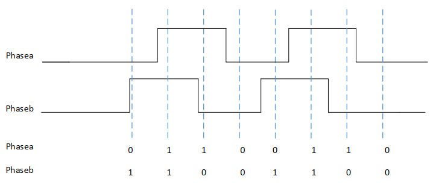

<!-- pg_ing916: 16 QDEC简介 -->

# 16 QDEC简介 {#ch-qdec}

QDEC全称Quadrature Decoder，即正交解码器。

其作用是用来解码来自旋转编码器的脉冲序列，以提供外部设备运动的步长和方向。

## 16.1 功能描述 {#功能描述-5}

### 16.1.1 特点 {#特点-5}

- 可配置时钟
- 支持过滤器
- 支持APB总线
- 支持DMA

### 16.1.2 正转和反转 {#正转和反转}

QDEC是通过采集到phase_a、phase_b相邻两次的数值变化来判断外设的运动方向。

顺时针采集数据如图所示：



图 16.1: QDEC顺时针采集数据

逆时针采集数据如图所示：



图 16.2: QDEC逆时针采集数据

在QDEC数据上，如果引脚配置和连接正确，顺时针转动则采集到的数据逐渐增大，逆时针则数据逐渐减小。

## 16.2 使用方法 {#使用方法-5}

### 16.2.1 方法概述 {#方法概述-4}

方法概述为：GPIO选配，时钟配置，QDEC参数配置以及数据处理。

#### 16.2.1.1 GPIO选择 {#gpio选择}

驱动接口：PINCTRL_SelQDECIn

QDEC的GPIO选择，请参考《ING91682X_BLE5.3_芯片数据手册》中的“IO引脚控制器Pin Controller”一节

对phase_a、phase_b选定要配置的GPIO口，并调用PINCTRL_SelQDECIn接口进行配置。

#### 16.2.1.2 时钟配置 {#时钟配置-2}

驱动接口：SYSCTRL_SelectQDECClk

当前QDEC可以选择使用的时钟源为HCLK时钟或者sclk_slow时钟

出于实际效果和硬件资源等因素考虑，**我们推荐开发者选择sclk_slow作为时钟源**

对所选用的时钟源还需要进行一次分频，分频系数范围为1-1023，默认值为2

这里需要特别注意的是：如果使用sclk_slow时钟， **请务必配置pclk时钟频率不大于qdec时钟源频率**

**注意：** 如果配置pclk频率大于qdec时钟源频率，会出现qdec参数配置失败从而不能正常工作的现象。

为了方便开发者使用，可以直接调用下面提供的接口来配置pclk时钟符合上述要求：

```c
static void QDEC_PclkCfg(void)
{
    if ((APB_SYSCTRL->QdecCfg >> 15) & 1)
        return;
    uint32_t hclk = SYSCTRL_GetHClk();
    uint32_t slowClk = SYSCTRL_GetSlowClk();
    uint8_t div = hclk / slowClk;
    if (hclk % slowClk)
        div++;
    if (!(div >> 4))
        SYSCTRL_SetPClkDiv(div);
}
```

开发者可以将以上代码拷贝到程序里，在配置qdec之前调用即可。

在配置完qdec之后可以选择将pclk恢复到原来频率，实例可参考SDK中HID mouse例程。

#### 16.2.1.3 QDEC参数配置 {#qdec参数配置}

驱动接口：QDEC_EnableQdecDiv、QDEC_QdecCfg

共有3个参数需要配置：qdec_clk_div、filter和miss

其含义分别如下：

- **qdec_clk_div：**用于控制qdec结果上报频率。即多少个时钟周期上报一次采样结果
- **filter：**用于过滤**filter×时钟周期**时长以内的毛刺
- **miss：**用于控制qdec可以自动补偿的最大miss结果数。例如由于滚轮转动过快，导致两次采样中变换了不止一个结果，则此时会自动补偿最多miss个结果。

对于miss值配置此处建议先加入较小的miss值（如miss=1）测试效果，如果效果良好则可以尝试继续加大miss值。在保证性能的基础上，理论上miss值越大越好。

**注意：** 对于miss值的配置需要格外注意，miss值的设置主要考虑到可能由于转动速度过快导致有数据丢失的情况，但此补偿机制容易受设备信号质量影响。对于信号质量很差的设备，如信号很多毛刺，如果加入miss则可能出现**“采样数据跳变”**和**“换向迟钝”**的问题。对于此类设备，建议进行以下几方面尝试：

**1.** 如选用sclk_slow作为时钟源，检查是否有配置pclk频率小于qdec工作频率

**2.** 改用较小工作时钟

**3.** 采用较小的miss值（如miss=1）和较大的filter值

**4.** 采用较大工作时钟（如HCLK时钟），不加miss进行采样

如果偶尔有较小的数据跳变，如5以内，则需判断其可能属于正常情况。

### 16.2.2 注意点 {#注意点-4}

- phase_a、phase_b引脚配置注意区分正反，交换引脚则得到相反的转向
- 配置pclk时钟可能会影响其他外设，建议配好qdec之后将pclk及时恢复
- qdec采样快慢和时钟正相关，和qdec_clk_div大小无关，qdec_clk_div只控制对结果的上报频率
- qdec上报结果会同时触发qdec中断或者DMA_REQ，qdec_clk_div设置过低会占用较多CPU资源
- filter建议选择较大值，受毛刺影响较小，稳定性较好

## 16.3 编程指南 {#编程指南-6}

### 16.3.1 驱动接口 {#驱动接口-5}

- QDEC_QdecCfg：qdec标准配置接口
- QDEC_EnableQdecDiv：qdec_clk_div设置使能接口
- QDEC_ChannelEnable：qdec通道使能接口
- QDEC_GetData：qdec获取数据接口
- QDEC_GetDirection：qdec获取转向接口
- QDEC_Reset：qdec复位接口

### 16.3.2 代码示例 {#代码示例-5}

下面一段代码展示了qdec全部配置并循环读数：

```c
static void QDEC_PclkCfg(void)
{
    if ((APB_SYSCTRL->QdecCfg >> 15) & 1)
        return;
    uint32_t hclk = SYSCTRL_GetHClk();
    uint32_t slowClk = SYSCTRL_GetSlowClk();
    uint8_t div = hclk / slowClk;
    if (hclk % slowClk)
        div++;
    if (!(div >> 4))
        SYSCTRL_SetPClkDiv(div);
}
void test(void)
{
    // setup qdec
    SYSCTRL_ClearClkGateMulti((1 << SYSCTRL_ITEM_APB_PinCtrl) |
                              (1 << SYSCTRL_ITEM_APB_QDEC));
    SYSCTRL_ReleaseBlock(SYSCTRL_ITEM_APB_QDEC);
    PINCTRL_SelQDECIn(16, 17);    // set GPIO16=phase_a, GPIO17=phase_b

    SYSCTRL_SelectQDECClk(SYSCTRL_CLK_SLOW, 100);
    QDEC_PclkCfg();    // set pclk not bigger than sclk_slow
    QDEC_EnableQdecDiv(QDEC_DIV_1024);
    QDEC_QdecCfg(50, 1);
    QDEC_ChannelEnable(1);

    // print qdec data and direction when rotate the mouse wheel manually
    uint16_t preData = 0;
    uint16_t data = 0;
    uint8_t dir;
    while(1) {
        data = QDEC_GetData();
        dir = QDEC_GetDirection();
        if (data != preData) {
            if (dir) {
                printf("data: %d, %s\n", data, "anticlockwise");
            } else {
                printf("data: %d, %s\n", data, "clockwise");
            }
        }
        preData = data;
    }
}
```

当手动转动鼠标滚轮时，会打印出收到的qdec数据和转向。

推荐开发者采用timer定时轮询的方式读取qdec数据，并进行数据处理和上报。具体的qdec详细使用实例请参考SDK中HID mouse例程。