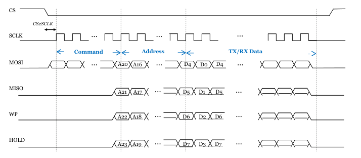
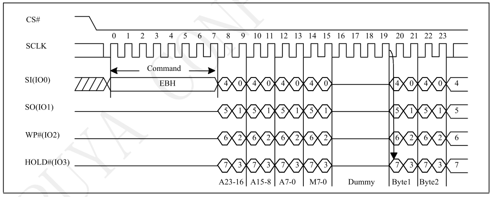

<!-- pg_ing916: 18 串行外围设备接口（SPI） -->

# 18 串行外围设备接口（SPI） {#ch-spi}

SPI全称为Serial Peripheral interface即串行外围设备接口。 SPI是一种高速同步的通信总线。一般使用四个IO：SDI（数据输入），SDO（数据输出），SCK（时钟），CS（片选）。针对Flash的QSPI则还需要使用额外的两个IO：WP（写保护），HOLD（保持）。

## 18.1 功能概述 {#功能概述-7}

- 两个SPI模块
- 支持SPI主(Master)&从(Slave)模式
- 支持Quad SPI，可以从外挂Flash执行代码
- 独立的RX&TX FIFO，深度为8个word
- 支持DMA
- 支持XIP(SPI0)

## 18.2 使用说明 {#使用说明-8}

### 18.2.1 时钟以及IO配置 {#时钟以及io配置}

使用模块之前，需要打开相应的时钟，并且配置IO（查看对应datasheet获取可用的IO）：

1. 通过`SYSCTRL_ClearClkGateMulti`打开SPI时钟，例如SPI1则需要打开`SYSCTRL_ITEM_APB_SPI1`。
2. 配置IO的输入功能`PINCTRL_SelSpiIn`，没有使用到的IO可以使用IO_NOT_A_PIN替代。
3. 使用`PINCTRL_SetPadMux`配置IO的输出功能。
4. 对于Slave的输入，例如CLK需要保持默认低电平，则使用`PINCTRL_Pull`配置IO的上拉功能。
5. 打开SPI中断`platform_set_irq_callback`。
6. 对于时钟大于20M的使用场景，IO的选择有特殊要求，请参考`高速时钟和IO映射`。

以SPI1为例，高速IO可以为：

```c
#define SPI_MIC_CLK         GIO_GPIO_7
#define SPI_MIC_MOSI        GIO_GPIO_8
#define SPI_MIC_MISO        GIO_GPIO_9
#define SPI_MIC_CS          GIO_GPIO_10
#define SPI_MIC_WP          GIO_GPIO_11
#define SPI_MIC_HOLD        GIO_GPIO_12
```

下述示例可以将指定IO映射到SPI1的Master模式：

```c
static void setup_peripherals_spi_pin(void)
{
    SYSCTRL_ClearClkGateMulti(    (1 << SYSCTRL_ITEM_APB_SPI1)
                                | (1 << SYSCTRL_ITEM_APB_PinCtrl));

    PINCTRL_SelSpiIn(SPI_PORT_1, SPI_MIC_CLK, SPI_MIC_CS, SPI_MIC_HOLD,
                     SPI_MIC_WP, SPI_MIC_MISO, SPI_MIC_MOSI);
    PINCTRL_SetPadMux(SPI_MIC_CLK, IO_SOURCE_SPI1_CLK_OUT);
    PINCTRL_SetPadMux(SPI_MIC_CS, IO_SOURCE_SPI1_CSN_OUT);
    PINCTRL_SetPadMux(SPI_MIC_MOSI, IO_SOURCE_SPI1_MOSI_OUT);

    platform_set_irq_callback(PLATFORM_CB_IRQ_APBSPI, peripherals_spi_isr, NULL);
```

如果是Slave模式，则需要额外配置默认上拉，并且输入输出IO有区别：

```c
static void setup_peripherals_spi_pin(void)
{
    SYSCTRL_ClearClkGateMulti(    (1 << SYSCTRL_ITEM_APB_SPI1)
                                | (1 << SYSCTRL_ITEM_APB_PinCtrl)));

    PINCTRL_Pull(SPI_MIC_CLK,PINCTRL_PULL_DOWN);
    PINCTRL_Pull(SPI_MIC_CS,PINCTRL_PULL_UP);
    PINCTRL_SelSpiIn(SPI_PORT_1, SPI_MIC_CLK, SPI_MIC_CS, SPI_MIC_HOLD,
                     SPI_MIC_WP, SPI_MIC_MISO, SPI_MIC_MOSI);
    PINCTRL_SetPadMux(SPI_MIC_CLK, IO_SOURCE_SPI1_CLK_OUT);
    PINCTRL_SetPadMux(SPI_MIC_MISO, IO_SOURCE_SPI1_MISO_OUT);

    platform_set_irq_callback(PLATFORM_CB_IRQ_APBSPI, peripherals_spi_isr, NULL);
```

### 18.2.2 模块初始化 {#模块初始化-2}

模块的初始化通过`apSSP_DeviceParametersSet`和结构体`apSSP_sDeviceControlBlock`实现，结构体各个参数为：

- `eSclkDiv`：时钟分频因子，决定了SPI的时钟速率。该参数和SPI模块时钟有关，在默认配置下，SPI模块时钟为24M，`eSclkDiv`可以直接使用`SPI_INTERFACETIMINGSCLKDIV_DEFAULT_xx`宏定义。对于更高的时钟，需要首先提高SPI模块时钟，然后再计算`eSclkDiv`，计算公式和配置方式请参考章节`其他配置`->`时钟配置`。
- `eSCLKPhase`：上升沿还是下降沿采样，参考`SPI_TransFmt_CPHA_e`。
- `eSCLKPolarity`：时钟默认是低电平还是高电平，参考`SPI_TransFmt_CPOL_e`。
- `eLsbMsbOrder`：bit传输顺序是LSB还是MSB，默认是MSB，参考`SPI_TransFmt_LSB_e`。
- `eDataSize`：每个传输单位的bit个数，8/16/32bit，参考`SPI_TransFmt_DataLen_e`。
- `eMasterSlaveMode`：选择是Master还是Slave模式，参考`SPI_TransFmt_SlvMode_e`。
- `eReadWriteMode`：选择传输模式：只读/只写/同时读写，参考`SPI_TransCtrl_TransMode_e`。
- `eQuadMode`：选择是普通SPI还是QSPI，参考`SPI_TransCtrl_DualQuad_e`。
- `eWriteTransCnt`：每次发送的单位个数，每个单位`eDataSize`个bit，达到单位个数后，CS将会拉高，代表一次传输结束。
- `eReadTransCnt`：每次接收的单位个数，每个单位`eDataSize`个bit，达到单位个数后，CS将会拉高，代表一次传输结束。
- `eAddrEn`：是否需要在数据之前发送地址，只适用Master，参考`SPI_TransCtrl_AddrEn_e`。
- `eCmdEn`：是否需要在数据之前发送命令，只适用Master，参考`SPI_TransCtrl_CmdEn_e`。
- `eInterruptMask`：需要打开的SPI中断类型，比如SPI传输结束中断和FIFO中断，参考`bsSPI_INTREN_xx`。
- `TxThres`：触发TX FIFO中断的门限值，比如可以为`eWriteTransCnt/2`，参考`apSSP_SetTxThres`。
- `RxThres`：触发RX FIFO中断的门限值，比如可以为`eReadTransCnt/2`，参考`apSSP_SetRxThres`。
- `SlaveDataOnly`：Slave模式下生效，如果只有数据，需要设置为打开，如果包含地址`eAddrEn`或者命令`eCmdEn`，需要设置改参数为DISABLE，参考`SPI_TransCtrl_SlvDataOnly_e`。
- `eAddrLen`：如果打开了`eAddrEn`，需要选择地址长度，参考`SPI_TransFmt_AddrLen_e`。

具体使用请参考`编程指南`。

### 18.2.3 中断配置 {#中断配置-1}

通过`eInterruptMask`打开需要的中断:

- `bsSPI_INTREN_ENDINTEN`：传输结束（CS拉高）之后会触发该中断。
- `bsSPI_INTREN_TXFIFOINTEN`：到达`TxThres`门限值之后，触发FIFO中断。
- `bsSPI_INTREN_RXFIFOINTEN`：到达`RxThres`门限值之后，触发FIFO中断。

  - 通过`apSSP_GetDataNumInRxFifo`来判断当前FIFO中有效数据的个数。使用`apSSP_ReadFIFO`来读取FIFO中的数据，直到FIFO为空。

### 18.2.4 编程指南 {#编程指南-7}

以下提供不同场景下的代码实现供参考。

#### 18.2.4.1 场景1：同时读写，不使用DMA {#场景1同时读写不使用dma}

其中SPI主（Master）和SPI从（Slave）配置为同时读写模式，CPU操作读写，没有使用DMA 配置之前需要决定使用的IO，如果是普通模式，则不需要SPI_MIC_WP和SPI_MIC_HOLD。

##### 18.2.4.1.1 Master配置 {#master配置-5}

- 配置IO，参考`时钟以及IO配置`。
- 模块初始化：

  假设每个传输单元是32bit，则mode 0下的Master模式初始化配置为：

  ```c
  #define SPI_MASTER_PARAM(DataLen) { SPI_INTERFACETIMINGSCLKDIV_DEFAULT_2M, \
  SPI_CPHA_ODD_SCLK_EDGES, SPI_CPOL_SCLK_LOW_IN_IDLE_STATES, \
  SPI_LSB_MOST_SIGNIFICANT_BIT_FIRST, SPI_DATALEN_32_BITS, \
  SPI_SLVMODE_MASTER_MODE, SPI_TRANSMODE_WRITE_READ_SAME_TIME, \
  SPI_DUALQUAD_REGULAR_MODE, DataLen, DataLen, \
  SPI_ADDREN_DISABLE, SPI_CMDEN_DISABLE, (1 << bsSPI_INTREN_ENDINTEN), \
  0, 0, SPI_SLVDATAONLY_ENABLE, SPI_ADDRLEN_1_BYTE }
  ```

  使用API`apSSP_DeviceParametersSet`来初始化SPI模块：

  ```c
  #define DATA_LEN (SPI_FIFO_DEPTH)
  static void setup_peripherals_spi_module(void)
  {
      apSSP_sDeviceControlBlock pParam = SPI_MASTER_PARAM(DATA_LEN);
      apSSP_DeviceParametersSet(APB_SSP1, &pParam);
  }
  ```
- 中断实现

  该示例中只打开了SPI ENDINT中断，该中断触发标志传输结束，清除中断状态

  ```c
  static uint32_t peripherals_spi_isr(void *user_data)
  {
    uint32_t stat = apSSP_GetIntRawStatus(APB_SSP1);

    if(stat & (1 << bsSPI_INTREN_ENDINTEN))
    {
      apSSP_ClearIntStatus(APB_SSP1, 1 << bsSPI_INTREN_ENDINTEN);
    }  
  }
  ```
- 发送数据

  发送数据需要填充数据到TX FIFO并且触发传输：

  - 使用`apSSP_WriteFIFO`写入需要传输的数据，通过`apSSP_TxFifoFull`来判断TX FIFO状态，写入数据直到FIFO变满。FIFO的深度为8，超过8个数据可以分为多次发送。
  - `apSSP_WriteCmd`来触发传输，此场景中`eAddrEn`或者`eCmdEn`都是关闭的，但是仍然需要填充一个任意数据（比如0x00）来触发传输。
  - 使用`apSSP_GetSPIActiveStatus`等待发送结束，或者查看对应中断。
  - 发送的数据格式和长度需要和`eDataSize`等参数对应。

  ```c
  uint32_t write_data[DATA_LEN];
  void peripherals_spi_send_data(void)
  {
    apSSP_WriteCmd(APB_SSP1, 0x00, 0x00);//trigger transfer
    for(i = 0; i < DATA_LEN; i++)
    {
      if(apSSP_TxFifoFull(APB_SSP1)){ break; }
      apSSP_WriteFIFO(APB_SSP1, write_data[i]);
    }
    while(apSSP_GetSPIActiveStatus(APB_SSP1));
  }
  ```
- 接收数据

  在SPI发送结束后，通过`apSSP_GetDataNumInRxFifo`查看并读取RX FIFO中的数据。

  ```c
  uint32_t read_data[DATA_LEN];
  uint32_t num = apSSP_GetDataNumInRxFifo(APB_SSP1);
  for(i = 0; i < num; i++)
  {
    apSSP_ReadFIFO(APB_SSP1, &read_data[i]);
  }
  ```
- 使用流程

  - 设置IO，setup_peripherals_spi_pin()。
  - 初始化SPI，setup_peripherals_spi_module()。
  - 在需要时候发送SPI数据，peripherals_spi_send_data()。
  - 检查中断状态。

##### 18.2.4.1.2 Slave配置 {#slave配置-5}

- 配置IO，参考`时钟以及IO配置`。
- 模块初始化：

  Slave的初始化和Master相同，只需要将mode切换为`SPI_SLVMODE_SLAVE_MODE`：

  ```c
  #define SPI_SLAVE_PARAM(DataLen) { SPI_INTERFACETIMINGSCLKDIV_DEFAULT_2M, \
  SPI_CPHA_ODD_SCLK_EDGES, SPI_CPOL_SCLK_LOW_IN_IDLE_STATES, \
  SPI_LSB_MOST_SIGNIFICANT_BIT_FIRST, SPI_DATALEN_32_BITS, \
  SPI_SLVMODE_SLAVE_MODE, SPI_TRANSMODE_WRITE_READ_SAME_TIME, \
  SPI_DUALQUAD_REGULAR_MODE, DataLen, DataLen, \
  SPI_ADDREN_DISABLE, SPI_CMDEN_DISABLE, (1 << bsSPI_INTREN_ENDINTEN), \
  0, 0, SPI_SLVDATAONLY_ENABLE, SPI_ADDRLEN_1_BYTE }
  ```

  调用`apSSP_DeviceParametersSet`来初始化SPI模块：

  ```c
  static void setup_peripherals_spi_module(void)
  {
      apSSP_sDeviceControlBlock pParam = SPI_SLAVE_PARAM(DATA_LEN);
      apSSP_DeviceParametersSet(APB_SSP1, &pParam);
  }
  ```
- 发送数据

  Slave的待发送数据需要提前放到TX FIFO中。 比如在初始化之后，就可以往FIFO中填充发送数据，同时需要判断`apSSP_TxFifoFull`：

  ```c
  for(i = 0; i < DATA_LEN; i++)
  {
    if(apSSP_TxFifoFull(APB_SSP1)){ break; }
    apSSP_WriteFIFO(APB_SSP1, write_data[i]);
  }
  ```
- 接收数据

  Slave的数据接收需要在中断中进行，`bsSPI_INTREN_ENDINTEN`中断代表传输结束，此时可以读取RX FIFO中的内容，如果数据长度大于FIFO深度，则需要打开`RxThres`，在FIFO中断中读取接收数据，或者使用DMA方式，否则数据会丢失。

  ```c
  static uint32_t peripherals_spi_isr(void *user_data)
  {
    uint32_t stat = apSSP_GetIntRawStatus(APB_SSP1), i;
    if(stat & (1 << bsSPI_INTREN_ENDINTEN))
    {
      uint32_t num = apSSP_GetDataNumInRxFifo(APB_SSP1);
      for(i = 0; i < num; i++)
      {
        apSSP_ReadFIFO(APB_SSP1, &read_data[i]);
      }

      apSSP_ClearIntStatus(APB_SSP1, 1 << bsSPI_INTREN_ENDINTEN);

    }
  }
  ```
- 使用流程

  - 设置IO，setup_peripherals_spi_pin()。
  - 初始化SPI，setup_peripherals_spi_module()。
  - 观察SPI中断，中断触发代表当前传输结束。

#### 18.2.4.2 场景2：同时读写，使用DMA {#场景2同时读写使用dma}

其中SPI主从配置为同时读写模式，同时使用DMA进行读写。 配置之前需要决定使用的IO，如果是普通模式，则不需要SPI_MIC_WP和SPI_MIC_HOLD。

##### 18.2.4.2.1 Master配置 {#master配置-6}

- 配置IO，参考`时钟以及IO配置`。
- 模块初始化，参考场景1`Master配置`。
- DMA初始化

  使用之前需要初始化DMA模块：

  ```c
  static void setup_peripherals_dma_module(void)
  {
      SYSCTRL_ClearClkGateMulti(1 << SYSCTRL_ClkGate_APB_DMA);
      DMA_Reset(1);
      DMA_Reset(0);
  }
  ```
- DMA设置

  1. 设置DMA将指定地址的数据搬运到SPI1 TX FIFO，并打开DMA。 SPI1启动后，搬运自动开始：

  ```c
  void peripherals_spi_dma_to_txfifo(int channel_id, void *src, int size)
  {
      DMA_Descriptor descriptor __attribute__((aligned (8)));

      descriptor.Next = (DMA_Descriptor *)0;
      DMA_PrepareMem2Peripheral(&descriptor,SYSCTRL_DMA_SPI1_TX,
                                src,size,DMA_ADDRESS_INC,0);
      DMA_EnableChannel(channel_id, &descriptor);
  }
  ```

  1. 设置DMA将SPI1 RX FIFO的数据搬运到指定地址：

  ```c
  void peripherals_spi_rxfifo_to_dma(int channel_id, void *dst, int size)
  {
      DMA_Descriptor descriptor __attribute__((aligned (8)));

      descriptor.Next = (DMA_Descriptor *)0;
      DMA_PreparePeripheral2Mem(&descriptor,dst,SYSCTRL_DMA_SPI1_RX,
                                size,DMA_ADDRESS_INC,0);
      DMA_EnableChannel(channel_id, &descriptor);
  }
  ```
- 中断实现

  该示例中只打开了SPI ENDINT中断，该中断触发标志传输结束，清除中断状态

  ```c
  static uint32_t peripherals_spi_isr(void *user_data)
  {
    uint32_t stat = apSSP_GetIntRawStatus(APB_SSP1);

    if(stat & (1 << bsSPI_INTREN_ENDINTEN))
    {
      apSSP_ClearIntStatus(APB_SSP1, 1 << bsSPI_INTREN_ENDINTEN);
    }  
  }
  ```
- 接收数据配置

  1. 首先需要打开 SPI 模块中的DMA功能`apSSP_SetRxDmaEn`。
  2. 设置每次传输时接收和发射的个数，改参数已经在模块初始化中设置过了，此处为可选项，如果需要更新，可以通过`apSSP_SetTransferControlRdTranCnt`和`apSSP_SetTransferControlWrTranCnt`来更新。注意：该场景下，发射和接收的个数需要相同。
  3. 配置DMA。

  ```c
  #define SPI_DMA_RX_CHANNEL   (1)//DMA channel 1
  uint32_t read_data[DATA_LEN];

  void peripherals_spi_read_data(void)
  {
    apSSP_SetRxDmaEn(APB_SSP1,1);
    apSSP_SetTransferControlRdTranCnt(APB_SSP1,DATA_LEN);
    peripherals_spi_rxfifo_to_dma(SPI_DMA_RX_CHANNEL, read_data,
                                  sizeof(read_data));
  }
  ```
- 发送数据配置

  类似于接收，发射需要打开SPI的DMA功能，并且配置DMA。

  ```c
  #define SPI_DMA_TX_CHANNEL   (0)//DMA channel 0
  uint32_t write_data[DATA_LEN];

  void peripherals_spi_push_data(void)
  {
    apSSP_SetTxDmaEn(APB_SSP1,1);
    apSSP_SetTransferControlWrTranCnt(APB_SSP1,DATA_LEN);
    peripherals_spi_dma_to_txfifo(SPI_DMA_TX_CHANNEL, write_data,
                                  sizeof(write_data));
  }
  ```
- 发送数据

  1. 在需要发送数据时，通过DMA填充待发射数据到TX FIFO。
  2. 配置接收数据的DMA，同时读写模式下，发射和接收同步进行。
  3. 配置命令触发传输。
  4. 等待发射结束`apSSP_GetSPIActiveStatus`，关闭DMA功能。

  ```c
  void peripherals_spi_send_data(void)
  {
    peripherals_spi_read_data();
    peripherals_spi_push_data();
    apSSP_WriteCmd(APB_SSP1, 0x00, 0x00);//trigger transfer
    while(apSSP_GetSPIActiveStatus(APB_SSP1));
    apSSP_SetTxDmaEn(APB_SSP1,0);
  }
  ```
- 使用流程

  - 设置IO，setup_peripherals_spi_pin()。
  - 初始化SPI，setup_peripherals_spi_module()。
  - 初始化DMA，setup_peripherals_dma_module()。
  - 在需要时候发送SPI数据，peripherals_spi_send_data()。
  - 检查中断状态。

##### 18.2.4.2.2 Slave配置 {#slave配置-6}

- 配置IO，参考`时钟以及IO配置`。
- 模块初始化，参考场景1`Slave配置`。
- DMA初始化，与Master的DMA初始化相同，参考`setup_peripherals_dma_module`。
- DMA设置，与Master的DMA设置相同，参考`peripherals_spi_dma_to_txfifo` 和`peripherals_spi_rxfifo_to_dma`。
- 接收数据配置，与Master相同，参考`peripherals_spi_read_data`。
- 发送数据配置，与Master相同，参考`peripherals_spi_push_data`。
- 传输前准备

  1. 对于Slave，如果需要在第一次传输时发送数据，则需要提前将需要发送的数据配置到DMA，配置`peripherals_spi_push_data`。
  2. 使用`peripherals_spi_read_data`配置接收DMA，等待Master传输。

  ```c
  peripherals_spi_read_data();
  peripherals_spi_push_data();
  ```
- 中断实现

  1. `bsSPI_INTREN_ENDINTEN`的触发代表当前传输结束。
  2. 检查接收数据。
  3. 如果需要准备下一次传输，使用`peripherals_spi_read_data`建立接收DMA。
  4. 如果需要准备下一次传输，准备发送数据，使用`peripherals_spi_push_data`建立发射DMA。
  5. 清除中断标志。

  ```c
  static uint32_t peripherals_spi_isr(void *user_data)
  {
    uint32_t stat = apSSP_GetIntRawStatus(APB_SSP1);

    if(stat & (1 << bsSPI_INTREN_ENDINTEN))
    {
      peripherals_spi_read_data();
      peripherals_spi_push_data();
      apSSP_ClearIntStatus(APB_SSP1, 1 << bsSPI_INTREN_ENDINTEN);
    }  
  }
  ```
- 使用流程

  - 设置IO，setup_peripherals_spi_pin()。
  - 初始化SPI，setup_peripherals_spi_module()。
  - 初始化DMA，setup_peripherals_dma_module()。
  - 设置接收DMA，peripherals_spi_read_data()。
  - 设置发射DMA，peripherals_spi_push_data()。
  - 观察SPI中断，中断触发代表当前接收结束。

### 18.2.5 其他配置 {#其他配置}

#### 18.2.5.1 时钟配置（pParam.eSclkDiv） {#时钟配置pparam.esclkdiv}

##### 18.2.5.1.1 默认配置 {#默认配置}

对于默认配置，SPI时钟的配置通过 `pParam.eSclkDiv` 来实现，计算公式为：(spi\quad interface\quad clock)/(2\times(eSclkDiv + 1))，其中默认配置下，`spi interface clock` 为24M，因此可以得到不同时钟下的`eSclkDiv`：

```c
#define SPI_INTERFACETIMINGSCLKDIV_DEFAULT_6M    (1)
#define SPI_INTERFACETIMINGSCLKDIV_DEFAULT_4M    (2)
#define SPI_INTERFACETIMINGSCLKDIV_DEFAULT_3M    (3)
#define SPI_INTERFACETIMINGSCLKDIV_DEFAULT_2M4   (4)
#define SPI_INTERFACETIMINGSCLKDIV_DEFAULT_2M    (5)
```

##### 18.2.5.1.2 高速时钟配置 {#高速时钟配置}

SPI0和SPI1的高速时钟配置有一些不同，**注意：高速时钟需要使用特定的IO，请查看`SPI高速时钟和pin的映射`**。

###### 18.2.5.1.2.1 SPI0 {#spi0}

对于更高的时钟，需要在配置`pParam.eSclkDiv`之前打开额外配置，打开方式如下

- 首先通过`SYSCTRL_GetPLLClk()`获取PLL时钟，此处假设为336M。
- 切换SPI0到高速时钟`SYSCTRL_SelectSpiClk(SPI_PORT_0,SYSCTRL_CLK_HCLK+1)`,此处的入参代表分频比2，即最终的`spi interface clock`为336/2 = 168.0M。
- 通过计算公式(spi\quad interface\quad clock)/(2\times(eSclkDiv + 1)) 得到不同时钟下的`eSclkDiv`。
- 通过`SYSCTRL_GetClk(SYSCTRL_ITEM_AHB_SPI0)`来确认interface clock是否生效。

在以上举例中，可以使用以下宏定义来配置`pParam.eSclkDiv`

```c
#define SPI_INTERFACETIMINGSCLKDIV_SPI0_21M    (1)
#define SPI_INTERFACETIMINGSCLKDIV_SPI0_14M    (2)
```

以下的API可以实现相同的功能，假设PLL时钟为336M，入参为21000000(21M),则该API可以完成SPI0时钟配置，并且返回`eSclkDiv`。**入参需要和PLL成倍数关系**。

```c
uint8_t setup_peripherals_spi_0_high_speed_interface_clk(uint32_t spiClk)
{
    //for spi0 only
    uint8_t eSclkDiv = 0;
    uint32_t spiIntfClk;
    uint32_t pllClk = SYSCTRL_GetPLLClk()；

    SYSCTRL_SelectSpiClk(SPI_PORT_0,SYSCTRL_CLK_PLL_DIV_1+1);

    spiIntfClk = SYSCTRL_GetClk(SYSCTRL_ITEM_AHB_SPI0);
    eSclkDiv = ((spiIntfClk/spiClk)/2)-1;

    return eSclkDiv;
}
```

调用方式为：

```c
pParam.eSclkDiv = setup_peripherals_spi_0_high_speed_interface_clk(21000000);
```

###### 18.2.5.1.2.2 SPI1 {#spi1}

对于更高的时钟，需要在配置`pParam.eSclkDiv`之前打开HCLK配置，打开方式如下：

- 首先查看HCLK频率:`SYSCTRL_GetHClk()`。

  - 如果有需要可以使用`SYSCTRL_SelectHClk(SYSCTRL_CLK_PLL_DIV_1+3);`来修改HCLK时钟。修改方法为，首先使用`SYSCTRL_GetPLLClk()`获取PLL时钟，入参为分频比，假如PLL时钟为336M，则`SYSCTRL_CLK_PLL_DIV_1+6`为7分频，最终HClk为336/7=48M。
- 将SPI1时钟切换到HCLK:`SYSCTRL_SelectSpiClk(SPI_PORT_1,SYSCTRL_CLK_HCLK)`。
- 通过计算公式(spi\quad interface\quad clock)/(2\times(eSclkDiv + 1)) 得到不同时钟下的`eSclkDiv`。
- 通过`SYSCTRL_GetClk(SYSCTRL_ITEM_APB_SPI1)`来确认interface clock是否生效。

假设HCLK为112M（即`spi interface clock`），通过计算公式可以得到不同时钟下的`eSclkDiv`为：

```c
#define SPI_INTERFACETIMINGSCLKDIV_SPI1_19M    (2)
#define SPI_INTERFACETIMINGSCLKDIV_SPI1_14M    (3)
```

以下的API可以实现相同的功能，假设HCLK时钟为112M，入参为14000000(14M),则该API可以完成SPI1时钟配置，并且返回`eSclkDiv`。**入参需要和HCLK成倍数关系**

```c
uint8_t setup_peripherals_spi_1_high_speed_interface_clk(uint32_t spiClk)
{
    uint8_t eSclkDiv = 0;
    uint32_t spiIntfClk;
    uint32_t hClk = SYSCTRL_GetHClk();

    SYSCTRL_SelectSpiClk(SPI_PORT_1,SYSCTRL_CLK_HCLK);

    spiIntfClk = SYSCTRL_GetClk(SYSCTRL_ITEM_APB_SPI1);
    eSclkDiv = ((spiIntfClk/spiClk)/2)-1;

    return eSclkDiv;
}
```

调用方式为：

```c
pParam.eSclkDiv = setup_peripherals_spi_1_high_speed_interface_clk(14000000);
```

#### 18.2.5.2 QSPI 使用 {#qspi-使用}

QSPI的bit顺序以及MOSI/MISO的含义和普通SPI不同，但大部分读写的配置是共享的。 使用QSPI需要在普通SPI的配置的基础上，做一些额外修改：

##### 18.2.5.2.1 IO 配置 {#io-配置-1}

QSPI用到了CLK,CS,MOSI,MISO,HOLD,WP,主从都需要配置为输入输出：

```c
    PINCTRL_SelSpiIn(SPI_PORT_1, SPI_MIC_CLK, SPI_MIC_CS, SPI_MIC_HOLD,
                     SPI_MIC_WP, SPI_MIC_MISO, SPI_MIC_MOSI);
    PINCTRL_SetPadMux(SPI_MIC_CLK, IO_SOURCE_SPI1_CLK_OUT);
    PINCTRL_SetPadMux(SPI_MIC_CS, IO_SOURCE_SPI1_CSN_OUT);
    PINCTRL_SetPadMux(SPI_MIC_MOSI, IO_SOURCE_SPI1_MOSI_OUT);
    PINCTRL_SetPadMux(SPI_MIC_MISO, IO_SOURCE_SPI1_MISO_OUT);
    PINCTRL_SetPadMux(SPI_MIC_WP, IO_SOURCE_SPI1_WP_OUT);
    PINCTRL_SetPadMux(SPI_MIC_HOLD, IO_SOURCE_SPI1_HOLD_OUT);
```

对于Slave，则还需要额外配置CS的内部上拉：

```c
    PINCTRL_Pull(SPI_MIC_CLK,PINCTRL_PULL_DOWN);
    PINCTRL_Pull(SPI_MIC_CS,PINCTRL_PULL_UP);
```

##### 18.2.5.2.2 QSPI Master {#qspi-master}

###### 18.2.5.2.2.1 pParam 配置 {#pparam-配置}

QSPI的部分`pParam`参数需要修改为如下，同时`Addr`和`Cmd`需要打开：

```c
    pParam.eQuadMode = SPI_DUALQUAD_QUAD_IO_MODE;
    pParam.SlaveDataOnly = SPI_SLVDATAONLY_DISABLE;
    pParam.eAddrEn = SPI_ADDREN_ENABLE;
    pParam.eCmdEn = SPI_CMDEN_ENABLE;
```

此外，Master还需要配置`pParam.eReadWriteMode`, 例如：

- `SPI_TRANSMODE_WRITE_READ`： 读和写顺序执行，比如首先利用四线完成写操作，然后再读。
- `SPI_TRANSMODE_WRITE_DUMMY_READ`： 先写后读，在Write和Read之间添加dummy（默认为8个clk cycle）。

对于Slave，则读写顺序相反：

- `SPI_TRANSMODE_READ_WRITE`：先读后写。
- `SPI_TRANSMODE_READ_DUMMY_WRITE`： 先读后写，在Read和Write之间添加dummy（默认为8个clk cycle）。

`SPI_TransCtrl_TransMode_e`定义了可以使用的`pParam.eReadWriteMode`。

配置参数举例：

```c
#define SPI_MASTER_PARAM(DataLen) { SPI_INTERFACETIMINGSCLKDIV_DEFAULT_2M, \
SPI_CPHA_ODD_SCLK_EDGES, SPI_CPOL_SCLK_LOW_IN_IDLE_STATES, \
SPI_LSB_MOST_SIGNIFICANT_BIT_FIRST, SPI_DATALEN_32_BITS, SPI_SLVMODE_MASTER_MODE, \
SPI_TRANSMODE_WRITE_DUMMY_READ, SPI_DUALQUAD_QUAD_IO_MODE, DataLen, DataLen, \
SPI_ADDREN_ENABLE, SPI_CMDEN_ENABLE, (1 << bsSPI_INTREN_ENDINTEN), \
0, 0, SPI_SLVDATAONLY_DISABLE, SPI_ADDRLEN_1_BYTE }

#define SPI_SLAVE_PARAM(DataLen) { SPI_INTERFACETIMINGSCLKDIV_DEFAULT_2M, \
SPI_CPHA_ODD_SCLK_EDGES, SPI_CPOL_SCLK_LOW_IN_IDLE_STATES, \
SPI_LSB_MOST_SIGNIFICANT_BIT_FIRST, SPI_DATALEN_32_BITS, SPI_SLVMODE_SLAVE_MODE, \
SPI_TRANSMODE_READ_DUMMY_WRITE, SPI_DUALQUAD_QUAD_IO_MODE, DataLen, DataLen, \
SPI_ADDREN_ENABLE, SPI_CMDEN_ENABLE, (1 << bsSPI_INTREN_ENDINTEN), \
0, 0, SPI_SLVDATAONLY_DISABLE, SPI_ADDRLEN_1_BYTE }
```

###### 18.2.5.2.2.2 Dummy cnt 配置 {#dummy-cnt-配置}

`pParam.eReadWriteMode`中指定了dummy的位置，通过`apSSP_SetTransferControlDummyCnt`配置dummy个数。

API的入参为dummy cnt，通过以下关系转换成API CLK的dummy cycles。

cycles = (dummy \quad cnt + 1) \times ((pParam.eDataSize) / (spi \quad io \quad width))

| dummy cnt + 1 | pParam.eDataSize | spi io width | cycles |
| --- | --- | --- | --- |
| 1 | 8 | 1(single) | 8 |
| 1 | 32 | 4(quad-qspi) | 8 |

以上述的参数配置为例，则下述API可以将dummy cycle配置为16：

```c
apSSP_SetTransferControlDummyCnt(APB_SSP1, 1);//dummy cnt = 1;
```

注意，额外的配置需要在`apSSP_DeviceParametersSet`之后以避免参数覆盖。

###### 18.2.5.2.2.3 Addr 格式 {#addr-格式}

QSPI的Command和Addr通过`apSSP_WriteCmd`配置，首先发送Command，Command固定占用MOSI的8个cycle， 然后发送Addr，Addr的长度通过`pParam.eAddrLen`配置，发送格式通过`apSSP_SetTransferControlAddrFmt`配置。

- SPI_ADDRFMT_SINGLE_MODE: 默认配置，Addr只占用MOSI
- SPI_ADDRFMT_QUAD_MODE：Addr以QSPI的模式发送，占用MOSI,MISO,WP,HOLD

该API只适用于SPI Master。 假如Addr配置为3字节以及QUAD MODE，则传输格式为：



###### 18.2.5.2.2.4 QSPI 读取和XIP {#qspi-读取和xip}

当通过SPI外接FLASH模块的时候，可以通过芯片内置功能直接读取FLASH内容而不需要操作SPI。该功能只支持SPI0。

操作步骤为，

- 首先打开时钟并且配置SPI IO， 参考`时钟以及IO配置`。对于QSPI，请参考QSPI的`IO配置`。

  IO必须使用`高速时钟和IO映射`中SPI0的指定IO。
- 然后需要额外打开SPI的直接读取功能（不需要其他的SPI模块配置）

```c
void apSSP_SetMemAccessCmd(SSP_TypeDef *SPI_BASE, apSSP_sDeviceMemRdCmd cmd);
```

cmd用来选择FLASH的读取命令，该命令需要查看对应的FLASH手册来获取。`apSSP_sDeviceMemRdCmd`中 列出了所有支持的读取命令以及该命令的格式：

```c
typedef enum
{
  SPI_MEMRD_CMD_03 = 0 ,//read command 0x03 + 3bytes address(regular mode) + data (regular mode)
  SPI_MEMRD_CMD_0B = 1 ,//read command 0x0B + 3bytes address(regular mode) + 1byte dummy + data (regular mode)
  SPI_MEMRD_CMD_3B = 2 ,//read command 0x3B + 3bytes address(regular mode) + 1byte dummy + data (dual mode)
  SPI_MEMRD_CMD_6B = 3 ,//read command 0x6B + 3bytes address(regular mode) + 1byte dummy + data (quad mode)
  SPI_MEMRD_CMD_BB = 4 ,//read command 0xBB + 3bytes + 1byte 0 address(dual mode) + data (dual mode)
  SPI_MEMRD_CMD_EB = 5 ,//read command 0xEB + 3bytes + 1byte 0 address(quad mode) + 2bytes dummy + data (quad mode)
  SPI_MEMRD_CMD_13 = 8 ,//read command 0x13 + 4bytes address(regular mode) + data (regular mode)
  SPI_MEMRD_CMD_0C = 9 ,//read command 0x0C + 4bytes address(regular mode) + 1byte dummy + data (regular mode)
  SPI_MEMRD_CMD_3C = 10,//read command 0x3C + 4bytes address(regular mode) + 1byte dummy + data (dual mode)
  SPI_MEMRD_CMD_6C = 11,//read command 0x6C + 4bytes address(regular mode) + 1byte dummy + data (quad mode)
  SPI_MEMRD_CMD_BC = 12,//read command 0xBC + 4bytes + 1byte 0 address(dual mode) + data (dual mode)
  SPI_MEMRD_CMD_EC = 13,//read command 0xEC + 4bytes + 1byte 0 address(quad mode) + 2bytes dummy + data (quad mode)
}apSSP_sDeviceMemRdCmd;
```

以SPI_MEMRD_CMD_EB为例，该命令的格式为：command(0xEB)+address(4bytes)+dummy(2bytes)+data(quad mode) 

- 直接读取外置FLASH的内容

外置FLASH的内容映射在`AHB_QSPI_MEM_BASE`开始的连续空间（32MB）。

- 使用举例：

```c
setup_peripherals_spi_pin();
apSSP_SetMemAccessCmd(AHB_SSP0, SPI_MEMRD_CMD_EB);
// read by *((uint8_t*)AHB_QSPI_MEM_BASE + i), i=[0,32MB)
```

- XIP

通过SPI模块下载程序到外置FLASH模块，然后跳转到外置FLASH地址来执行代码。

##### 18.2.5.2.3 QSPI Slave {#qspi-slave}

Addr只适用于Master，当作为Slave的时候，只支持Command命令。Slave在QSPI下集成了 两个Command:

- QSPI read only: 0x0E

  格式固定为：Command(单线，8bit) + Dummy(单线，8bit) + read Data(四线)
- QSPI write only: 0x54

  格式固定为：Command(单线，8bit) + Dummy(单线，8bit) + write Data(四线)

当使用这两个Command的时候，Master需要按照上述格式配置。

#### 18.2.5.3 高速时钟和IO映射 {#高速时钟和io映射}

只有SPI0支持XIP，最大时钟速率和VBAT有关：

| Function | SPI0 | SPI1 |
| --- | --- | --- |
| XIP | 最大速率：96M（取决于VBAT） | 不支持 |

SPI0和SPI1最大可以支持的时钟在不同场景下有区别：

| Function | SPI0 | SPI1 |
| --- | --- | --- |
| Master | 传输中只有读或者写：96M | 24M |
| Master | 传输中既有读也有写：48M | 24M |
| Slave | 24M | 24M |

高速时钟对IO能力有要求，因此对于时钟大于20M的情况，需要使用以下固定的IO，其中SPI0的IO映射固定。对于SPI1，SCLK必须使用IO7，其他IO8/9/10/11/12可以任意配置。

| SPI0 | SPI1 |
| --- | --- |
| GPIO18:CS | GPIO7: SCLK |
| GPIO19:SCLK | GPIO8: CS/HOLD/WP/MISO/MOSI |
| GPIO20:HOLD | GPIO9: CS/HOLD/WP/MISO/MOSI |
| GPIO26:WP | GPIO10:CS/HOLD/WP/MISO/MOSI |
| GPIO27:MISO | GPIO11:CS/HOLD/WP/MISO/MOSI |
| GPIO28:MOSI | GPIO12:CS/HOLD/WP/MISO/MOSI |