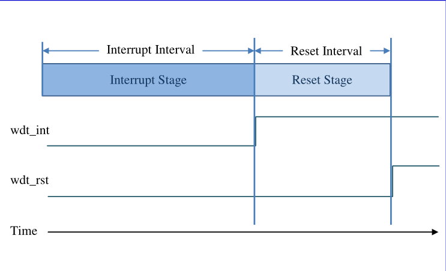

<!-- pg_ing916: 23 看门狗（WATCHDOG） -->

# 23 看门狗（WATCHDOG） {#ch-watchdog}

## 23.1 功能概述 {#功能概述-12}

看门狗的本质就是一个定时器，其功能主要是防止程序跑飞，同时也能防止程序在线运行时出现死循环， 一旦发生错误就向芯片内部发出重启信号。

特性：

- 支持AMBA 2.0 APB总线
- 当看门狗超时时，提供中断和重启的组合
- 为控制/重启寄存器提供写保护机制
- 可编程定时器时钟源
- 可配置的用于寄存器写保护和定时器重启的魔数
- 看门狗定时器可外部暂停

ING916XX的看门狗定时器提供了一个两级机制，如下图所示（图 [23.1](https://ingchips.github.io/drafts/pg_ing916/ch-watchdog.html#fig:Stages-of-the-WDT)）。：



图 23.1: WDT阶段图

- 1）第一阶段 `中断阶段`：若watchdog中断启用，则在中断计时结束时会产生中断信号wdt_int；
- 2）第二阶段 `复位阶段`：若watchdog复位启用，并且在复位超时时间结束前watchdog未重启，则会产生复位信号wdt_rst使得系统复位。

## 23.2 使用说明 {#使用说明-13}

### 23.2.1 配置看门狗 {#配置看门狗}

使用 `TMR_WatchDogEnable3` 配置并启用看门狗。

```c
void TMR_WatchDogEnable3(
  wdt_inttime_interval_t int_timeout, ,  //中断阶段时间
  wdt_rsttime_interval_t rst_timeout,  //复位阶段时间
  uint8_t enable_int          //中断使能(1)/禁用(0)
  );
```

其中中断阶段时间和复位阶段的时间设置分别支持16种和8种，分别如下述的枚举变量 `wdt_inttime_interval_t` 和 `wdt_rsttime_interval_t`所示。 默认使用的PCLK=32.768MHz，所以对应 `int_timeout == WDT_INTTIME_INTERVAL_1S` 时，对应的中断阶段时间为1s，其余时间以及复位阶段的超时时间以此类推。

```c
typedef enum
{
    WDT_INTTIME_INTERVAL_2MS          = 0,    //0.001953125s
    WDT_INTTIME_INTERVAL_8MS          = 1,    //0.0078125s
    WDT_INTTIME_INTERVAL_31MS         = 2,    //0.03125s
    WDT_INTTIME_INTERVAL_62MS         = 3,    //0.0625s
    WDT_INTTIME_INTERVAL_125MS        = 4,
    WDT_INTTIME_INTERVAL_250MS        = 5,
    WDT_INTTIME_INTERVAL_500MS        = 6,
    WDT_INTTIME_INTERVAL_1S           = 7,
    WDT_INTTIME_INTERVAL_4S           = 8,
    WDT_INTTIME_INTERVAL_16S          = 9,
    WDT_INTTIME_INTERVAL_1M_4S        = 10,   //64s
    WDT_INTTIME_INTERVAL_4M_16S       = 11,   //256s
    WDT_INTTIME_INTERVAL_17M_4S       = 12,   //1024s
    WDT_INTTIME_INTERVAL_1H_8M_16S    = 13,   //4096s
    WDT_INTTIME_INTERVAL_4H_33M_6S    = 14,   //16384s
    WDT_INTTIME_INTERVAL_18H_12M_16S  = 15    //65536s
}wdt_inttime_interval_t;

typedef enum
{
    WDT_RSTTIME_INTERVAL_4MS          = 0,    //3.90625ms
    WDT_RSTTIME_INTERVAL_8MS          = 1,    //7.8125ms
    WDT_RSTTIME_INTERVAL_15MS         = 2,    //15.625ms
    WDT_RSTTIME_INTERVAL_31MS         = 3,    //31.25ms
    WDT_RSTTIME_INTERVAL_62MS         = 4,    //62.5ms
    WDT_RSTTIME_INTERVAL_125MS        = 5,
    WDT_RSTTIME_INTERVAL_250MS        = 6,
    WDT_RSTTIME_INTERVAL_500MS        = 7 
}wdt_rsttime_interval_t;
```

为了方便使用，通过宏定义将ING916xx和ING918xx接口统一为 `TMR_WatchDogEnable` 。

```c
#define TMR_WatchDogEnable(timeout) do { uint64_t TMR_CLK_FREQ = OSC_CLK_FREQ;uint32_t cnt = (uint64_t)(timeout) / OSC_CLK_FREQ;uint8_t mode = 7;\
                                            for (uint8_t i = 1; i < 10; i++,mode++) { if (cnt < (1UL << (i * 2))) {break;}} \
                                            TMR_WatchDogEnable3(mode, WDT_RSTTIME_INTERVAL_500MS, 1); } while (0)   \
```

代码中会将设置的时间映射到结构体 `wdt_inttime_interval_t` 中 ，但是由于 *ING916XX* 的WDT能设置的时间是离散的，所以为了方便使用， 我们只选取从 `WDT_INTTIME_INTERVAL_1S` 到 `WDT_INTTIME_INTERVAL_18H_12M_16S` 。

由于 *ING916XX* 和 *ING918XX* 的看门狗在机制上有差别，所以使用 *ING916XX* 时推荐使用 `TMR_WatchDogEnable3` 。 若要在 *ING916XX* 中使用 `TMR_WatchDogEnable` 需注意：*ING918XX* **的看门狗没有中断机制，实际的复位超时时间为设定时间的两倍；** **而在** *ING916XX* **中的中断阶段和复位阶段的超时时间都是可以设置的，复位时间我们默认0.5s。所以若用** `TMR_WatchDogEnable(OSC_CLK_FREQ * 1)` **设置的时间在918和916上分别是2s和1.5s。**

### 23.2.2 重启看门狗 {#重启看门狗}

使用 `TMR_WatchDogRestart` 重启看门狗，也就是我们俗称的 `喂狗`。

```c
void TMR_WatchDogRestart(void);
```

### 23.2.3 清除中断 {#清除中断-1}

使用 `TMR_WatchDogClearInt` 清除看门狗的中断。

```c
void TMR_WatchDogClearInt(void);
```

### 23.2.4 禁用看门狗 {#禁用看门狗}

在使用`TMR_WatchDogEnable` 启用或 `TMR_WatchDogRestart` 重启看门狗之后， 需要使用 `TMR_WatchDogDisable` 才能将其禁用。

```c
void TMR_WatchDogDisable(void);
```

### 23.2.5 暂停看门狗 {#暂停看门狗}

使用 `TMR_WatchDogPauseEnable()` 可以暂停看门狗。

```c
void TMR_WatchDogPauseEnable(
  uint8_t enable
  );
```

### 23.2.6 处理中断状态 {#处理中断状态-4}

当调用 `TMR_WatchDogEnable` 或者在 `TMR_WatchDogEnable3`的参数中使能中断，就会在WDT上产生中断， 此时需要调用 `TMR_WatchDogClearInt` 清除看门狗中断之后才能再次触发中断。