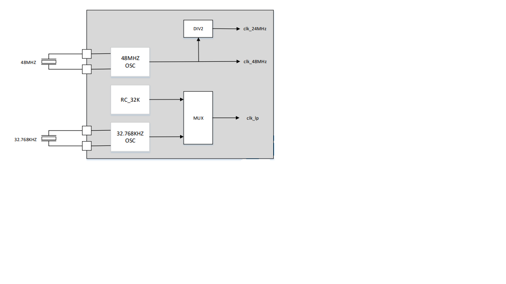

<!-- pg_ing918: 11 系统控制（SYSCTRL） -->

# 11 系统控制（SYSCTRL） {#ch-sysctrl}

## 11.1 功能概述 {#功能概述-4}

SYSCTRL 负责管理、控制各种片上外设，主要功能有：

- 外设的复位
- 外设的时钟管理，包括时钟源、频率设置、门控等
- 其它功能

### 11.1.1 外设标识 {#外设标识}

SYSCTRL 为外设定义了几种不同的标识。最常见的几种标识为：

1.SYSCTRL的时钟门控

```c
typedef enum
{
    SYSCTRL_ClkGate_APB_I2C0    = 4,
    SYSCTRL_ClkGate_APB_SPI1    = 5,
    // ...
    SYSCTRL_ClkGate_APB_I2C1    = 19
} SYSCTRL_ClkGateItem;
```

2.SYSCTRL的reset

```c
typedef enum
{
    SYSCTRL_Reset_AHB_DMA     = 0,
    SYSCTRL_Reset_AHB_LLE     = 1,
    // ...
    SYSCTRL_Reset_APH_TRNG    = 21
} SYSCTRL_ResetItem;
```

这些标识用于外设的复位、时钟门控等。

### 11.1.2 时钟树 {#时钟树}

1. 32KiHz 时钟（*clk_32k*）

   32k 时钟有两个来源：内部 RC 32KHz，外部 32768Hz 晶体。
2. PLL 输入的 24MHz 时钟（*clk_pll_in*）

   24MHz 时钟的主要来源：外部 48MHz 晶体。
3. 时钟分布图



## 11.2 使用说明 {#使用说明-2}

### 11.2.1 外设复位 {#外设复位}

通过 `SYSCTRL_ResetBlock` 复位外设，通过’SYSCTRL_ReleaseBlock’释放复位。

```c
void SYSCTRL_ResetBlock(SYSCTRL_ResetItem item);
void SYSCTRL_ReleaseBlock(SYSCTRL_ResetItem item);
```

### 11.2.2 时钟门控 {#时钟门控}

通过 `SYSCTRL_SetClkGateMulti` 设置门控（即关闭时钟），通过 `SYSCTRL_ClearClkGateMulti` 消除门控（即恢复时钟）。

```c
void SYSCTRL_SetClkGateMulti(SYSCTRL_ClkGateItem item);
void SYSCTRL_ClearClkGateMulti(SYSCTRL_ClkGateItem item);
```

`SYSCTRL_SetClkGateMulti` 和 `SYSCTRL_ClearClkGateMulti` 可以同时控制多个外设的门控。 `items` 参数里的各个比特与 `SYSCTRL_ClkGateItem` 里的各个外设一一对应。

```c
void SYSCTRL_SetClkGateMulti(uint32_t items);
void SYSCTRL_ClearClkGateMulti(uint32_t items);
```

### 11.2.3 时钟配置 {#时钟配置}

举例如下。

1. 开启I2C时钟

   使用 `SYSCTRL_SelectI2sClk` 为 I2C 配置时钟：

   ```c
   SYSCTRL_ClearClkGateMulti( (1 << SYSCTRL_ClkGate_APB_I2C0)
                             |(1 << SYSCTRL_ClkGate_APB_PinCtrl));
   ```
2. 关闭定时器TMR0时钟

   使用 `SYSCTRL_GetClk` 可获得指定外设的时钟频率：

   ```c
   SYSCTRL_ClearClkGateMulti(0
                           | (1 << SYSCTRL_ClkGate_APB_TMR0));
   ```