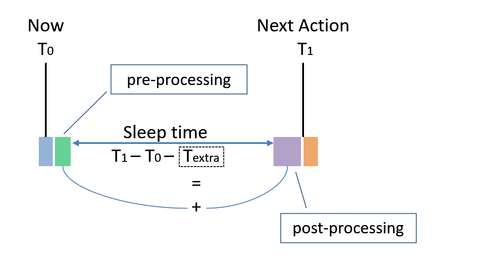

<!-- pg_power_saving_en: 4 API -->

# 4 API {#ch-api}

There is a global switch for power saving, *Enable* or *Disable*, which can be configured by `platform_config` at any time:

```c
// To enable power saving
platform_config(PLATFORM_CFG_POWER_SAVING, PLATFORM_CFG_ENABLE);

// To disable power saving
platform_config(PLATFORM_CFG_POWER_SAVING, PLATFORM_CFG_DISABLE);
```

## 4.1 Callback events {#callback-events}

As discussed in [Involvement of Apps](https://ingchips.github.io/application-notes/pg_power_saving_en/ch-framework.html#ch-framework-app-works), there are two events that should be handled by Apps:

### 4.1.1 PLATFORM_CB_EVT_QUERY_DEEP_SLEEP_ALLOWED {#platform_cb_evt_query_deep_sleep_allowed}

Handler of this event returns bit combination of allowed sleep modes in Category B. A value of 0 means that no mode in Category B is allowed at present.

```c
#define PLATFORM_ALLOW_DEEP_SLEEP      ...
#define PLATFORM_ALLOW_DEEPER_SLEEP    ...
#define PLATFORM_ALLOW_BLE_ONLY_SLEEP  ...
```

When DEEPER SLEEP is allowed, DEEP SLEEP is also allowed implicitly. For example, if both DEEP and DEEPER SLEEP are allowed, then:

```c
return PLATFORM_ALLOW_DEEP_SLEEP + PLATFORM_ALLOW_DEEPER_SLEEP;
```

or, simply (although not recommended),

```c
return PLATFORM_ALLOW_DEEPER_SLEEP;
```

For ING916 and ING20, Apps can also configure external wake up sources in the handle.

When a sleep mode returned as allowed but is not supported in the system, the sleep mode is ignored.

### 4.1.2 PLATFORM_CB_EVT_BEFORE_DEEP_SLEEP6 {#platform_cb_evt_before_deep_sleep}

When platform decides to enter one of Category B sleep modes, this event is emitted. Apps can take this opportunity to configure peripherals on-demand. The callback function shall be simple and return as soon as possible.

Input parameter `void *data` is casted from `platform_sleep_category_b_t`, representing the selected sleep mode.

For ING916 and ING20, Apps can also configure external wake up sources in the handle.

### 4.1.3 PLATFORM_CB_EVT_ON_DEEP_SLEEP_WAKEUP {#platform_cb_evt_on_deep_sleep_wakeup}

In the handler of this event, Apps can re-initialize peripherals and do other jobs according to the needs.

Input parameter `void *data` is casted from `platform_wakeup_call_reason_t`:

```c
typedef enum
{
    PLATFORM_WAKEUP_REASON_NORMAL = ...,
    PLATFORM_WAKEUP_REASON_ABORTED = ...,
} platform_wakeup_call_reason_t;
```

*PLATFORM_WAKEUP_REASON_NORMAL* means that this event is emitted for a normal (successful) wake up procedure, i.e. the sleep procedure is completed successfully; *PLATFORM_WAKEUP_REASON_ABORTED* means that the previous sleep procedure is aborted, i.e. sleep had not happened at all. For example, trying to go to DEEP SLEEP while EXT_INT is asserted will be a failure, and sleep will not happen.

Event with *PLATFORM_WAKEUP_REASON_NORMAL* is always emitted; while event with *PLATFORM_WAKEUP_REASON_ABORTED* is emitted when `PLATFORM_CFG_ALWAYS_CALL_WAKEUP` is *Enabled*. For ING918, `PLATFORM_CFG_ALWAYS_CALL_WAKEUP` is default to *Disabled*; while for ING916 and ING20, default to *Enabled*. This is because for ING916 and ING20, external wake up sources such GPIO might need to be reconfigured if sleep procedure is aborted. Without this event, Apps will not be able to do such reconfiguration. Since external sources are not configurable in the case of ING918, so it is default to *Disabled*.

If `PLATFORM_CFG_ALWAYS_CALL_WAKEUP` is *Enabled*, then there will be a *PLATFORM_CB_EVT_ON_DEEP_SLEEP_WAKEUP* event *definitely* for each *PLATFORM_CB_EVT_QUERY_DEEP_SLEEP_ALLOWED* event that returns a non-0 value.

At present, this handler is invoked in a *strange* context. It is in neither an ordinary process, nor an interrupt service routine. In the case of FreeRTOS, neither normal APIs or their *FromISR* variants are allowed, with only a few exceptions, such as:

- Use `xSemaphoreGiveFromISR` on a binary semaphore.

Some platform APIs might be unavailable, either. For example, `platform_get_us_time()` on ING918 would not get reliable value, while on ING916, it would hang.

### 4.1.4 PLATFORM_CB_EVT_ON_IDLE_TASK_RESUMED7 {#platform_cb_evt_on_idle_task_resumed}

After event *PLATFORM_CB_EVT_ON_DEEP_SLEEP_WAKEUP* with reason *PLATFORM_WAKEUP_REASON_NORMAL*, and the idle process is fully resumed from power saving, this event is emitted.

Input parameter `void *data` is always 0.

Comparing with *PLATFORM_CB_EVT_ON_DEEP_SLEEP_WAKEUP*, in this event:

- All OS functionalities are resumed;

  For NoOS variants, the callback is invoked by `platform_os_idle_resumed_hook()`. Therefore, `platform_os_idle_resumed_hook()` must be properly used.
- All platform APIs are functional;
- Event callback function is invoked in the idle process.

---

The prototype of event handles should be compatible of:

```c
typedef uint32_t (*f_platform_evt_cb)(void *data, void *user_data);
```

Handlers are registered by:

```c
void platform_set_evt_callback(
  // the event
  platform_evt_callback_type_t type,
  // the callback function
  f_platform_evt_cb f,
  // user data that will be passed into callback function `f`
  void *user_data
);
```

## 4.2 Interrupts {#interrupts}

Since CPU is powered off in Category B sleep modes, after waken up, from CPU’s point of view, interrupts should be re-enabled.

For example, an UART port is used the App with both Rx and Tx interrupts are enabled. Then, in the waken up event handle, not only the peripheral itself should be re-initialized, its Rx and Tx interrupts enabled, but also the corresponding position in interrupt vector table. In the case of ARM Cortex-M processors, it is called NVIC[8](#fn8).

If the ISR is registered by `platform_set_irq_callback`, then there are two options to re-enable the interrupt:

1. Call `platform_set_irq_callback` again, since this API will enable the interrupt;
2. Use `platform_enable_irq`:

   ```c
   void platform_enable_irq(
     // corresponding interrupt request type
     platform_irq_callback_type_t type,
     // flag = 1 for enable; flag = 0 for disable
     uint8_t flag);
   ```

If the ISR is in the table registered by `platform_set_irq_callback_table`, then use `platform_enable_irq`, too.

In the case of ARM Cortex-M processors, the priority of an interrupt is identified by an unsigned integer whose width is `__NVIC_PRIO_BITS`, where a higher value represents a lower priority. Therefore, the highest priority is 0 and the lowest is (1 << __NVIC_PRIO_BITS) - 1. Note that, 0 is not allowed here[9](#fn9), so the highest priority shall be 1. When using FreeRTOS, the value for highest priority is defined by and can be got from `configLIBRARY_MAX_SYSCALL_INTERRUPT_PRIORITY`.

Priorities of interrupts are all reset to default configurations as well after waken up. Default configurations are given in Table [4.1](https://ingchips.github.io/application-notes/pg_power_saving_en/ch-api.html#tab:ch-api-def-priorities).

*Table 4.1: Default Priorities of Interrupts*
| Interrupt | ING918 | Others |
| --- | --- | --- |
| BLE sub-system | 3 | 6 |
| Others | 5 | 11 |

### 4.2.1 Side Note on Priority {#side-note-on-priority}

The BLE stack in ING91X are designed to be soft real-time as much as possible, for example, the whole system can be stopped and resumed later without lost of BLE connection if the supervision timer is not reached. For hard real-time, there are deadlines that must be met each and every time. In such cases, developers might need to change those priorities and will assign the highest priorities to those interrupts that look like to the most important. However, that is not the optimal algorithm. Rate Monotonic Algorithm[10](#fn10) is a classic algorithm that should be considered firstly.

To modify priority, call `platform_read_info` to get the underlying IRQ number, then use corresponding API of CPU to modify it. For example, change the priority of UART0 to `7`, in the case of ARM Cortex-M processors:

```c
IRQn_Type n = (IRQn_Type)platform_read_info(
  PLATFOFM_INFO_IRQ_NUMBER + PLATFORM_CB_IRQ_UART0);
NVIC_SetPriority(n, 7);
```

When assigning a higher priority than BLE sub-system, Link Layer APIs are **NOT** allowed to be invoked in these ISR(s) even though they are marked as *thread safe*.

## 4.3 Shutdown {#shutdown-1}

Shutdown is initiated by calling `platform_shutdown`:

```c
void platform_shutdown(
  // Duration before power on again (measured in cycles of real-time clock)
  const uint32_t duration_cycles,
  // Pointer to the start of data to be retained
  const void *p_retention_data,
  // Size of the data to be retained
  const uint32_t data_size);
```

When `duration_cycles` is zero, power on when external wake up source is asserted. When `duration_cycles` is not zero, it must be larger than a minimum value of 825 cycles (about 25.18ms) reserved for hardware. `data_size` can be zero too if no data is needed to be retained. Only part of SYS memory starting from 0x2000000 can be retained.

If this function fails, it will return. If this function successes, CPU is powered off, so it will not return.

## 4.4 The Real-time Clock {#the-real-time-clock}

The Real-time clock is crucial for power saving. There are two sources for this clock, one is internal real-time RC clock, and the other is the real-time crystal oscillator which needs an external crystal. So, platform provides APIs to select clock source, and change settings:

- **PLATFORM_CFG_RT_RC_EN**

  Enable/Disable the internal real-time RC clock. Default: Enabled.
- **PLATFORM_CFG_RT_OSC_EN**

  Enable/Disable the real-time crystal oscillator. Default: Enable.
- **PLATFORM_CFG_RT_CLK**

  Real-time clock selection. Flag is `platform_rt_clk_src_t` with default value `PLATFORM_RT_RC`:

  ```c
  typedef enum
  {
    // external real-time crystal oscillator
    PLATFORM_RT_OSC,
    // internal real-time RC clock
    PLATFORM_RT_RC
  } platform_rt_clk_src_t;
  ```

  When modifying this configuration, both RT_RC and RT_OSC should be **enabled**. For ING918: both clocks must be running; To ensure a clock is running:

  - **RT_OSC**: wait until status of RT_OSC is OK;
  - **RT_RC**: wait 100\mu s after enabled.

  It’s recommended to wait another 100\mu s before disabling the unused one.
- **PLATFORM_CFG_RT_CLK_ACC**

  Configure Real-time clock accuracy in *ppm*.
- **PLATFORM_CFG_RT_CLK_CALI_PERIOD**

  Real-time clock auto-calibration[11](#fn11) period in seconds. Default: 3600 \times 2 = 2 (\mathit{hours}).

  Beside auto-calibration, it can also be started manually by:

  ```c
  uint32_t platform_calibrate_rt_clk(void);
  ```

The frequency of Real-time clock can be calculated from calibration value:

f = \frac{65536000000}{\mathit{Cali}} \mathit{Hz},

where, the calibration value (\mathit{Cali}) is an unsigned integer returned by `platform_read_info(PLATFORM_INFO_RT_CLK_CALI_VALUE)`.

### 4.4.1 Internal real-time RC Clock {#internal-real-time-rc-clock}

The internal real-time RC clock is less accurate real-time crystal oscillator generally. It can be tuned by selecting property capacitor and resistor. This process is done by invoking:

```c
uint16_t platform_rt_rc_auto_tune(void);
```

The frequency is tuned to different frequencies by `platform_rt_rc_auto_tune` at present (Table [4.2](https://ingchips.github.io/application-notes/pg_power_saving_en/ch-api.html#tab:ch-api-def-rc-freq)).

*Table 4.2: Tuned Frequencies by platform_rt_rc_auto_tune*
| Family | Frequency (Hz) |
| --- | --- |
| ING918 | 50000 |
| Others | 32768 |

This process takes hundreds of milliseconds, so it recommended to use it in a thread but not in `app_main`. This process can be done only once after starting up. It also returns a value representing the best choice which can be saved and used to tune the clock directly in latter restarts:

```c
void platform_rt_rc_tune(
  uint16_t value  // returned by `platform_rt_rc_auto_tune`
);
```

This framework does not depends on a specific frequency, and it is possible to tune to a another frequency by calling `platform_rt_rc_auto_tune2`:

```c
uint16_t platform_rt_rc_auto_tune2(
  // target frequency in Hz
  uint32_t target_frequency);
```

**ING918**: RC clock’s power supply after waken up from DEEP SLEEP is different from starting up. Therefore, calling `platform_rt_rc_auto_tune()` after DEEP SLEEP can achieve better accuracy.

## 4.5 Timers {#timers}

Platform also provides a few timer APIs coupled with power saving.

There is an internal counter increased by 1 per 1 \mu s, which wraps after 7953.64 \mathit{days} (\approx 21.79 \mathit{years}). Therefore, this timer can be treated as never wrapping practically. This counter is carefully recovered during waking up[12](#fn12). It is reset to zero when power up again from shutdown. Use `platform_get_us_time` to read this counter:

```c
uint64_t platform_get_us_time(void);
```

System tick is disabled and restarted when entering and leaving sleep modes. It’s difficult to properly reconfigure it accurately. Platform provides a configure item `PLATFORM_CFG_RTOS_ENH_TICK`. When enabled, accuracy of system ticks is improved but less power efficiency.

Platform also provides another timer that survives in all sleep modes and is more accurate than system ticks. Such timers can be created by calling `platform_set_timer`:

```c
void platform_set_timer(
  // callback function when timer expires
  void (* callback)(void),
  // timer expires after this delay from now
  // Unit: 625us
  uint32_t delay);
```

This timer has some unique features:

- Comparing to hardware timers, this timer can be thought as “running” during power saving mode;
- Comparing to RTOS software timers, this timer is software + hardware too;
- Comparing to RTOS software timers, this timer may be more accurate in some circumstance;
- This function always succeed, and only fails when running out of memory.

`callback` is also the identifier of the timer. So below two lines defines only one timer expiring after 200 units but not two separate timers:

```c
platform_set_timer(f, 100);
platform_set_timer(f, 200);
```

The callback function is called in a RTOS task (if existing), but not an ISR.

Range of `delay` is 0 \sim \mathit{0x7fffffff}. When `delay` is zero, the timer associated with the callback function is cleared. Since `delay` is in 625 \mu s, the maximum delay is 372.827 \mathit{hours} (\approx 15.5345 \mathit{days}).

## 4.6 IDLE Procedure {#idle-procedure}

As mentioned in [Sleep Modes](https://ingchips.github.io/application-notes/pg_power_saving_en/ch-framework.html#ch-framework-modes), IDLE mode is base on CPU’s feature solely. It’s common for CPU to have an instruction that instruct CPU to stop and enter a slight sleep mode. It can wake up (continue to execute) *quickly* when there is any interrupt/exception, or other signals. For x86 processors, the instruction is *HLT* (halt), while for ARM Cortex-M processors, it is *wfi* (wait for interrupts) or *wfe* (wait for events). When there is only one ARM Cortex-M processor, the IDLE procedure is simply a *wfi* guarded by a pair of synchronization barriers:

```c
__DSB();
__wfi();
__ISB();
```

When there is a PLL (such as ING916 and ING20), CPU and other components may run at a range of frequencies, event `PLATFORM_CB_EVT_IDLE_PROC` is defined to provide flexibility of customizing the IDLE procedure. This event is emitted each time IDLE mode is entered, and default IDLE procedure is replaced by the callback function. For example, Apps can lower clock frequencies to enjoy much low power consumption in IDLE mode if the slower response in waking up is acceptable:

```c
static uint32_t idle_proc(void *dummy, void *user_data)
{
    SYSCTRL_ConfigPLLClk(DIV_PRE, LOOP, 63);
    __DSB();
    __WFI();
    __ISB();
    SYSCTRL_ConfigPLLClk(DIV_PRE, LOOP, DIV_OUTPUT);
    return 0;
}

platform_set_evt_callback(PLATFORM_CB_EVT_IDLE_PROC,
    idle_proc, NULL);
```

## 4.7 Timing {#timing}

Finally, there are several configuration to share some information about *outside* world to the power saving framework.

- **PLATFORM_CFG_xx_TIME_REDUCTION** which helps to answer how much time the sleep can take;

  As shown in Figure [4.1](https://ingchips.github.io/application-notes/pg_power_saving_en/ch-api.html#fig:ch-api-time-reduction), suppose now is T_0, and next action occurs at T_1. Obviously, the system can not sleep for (T_1 - T_0), since there are pre-processing and post-processing in both hardware and software which will take some time too. These events callbacks are part of “pre-processing”:

  - `PLATFORM_CB_EVT_QUERY_DEEP_SLEEP_ALLOWED`,
  - `PLATFORM_CB_EVT_BEFORE_DEEP_SLEEP`.

  And these events callbacks are part of “post-processing”:

  - `PLATFORM_CB_EVT_ON_DEEP_SLEEP_WAKEUP`,
  - `PLATFORM_CB_EVT_LLE_INIT` (Always for ING918/ING916, and sometimes for ING20[13](#fn13)).

  

  Figure 4.1: Sleep Time Calculation

  Therefore extra time (T_{extra}) needs to be reduced from (T_1 - T_0). The amount of time can be configured through `PLATFORM_CFG_SLEEP_TIME_REDUCTION` for SLEEP mode, and `PLATFORM_CFG_DEEP_SLEEP_TIME_REDUCTION` for DEEP SLEEP and DEEPER SLEEP modes.

  `PLATFORM_CFG_SLEEP_TIME_REDUCTION` is only applicable to ING918.
- **PLATFORM_CFG_LL_DELAY_COMPENSATION** which helps to answer when starting to configure BLE sub-system.

  Suppose a BLE activity occurs at T_1 exactly, Link Layer software need to properly configure it before T_1. Since CPU may run at a variant of frequencies, time needed to do this job also varies. This configurations tells the framework how much time shall be reserved for Link Layer software: let t be PLATFORM_CFG_LL_DELAY_COMPENSATION, then Link Layer will start at (T_1 - t).

  This configuration is not applicable to ING918.

Default values are given in Table [4.3](https://ingchips.github.io/application-notes/pg_power_saving_en/ch-api.html#tab:ch-api-default-timing).

*Table 4.3: Default Timing Configurations*
| Item | Default for ING918 (\mu s) | Default for ING916 (\mu s) |
| --- | --- | --- |
| SLEEP_TIME_REDUCTION | 450 | – |
| DEEP_SLEEP_TIME_REDUCTION | 550 | 4000 |
| LL_DELAY_COMPENSATION | – | 200 |

Generally, these values do not need to be updated in the case of ING918. If the wake up handler does a lot of processing, then those two reductions should be increased accordingly.

It’s much more complicated for ING916 or ING20. Good values can be found by trial and error, when precise measurement is impossible. When values are too small, BLE functions will be affected, so it can be used as an indicator. Table [4.3](https://ingchips.github.io/application-notes/pg_power_saving_en/ch-api.html#tab:ch-api-default-timing) lists reference values for LL_DELAY_COMPENSATION of ING916.

*Table 4.3: Examples for LL_DELAY_COMPENSATION of ING916*
| CPU Frequency (M\mathit{Hz}) | Value (\mu s) |
| --- | --- |
| 48 | 1200 |
| 32 | 2000 |
| 24 | 2500 |
| 16 | 5000 |
| 8 | 9000 |

---

1. <a id="fn6"></a>Available from SDK v8.4.24.[↩︎](https://ingchips.github.io/application-notes/pg_power_saving_en/ch-api.html#fnref6)
2. <a id="fn7"></a>Available from SDK v8.4.16.[↩︎](https://ingchips.github.io/application-notes/pg_power_saving_en/ch-api.html#fnref7)
3. <a id="fn8"></a>Nested Vectored Interrupt Controller[↩︎](https://ingchips.github.io/application-notes/pg_power_saving_en/ch-api.html#fnref8)
4. <a id="fn9"></a>This is required by software bundles.[↩︎](https://ingchips.github.io/application-notes/pg_power_saving_en/ch-api.html#fnref9)
5. <a id="fn10"></a>Liu and Leyland, 1973, *Scheduling Algorithms for Multiprogramming in a Hard Real-Time Environment*.[↩︎](https://ingchips.github.io/application-notes/pg_power_saving_en/ch-api.html#fnref10)
6. <a id="fn11"></a>*Calibration* means to measure the frequency of this clock with another high frequency and high precision clock.[↩︎](https://ingchips.github.io/application-notes/pg_power_saving_en/ch-api.html#fnref11)
7. <a id="fn12"></a>For DEEPER SLEEP mode of ING916 and ING20, it is coarsely recovered comparing to other modes.[↩︎](https://ingchips.github.io/application-notes/pg_power_saving_en/ch-api.html#fnref12)
8. <a id="fn13"></a>ING20 initializes LLE on demand: If a BLE activity is expected to be carried out at T_1, `PLATFORM_CB_EVT_LLE_INIT` will be part of “post-processing”; otherwise, LLE won’t be initialized.[↩︎](https://ingchips.github.io/application-notes/pg_power_saving_en/ch-api.html#fnref13)