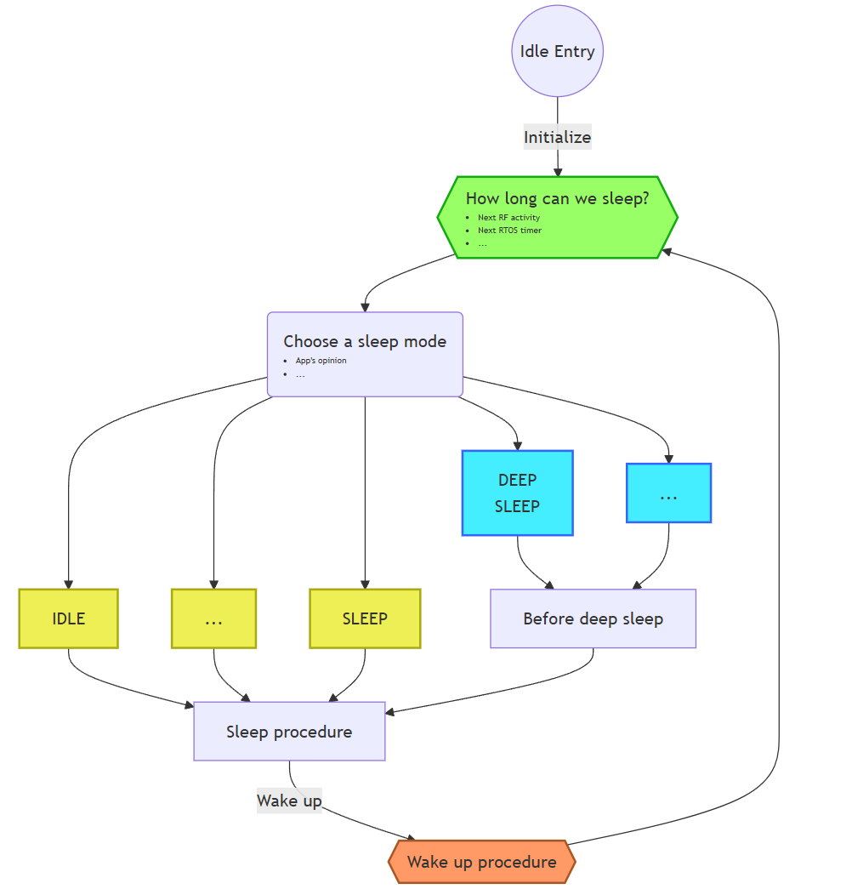

<!-- pg_power_saving_en: 3 Framework -->

# 3 Framework {#ch-framework}

The implementation of power saving in SDK is designed to be easy to use. Generally, power saving relies on the idle process in RTOS, which is usually a process[3](#fn3) having the lowest priority. It’s a common practice for OS(es) to have an idle process, for example, the idle process with PID 0 in Windows and Linux.

Figure 3.1: Idle Process

Figure [3.1](https://ingchips.github.io/application-notes/pg_power_saving_en/ch-framework.html#fig:ch-framework-idle-task) is an overview of the idle process. Once initialized, the idle process keeps trying to put the system into sleep modes to save power. It first checks how long the system could sleep, i.e. sleep time, which is generally determined by:

- When the next BLE sub-system activity occurs;
- When the next RTOS timer expires.

Note that, peripherals, such as hardware timers, UART, are not taken into account here.

Then, the idle process makes choice on sleep modes. Following factors are considered:

- Sleep time
- App’s opinion;
- Current system state.

Different sleep modes have their own hard time requirements, because it needs extra time to bring the system into sleep modes and wake it up again. App’s opinion tells the idle process a subset of sleep modes which are allowed to be chosen from. Current system state including BLE sub-system is also considered.

After the most suitable sleep mode which consumes lowest power, is decided, the sleep procedure stops RTOS and takes the system into the chosen sleep mode.

After waken up, the wake up procedure performs post processing to make sure everything is normal, for example, the system tick is taken care of here. This framework knows nothing about peripherals and their configurations, and it just notifies App that the system has waken up. App could take this opportunity to configure peripherals. After everything is ready, the wake up procedure allows RTOS to continue. And the whole loop is started all over again.

## 3.1 Sleep Modes {#ch-framework-modes}

There are a variety of sleep modes available (supported by SoC and power saving framework) summarized in Table [3.1](https://ingchips.github.io/application-notes/pg_power_saving_en/ch-framework.html#tab:ch-framework-sleep-modes).

*Table 3.1: Sleep modes*
| Mode | ING918 | ING916, ING20 | Notes |
| --- | --- | --- | --- |
| IDLE | \checkmark | \checkmark | Everything is active; CPU is waiting for interrupts. |
| SNOOZE | \checkmark | Same as IDLE except RF is shutdown. |  |
| SLEEP | \checkmark | Same as IDLE except BLE sub-system is shutdown. |  |
| DEEP SLEEP | \checkmark | \checkmark | CPU and peripherals are all shutdown. All memory is retained. |
| DEEPER SLEEP | \checkmark | Like DEEP SLEEP. Only a small portion of memory is retained. |  |
| BLE ONLY SLEEP | \checkmark | Like DEEP SLEEP, but BLE sub-system fully functional |  |

IDLE mode is the slightest sleep mode, backed by the underlying CPU while other modes are defined and backed by dedicated logic in the SoC out of CPU itself. There are subtle differences between different sleep modes besides the notes in Table [3.1](https://ingchips.github.io/application-notes/pg_power_saving_en/ch-framework.html#tab:ch-framework-sleep-modes):

- For DEEP SLEEP on ING916 and ING92, some peripherals, such as GPIO, can be optionally put into special low power modes, rather than powered off, in which case, its output could be retained or acting as wake up sources;
- In DEEPER SLEEP, comparing with DEEP SLEEP:

  - Less peripherals are allowed to be put into special low power modes;
  - Internal 1 \mu s timer becomes less accurate;
  - Only 16KiB of system memory is retained;
  - BLE sub-system including share memory is powered off, so all BLE configurations/parameters are lost;
- For BLE ONLY SLEEP, the system can be waken up only by BLE sub-system;
- DEEPER SLEEP is only available in the *mini* bundles.

Different sleep modes consume different amount of current, since different components in SoC consume different amount of current. Here is a very rough quantitative summary, providing a qualitative analysis:

- CPU + Flash

  Current consumption heavily depends on working frequency. It may vary from about 1mA to more than 10 mA.

  For ING918, CPU clock is fixed at 48M\mathit{Hz}, consuming {\scriptsize \sim} 5mA.
- RAM retention

  More memory retained, more current is needed. It costs roughly {\scriptsize \sim} 0.02 \mu A per KiB.
- BLE Activity

  It costs from several mA to more than 10mA.

## 3.2 Wake up Sources {#wake-up-sources}

There are two types of sources that can cause the system to wake up:

- Internal sources

  There is only one internal source: sleep timer. It is a dedicated hardware timer used only by the idle process, configured to sleep time, and cause the system to wake up when expired.

  This timer has 32 bits, and is driven by the Real-time clock.
- External sources

  External sources are given in Table [3.2](https://ingchips.github.io/application-notes/pg_power_saving_en/ch-framework.html#tab:ch-framework-wakeup-sources-918) and Table [3.3](https://ingchips.github.io/application-notes/pg_power_saving_en/ch-framework.html#tab:ch-framework-wakeup-sources-916)[4](#fn4).

  *Table 3.2: External wake up sources of ING918*
  | Mode | Sources |
  | --- | --- |
  | IDLE | All interrupts. |
  | SNOOZE | All interrupts. |
  | SLEEP | All interrupts. |
  | DEEP SLEEP | EXT_INT. |

  *Table 3.3: External wake up sources of ING916 and ING20*
  | Mode | Sources |
  | --- | --- |
  | IDLE | All interrupts. |
  | DEEP SLEEP | GPIO/RTC/Comparator. Configurable. |
  | DEEPER SLEEP | GPIO. Configurable. |
  | BLE ONLY SLEEP | BLE sub-system. |

- No matter which mode SoC is in, RESET pin always works, but we don’t name it as an external wake up source;
- Watchdog is an ordinary peripheral, and powered off in DEEP SLEEP, DEEPER SLEEP, and BLE ONLY SLEEP modes.

## 3.3 Involvement of Apps {#ch-framework-app-works}

Sleep modes can be classified into two categories, Category A that do not need the involvements of Apps (IDLE, SNOOZE, and SLEEP), and Category B that do need the involvements of Apps (DEEP SLEEP, DEEPER SLEEP, and BLE ONLY SLEEP).

This framework tried its best to minimize the involvements of Apps, and there are just three things to be handled by Apps:

1. Tell the idle process which modes in Category B are allowed to be used;

   For ING916 and ING20, Apps can take this opportunity to configure external wake up sources as well.
2. Optionally configure peripherals on-demand before entering Category B sleep modes[5](#fn5);
3. (Re-)Configure peripherals after waken up from Category B sleep modes.

These three things are done in three platform event handlers respectively.

How to determine if a mode in Category B is allowed? Here are some suggestions.

- DEEP SLEEP

  - If peripherals can’t be powered off now, for example, UART is running or FIFO not empty, then NO;
  - Hardware timer is used, which generates interrupts very frequently (such as 1000 \mathit{Hz}), then NO.
- DEEPER SLEEP

  - If DEEP SLEEP is not allowed, then NO;
  - If external wake up source does not fit the need, for example, comparator is required as a wake up source, then NO;
  - If memory outside of the retained range is in use, for example, memory allocated from Link Layer’s heap, then NO;
  - If internal 1\mu s timer should be as accurate as in DEEP SLEEP, then NO.
- BLE ONLY SLEEP

  - If DEEP SLEEP is not allowed, then NO;
  - If other external wake up source are needed, then NO.

## 3.4 Shutdown {#shutdown}

The idle process implements an automatic and passive power saving mechanism. A proactive mechanism also exists, *Shutdown*, where developers can optionally specify a time after which the system is powered on again, and a portion of memory to be retained during shutdown. The time can be set to 0, which means to disable the power on timer, and stay in shutdown mode unless external power on signal is asserted or RESET.

- For ING918

  Shutdown is based on DEEP SLEEP, except that most of if not all memory is powered off too. As in DEEP SLEEP, the system can be powered on again by EXT_INT.
- For ING916 and ING20

  Shutdown can be backed by DEEP SLEEP (default) or DEEPER SLEEP, which can be selected by bit 0 of a debugger parameter `PLATFORM_CFG_PS_DBG_4` at present. The system can be powered on again by external sources (Table [3.3](https://ingchips.github.io/application-notes/pg_power_saving_en/ch-framework.html#tab:ch-framework-wakeup-sources-916)), too.

  Comparing with DEEP SLEEP, all of the system memory can be retained in DEEP SLEEP, and a bit more current is consumed.

For SDK v8.3.5 or elder versions, shutdown is always based on DEEPER SLEEP.

---

1. In embedding systems, it may also be called a *task* or *thread*.[↩︎](https://ingchips.github.io/application-notes/pg_power_saving_en/ch-framework.html#fnref3)
2. Refer to *Programmer’s Guide - ING916XX Peripheral* for the configuration of wake up sources[↩︎](https://ingchips.github.io/application-notes/pg_power_saving_en/ch-framework.html#fnref4)
3. Available from SDK v8.4.24.[↩︎](https://ingchips.github.io/application-notes/pg_power_saving_en/ch-framework.html#fnref5)