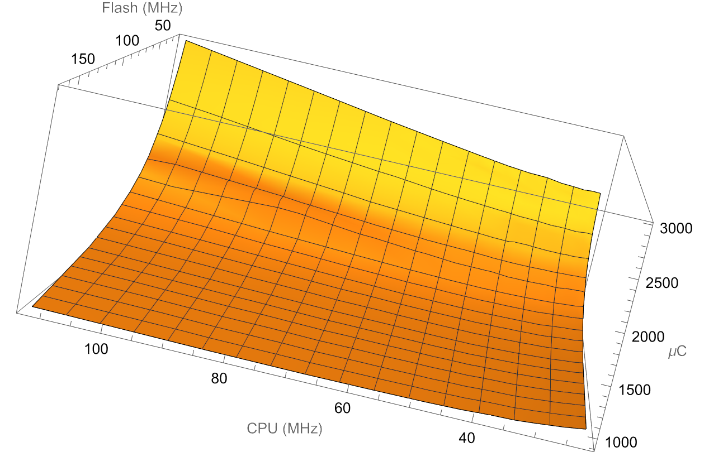
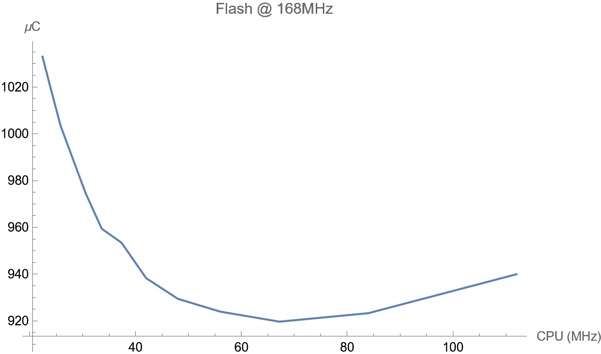

<!-- pg_power_saving_en: 6 Tips on Low Power Products -->

# 6 Tips on Low Power Products {#ch-tips}

Here are some tips for building low power products.

## 6.1 Clock Gating {#clock-gating}

Make sure that clock is gated for those peripherals that are not used. Since clock of all peripherals (except SYSCTRL and the default UART[25](#fn25)) are defaults to gated, so, make sure do not release the gating for those peripherals that are not used. If default UART is not used, then gate its clock.

## 6.2 Choose Best Frequency {#choose-best-frequency}

For SoC that has complex clock configurations like ING916, clock frequencies of each peripheral as well as CPU itself, should be chosen with care.

### 6.2.1 CPU {#ch-tips-cpu}

The lower frequency, the less current is consumed. But, with a lower frequency, processing time becomes longer. Do not only measure current, but also execution time.

Table [6.1](https://ingchips.github.io/application-notes/pg_power_saving_en/ch-tips.html#tab:ch-tips-cpu-currents) shows current consumption[26](#fn26) of ING916’s CPU running at varies frequencies under room temperature.

*Table 6.1: ING916 CPU Current Consumption (\(mA\))*
| Frequency (MHz) | V_{bat} = 3.3V | V_{bat} = 2.5V | V_{bat} = 1.8V |
| --- | --- | --- | --- |
| 112 | 8.95 | 11.32 | 14.26 |
| 64 | 5.97 | 7.17 | 9.26 |
| 24 | 1.71 | 2.06 | 2.69 |
| 8 | 0.90 | 1.09 | 1.47 |

Better ways to measure power efficiency is to measure current per MHz (Table [6.2](https://ingchips.github.io/application-notes/pg_power_saving_en/ch-tips.html#tab:ch-tips-cpu-current-mhz)) or power per MHz (Table [6.3](https://ingchips.github.io/application-notes/pg_power_saving_en/ch-tips.html#tab:ch-tips-cpu-power-mhz)).

*Table 6.2: ING916 CPU Current Consumption Per MHz (\(\mu A/M\mathit{Hz}\))*
| Frequency (MHz) | V_{bat} = 3.3V | V_{bat} = 2.5V | V_{bat} = 1.8V |
| --- | --- | --- | --- |
| 112 | 89.9 | 101.1 | 127.3 |
| 64 | 93.3 | 112.0 | 144.7 |
| 24 | 71.3 | 85.8 | 112.1 |
| 8 | 112.6 | 136.3 | 183.8 |

*Table 6.3: ING916 CPU Power Consumption Per MHz (\(\mu W/M\mathit{Hz}\))*
| Frequency (MHz) | V_{bat} = 3.3V | V_{bat} = 2.5V | V_{bat} = 1.8V |
| --- | --- | --- | --- |
| 112 | 263.7 | 252.7 | 229.2 |
| 64 | 307.8 | 280.1 | 260.4 |
| 24 | 235.1 | 214.6 | 201.8 |
| 8 | 371.3 | 340.6 | 330.8 |

From these numbers we can see that:

- It’s not power efficient to do computation at a very low frequency, for example, under the same condition, running at 8 M \mathit{Hz} consumes at least 40\% more power than 112 M \mathit{Hz};
- 24 M \mathit{Hz} looks like a sweet spot if the processing delay is acceptable;
- If frequency is fixed, always try to use lower V_{bat} voltage.

### 6.2.2 CPU + Flash {#cpu-flash}

Flash embedded in ING916 and ING20 SoC interfacing CPU through QSPI, which might become a bottleneck without cache. Since cache is shutdown in Category B sleep modes, in a short duration after waking up, the system works like without cache. Therefore, it is important to measure current consumption in such cases.

Take ING916 as an example, create a function filled with 8192 NOP(s)(no operation) that is larger than I-Cache, loop the function for 200 times, and measure the used electric charge. Figure [6.1](https://ingchips.github.io/application-notes/pg_power_saving_en/ch-tips.html#fig:ch-tips-cpu-flash) shows the result. It can be found that when lowering Flash frequency, much more electric charge is used. To put it simple, run Flash as fast as possible to save power.

Figure 6.1: Electric Charge Consumption

Further more, focusing on Flash running at 168M\mathit{Hz}, the best frequency for CPU is \sim 67M\mathit{Hz}, as shown in Figure [6.2](https://ingchips.github.io/application-notes/pg_power_saving_en/ch-tips.html#fig:ch-tips-cpu-flash-168). If Flash running at 192M\mathit{Hz}, the best frequency for CPU is \sim 77M\mathit{Hz}. These two groups of numbers show that in the case of no cache, it’s better to set the frequency of CPU to be 40\% of that of Flash, proving that Flash is really the bottleneck.

Figure 6.2: Electric Charge Consumption (Flash 168MHz)

On the other hand, when cache becomes hot and has a high hit rate, it would be better to run CPU as fast as possible and the impaction of the slower Flash can be neglected.

### 6.2.3 Computational Intensive vs Hardware Timing {#computational-intensive-vs-hardware-timing}

There are computational intensive jobs, and there are slow hardware operations that need quite some time to complete. Different strategies shall be considered.

For computational intensive jobs, check section [CPU](https://ingchips.github.io/application-notes/pg_power_saving_en/ch-tips.html#ch-tips-cpu) on how to let it run more efficiently. For slow hardware operations, check if sleep modes can be utilized; if not, consider changing to a lower clock frequency for CPU, Flash, and notably *hclk*.

---

1. It is UART0 if there are multiple UART peripherals.[↩︎](https://ingchips.github.io/application-notes/pg_power_saving_en/ch-tips.html#fnref25)
2. Refer to *ING916X BLE5.3 SoC Test Report*.[↩︎](https://ingchips.github.io/application-notes/pg_power_saving_en/ch-tips.html#fnref26)