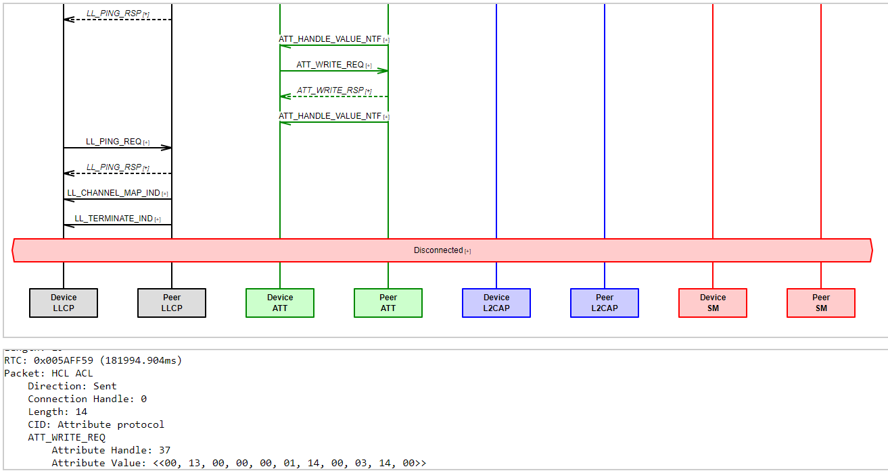

<!-- user_guide: 4 Core Tools -->

# Chapter 4 Core Tools {#core-tools}

SDK core tools play an important role in the BLE device development.

## 4.1 Wizard {#wizard}

`Wizard` is the recommended entry point in the whole development life cycle. With it, we can create & open project, edit project data, and migrate projects, etc.

1. Create Project

   `Wizard`’s new project wizard assists the creation of new projects. We can select favourate IDE, peripheral role, edit advertising and profile data, enable FOTA and logging, etc.

   Once a project is created, following files are also created, used by `Wizard` but not IDE, and they shoule not be deleted, or `Wizard` will not to function properly:

   - `$(ProjectName).ingw`

     This file shares the same name with the project with an extension `.ingw`. It contains crucial information about the project and SDK. Without this information, it becomes impossible to do migration.
2. Advertising Data Editor

   This editor helps us to generate advertising data. It can also be opened from main menu `Tools` -> `Advertising Data Editor ...`.
3. GATT Profile Editor (or GATT/ATT Database Editor)

   This editor helps us to build GATT profile data. It can also be opened from main menu `Tools` -> `Profile Database Editor ...`.

   This editor supports three type of services, SIG defined services, *INGChips* defined services and user defined services. To add an user defined service, it must be create beforehandle (see below).
4. Manage Custom Services

   This editor can be opened from main menu `Tools` -> `Manage Custom GATT Services ...`. We can add, delete and edit custom services.

   Custom Services and characteristics are all named with a prefix which is deduced from company name initialized when installing SDK, and updatable through `Environment Options`.
5. Migration

   In case a new version of SDK is installed, ROM and RAM used by platform might be changed, so projects settings need to be updated accordingly. This process is automated by right click on a project and select `Check & Fix Settings ...`.

*Alway* remember to backup your project before perform a migration, either by committing all changes into version control system or making a full backup.

## 4.2 Downloader {#ch2-downloader}

### 4.2.1 Introduction {#introduction}

This downloader downloads up-to six images (binaries) to flash through UART or USB connection. It co-operate with bootloader. Bootloader can be made into flash downloading mode either by:

- Asserting boot pin[18](#fn18) (this is used in the vast majority of cases),
- Setting entry point which is stored Flash to an invalid address (Only on ING918).

When ING918 is powered on, bootloader checks above conditions. If any conditions are true, bootloader sends the handshaking message. When ING916 is made into flash downloading mode, bootloader will check GPIO15: if its level is high, USB port is also enabled.

Tips on different types of debuggers:

- ING-DAPLink: pressing the “Load” button on Downloader’s main UI or the “Load” button on the debugger will make Bootloader into flash downloading mode;
- Other debuggers: pressing the “Load” button on the debugger will make Bootloader into flash downloading mode;
- Third party debuggers: Asserting boot pin while releasing Reset will make Bootloader into flash downloading mode.

User can download any files, although typically these files are generated by IDE tools. The load address of image (binary) must be aligned at flash erasable unit boundary (`EFLASH_ERASABLE_SIZE`).

- ING918: each erasable unit is a page

  The load address of image (binary) must be aligned at flash page boundary. Each flash page has $8192 (`0x2000`) bytes. Flash starts from `0x4000`, so the load address should be `0x4000 + X * 0x2000`, where `X` is an integer.
- ING918: each erasable unit is a sector

  The load address of image (binary) must be aligned at flash sector boundary. Each flash sector has 4096 (`0x1000`) bytes. Flash starts from `0x02000000`, so the load address should be `0x02000000 + X * 0x1000`, where `X` is an integer.

Downloader complains if the load address is not correct. Note that when this downloader is started from `Wizard`, binaries have already been correctly configured.

Click `Setup UART ...` or `Setup Port ...` to configure communication port (Figure [4.1](https://ingchips.github.io/user_guide/core-tools.html#fig:ch2-downloader-uart-cfg)). Users need to set `Port Number` to the value shown in Windows Device Manager, for example, if “COM9” is used, then set `Port` to `COM9`, or simply `9`. For chips that support downloading through USB, `Port` can be set to `USB` to select the default USB device. Baud rate can be set to a value larger than `115200`, such as `460800`, `921600`, etc, to achieve a faster download speed. The maximum supported baud rate is `921600`. Due to the limitation of internal flash characters, there isn’t any further significant improvement for baud rate larger than `512000`. Other fields should be left unchanged.


Figure 4.1: Configurate UART

The whole downloading procedure is composed of several steps, such as downloading, verification, set entry address, and launching app. These steps can be configured by clicking `Options` (Figure [4.2](https://ingchips.github.io/user_guide/core-tools.html#fig:ch2-downloader-options)).


Figure 4.2: Downloader Options

Entry address specifies the entry point of the program. For ING918, if platform binary is used, entry address must be set to `0x4000` which is also the load address of platform binary. For ING916, entry address is ignored if the address is not in the range of RAM.

If “Verify Download” is enabled, then data will be read back and compare with origin file to ensure data is correctly downloaded. Data blocks are CRC checked, so “Verify Download” can be kept disabled on a regular basis. If downloading keeps failing on specific address, then we can enable it to double check if flash is malfunctioned. In this case, when mismatch is found, read-back data will be stored to a file.

When “Batch” mode is enabled, downloader will keep waiting for bootloader handshaking, and once received handshaking, downloading starts; after downloading completes, downloader will start waiting again. When “Batch” mode is disabled, downloader will no longer wait for handshaking after downloading completes.

Click `Start` to start downloading, or rather start waiting for handshaking. Bootloader sends handshaking message only once, and if chips are already powered up, it may be too late to receive handshaking. In this case, we can click `Force` to skip handshaking and start downloading immediately.

### 4.2.2 Scripting & Mass Production {#script-mass-prod}

This downloader supports powerful scripting, making it suitable for mass production. In the script, two event handlers (functions) are required to be defined.

- `OnStartRun`

  This event handler gets called when each round of downloading starts;
- `OnStartBin`

  This event handler gets called when a binary starts downloading. Here, binary data can be modified on-the-fly before it is written into flash.

When “Batch” mode is enabled, this downloader keeps a counter which is increased by `1` after downloading finishes. This counter is shown as `Counter.Current` shown in Figure [4.2](https://ingchips.github.io/user_guide/core-tools.html#fig:ch2-downloader-options). There is also a variable called `Counter.Limit`. In “Batch” mode, before a new round of downloading starts, `Counter.Current` is checked against this limit, if it is *larger* than limit, “Batch” mode stops automatically. For example, if `Counter.Current` and `Counter.Limit` are set to `10` and `13` respectively, then “Batch” mode will run for `4` rounds in total, with `Counter.Current` equals to `10`, `11`, `12` and `13`. After “Batch” mode stops, `Counter.Current` equals to `14`.

The language used for scripting is *RemObjects Pascal Script*[19](#fn19), which is quite similar to `C`, and easy to develop. Below is an simple but working example, in which, the batch round number (`BatchCounter`) is written to a fixed location in the binary.

```pascal
// we can use constants
const
  BD_ADDR_ADDR = $1;

// BatchCounter is just Counter.Current
procedure OnStartRun(const BatchCounter: Integer; var Abort: Boolean);
begin
  // Use *Print* for logging and debugging
  Print('OnStartRun %d', [BatchCounter]);
  // we can abort downloading by assigning True to *Abort*
  // Abort := True;
end;

procedure OnStartBin(const BatchCounter, BinIndex: Integer;
                     var Data: TBytes; var Abort: Boolean);
begin
  // Note that BinIndex counts from 1 (not 0), just as shown on GUI
  if BinIndex <> 2 then Exit;
  // We can modify binary data before it is downloaded into flash
  Data[BD_ADDR_ADDR + 0] := BatchCounter and $FF;
  Data[BD_ADDR_ADDR + 1] := (BatchCounter shr 8) and $FF;
  Data[BD_ADDR_ADDR + 2] := (BatchCounter shr 8) and $FF;
end;
```

### 4.2.3 Flash Read Protection {#flash-read-protection}

To protect illegal access of data & program stored in flash, 918xx has a read-protection mechanism. Once read-protection is enabled, JTAG/SW and this downloader can not be able to access flash any more. To re-enable JTAG/SW debugging functionality and downloading, the read-protection must be turned off by a procedure called *unlock*. Flash data is erased in this procedure.

Once the app is ready to ship, and it is decided that data & program must be protected from illegal access, just enable “Read Protection” as shown in Figure [4.2](https://ingchips.github.io/user_guide/core-tools.html#fig:ch2-downloader-options). To download program into a read protected, check `Unlock Before Download` option. As flash data is erased during *unlocking*, do not forget to re-download `platform` binary.

All configurations are stored in an *ini* file.

### 4.2.4 Python Version {#python-version}

SDK also provides a Python version downloader (*icsdw.py*). It’s open source and easy to be integrated with other tools.

This version is written in Python 3. It uses `PySerial`[20](#fn20) package to access serial port, so run “`pip install pyserial`” to install the package.

Python downloader shares the same *ini* file with only one exception: Scripting. The GUI downloader stores *RemObjects Pascal* source code with key named “*script*” in section “*options*”, while the python version stores the path to a user module. The path can be a full path or a relative path (relative to the location of the *ini* file).

In the user module, two methods are required to be defined to handle events as in the GUI downloader, `on_start_run` & `on_start_bin`. Below is an example, in which, the batch round number (`batch_counter`) is written to a fixed location in #2 binary.

```python
# return abort_flag
def on_start_run(batch_counter: int):
    return False

# return abort_flag, new_data
def on_start_bin(batch_counter: int, bin_index: int, data: bytes):
    if bin_index != 2:
        return False, data
    ba = bytearray(data)
    addr = batch_counter.to_bytes(4, 'little')
    ba[1:5] = addr
    return False, bytes(ba)
```

## 4.3 Tracer {#tracer}

`Tracer` is the visual tool for inspecting recorded Trace data introduced in [Debugging & Tracing](https://ingchips.github.io/user_guide/dive-into-sdk.html#debugging-tracing).

To limit items drawn on screen, `Tracer` breaks trace data into frames. Each frame has a length of 5sec. When a frame is selected, besides the current frame, the previous and the next one are also shown for continuity.


Figure 4.3: Tracer Main UI

**Graph** shows all trace data visually. By clicking an item in **Graph**, detailed information is decoded and shown in **Message Decoder** and **Message Hex Viewer**. **Graph** supports some of CAD operations, such as zooming, panning, measuring, etc. Checkout menu `Help` -> `About` for detailed information. (Figure [4.3](https://ingchips.github.io/user_guide/core-tools.html#fig:ch2-tracer-main))



Figure 4.4: MSC Generated by Tracer

To help analyzing app & high layer issues, `ingTrace` can generate MSC (message sequence chart) for each connection. While **Graph** emphasizes on timing between events, MSC emphasizes on procedure and fits better for protocol analysis. Message can be decoded by clicking on the `[+]` mark (Figure [4.4](https://ingchips.github.io/user_guide/core-tools.html#fig:ch2-tracer-msc)).

## 4.4 Axf Tool {#ch2-axf-tool}

`Axf Tool` is a command line tool analyzing executables and memory dump, which can be invoked from popup menu on a project in `Wizard`. It has several functionalities:

- **stack-usage**: Statically analyze stack usage, and report call chains with top N maximum stack depth.
- **bt-api-thread-safety**: Audit the usage of Bluetooth API, and check thread confinement.
- **call-stack**: Try to recover call stack from memory dump.
- **history**: Give a brief history of BLE activities.
- **check-heap**: Try to check for errors in heaps.
- **check-task**: Runtime check of FreeRTOS tasks with the help of dump.

Use `axf_tool.exe help {function}` to get help on a specific functionality.

## 4.5 AI Shortcuts {#ai-shortcuts}

AI Shortcuts is a tool that brings the power of AI to help on a collection of code and text related tasks by simplify pressing a hot key.

### 4.5.1 Installation {#installation}

This tool is an optional component of SDK and is not installed with SDK, but installed later by the Wizard.

Open `AI Shortcuts` page of the `Environment Options` dialog (menu item `Tools` -> `Environment Options`), configure it properly and click “Install” button to install it. Wizard will select a proper LLM (Large Language Model) according to GPU VRAM size. Still, user can still make his own choice, for example, try a larger model on CPU.

### 4.5.2 Usage {#usage}

After installed, click “AI Shortcuts” button to start this tool.

Select a block of code, press the hot key, and click a button on the main UI.

When this tool is minimized to the system tray, use pop menu to quit this tool. There is a “Feel Lucky” menu item on the pop menu. When it is selected, tasks like “Generate Comments” will apply the generated comments to the selected code directly; when not selected, developers can click “Retry” button to re-generate if not satisfied with the result.

---

1. <a id="fn18"></a>ING918 has a dedicated boot pin, while ING916 reuses GPIO0.[↩︎](https://ingchips.github.io/user_guide/core-tools.html#fnref18)
2. <a id="fn19"></a>[https://github.com/remobjects/pascalscript](https://github.com/remobjects/pascalscript)[↩︎](https://ingchips.github.io/user_guide/core-tools.html#fnref19)
3. <a id="fn20"></a>[https://pypi.org/project/pyserial/](https://pypi.org/project/pyserial/)[↩︎](https://ingchips.github.io/user_guide/core-tools.html#fnref20)