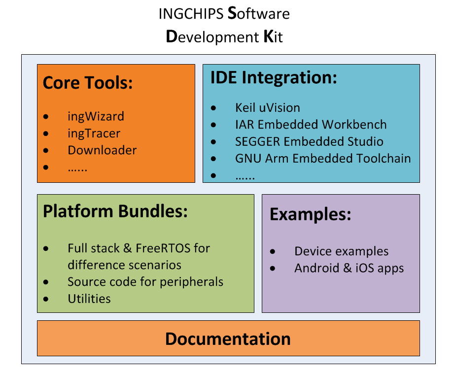

<!-- user_guide: 2 Introduction -->

# Chapter 2 Introduction {#intro}



Figure 2.1: SDK Overview

*INGCHIPS* software development kit has following major components (see Figure [2.1](https://ingchips.github.io/user_guide/intro.html#fig:fig-welcome)):

1. Core Tools

   Provide project wizard, flash loader and other functionalities. These tools make BLE development easy and seamless.
2. Language & IDE Integration

   Support `Keil μVision`[1](#fn1), `IAR Embedded Workbench`[2](#fn2), `Rowley Crossworks for ARM`[3](#fn3), and `SEGGER Embedded Studio for ARM`[4](#fn4). All IDE/Toolchain settings are configured by core tools properly and automatically. `GNU Arm Embedded Toolchain`[5](#fn5) is also supported.
3. Platform Bundles

   Provide different bundles for different application scenarios (such as `typical`, and `extension`). Each bundle contains full stack & (optional) `FreeRTOS` binary, and `C` header files. Source codes for accessing peripherals are also provided.
4. Examples

   Provide a rich set of BLE device examples and corresponding Android and iOS referencing applications.
5. Documentation

   User guide (this document), API reference, and application notes are also provided.

## 2.1 Scope {#scope}

This document covers platform overall architecture, core tools and platform APIs.

## 2.2 Architecture {#architecture}

There are two variants of bundles, one with built-in FreeRTOS (RTOS Bundles), and one without built-in RTOS (“NoOS” Bundles).

### 2.2.1 RTOS Bundles {#rtos-bundles}

ING918xx/ING9186xx software architecture is shown in Figure [2.2](https://ingchips.github.io/user_guide/intro.html#fig:ch0-concept). Bootloader is stored in ROM and can’t be modified, while platform and app executable are stored in flash. Platform executable is provided for each bundle. BLE stack, FreeRTOS and some SoC functionality are compiled into this single platform executable. When system starts up, platform executable initializes, then loads the primary app executable.


Figure 2.2: Architecture

A secondary app can only be asked to execute [programmaticly](https://ingchips.github.io/user_guide/api-ref.html#api-switch-app). It is possible to download several secondary apps, and to switch between them programmaticly. After reset, platform will load the primary app executable as usual. Entry address of the primary app is managed by SDK tools, while entry addresses of secondary apps can be configured manually.

#### 2.2.1.1 Apps built with C {#apps-built-with-c}

App executable’s main function is named `app_main`, where app gets initialized:

```c
int app_main(void)
{
    ...
    return 0;
}
```

Generally, `app_main` returns `0`. If developer want to replace the built-in RTOS by a customized one, an implementation of the generic RTOS interface can also be passed to platform binaries through the returning value of `app_main` as using [“NoOS” Bundles](https://ingchips.github.io/user_guide/intro.html#noos_bundles). [6](#fn6)

Platform, BLE stack and FreeRTOS APIs are all declared in corresponding `C` header files. To use these APIs, just include the necessary header files.

#### 2.2.1.2 Other Languages {#other-languages}

Languages can also be used to build apps, for example:

- Rust[7](#fn7)
- Nim[8](#fn8)
- Zig[9](#fn9)

### 2.2.2 “NoOS” Bundles {#noos_bundles}

When developers want to use other RTOS, or use features that are missing in those RTOS bundles, developers can choose the “NoOS” bundles.

A generic RTOS interface is defined, and developers should provide an implementation of this interface to platform binaries through the returning value of `app_main`:

```c
uintptr_t app_main(void)
{
    ...
    return (uintptr_t)os_impl_get_driver();
}
```

## 2.3 Abbreviations & Terminology {#abbreviations-terminology}

*Table 2.1: Abbreviations*
| Abbreviation | Notes |
| --- | --- |
| ATT | Attribute Protocol |
| BLE | Bluetooth Low Energy |
| FOTA | Firmware Over-The-Air |
| IRQ | Interrupt Request |
| GAP | Generic Access Profile |
| GATT | Generic Attribute Profile |
| RAM | Random Access Memory |
| ROM | Read Only Memory |
| SDK | Software Development Kit |

*Table 2.2: Terminology*
| Terminology | Notes |
| --- | --- |
| Flash Memory | An electronic non-volatile computer storage medium |
| FreeRTOS | A real-time operating system kernel |

## 2.4 References {#references}

1. Host API Reference
2. Bluetooth SIG[10](#fn10)
3. FreeRTOS[11](#fn11)
4. Mastering the FreeRTOS™ Real Time Kernel[12](#fn12)

---

1. <a id="fn1"></a>[https://www.keil.com/](https://www.keil.com/)[↩︎](https://ingchips.github.io/user_guide/intro.html#fnref1)
2. <a id="fn2"></a>[https://www.iar.com/iar-embedded-workbench/](https://www.iar.com/iar-embedded-workbench/)[↩︎](https://ingchips.github.io/user_guide/intro.html#fnref2)
3. <a id="fn3"></a>[https://www.crossworks.com/index.htm/](https://www.crossworks.com/index.htm/)[↩︎](https://ingchips.github.io/user_guide/intro.html#fnref3)
4. <a id="fn4"></a>[https://www.segger.com/products/development-tools/embedded-studio/](https://www.segger.com/products/development-tools/embedded-studio/)[↩︎](https://ingchips.github.io/user_guide/intro.html#fnref4)
5. <a id="fn5"></a>[https://developer.arm.com/open-source/gnu-toolchain/gnu-rm](https://developer.arm.com/open-source/gnu-toolchain/gnu-rm)[↩︎](https://ingchips.github.io/user_guide/intro.html#fnref5)
6. <a id="fn6"></a>Starting from SDK v8.5.0. For elder version, `app_main` shall always return `0`.[↩︎](https://ingchips.github.io/user_guide/intro.html#fnref6)
7. <a id="fn7"></a>[https://ingchips.github.io/blog/2022-09-24-use-rust/](https://ingchips.github.io/blog/2022-09-24-use-rust/)[↩︎](https://ingchips.github.io/user_guide/intro.html#fnref7)
8. <a id="fn8"></a>SDK example: *Smart Home Hub*.[↩︎](https://ingchips.github.io/user_guide/intro.html#fnref8)
9. <a id="fn9"></a>SDK example: *Central FOTA*.[↩︎](https://ingchips.github.io/user_guide/intro.html#fnref9)
10. <a id="fn10"></a>[https://www.bluetooth.com/](https://www.bluetooth.com/)[↩︎](https://ingchips.github.io/user_guide/intro.html#fnref10)
11. <a id="fn11"></a>[https://freertos.org](https://freertos.org)[↩︎](https://ingchips.github.io/user_guide/intro.html#fnref11)
12. <a id="fn12"></a>[https://www.freertos.org/Documentation/161204_Mastering_the_FreeRTOS_Real_Time_Kernel-A_Hands-On_Tutorial_Guide.pdf](https://www.freertos.org/Documentation/161204_Mastering_the_FreeRTOS_Real_Time_Kernel-A_Hands-On_Tutorial_Guide.pdf)[↩︎](https://ingchips.github.io/user_guide/intro.html#fnref12)