<!-- user_guide: 3 Tutorials -->

# Chapter 3 Tutorials {#tutorial}

Following step-by-step tutorials show the basic usage of core tools and concepts of the SDK.

## 3.1 Hello World {#ch1-hello-world}

In this tutorial, we are going to create a device which is advertising its name, “Hello, 世界”.

Start `Wizard` from start menu and select menu item `Project` -> `New Project ...`. This brings up the project wizard. This first page shown by the wizard is `Development Tool` (see Figure [3.1](https://ingchips.github.io/user_guide/tutorial.html#fig:ch1-welcome)).

### 3.1.1 Development Tool Page {#development-tool-page}


Figure 3.1: Choose Project Type

On this page (Figure [3.1](https://ingchips.github.io/user_guide/tutorial.html#fig:ch1-welcome)):

1. Choose IDE/Toolchain
2. Choose a project name
3. Choose where to store your project

`Wizard` provides below handy functionality:

- If `Git` is used for software configuration management, select `Setup .gitignore`;
- If `Visual Studio Code` is the preferred code editor, select `Setup Visual Studio Code`.

Then press `Next` to proceed to the next page, `Choose Chip Series`.

### 3.1.2 Choose Chip Series Page {#choose-chip-series-page}


Figure 3.2: Choose Chip Series

On this page (Figure [3.2](https://ingchips.github.io/user_guide/tutorial.html#fig:ch1-wiz-series)), choose the target chip series of the project. Then press `Next` to proceed to the next page, `Choose Project Type`.

### 3.1.3 Choose Project Type Page {#choose-project-type-page}


Figure 3.3: Choose Project Type

On this page (Figure [3.3](https://ingchips.github.io/user_guide/tutorial.html#fig:proj-type)), select `Typical`.

Then press `Next` to proceed to the next page, `Role of Your Device`.

### 3.1.4 Role of Your Device Page {#role-of-your-device-page}

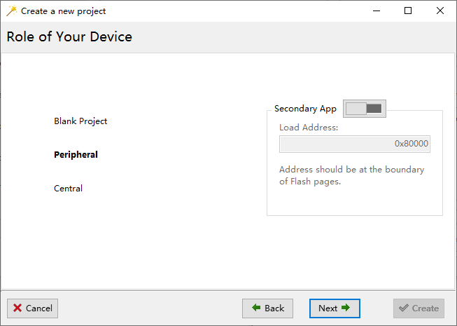

Figure 3.4: Role of Your Device

On this page (Figure [3.4](https://ingchips.github.io/user_guide/tutorial.html#fig:ch1-role)), just select Peripheral, and press `Next` to proceed to the next page, `Peripheral Setup`.

### 3.1.5 Peripheral Setup Page {#peripheral-setup-page}

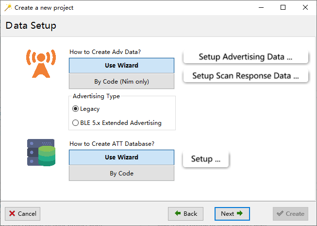

Figure 3.5: Peripheral Setup

On this page (Figure [3.5](https://ingchips.github.io/user_guide/tutorial.html#fig:ch1-peripheral)), select `Legacy` advertising.

Phones that support BLE 5.x extended advertising are still rare at present (`r Sys.Date()`) even if BLE 5.0 is declared as “supported”, so we use legacy advertising for better compatibility. Furthermore, legacy advertising can be changed to BLE 5.x extended advertising by toggling a single bit later.

Click `Setup Advertising Data` button, which will bring up the advertising data editor (Figure [3.6](https://ingchips.github.io/user_guide/tutorial.html#fig:ch1-hello-adv)). In the editor, type `name` to quickly search for the GAP advertising item `09 - «Complete Local Name»`, and click `Add` to add it into our device’s advertising data.

Click the newly added `09 - «Complete Local Name»` item, then fill in “Hello, 世界” in the data editor shown below and press Enter. `Data Preview` will be updated and the whole advertising data is shown in raw bytes with a few comments on each item. Obviously, Chinese characters are encoded in `UTF-8` properly.

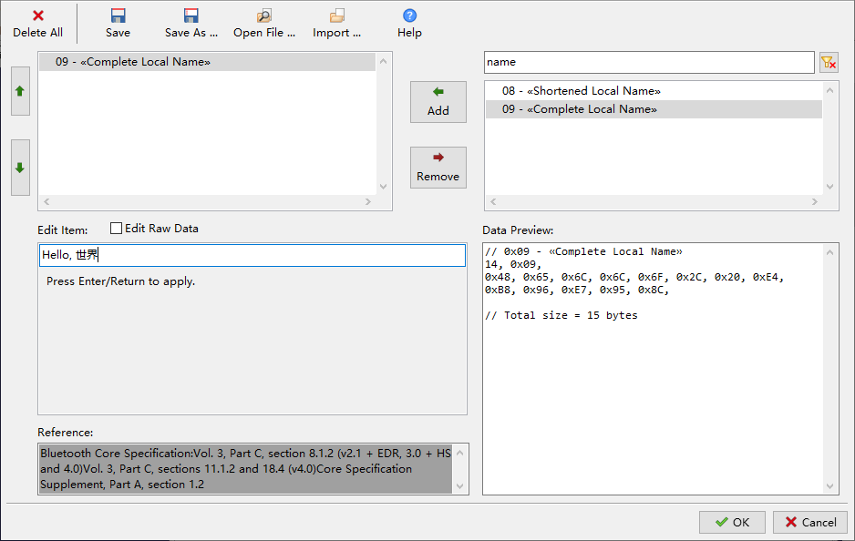

Figure 3.6: Edit Advertising Data

Now, click `OK` to go back to project wizard, and press `Next` to proceed to the next page `Security & Privacy`.

### 3.1.6 Security & Privacy Page {#security-privacy-page}


Figure 3.7: Firmare Over-The-Air

Leave all options as default (Figure [3.7](https://ingchips.github.io/user_guide/tutorial.html#fig:ch1-wiz-security)), and press `Next` to proceed to the next page `Firmare Over-The-Air`.

### 3.1.7 Firmare Over-The-Air Page {#firmare-over-the-air-page}

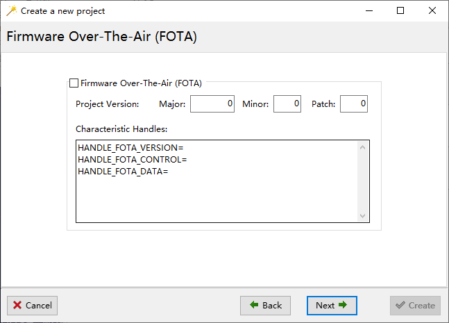

Figure 3.8: Firmare Over-The-Air

Leave all options as default (Figure [3.8](https://ingchips.github.io/user_guide/tutorial.html#fig:ch1-hello-fota)), and press `Next` to proceed to the last page `Common Functions`.

### 3.1.8 Common Functions Page {#common-functions-page}


Figure 3.9: Common Functions

On this page (Figure [3.9](https://ingchips.github.io/user_guide/tutorial.html#fig:ch1-hello-common)), we also accept the default settings and press `Create`. Now your project is created (Figure [3.10](https://ingchips.github.io/user_guide/tutorial.html#fig:ch1-hello-proj-ready)), and ready for building and downloading.


Figure 3.10: “Hello, 世界” is Ready

### 3.1.9 Build your project {#build-your-project}

Back to the main window of `Wizard` (Figure [3.10](https://ingchips.github.io/user_guide/tutorial.html#fig:ch1-hello-proj-ready)), click on your project to open it. Build your project in IDE.

### 3.1.10 Download {#download}

To download your project, back to `Wizard` (Figure [3.10](https://ingchips.github.io/user_guide/tutorial.html#fig:ch1-hello-proj-ready)), right click on your project, and select `Download to Flash` from the popup menu to start the downloader (Figure [3.11](https://ingchips.github.io/user_guide/tutorial.html#fig:ch1-hello-downloader)).

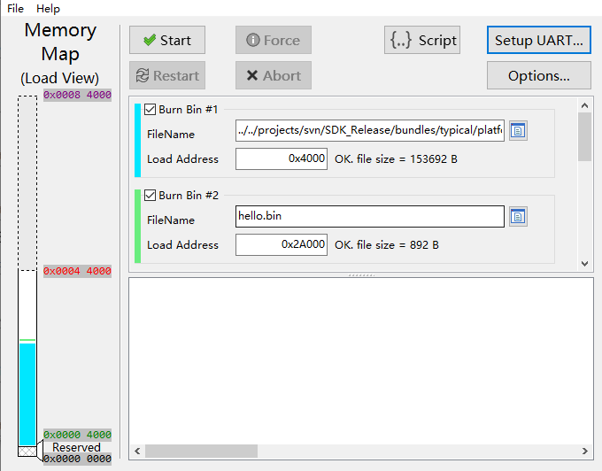

Figure 3.11: Download to Flash

All settings in the downloader are ready except the UART port number. In the downloader, configure the correct UART port and then click `Start`.

Once downloaded, check if you can find a device named “Hello, 世界” by LightBlue, `INGdemo` (Figure [3.12](https://ingchips.github.io/user_guide/tutorial.html#fig:ch1-hello-ingota)) or other apps. Note that, this device may not be listed in the Bluetooth menu of system settings at present.

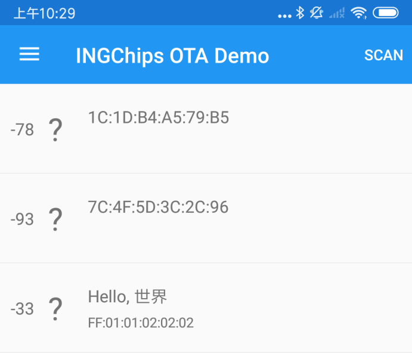

Figure 3.12: Hello, 世界

## 3.2 iBeacon {#ibeacon}

In this tutorial, let’s make an iBeacon. iBeacon is a protocol developed by Apple[13](#fn13) and introduced at the Apple Worldwide Developers Conference in 2013. Beacons are a class of Bluetooth low energy (BLE) devices that broadcast their identifier to nearby portable electronic devices. This technology enables smartphones, tablets and other devices to perform actions when in close proximity to an iBeacon device.

Firstly, get a iBeacon scanning app from App Store. We will use an app called `Locate` in this tutorial. `Locate` has a list of preconfigured proximity UUIDs, which includes an all 0s Null UUID. We will use this Null UUID[14](#fn14).

### 3.2.1 Setup Advertising Data {#setup-advertising-data}

There are two items in iBeacon advertising packet.

1. Flags

   Value is fixed to 0x06, i.e. two bits are set, LE General Discoverable Mode & BR/EDR Not Supported.
2. Manufacturer Specific Data

   The contents of this item is shown in Table [3.1](https://ingchips.github.io/user_guide/tutorial.html#tab:ch1-ibeacon)

*Table 3.1: iBeacon Manufacturer Specific Data*
| Size in Bytes | Name | Value | Notes |
| --- | --- | --- | --- |
| 2 | Company ID | 0x004C | Company ID of Apple, Inc |
| 2 | Beacon Type | 0x1502 | Value defined by Apple |
| 16 | Proximity UUID | User defined value |  |
| 2 | Major | Group ID |  |
| 2 | Minor | ID within a group |  |
| 1 | Measured Power | in dBm | Measured by an iPhone 5s at a 1 meter distance |

In order to make an iBeacon device, we can just follow the same steps as in the [Hello World](https://ingchips.github.io/user_guide/tutorial.html#ch1-hello-world) example, with only on exception that we need to configure the advertising package according to the specification.

In the advertising data editor, add `0x01 - «Flags»` and `0xFF - «Manufacturer Specific Data»`. Click `0x01 - «Flags»`, check `LE General Discoverable Mode` and `BR/EDR Not Supported`. Click `0xFF - «Manufacturer Specific Data»`, then the `Edit as` button, a menu pops up and select `iBeacon ...` (Figure [3.13](https://ingchips.github.io/user_guide/tutorial.html#fig:ch1-edit-beacon-adv)) to open iBeacon manufacturer specific data editor (Figure [3.14](https://ingchips.github.io/user_guide/tutorial.html#fig:ch1-edit-beacon-content)).

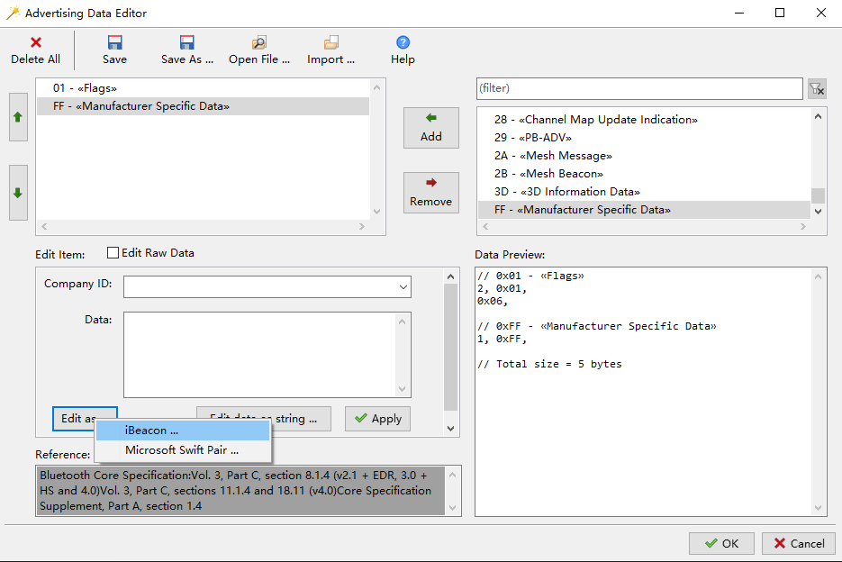

Figure 3.13: Edit iBeacon Advertising Data

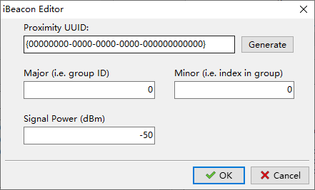

Figure 3.14: Edit iBeacon Manufacturer Specific Data

Signal power can be set to any reasonable value (such as -50dBm), and we will calibrate it later with the help of the `Locate` app.

### 3.2.2 Try It {#try-it}

Let’s select GNU Arm Embedded Toolchain as our development environment on `Choose Project Type` page, and the wizard will make everything ready (Figure [3.15](https://ingchips.github.io/user_guide/tutorial.html#fig:ch1-ibeacon-proj)).


Figure 3.15: iBeacon Ready for GNU Arm Toolchain

Click on the project to open a console, type `make`[15](#fn15) to build it. Back to `Wizard`, follow the same steps to download it. Now we are able to find our newly created iBeacon in `Locate`. (Figure [3.16](https://ingchips.github.io/user_guide/tutorial.html#fig:ch1-locate-page1-small))


Figure 3.16: iBeacon in Locate app

Tap on our device then we can calibrate signal power or check distance in real-time as shown in Figure [3.17](https://ingchips.github.io/user_guide/tutorial.html#fig:ch1-locate-page2-small).


Figure 3.17: iBeacon Detailed Information in Locate app

Once signal power is calibrated, we can right click on our project in `Wizard`, and select `Edit Data` -> `Advertising` menu item to edit its advertising data with same editor that we are getting familiar with. After advertising data is updated, rebuild the project and check if the distance is more accurate.

According to the specification, proximity beacons must use a non connectable undirected advertising PDU, using a fixed 100ms advertising interval. In this tutorial, we are not going to touch the code, so advertising parameters are not touched, either. To make these parameters fully meet the specification, please refer to the corresponding host GAP APIs.

## 3.3 Thermometer {#thermometer}

In this tutorial, we are going to make a *serious* BLE device, a thermometer. Bluetooth SIG has already defined a GATT service called Health Thermometer[16](#fn16). This SDK contains a reference app called `INGdemo`, which can be deployed to an `Android` or `iOS` device. Using `INGdemo`, we can check Bluetooth devices’ advertising data, and if health thermometer service is found in a device, `INGdemo` can connect to it and read temperature.

In this tutorial, you will learn how to:

- Broadcast supported services
- Configure a GATT profile
- Respond to the read request of a GATT characteristic

### 3.3.1 Setup Advertising Data {#setup-advertising-data-1}

Again, we follow the same steps as in the [Hello World](https://ingchips.github.io/user_guide/tutorial.html#ch1-hello-world) example, and on the `Peripheral Setup` page, we declare the thermometer service and create a GATT profile. Add following three items into the advertising data:

1. `Flags`

   Value is fixed to 0x06, i.e. two bits are set, LE General Discoverable Mode & BR/EDR Not Supported.
2. `Complete List of 16-bit Service Class UUIDs`

   Add one service `0x1809 - Health Thermometer` as shown in Figure [3.18](https://ingchips.github.io/user_guide/tutorial.html#fig:ch1-thermo-adv).
3. `Complete Local Name`

   Let’s name our device as “AccurateOne”.

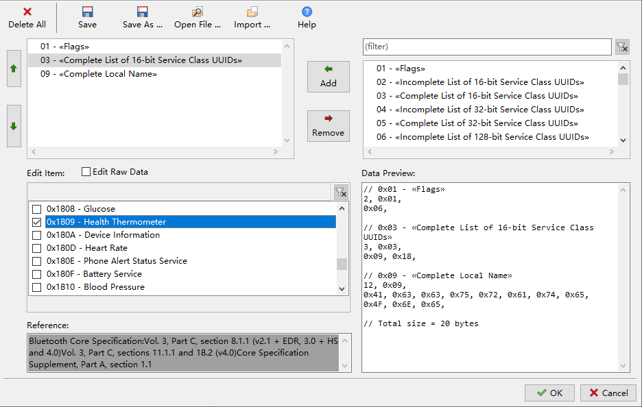

Figure 3.18: Thermometer Advertising Data

### 3.3.2 Setup GATT Profile {#setup-gatt-profile}

Back to the `Peripheral Setup` page and click `Setup ATT database ...` to open the GATT profile editor. Add two service, General Access (0x1800) and Health Thermometer (0x1809). Delete all non-mandatory characteristics of General Access service. For Health Thermometer service, keep two characteristics, i.e. temperature measurement and temperature type, and delete the other two.

Next, edit each characteristic’s value:

1. Device Name of General Access:

   Right click on the characteristic, select `Edit String Value ...` menu, and set the value to “AccurateOne”.
2. Appearance of General Access:

   Right click on the characteristic, select `Help` and the editor will open the corresponding document on Bluetooth SIG website. Find the value for general thermometer (0x0300), then click the `Edit` button and input `0x00, 0x03` into the data field.
3. Temperature Measurement of Health Thermometer

   Check the document on Bluetooth SIG website. click the `Edit` button and input five 0s (`0, 0, 0, 0, 0`) into the data field. Here the first byte contains the flags showing that the following measurement is a `FLOAT` value in units of Celsius. Check `read` and `dynamic` properties (Figure [3.19](https://ingchips.github.io/user_guide/tutorial.html#fig:ch1-thermo-edit-ch)).

   `FLOAT` type is IEEE-11073 32-bit float. Basically, it has a 24-bit mantissa, and an 8-bit exponent (the most significant byte) in base *10*.
4. Temperature Type of Health Thermometer

   Check the document on Bluetooth SIG website. Set it to any valid value by click the `Edit` button.


Figure 3.19: Edit Temperature Measurement

### 3.3.3 Write the Code {#write-the-code}

After project is created, open `profile.c` in IDE, and the temperature measurement characteristic handling function `att_read_callback` is automatically generated by `Wizard`.

```c
static uint16_t att_read_callback(hci_con_handle_t connection_handle,
                                  uint16_t att_handle, uint16_t offset,
                                  uint8_t * buffer, uint16_t buffer_size)
{
    switch (att_handle)
    {
    case HANDLE_TEMPERATURE_MEASUREMENT:
        if (buffer)
        {
            // add your code
            return buffer_size;
        }
        else
            return 1; // TODO: return required buffer size

    default:

        return 0;
    }
}
```

`att_read_callback` will be called twice or more when app reads a characteristic that has `dynamic` property: one for querying required buffer size, and one for reading data. If data is large, `att_read_callback` might be called more times, each reading a part of data specified by `offset`.

As discussed above, define a temperature measurement type:

```c
typedef __packed struct gatt_temperature_meas
{
     uint8 flags;
    sint32 mantissa:24;
    sint32 exponent:8;
} gatt_temperature_meas_t;

static gatt_temperature_meas_t temperature_meas = {0};
```

Now, we can complete the above `case HANDLE_TEMPERATURE_MEASUREMENT` clause:

```c
    case HANDLE_TEMPERATURE_MEASUREMENT:
        if (buffer)
        {
            // simulate an "accurate" thermometer
            temperature_meas.mantissa = rand() % 100;
            // output data
            memcpy(buffer, ((uint8 *)&temperature_meas) + offset, buffer_size);
            return buffer_size;
        }
        else
            return sizeof(gatt_temperature_meas_t);
```

Build & download project, then connect to “AccurateOne” device in `INGdemo` app. Check if temperature changes randomly each time `Refresh` button is pressed (Figure [3.20](https://ingchips.github.io/user_guide/tutorial.html#fig:ch1-ingtemp)).


Figure 3.20: Refresh Temperature Measurement

A thermometer (a server) can use notification or indication procedure to notify (without acknowledge) or indicate (with acknowledge) a characteristic value, see [Thermometer with Notification]. In this example, “AccurateOne” does not use these two procedures, and sends its measurement passively.

### 3.3.4 Notification {#notification}

## 3.4 Thermometer with FOTA {#thermometer-with-fota}

In this tutorial, we are going to add Firmware Over-The-Air update feature into our thermometer. This SDK provides a FOTA reference design that is workable out-of-the-box. To make FOTA work, at least three parties are involved, a device, an app, and an HTTP server. The `INGdemo` app is already there, so in this tutorial, we will focus on the device and HTTP server.

### 3.4.1 Device with FOTA {#device-with-fota}

Follow the same steps as in the previous [Thermometer](https://ingchips.github.io/user_guide/tutorial.html#thermometer) example to create a new project, say “ota”.

When editing advertising data, we can import data created in previous example by clicking `Open File...` button of the editor. Advertising data is stored in `$(ProjectPath)/data/advertising.adv`. Let’s change device’s name to “Clickety Click”.

When editing GATT profile database, we can import data created in previous example by clicking `Open File...` button of the editor. GATT profile data is stored in `$(ProjectPath)/data/gatt.profile`. Select `INGChips Service` from the drop-down menu of `Add Service` button, and add “INGChips FOTA Service”. At present, we are not going to consider security issues, so delete the “FOTA Public Key” characteristics. Next, edit characteristics value of this service:

1. FOTA Version:

   This identifies the full version number of our project. As shown in flash downloader, a whole project is composed by two binaries, one is from SDK bundle, called platform binary, and the other one is built from our project, called the app binary. FOTA version contains two sub-versions, one for each binary. Each sub-version contains three fields:

   - Major: A 16-bit field.
   - Minor: A 8-bit field.
   - Patch: Another 8-bit field.

   Each bundle has its own version (so as the platform binary), using the same numbering scheme, which can be found on `SDK` page of `Environment Options` dialog (use menu item `Tools` -> `Environment Options` to open this dialog). Suppose platform version is 1.0.1[17](#fn17), and we would like our app’s version to be 1.0.0, then we set this characteristic’s value to (Fig [3.21](https://ingchips.github.io/user_guide/tutorial.html#fig:ch1-ota-version)):

   ```c
   0x0001, 0, 1  // platform version
   0x0001, 0, 0, // app version
   ```
2. FOTA Control

   This is control point during update. Set its value to `0` (i.e. `OTA_STATUS_DISABLED`), which is the initial status of FOTA.


Figure 3.21: Configure FOTA Version

Click `OK` to close GATT profile editor. (Note: do not click `Save`, unless you want to change the file `$(ProjectPath)/data/gatt.profile` that is opened in editor.)

Back to project wizard, press `Next` to proceed to the next page `Firmare Over-The-Air`. On this page, let’s check `FOTA`. Note that characteristics handles related to FOTA is generated automatically by inspecting the GATT profile. Then finish remaining steps on project wizard.

Open our brand-new project “ota”, copy the code from previous example to make our thermometer respond to `Refresh` in `INGdemo` app.

Next, let’s make a new version.

### 3.4.2 Make a New Version {#make-a-new-version}

New version of our “ota” will have a new name “Barba Trick”, and app version number is upgraded to `2.0.0`. These data are saved in advertising and profile data respectively, so right click on the project and use editors to update it. After data is updated, use `Save As ...` to save data to another file in the same directory, for example, update advertising data and save it to `$(ProjectPath)/data/advertising_2.adv`, and updated profile to `$(ProjectPath)/data/gatt_2.profile`.

Use macro `V2` to control the actual advertising and profile data:

```c
const static uint8_t adv_data[] = {
#ifndef V2
    #include "../data/advertising.adv"
#else
    #include "../data/advertising_2.adv"
#endif
};

......

const static uint8_t profile_data[] = {
#ifndef V2
    #include "../data/gatt.profile"
#else
    #include "../data/gatt_2.profile"
#endif
};
```

Rebuild the project with macro `V2` defined, copy `ota.bin` and `platform.bin` (in `SDK_DIR/sdk/bundles/typical`) to an empty directory, say `ota_app_v2`.

Create a file named `manifest.json` in `ota_app_v2`, with follow data in it:

```javascript
{
    "platform": {
                "version": [1,0,1],
                "name": "platform.bin",
                "address": 16384
    },
    "app": {
                "version": [2,0,0],
                "name": "ota.bin",
                "address": 163840
    },
    "entry": 16384,
    "bins":[]
}
```

Those addresses can be found in `Environment Options`. `entry` value is fixed to `0x4000`, i.e. `16384`. Note that `json` do not accept the popular `0xabcd` hexadecimal literals. `INGdemo` can download additional binaries specified by `bins` to device. In this case, we don’t have such binaries, so this field is left as an empty array.

Then create a `readme` file for this update with some information about this update in it.

Now the FOTA package is ready. Make a `ota_app_v2.zip` ZIP archive of the whole `ota_app_v2` directory. Note that `ota_app_v2` should not be made into a sub-directory in `ota_app_v2.zip`. Table [3.2](https://ingchips.github.io/user_guide/tutorial.html#tab:ch1-ota-package) summarize the files in the ZIP archive.

*Table 3.2: FOTA Package Summary*
| File Name | Notes |
| --- | --- |
| readme | Some information about this update |
| manifest.json | Meta information |
| platform.bin | Platform binary |
| ota.bin | App binary |

Back to IDE, rebuild the project leaving macro `V2` undefined, then download the project.

### 3.4.3 FOTA Server {#fota-server}

`INGdemo` app needs a FOTA server URL, defined in `class Thermometer.FOTA_SERVER`. Move `ota_app_v2.zip` to HTTP server’s document directory, and create a `latest.json` file, which contains information about latest version. Its content is:

```javascript
{
    "app": [2,0,0],
    "platform": [1,0,1],
    "package": "ota_app_v2.zip"
}
```

Make sure that these two files can be accessed through URL `(FOTA_SERVER + latest.json)` and `(FOTA_SERVER + ota_app_v2.zip)`.

### 3.4.4 Try It {#try-it-1}

Connect to “Clickety Click” in `INGdemo`, click `Update` (Figure [3.22](https://ingchips.github.io/user_guide/tutorial.html#fig:ch1-fota-update)). Since `platform.bin` is up-to-date, only `app.bin` need to be updated, the whole update completes in a short time. Return to the main page, scan again and check if our new version works, a device named “Barba Trick” appearing. Connect to “Barba Trick”, firmware is up-to-date now.


Figure 3.22: Update Available for “Clickety Click”

This tutorial gives an example on FOTA implementation. Users are free to design a new FOTA solution, from version definition to FOTA service and characteristics. It also possible to develop a dedicated secondary app for FOTA.

*Security* must be considered.

## 3.5 iBeacon Scanner {#ibeacon-scanner}

We already know to how to make iBeacon devices. In this tutorial, we are going to create an iBeacon scanner.

A scanner plays a central role in Bluetooth pico network. As always, we create a new project named “iscanner” in `Wizard` (Fig [3.23](https://ingchips.github.io/user_guide/tutorial.html#fig:ch1-proj-iscanner)). On `Role of Your Device` page, select *Central*. A central device almost always scans for something then performs other actions, and our new project wizard automatically adds codes to start scanning.


Figure 3.23: “iscanner” Created for IAR Embedded Workbench

Open this new project in IDE, and navigate to function `user_packet_handler`. We can see there is an event called `HCI_SUBEVENT_LE_EXTENDED_ADVERTISING_REPORT`:

```c
    case HCI_SUBEVENT_LE_EXTENDED_ADVERTISING_REPORT:
        {
            const le_ext_adv_report_t *report = decode_hci_le_meta_event(packet,
                      le_meta_event_ext_adv_report_t)->reports;
            // ...
        }
        break;
```

Each time this event is received, we can check if the advertising report contains `0xFF - «Manufacturer Specific Data»`, and if it is an iBeacon packet. With the knowlegde of making an iBeacon device, it is straight forward to define an iBeacon packet type in `C`.

```c
typedef __packed struct ibeacon_adv
{
    uint16_t apple_id;
    uint16_t id;
    uint8_t  uuid[16];
    uint16_t major;
    uint16_t minor;
    int8_t   ref_power;
} ibeacon_adv_t;

#define APPLE_COMPANY_ID        0x004C
#define IBEACON_ID              0x1502
```

`__packed` is an extended keyword to specify a data alignment of 1 for a data type. Fortunately, it is supported by both *ARM* and *IAR* compilers. Alternatively, one can use `#pragma pack` directive:

```c
#pragma pack (push, 1)
typedef struct ibeacon_adv
{
    ...
} ibeacon_adv_t;
#pragma pack (pop)
```

Before proceeding, let’s create a helper function that converts an UUID to a string.

```c
const char *format_uuid(char *buffer, uint8_t *uuid)
{
    sprintf(buffer, "{%02X%02X%02X%02X-%02X%02X-%02X%02X-"
                    "%02X%02X-%02X%02X%02X%02X%02X%02X}",
           uuid[0], uuid[1], uuid[2], uuid[3],
           uuid[4], uuid[5], uuid[6], uuid[7], uuid[8], uuid[9],
           uuid[10], uuid[11], uuid[12], uuid[13], uuid[14], uuid[15]);
    return buffer;
}
```

### 3.5.1 Distance Estimation {#distance-estimation}

The received signal strength indication (RSSI) is reported together with advertising data. Generally, the intensity of electromagnetic waves radiating from a point source is inversely proportional to the square of the distance from the source. The well known equation for free space loss is:

Loss = 32.45 + 20log(d) + 20log(f)

Where d is in km, f in MHz and Loss in dB. By comparing RSSI and measured power at a distance of 1 meter (`ref_power`), we can grossly estimate the distance between the scanner and beacon using the free space loss equation:

```c
double estimate_distance(int8_t ref_power, int8_t rssi)
{
    return pow(10, (ref_power - rssi) / 20.0);
}
```

Now, we are able to make a fully functional iBeancon scanner in less than twenty lines:

```c
    uint8_t length;
    ibeacon_adv_t *p_ibeacon;
    char str_buffer[80];
    const le_ext_adv_report_t *report;
    ......
    case HCI_SUBEVENT_LE_EXTENDED_ADVERTISING_REPORT:
        report = decode_hci_le_meta_event(packet,
                        le_meta_event_ext_adv_report_t)->reports;
        p_ibeacon = (ibeacon_adv_t *)ad_data_from_type(report->data_len,
                        (uint8_t *)report->data, 0xff, &length);

        if ((length != sizeof(ibeacon_adv_t))
            || (p_ibeacon->apple_id != APPLE_COMPANY_ID)
            || (p_ibeacon->id != IBEACON_ID))
            break;

        printf("%s %04X,%04X, %.1fm\n",
                format_uuid(str_buffer, p_ibeacon->uuid),
                p_ibeacon->major, p_ibeacon->minor,
                estimate_distance(p_ibeacon->ref_power, report->rssi));
        break;
```

Use the `Locate` app to transmit iBeacon signal, and check if our device can found it (Figure [3.24](https://ingchips.github.io/user_guide/tutorial.html#fig:ch1-iscanner)). Finaly, since RSSI value fluctuates, one can add a low pass filter on RSSI to make the estimation more stable.

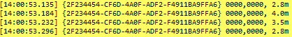

Figure 3.24: iBeacon Scan Result

Note that the size of this app’s binary increases dramatically. This is mainly because that Cortex-M3 don’t have a hardware floating-point unit and floating-point operations are all performed by library functions. *Think twice* before using floating-point operations.

### 3.5.2 Concurrent Advertising & Scanning {#concurrent-advertising-scanning}

As an exercise, we can merge iBeacon project with this one, and check if our device can send iBeacon signals while keeps scanning for other iBeacon devices.

Bluetooth radio uses TDD (Time Division Duplex) topology in which data transmission occur in one direction at one time and data reception occur at another time, and it’s impossible to receive its own iBeacon signal.

## 3.6 Notification & Indication {#notification-indication}

A server can use notification or indication procedure to notify (without acknowledge) or indicate (with acknowledge) a characteristic’s value. Now, let’s add notification and indication features to our thermometer we have created in a previous tutorial.

To notify or indicate a characteristic’s value, we use `att_server_notify` and `att_server_indicate` respectively. These APIs must be called within the Bluetooth stack (`Host`) task.

Unsolicited notifications and indication may be triggered by a timer or interrupts, i.e. by sources outside of Bluetooth stack task. To call these Bluetooth stack APIs, inter-task communication mechanism based on RTOS messages is provided.

### 3.6.1 Inter-task Communication {#inter-task-comm}

`btstack_push_user_msg` can be used to send a message into Bluetooth stack stack:

```c
uint32_t  btstack_push_user_msg(uint32_t msg_id, void *data, const uint16_t len);
```

This message will be passed to your `user_packet_handler` under event ID `BTSTACK_EVENT_USER_MSG`:

```c
static void user_packet_handler(uint8_t packet_type, uint16_t channel,
                                uint8_t *packet, uint16_t size)
{
    uint8_t event = hci_event_packet_get_type(packet);
    btstack_user_msg_t *p_user_msg;
    if (packet_type != HCI_EVENT_PACKET) return;

    switch (event)
    {
    // ......
    case BTSTACK_EVENT_USER_MSG:
        p_user_msg = hci_event_packet_get_user_msg(packet);
        user_msg_handler(p_user_msg->msg_id, p_user_msg->data,
                         p_user_msg->len);
        break;
    // ......
    }
}
```

Here, we delegate the handling of the user message to another function `user_msg_handler`. Note that `user_msg_handler` is running in the context of Bluetooth stack task, and we are allowed to call those Bluetooth stack APIs now.

Event `BTSTACK_EVENT_USER_MSG` is broadcasted to all `HCI` event callback functions.

### 3.6.2 Timer {#timer}

Now let’s make our thermometer “AccurateOne” to update its value once per second. Firstly, create a timer in initialization, such as in `app_main` or `setup_profile`.

```c
TimerHandle_t app_timer = 0;

uint32_t setup_profile(void *data, void *user_data)
{
    app_timer = xTimerCreate("app",
                                pdMS_TO_TICKS(1000),
                                pdTRUE,
                                NULL,
                                app_timer_callback);
        // ...
}
```

Timer callback function is defined as:

```c
#define USER_MSG_ID_REQUEST_SEND            1
static void app_timer_callback(TimerHandle_t xTimer)
{
    if (temperture_notify_enable | temperture_indicate_enable)
        btstack_push_user_msg(USER_MSG_ID_REQUEST_SEND, NULL, 0);
}
```

This timer is started when we get `HCI_SUBEVENT_LE_ENHANCED_CONNECTION_COMPLETE` in `HCI_EVENT_LE_META`, and stopped when we get `HCI_EVENT_DISCONNECTION_COMPLETE`.

Here `temperture_notify_enable` and `temperture_indicate_enable` are two flags initialized as 0s and set to `1` in `att_write_callback`:

```c
static int att_write_callback(hci_con_handle_t connection_handle,
                              uint16_t att_handle, uint16_t transaction_mode,
                              uint16_t offset, uint8_t *buffer, uint16_t buffer_size)
{
    switch (att_handle)
    {
    case HANDLE_TEMPERATURE_MEASUREMENT + 1:
        handle_send = connection_handle;
        switch (*(uint16_t *)buffer)
        {
        case GATT_CLIENT_CHARACTERISTICS_CONFIGURATION_INDICATION:
            temperture_indicate_enable = 1;
            break;
        case GATT_CLIENT_CHARACTERISTICS_CONFIGURATION_NOTIFICATION:
            temperture_notify_enable = 1;
            break;
        }
        return 0;
    // ...
    }
}
```

Here we store `connection_handle` to a global variable `handle_send` which will be used later. The last piece of code is to handle message `USER_MSG_ID_REQUEST_SEND` in `user_msg_handler`:

```c
static void user_msg_handler(uint32_t msg_id, void *data, uint16_t size)
{
    switch (msg_id)
    {
    case USER_MSG_ID_REQUEST_SEND:
        att_server_request_can_send_now_event(handle_send);
        break;
    }
}
```

And report temperature in `ATT_EVENT_CAN_SEND_NOW`:

```c
...
case ATT_EVENT_CAN_SEND_NOW:
    temperature_meas.mantissa = rand() % 100;
    if (temperture_notify_enable)
    {
        att_server_notify(handle_send,
                          HANDLE_TEMPERATURE_MEASUREMENT,
                          (uint8_t*)&temperature_meas,
                          sizeof(temperature_meas));
    }

    if (temperture_indicate_enable)
    {
        att_server_indicate(handle_send,
                          HANDLE_TEMPERATURE_MEASUREMENT,
                          (uint8_t*)&temperature_meas,
                          sizeof(temperature_meas));
    }
    break;
...
```

Try to rebuild and download the project, and check if the temperature value shown in `INGdemo` changes once per second.

There is a fully functional thermometer example, a.k.a `thermo_ota`, supporting FOTA, notification and indication.

## 3.7 Throughput {#throughput}

BLE 5.0 introduces a new uncoded PHY with a sampling rate at 2M.

### 3.7.1 Theoretical Peak Throughput {#theoretical-peak-throughput}

Maximum payload length is 251 bytes for a Data Physical Channel PDU. Using 2M PHY, it takes 1048 μs to transmit. And an empty Data Physical Channel PDU takes 44 μs to transmit.

To achieve maximum throughput on one direction, length of all PDUs on this direction should be 251 bytes, while on the other direction, all PDUs should be empty. So, the transmission of 251 bytes takes a total duration of

1048 + 44 + 150 * 2 = 1392 (\mu s)

Therefore, the theoretical peak throughput provided by link layer is

251 * 8 / 1392 * 1000000 \approx 1442.528 (kbps)

For an app working above GATT, I2CAP and ATT all have their own overhead. Typically, GATT has a maximum effective payload of (251 - 7 =) 244 bytes. So, GATT could provide a theoretical peak throughput of

244 * 8 / 1392 * 1000000 \approx 1402.298 (kbps)

### 3.7.2 Test Throughput {#test-throughput}

There are a pair of examples in SDK for throughput testing (Figure \ref{fig:ch1-tpt}).


Figure 3.25: Examples for Throughput Testing

#### 3.7.2.1 Test against INGdemo {#test-against-ingdemo}

Download `peripheral_throughput`. Use `INGdemo` to connect to `ING Tpt`, and open throughput testing page. On this page, we can test throughput from master to slave, from slave to master, or on both directions simultaneously.

Figure \ref{fig:ch1-tpt-app} shows that using a common low end Android phone with 2M PHY support, we can achieve a 1M+ bps throughput over the air.

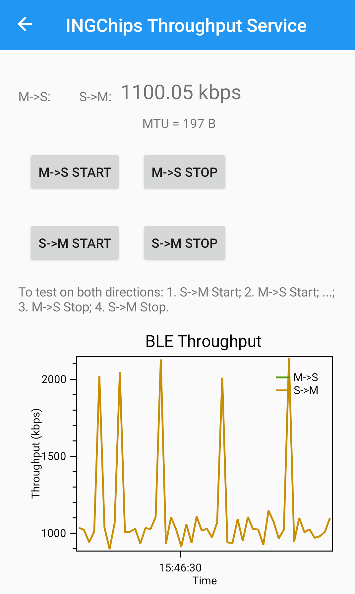

Figure 3.26: Througput on an Android Phone

#### 3.7.2.2 Test against Our Own App {#test-against-our-own-app}

Example `central_throughput` demonstrates the typical procedure for a BLE central device:

1. Scan and connect to a device that has throughput service declared in its advertising
2. Discover throughput service;
3. Discover characteristics of the service;
4. Discover descriptors of characteristics.

`INGChips Throughput Service` has two characteristics.

- Generic Output

  By this characteristic, peripheral device send data to central device.

  This characteristic has a `Client Characteristic Configuration` descriptor.
- Generic Input

  By this characteristic, central device send data to peripheral device.

Download `central_throughput` to another board. This app has a UART command line interface to host computer. Connect to a host computer, type “?” to check supported commands. This app connects to `peripheral_throughput` automatically. Input command `start s->m` or `start m->s` to start testing throughput from peripheral to central, or from central to peripheral, receptively.

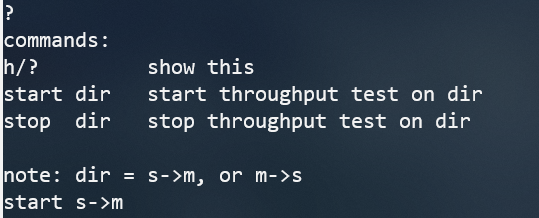

Figure 3.27: Command interface

Figure \ref{fig:ch1-board-tpt} shows that using two boards, we have achieved a stable throughout at 1.2M+ bps over the air.

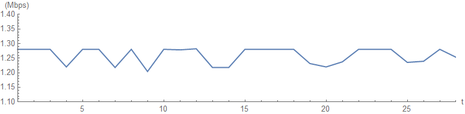

Figure 3.28: Througput Between Boards

This throughput is tested over the air, a little bit lower than theoretical peak value, but much more practical.

## 3.8 Dual Role & BLE Gateway {#dual-role-ble-gateway}

In this tutorial, we are going to create a BLE gateway, which collects data from several peripheral devices and reports data to a central device. When collecting data, this gateway is a central device, while reporting data, it is a peripheral device, i.e., our app has two roles.

More specifically, our gateway only supports to collect data from thermometers. Let call it a `smart_meter`.


Figure 3.29: Smart Meter Overview

`smart_meter` uses a generic string based output service for report data to a central device, such as the `INGdemo` running on a smart phone. It also has a UART control interface connecting to a host computer.

Checkout the example `peripheral_console` for how to do string input & output.

Full functional `smart_meter` app is also provided as an example. Take this example as an reference while creating your own.

Now, let’s create this BLE gateway.

### 3.8.1 Use Wizard to create a peripheral app {#use-wizard-to-create-a-peripheral-app}

Use GUI editor to edit advertising data, naming our app as “ING Smart Meter”.

Use GUI editor to edit GATT Profile. Add `INGChips Console Service` into GATT Profile (Figure \ref{fig:ch1-smart-meter-gatt}).


Figure 3.30: Smart Meter GATT Profile

### 3.8.2 Define Thermometer Data {#define-thermometer-data}

A thermometer is identified by its device address and `id`. Each thermometer uses its own connection identified by `conn_handle`.

```c
typedef struct slave_info
{
    uint8_t     id;
    bd_addr_t   addr;
    uint16_t    conn_handle;
    gatt_client_service_t                   service_thermo;
    gatt_client_characteristic_t            temp_char;
    gatt_client_characteristic_descriptor_t temp_desc;
    gatt_client_notification_t              temp_notify;
} slave_info_t;
```

Define four thermometers.

### 3.8.3 Scan for Thermometers {#scan-for-thermometers}

Call two GAP APIs to start scanning. Once a device is found, check whether its device address is one of the thermometers. If so, stop scanning and call `gap_ext_create_connection` to connect.

After connection established, if there is any thermometer not connected, then start scanning again.

### 3.8.4 Discover Services {#discover-services}

After connection established, call `gatt_client` APIs to discover its services.

These APIs follow a similar logic like Android, iOS.

### 3.8.5 Data Handling {#data-handling}

Subscribe to thermometer’s `Temperature Measurement` characteristic. When a new measurement is received, convert the value into a string and report it to a host computer. If our app is already connected to a central device, forward this information to it through GATT characteristic.

### 3.8.6 Robustness {#robustness}

To make our app more *robust*:

- If disconnected from a thermometer, then start scanning;
- If disconnected from a central device, then start advertising.

### 3.8.7 Prepare Thermometers {#prepare-thermometers}

We can use example `thermo_ota` as thermometers. But we need to configure different address for each one.

We can write a simple script for downloader to generate these addresses automatically:

```pascal
procedure OnStartBin(const BatchCounter, BinIndex: Integer;
                     var Data: TBytes; var Abort: Boolean);
begin
  if BinIndex <> 6 then Exit;
  Data[0] := BatchCounter;
end;
```

For further information on downloader scripting, see [Scripting & Mass Production](https://ingchips.github.io/user_guide/core-tools.html#script-mass-prod).

### 3.8.8 Test {#test}

Input command `start` on host computer to start our app (start scanning & advertising). Use `INGdemo` to connect to a device named “ING Smart Meter” and check temperature measurements.

Turn off and on one or more thermometers, and our app should be able to reconnect to them.

## 3.9 Start from Examples {#start-from-examples}

`Wizard` main interface displays all the examples included with the SDK. Developers can directly modify the examples and see the effects. When the SDK is reinstalled, these modifications will be overwritten. If developers need to develop a project based on an example, you can select “Copy this Example …” from the popup menu to fully copy the example to another location.

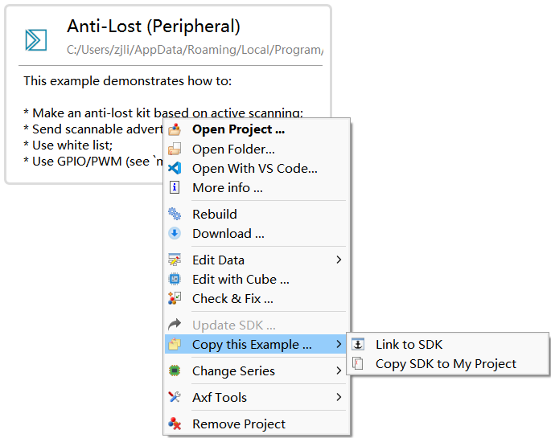

Figure 3.31: Copy an SDK Example

---

1. <a id="fn13"></a>[https://developer.apple.com/ibeacon/](https://developer.apple.com/ibeacon/)[↩︎](https://ingchips.github.io/user_guide/tutorial.html#fnref13)
2. <a id="fn14"></a>Note that UUID is not allowed to be all 0s in final products.[↩︎](https://ingchips.github.io/user_guide/tutorial.html#fnref14)
3. <a id="fn15"></a>`Makefile` follows the syntax of GNU `make`.[↩︎](https://ingchips.github.io/user_guide/tutorial.html#fnref15)
4. <a id="fn16"></a>[https://www.bluetooth.com/specifications/gatt/viewer?attributeXmlFile=org.bluetooth.service.health_thermometer.xml](https://www.bluetooth.com/specifications/gatt/viewer?attributeXmlFile=org.bluetooth.service.health_thermometer.xml)[↩︎](https://ingchips.github.io/user_guide/tutorial.html#fnref16)
5. <a id="fn17"></a>Apps can report a different version in FOTA. It is not reqired to be same as in `Environment Options`.[↩︎](https://ingchips.github.io/user_guide/tutorial.html#fnref17)