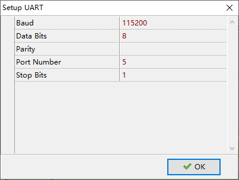
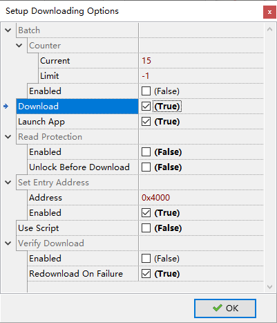
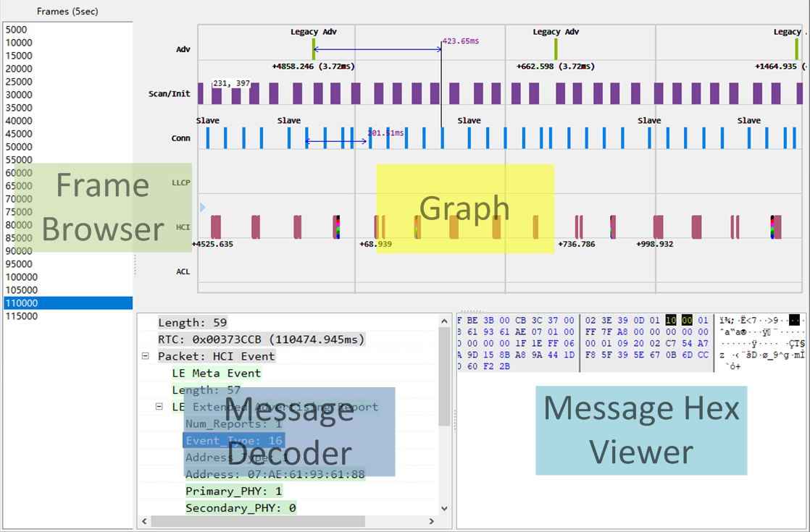

<!-- user_guide_cn: 4 核心工具 -->

# 4 核心工具 {#core-tools}

SDK 核心工具在整个 BLE 开发过程中扮演重要角色。

## 4.1 向导 {#向导}

向导（`Wizard`） 是整个开发周期中的推荐入口。我们用这个工具创建、打开项目，编辑项目数据，迁移项目版本等。

1. 创建项目

   `Wizard` 的新项目向导辅助我们建立新项目。在向导里，可以选择喜欢的 IDE，蓝牙角色，编辑广播、配置数据， 使能 FOTA、日志，等等。

   项目创建后，向导同时会生成以下只供 `Wizard` 使用的文件——不要删除这些文件，否则 `Wizard` 将无法正常工作：

   - `$(ProjectName).ingw`

     这个文件的文件名与与项目相同，但是扩展名为 `.ingw`。它包含关于项目和 SDK 的关键信息。 如果没有这些信息，就无法进行版本迁移。
2. 广播数据编辑器（Advertising Data Editor）

   这个编辑器帮助我们生成广播数据。它也可用从主菜单 `Tools` -> `Advertising Data Editor ...` 打开。
3. GATT 配置编辑器（GATT Profile Editor 或者 GATT/ATT Database Editor)

   这个编辑器帮助我们生成 GATT 配置数据。它也可从主菜单 `Tools` -> `Profile Database Editor ...` 打开。

   这个编辑器支持三种类型的服务：SIG 定义的服务，*INGChips* 定义的服务， 以及用户自定义的服务。用户自定义服务需要事先定义（见后文）然后才能添加。
4. 管理自定义服务

   这个编辑器可以通过主菜单 `Tools` -> `Manage Custom GATT Services ...` 打开。 我们可以添加、删除、编辑自定义服务。

   自定义服务和特征的名字都以安装时指定的公司名称作为前辍。公司名称可以通过 `Environment Options` 修改。
5. 迁移

   当更新了 SDK 版本后，platform 占用的 Flash 和 RAM 可能发生变化，项目的设置也就需要相应更新。 这个过程可以通过在项目上点击右键，然后选择 `Check & Fix Settings ...` 自动完成。

在使用迁移功能之前 *务必* 先对项目做备份：将项目提交到版本管理系统或者直接备份所有文件。

## 4.2 下载器 {#ch2-downloader}

### 4.2.1 介绍 {#介绍}

下载器可以将最多 6 个映像文件（二进制文件）通过 UART 或者 USB 烧录到芯片。 它需要芯片内的引导程序（Bootloader）的配合。Bootloader 可以通过以下途径进入 Flash 下载状态：

- 使能 Boot 引脚[17](#fn17)（这是最常用的情况），或者
- 将 Flash 里的入口地址设为非法值（仅适用于 ING918xx）。

当芯片上电时，Bootloader 会检查上述各个条件，只要有一条满足，就会进入下载状态，并发送握手信息。 当 ING916 进入 Flash 下载状态时，Bootloader 还将检查 GPIO15：如果其电平为高，USB 端口也将被启用。

不同类型调试器的使用提示：

- ING-DAPLink：点击下载器主界面上的“Load”按钮或调试器上的“Load”按钮将使引导加载程序进入 Flash 下载模式；
- 其他调试器：点击调试器上的“Load”按钮将使引导加载程序进入 Flash 下载模式；
- 第三方调试器：在释放复位的同时拉高 Boot 引脚将使引导加载程序进入 Flash 下载模式。

用户可以下载任意文件，尽管典型情况下，这些文件都是由 IDE 工具生成。 程序映像文件的加载地址必须与 Flash 烧写单位对齐：

- 对于 ING918xx，烧写单位为页

  映像文件的加载地址必须与页边界对齐。每页 8192 (`0x2000`) 字节。Flash 起始地址为 `0x4000`， 所以加载地址应该满足 `0x4000 + X * 0x2000`, 这里 `X` 为自然数。
- 对于 ING916xx，烧写单位为扇区

  映像文件的加载地址必须与扇区边界对齐。每个扇区 4096 (`0x1000`) 字节。Flash 起始地址为 `0x02000000`， 所以加载地址应该满足 `0x02000000 + X * 0x1000`, 这里 `X` 为自然数。

如果加载地址有误，下载器会报告错误信息。 说明：当从 `Wizard` 里启动下载器时，地址应该都已正确配置。

点击 `Setup UART ...` 或者 `Setup Port ...` 配置通信端口参数（图 [4.1](https://ingchips.github.io/user_guide_cn/core-tools.html#fig:ch2-downloader-uart-cfg)）。 用户需要将 `Port` 设置成 Windows 设备管理器显示的串口号，例如，如果使用 “COM9” 就将 `Port` 设置为 `COM9`，或者直接写 `9`。对于支持通过 USB 下载的芯片，可以将 `Port` 设置为 `USB` 来通过 USB 下载。 波特率可以设置成比默认值 `115200` 更大的数值，比如 `460800`, `921600` 等， 来获得更高的下载速率。 工具支持的最高波特率为 `921600`。受限于内部 Flash 的自身特性， 将波特率设为比 `512000` 更高的数值并不会带来下载速率的进一步提升。其它参数保持不变。



Figure 4.1: Configurate UART

整个下载过程包含多个步骤：下载、验证、设置启动地址、启动程序。这些步骤可通过点击 `Options` 进行设置（图 [4.2](https://ingchips.github.io/user_guide_cn/core-tools.html#fig:ch2-downloader-options)）。 对于 ING918，当使用 platform 时，启动地址（入口地址） `0x4000` 等于 platform 的加载地址。 对于 ING916，当启动地址不属于 RAM 范围时，该地址不起作用。



Figure 4.2: Downloader Options

如果启用了 “Verify Download” 功能， 数据下载之后会从 Flash 回读并与原始数据对比以验证下载是否正确。由于下载时数据已经过 CRC 验证，一般情况下， “Verify Download” 并不需要启用。 如果在特定位置持续出现下载错误，那么我们可用启用验证功能以便检查 Flash 是否出现异常。当验证失败时， 下载器会把回读的数据保存到文件里以便进一步分析。

当启用了批量（“Batch”）模式时，下载器会持续等待 Bootloader 的握手信号， 一旦收到握手信号就会开始下载；下载完成后，下载器再次进入等待状态。如果未启用 “Batch” 模式， 下载完成后下载器就不会再次等待握手信号。

点击 `Start` 开始下载，更确切地说是开始等待握手信号。Bootloader 只发送一次握手信号， 如果芯片已经上电，Bootloader 已经发送过了握手信号，这种情况下，我们可以点击 `Force` 跳过等待过程，直接开始下载。

### 4.2.2 脚本与量产 {#script-mass-prod}

下载器支持脚本，可以应用于量产。在下载脚本里可以捕捉到两个事件：

- `OnStartRun`

  这个事件处理函数在每轮下载开始时都会调用；
- `OnStartBin`

  这个事件处理函数在每个二进制文件开始下载时都会调用。在这个函数里，可以即时修改待下载的数据。

当启用了 “Batch” 时，下载器会维护一个计数器，每次下载完成，该计数器加 1。这个计数器即图 [4.2](https://ingchips.github.io/user_guide_cn/core-tools.html#fig:ch2-downloader-options) 中的 `Counter.Current`。还有一个名为 `Counter.Limit` 的变量： 在 “Batch” 模式下，当要开始新的一轮下载时，会检查 `Counter.Current`， 如果**超过**了限制，“Batch” 模式自动停止。 例如 `Counter.Current` 和 `Counter.Limit` 分别为 `10` 和 `13`，那么 “Batch” 模式将一共执行 4 轮 下载，每一轮的 `Counter.Current` 等于 `10`、`11`、`12` 和 `13`。“Batch” 停止后， `Counter.Current` 等于 `14`.

下载器使用的脚本语言为 *RemObjects Pascal Script*[18](#fn18)， 与 `C` 比较类似，易于开发。下面是一个简单但是实用的例子，把下载计数器写入二进制文件的固定位置：

```pascal
// 我们可以使用常数
const
  BD_ADDR_ADDR = $1;

// BatchCounter 就是 Counter.Current
procedure OnStartRun(const BatchCounter: Integer; var Abort: Boolean);
begin
  // 使用 Print 输出日志、调试信息
  Print('OnStartRun %d', [BatchCounter]);
  // 把 Abort 赋值为 True 可以中止下载
  // Abort := True;
end;

procedure OnStartBin(const BatchCounter, BinIndex: Integer;
                     var Data: TBytes; var Abort: Boolean);
begin
  // 注意 BinIndex 从 1 开始计数（而不是 0），与图形界面一致
  if BinIndex <> 2 then Exit;
  // 我们在数据下载到 Flash 之前修改它
  Data[BD_ADDR_ADDR + 0] := BatchCounter and $FF;
  Data[BD_ADDR_ADDR + 1] := (BatchCounter shr 8) and $FF;
  Data[BD_ADDR_ADDR + 2] := (BatchCounter shr 8) and $FF;
end;
```

### 4.2.3 Flash 读保护（适用于 ING918xx） {#flash-读保护适用于-ing918xx}

为防止对 Flash 内的数据和程序的非法访问，918xx 设计了一种读保护机制。 读保护一旦启用，JTAG/SWD 就下载器都无法访问 Flash。 要使芯片重新启用 JTAG/SWD 调试、下载功能，需要一个经过 *解锁* 过程。*解锁* 时， Flash 里的数据被全部擦除。

当 app 已准备就绪，并且认为需要保护 Flash 里的数据和程序不被非法访问，可如图 [4.2](https://ingchips.github.io/user_guide_cn/core-tools.html#fig:ch2-downloader-options) 所示启用读保护（“Read Protection”）功能。 启用 `Unlock Before Download` 选项可以为已经启用了读保护的设备重新下载程序。由于 *解锁* 时，Flash 里的数据被全部擦除，不要忘记重新下载 platform。

所有的配置参数都保存在一个 *ini* 文件内。

### 4.2.4 Python 版本 {#python-版本}

SDK 同时提供了一个 Python 版本的下载器（*icsdw.py*）。它是开源的，可以与其它工具集成。

本工具是用 Python 3 开发，使用 `PySerial`[19](#fn19) 包访问串口。 这个包可以通过运行命令 “`pip install pyserial`” 安装。

Python 版下载器与图形界面版（GUI）下载器使用相同的 *ini* 文件，只有一处例外：脚本。 GUI 版工具将 *RemObjects Pascal* 保存在 “*options*” 里 “*script*” 域，而 Python 版在 这个域里保存的是一个用户模块的路径。这个路径可以是绝对路径，也可以是相对路径（相对于 *ini* 文件）。

在用户模块里，与 GUI 版本类似，可以定义两个事件回调函数， `on_start_run` 和 `on_start_bin`。下面的例子演示了如何将批量计数器写入第 2 号二进制文件的固定地址：

```python
# 返回 abort_flag
def on_start_run(batch_counter: int):
    return False

# 返回 abort_flag, new_data
def on_start_bin(batch_counter: int, bin_index: int, data: bytes):
    if bin_index != 2:
        return False, data
    ba = bytearray(data)
    addr = batch_counter.to_bytes(4, 'little')
    ba[1:5] = addr
    return False, bytes(ba)
```

## 4.3 Trace 工具 {#ingtracer}

Trace 工具（`Tracer`）是 [调试与跟踪](https://ingchips.github.io/user_guide_cn/dive-into-sdk.html#debugging-tracing) 里提到的 Trace 数据的可视化工具.

为了限制屏幕上的数据，`Tracer` 将数据划分为若干帧。每一帧的长度为 5 秒。 为了使呈现的数据更具有连续性，当选择了一帧时，除了当前帧， 其前后各一帧也会显示出来。



Figure 4.3: Tracer 主界面

**Graph** 将所有数据图形化显示。点击 **Graph** 里的一项， 会在 **Message Decoder** 和 **Message Hex Viewer** 显示详细的解码信息。**Graph** 支持一些 CAD 操作， 如缩放、平移、测量等。选择菜单 `Help` -> `About` 查看详细信息。 （图 [4.3](https://ingchips.github.io/user_guide_cn/core-tools.html#fig:ch2-tracer-main)）


Figure 4.4: MSC Generated by Tracer

为辅助分析 app 及高层协议栈问题，`ingTrace` 可为每一个连接生成 MSC （消息序列图）。 **Graph** 窗口侧重事件之间的定时关系，而 MSC 则侧重流程，更便于分析协议层面的问题。点击 MSC 里的 `[+]` 可以解码消息 （图 [4.4](https://ingchips.github.io/user_guide_cn/core-tools.html#fig:ch2-tracer-msc)）。

## 4.4 Axf Tool {#ch2-axf-tool}

`Axf Tool` 是一个用于分析可执行程序和内存转储的命令行工具，可从 `Wizard` 的项目快捷菜单执行。 包含多种功能：

- **stack-usage**: 静态分析栈的使用情况，并报告栈空间使用最多前 N 条函数调用链；
- **bt-api-thread-safety**: 分析对蓝牙 API 的调用，检查是否违反了单线程约定；
- **call-stack**: 尝试从内存转储中恢复函数调用栈；
- **history**: 给出关于 BLE 活动简史；
- **check-heap**: 尝试检查堆的状态；
- **check-task**: 在内存转储的帮助下动态检查 FreeRTOS 里的各个任务的情况。

通过 `axf_tool.exe help {function}` 命令获得每种功能的详细信息。

## 4.5 AI 捷径 {#ai-捷径}

AI 捷径（AI Shortcuts）通过简单的快捷键操作，为代码和文本相关任务引入 AI 的强大功能。

### 4.5.1 安装 {#安装}

该工具是 SDK 的一个可选组件，不随 SDK 一起安装，需要通过向导（`Wizard`）在后期安装。

打开 `Environment Options` 对话框（菜单项 `Tools` -> `Environment Options`）中的 `AI Shortcuts` 页面，正确配置后点击“Install”按钮安装。向导会根据 GPU 显存大小选择合适的 LLM（大型语言模型）。 用户仍然可以做出自己的选择，例如在 CPU 上尝试更大的模型。

### 4.5.2 使用方法 {#使用方法}

安装完成后，点击“AI Shortcuts”按钮启动该工具。

选择一段代码，按下快捷键，然后点击主界面上的按钮即可。

当该工具最小化到系统托盘时，可以使用弹出菜单退出工具。 弹出菜单上有一个名为“手气不错”的菜单项。当选中该项时，像“生成注释”这样的任务会直接将生成的注释应用到所选代码中； 当未选中时，如果对结果不满意，开发人员可以点击“重试”按钮重新生成。

---

1. <a id="fn17"></a>ING918 具备专门的 Boot 引脚。ING916 复用 GPIO0。[↩︎](https://ingchips.github.io/user_guide_cn/core-tools.html#fnref17)
2. <a id="fn18"></a>[https://github.com/remobjects/pascalscript](https://github.com/remobjects/pascalscript)[↩︎](https://ingchips.github.io/user_guide_cn/core-tools.html#fnref18)
3. <a id="fn19"></a>[https://pypi.org/project/pyserial/](https://pypi.org/project/pyserial/)[↩︎](https://ingchips.github.io/user_guide_cn/core-tools.html#fnref19)