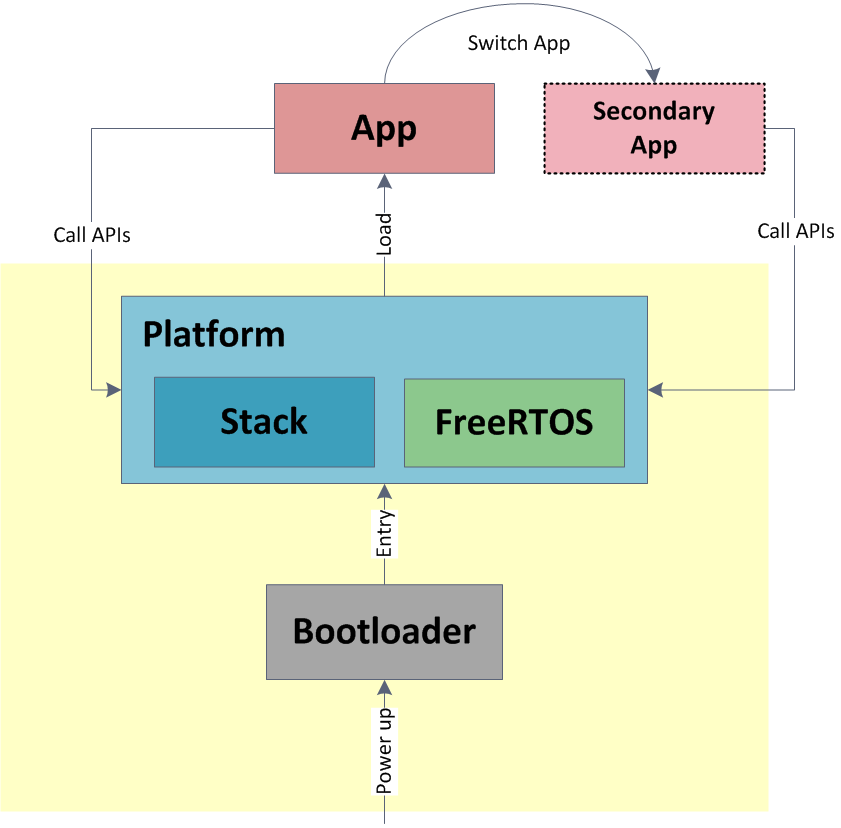

<!-- user_guide_cn: 2 简介 -->

# 2 简介 {#intro}


Figure 2.1: SDK Overview

*INGCHIPS* 软件开发工具包包含以下主要组件（图 [2.1](https://ingchips.github.io/user_guide_cn/intro.html#fig:fig-welcome)）:

1. 核心工具

   提供项目向导，Flash 下载器及其它功能。这些工具可使 BLE 开发更简单、流畅。
2. 语言和 IDE 集成

   支持 `Keil μVision`[1](#fn1) ， `IAR Embedded Workbench`[2](#fn2) ， `Rowley Crossworks for ARM`[3](#fn3) ， `SEGGER Embedded Studio for ARM`[4](#fn4) 。 支持 `GNU Arm Embedded Toolchain`[5](#fn5) 。 核心工具可以自动配置所有这些 IDE、工具链。
3. 平台软件包

   为不同应用场景提供不同的软件包（比如 `typical`，`extension`）。 每个软件包包含完整的协议栈和（可选的） `FreeRTOS` 可执行二进制文件及对应的 `C` 头文件。 提供访问芯片外设所需的源代码。
4. 示例

   提供丰富的 BLE 设备示例代码，及对应的 Android、iOS 参考代码。
5. 文档

   提供用户手册（本文档），API 参考，应用指南等。

## 2.1 范围 {#范围}

本手册介绍平台软件包架构，核心工具，和平台 API。

## 2.2 架构 {#架构}

平台软件包分为两种类型，一种内置 FreeRTOS（称为 RTOS 软件包）, 一种不内置 RTOS （称为 “NoOS” 软件包）。

### 2.2.1 RTOS 软件包 {#rtos-软件包}

ING918xx/ING916xx 软件架构如图 [2.2](https://ingchips.github.io/user_guide_cn/intro.html#fig:ch0-concept) 所示。 Bootloader 存储于 ROM，不可修改，而平台和应用存储于 Flash。 BLE 协议栈、FreeRTOS 及部分 SoC 功能编译为平台可执行程序。当系统启动时，平台可执行程序首先完成初始化，然后加载主应用。



Figure 2.2: Architecture

辅应用以[编程](https://ingchips.github.io/user_guide_cn/api-ref.html#api-switch-app)方式告知平台运行。可以下载多个辅应用，编程切换。 芯片复位后，平台又会正常加载主应用。主应用的入口地址由 SDK 工具自动管理，辅应用的入口地址由开发者指定。

#### 2.2.1.1 使用 C 语言开发 App {#使用-c-语言开发-app}

App 的主函数名为 `app_main`，app 在这个函数里进行初始化：

```c
int app_main(void)
{
    ...
    return 0;
}
```

通常情况下，`app_main` 返回 `0`。如果开发者想要使用自定义的 RTOS 来替代内置的 RTOS， 也可以通过 `app_main` 的返回值向平台传递一个通用 RTOS 接口的实现， 方式与使用 [“NoOS” 软件包](#noos_bundles) 相同。[6](#fn6)

平台，BLE 协议栈和 FreeRTOS 的 API 在相应的 `C` 头文件里声明，包含头文件就可以使用。

#### 2.2.1.2 其它语言 {#其它语言}

可以使用其它语言开发应用，如：

- Rust[7](#fn7)
- Nim[8](#fn8)
- Zig[9](#fn9)

### 2.2.2 “NoOS” 软件包 {#noos-软件包}

当需要使用另外的 RTOS，或者需要使用那些 RTOS 软件包中未提供的功能时，开发者可以选用“NoOS”软件包。

“NoOS”软件包定义了一个通用 RTOS 接口，开发者需要实现这个接口，并通过 `app_main` 的返回值告知平台。

```c
uintptr_t app_main(void)
{
    ...
    return (uintptr_t)os_impl_get_driver();
}
```

## 2.3 缩略语和术语 {#缩略语和术语}

*Table 2.1: 缩略语*
| 缩略语 | 解释 |
| --- | --- |
| ATT | Attribute Protocol （属性协议） |
| BLE | Bluetooth Low Energy （低功耗蓝牙） |
| FOTA | Firmware Over-The-Air （固件空中升级） |
| IRQ | Interrupt Request （终端请求） |
| GAP | Generic Access Profile （通用存取配置） |
| GATT | Generic Attribute Profile （通用属性配置） |
| RAM | Random Access Memory （随机存取存储器） |
| ROM | Read Only Memory （只读存储器） |
| SDK | Software Development Kit （软件开发工具包） |

*Table 2.2: 术语*
| Terminology | Notes |
| --- | --- |
| Flash Memory | 一种电子非易失性计算机存储介质 |
| FreeRTOS | 一种实行操作系统内核 |

## 2.4 参考资料 {#参考资料}

1. Host API Reference
2. Bluetooth SIG[10](#fn10)
3. FreeRTOS[11](#fn11)
4. Mastering the FreeRTOS™ Real Time Kernel[12](#fn12)

---

1. <a id="fn1"></a>[https://www.keil.com/](https://www.keil.com/)[↩︎](https://ingchips.github.io/user_guide_cn/intro.html#fnref1)
2. <a id="fn2"></a>[https://www.iar.com/iar-embedded-workbench/](https://www.iar.com/iar-embedded-workbench/)[↩︎](https://ingchips.github.io/user_guide_cn/intro.html#fnref2)
3. <a id="fn3"></a>[https://www.crossworks.com/index.htm/](https://www.crossworks.com/index.htm/)[↩︎](https://ingchips.github.io/user_guide_cn/intro.html#fnref3)
4. <a id="fn4"></a>[https://www.segger.com/products/development-tools/embedded-studio/](https://www.segger.com/products/development-tools/embedded-studio/)[↩︎](https://ingchips.github.io/user_guide_cn/intro.html#fnref4)
5. <a id="fn5"></a>[https://developer.arm.com/open-source/gnu-toolchain/gnu-rm](https://developer.arm.com/open-source/gnu-toolchain/gnu-rm)[↩︎](https://ingchips.github.io/user_guide_cn/intro.html#fnref5)
6. <a id="fn6"></a>从 SDK v8.5.0 版本开始支持。对于更早的版本，`app_main` 必须始终返回 `0`。[↩︎](https://ingchips.github.io/user_guide_cn/intro.html#fnref6)
7. <a id="fn7"></a>[https://ingchips.github.io/blog/2022-09-24-use-rust/](https://ingchips.github.io/blog/2022-09-24-use-rust/)[↩︎](https://ingchips.github.io/user_guide_cn/intro.html#fnref7)
8. <a id="fn8"></a>SDK 示例：*Smart Home Hub*。[↩︎](https://ingchips.github.io/user_guide_cn/intro.html#fnref8)
9. <a id="fn9"></a>SDK 示例：*Central FOTA*。[↩︎](https://ingchips.github.io/user_guide_cn/intro.html#fnref9)
10. <a id="fn10"></a>[https://www.bluetooth.com/](https://www.bluetooth.com/)[↩︎](https://ingchips.github.io/user_guide_cn/intro.html#fnref10)
11. <a id="fn11"></a>[https://freertos.org](https://freertos.org)[↩︎](https://ingchips.github.io/user_guide_cn/intro.html#fnref11)
12. <a id="fn12"></a>[https://www.freertos.org/Documentation/161204_Mastering_the_FreeRTOS_Real_Time_Kernel-A_Hands-On_Tutorial_Guide.pdf](https://www.freertos.org/Documentation/161204_Mastering_the_FreeRTOS_Real_Time_Kernel-A_Hands-On_Tutorial_Guide.pdf)[↩︎](https://ingchips.github.io/user_guide_cn/intro.html#fnref12)