<!-- user_guide_cn: 3 教程 -->

# 3 教程 {#tutorial}

下面的教程将一步一步地讲解 SDK 里的基本概念，核心工具的使用方法。

## 3.1 世界你好 {#ch1-hello-world}

在本教程里，我们将创建一个设备，发送的广播里带着它的名字：“Hello, 世界”。

从开始菜单里打开 `Wizard`，选择菜单 `Project` -> `New Project ...`。 这个菜单项会打开项目向导。向导的第一页是 `Development Tool` （见图 [3.1](https://ingchips.github.io/user_guide_cn/tutorial.html#fig:ch1-welcome)）。

### 3.1.1 Development Tool 页面 {#development-tool-页面}

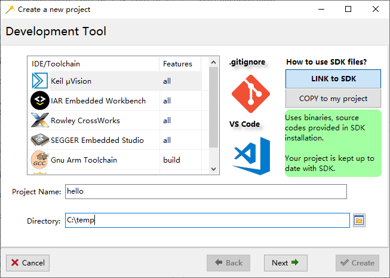

Figure 3.1: 选择项目类型

在这个页面 （图 [3.1](https://ingchips.github.io/user_guide_cn/tutorial.html#fig:ch1-welcome)）：

1. 选择 IDE/工具链
2. 设置项目名称
3. 选择项目的存储位置

`Wizard` 提供以下便利功能：

- 如果需要用 `Git` 做软件版本管理，选择 `Setup .gitignore`；
- 如果准备使用 `Visual Studio Code` 作为代码编辑器，选择 `Setup Visual Studio Code`。

然后点击 `Next` 按钮进入下一页，`Choose Chip Series`。

### 3.1.2 Choose Chip Series 页面 {#choose-chip-series-页面}

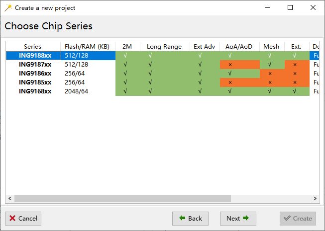

Figure 3.2: Choose Chip Series

在这个页面（图 [3.2](https://ingchips.github.io/user_guide_cn/tutorial.html#fig:ch1-wiz-series)）选择项目的目标芯片型号，然后点击 `Next` 进入下一页，`Choose Project Type`。

### 3.1.3 Choose Project Type 页面 {#choose-project-type-页面}

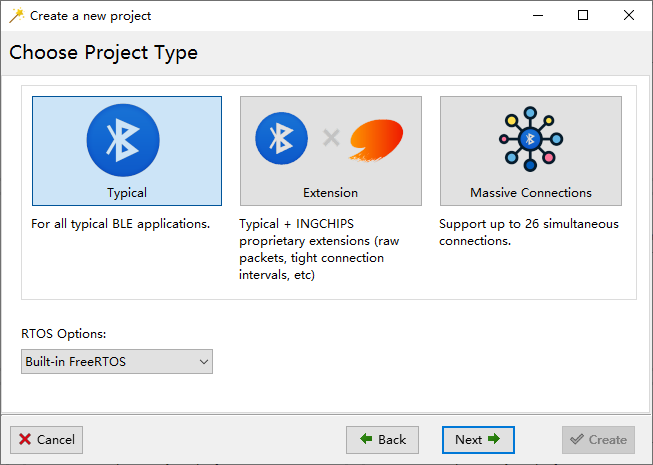

Figure 3.3: Choose Project Type

在这个页面（图 [3.3](https://ingchips.github.io/user_guide_cn/tutorial.html#fig:proj-type)），选择 `Typical`。

然后点击 `Next` 进入下一页，`Role of Your Device`。

### 3.1.4 Role of Your Device 页面 {#role-of-your-device-页面}


Figure 3.4: Role of Your Device

在这个页面 （图 [3.4](https://ingchips.github.io/user_guide_cn/tutorial.html#fig:ch1-role)），选择 Peripheral，然后点击 `Next` 进入下一页，`Peripheral Setup`。

### 3.1.5 Peripheral Setup 页面 {#peripheral-setup-页面}


Figure 3.5: Peripheral Setup

在这个页面（图 [3.5](https://ingchips.github.io/user_guide_cn/tutorial.html#fig:ch1-peripheral)），选择 `Legacy` 广播方式。

支持 BLE 5.x 扩展广播的手机目前依然凤毛麟角，即使声称了“支持” BLE 5.0。为了更好的兼容性，这里我们选择 使用 `Legacy` 广播。此外，待项目创建之后，通过修改一个比特就能将 `Legacy` 广播切换成 BLE 5.x 扩展广播。

点击 `Setup Advertising Data` 按钮， 打开广播数据编辑器（图 [3.6](https://ingchips.github.io/user_guide_cn/tutorial.html#fig:ch1-hello-adv)）。 在编辑器里，输入 `name` 可以快速定位到 GAP 广播项 `09 - «Complete Local Name»`，点击 `Add` 将这个项添加到设备的广播数据里。

点击刚刚添加的 `09 - «Complete Local Name»` 数据项， 然后将在下面的数据编辑框里输入 “Hello, 世界” 并按回车。 `Data Preview` 会更新，整个广播都将已原始字节流的形式显示其中。显而易见，工具对中文字符使用了 `UTF-8` 编码。


Figure 3.6: Edit Advertising Data

现在点击 `OK` 回到项目向导，然后点击 `Next` 进入下一页，`Security & Privacy`。

### 3.1.6 Security & Privacy 页面 {#security-privacy-页面}

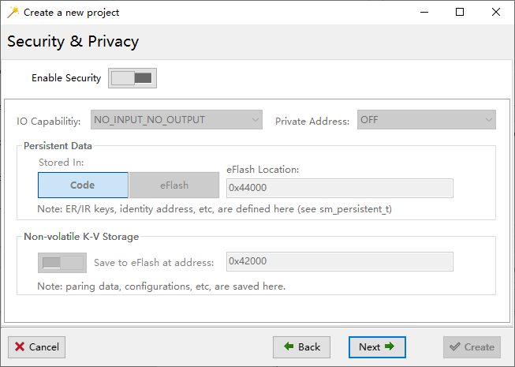

Figure 3.7: Firmare Over-The-Air

保持默认值（图 [3.7](https://ingchips.github.io/user_guide_cn/tutorial.html#fig:ch1-wiz-security)），然后点击 `Next` 进入下一页，`Firmare Over-The-Air`。

### 3.1.7 Firmare Over-The-Air 页面 {#firmare-over-the-air-页面}


Figure 3.8: Firmare Over-The-Air

保持默认值（图 [3.8](https://ingchips.github.io/user_guide_cn/tutorial.html#fig:ch1-hello-fota)），然后点击 `Next` 进入下一页，`Common Functions`.

### 3.1.8 Common Functions 页面 {#common-functions-页面}

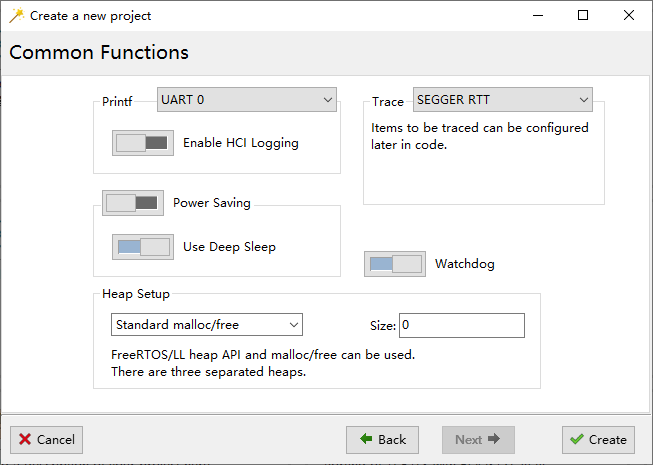

Figure 3.9: Common Functions

在这一页（图 [3.9](https://ingchips.github.io/user_guide_cn/tutorial.html#fig:ch1-hello-common)），我们依然保持默认值不变，点击 `Create`。 现在项目创建好了（图 [3.10](https://ingchips.github.io/user_guide_cn/tutorial.html#fig:ch1-hello-proj-ready)），可以随时编译、下载。


Figure 3.10: “Hello, 世界” is Ready

### 3.1.9 编译您的项目 {#编译您的项目}

回到 `Wizard` 的主窗口（图 [3.10](https://ingchips.github.io/user_guide_cn/tutorial.html#fig:ch1-hello-proj-ready)），点击打开您的项目。在 IDE 里编译您的项目。

### 3.1.10 下载 {#下载}

回到 `Wizard` （图 [3.10](https://ingchips.github.io/user_guide_cn/tutorial.html#fig:ch1-hello-proj-ready)），右键点击您的项目，从弹出的快捷菜单中选择 `Download to Flash` 就可以打开下载工具（图 [3.11](https://ingchips.github.io/user_guide_cn/tutorial.html#fig:ch1-hello-downloader)）。


Figure 3.11: Download to Flash

除了串口号，下载工具的所有设置都已就绪。设置串口口，然后点击 `Start`。

下载完成之后，用 LightBlue、`INGdemo` （图 [3.12](https://ingchips.github.io/user_guide_cn/tutorial.html#fig:ch1-hello-ingota)）或者其它 app 检查是否可以找到一个名为 “Hello, 世界”的设备。注意，这个设备目前可能无法在系统设置的蓝牙菜单里看到。


Figure 3.12: Hello, 世界

## 3.2 iBeacon {#ibeacon}

在本教程中，让我们创建一个iBeacon。iBeacon是由Apple[13](#fn13) 开发的协议，并在2013年的苹果全球开发者大会上发布。Beacons是一类低功耗蓝牙(BLE)设备，可以将其标识符广播到附近的便携式电子设备。这项技术使智能手机、平板电脑和其他设备在接近iBeacon设备时能够执行相应的操作。 首先，从app Store下载一个iBeacon扫描应用程序。在本教程中，我们将使用一个名为 `Locate` 的应用程序。 `Locate` 有一个预配置的近距离UUID列表，其中包括一个全0 Null UUID。我们将使用这个Null UUID[14](#fn14)。

### 3.2.1 建立广播数据 {#建立广播数据}

iBeacon广播包中有两个项目。

1. Flags

   值固定为0x06，即设置了两位，LE General Discoverable Mode & BR/EDR Not Supported。
2. Manufacturer Specific Data

   本项目内容如表 [3.1](https://ingchips.github.io/user_guide_cn/tutorial.html#tab:ch1-ibeacon)所示

*Table 3.1: iBeacon厂商特定数据*
| Size in Bytes | Name | Value | Notes |
| --- | --- | --- | --- |
| 2 | Company ID | 0x004C | Company ID of Apple, Inc |
| 2 | Beacon Type | 0x1502 | Value defined by Apple |
| 16 | Proximity UUID | User defined value |  |
| 2 | Major | Group ID |  |
| 2 | Minor | ID within a group |  |
| 1 | Measured Power | in dBm | Measured by an iPhone 5s at a 1 meter distance |

为了制作一个iBeacon设备，我们可以遵循[Hello World]示例中的相同步骤，我们只有在个别情况下需要根据规范配置广播包。

在广播数据编辑器中，添加 `0x01 - «Flags»` 和 `0xFF - «Manufacturer Specific Data»` .单击 `0x01 - «Flags»` ，检查 `LE General Discoverable Mode` 和 `BR/EDR Not Supported` 。单击`0xFF - «Manufacturer Specific Data»` ，然后点击 `Edit as` 按钮，会有一个菜单弹出并选择 `iBeacon ...` (图[3.13](https://ingchips.github.io/user_guide_cn/tutorial.html#fig:ch1-edit-beacon-adv)) 来打开iBeacon厂商特定数据编辑器 (图 [3.14](https://ingchips.github.io/user_guide_cn/tutorial.html#fig:ch1-edit-beacon-content)).


Figure 3.13: 编辑iBeacon广播数据


Figure 3.14: 编辑iBeacon厂商特定数据

信号功率可以设置为任何合理值(如-50dBm)，稍后我们将在 `Locate` 应用程序的帮助下对其进行校准。

### 3.2.2 尝试应用 {#尝试应用}

让我们在 `Choose Project Type` 页面上选择GNU Arm Embedded Toolchain作为我们的开发环境，向导会让一切准备就绪 (图 [3.15](https://ingchips.github.io/user_guide_cn/tutorial.html#fig:ch1-ibeacon-proj)).


Figure 3.15: GNU Arm工具链iBeacon已就绪

单击项目以打开控制台，输入 `make`[15](#fn15)来构建它。回到 `Wizard` ，按照相同的步骤将其下载。现在，我们可以在 `Locate` 中找到新创建的iBeacon设备。 (图 [3.16](https://ingchips.github.io/user_guide_cn/tutorial.html#fig:ch1-locate-page1-small))

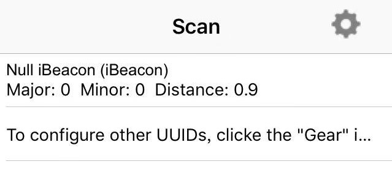

Figure 3.16: iBeacon本地locate APP界面

点击我们的设备，我们就可以实时校准信号功率或检查距离，如图 [3.17](https://ingchips.github.io/user_guide_cn/tutorial.html#fig:ch1-locate-page2-small)所示。

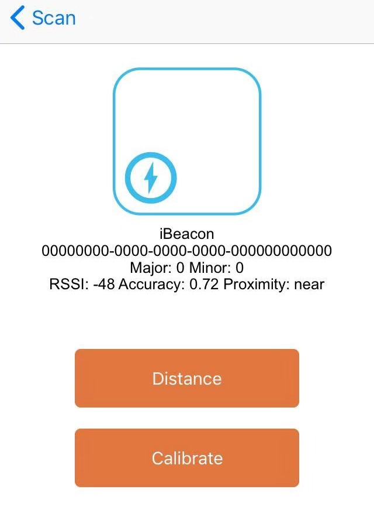

Figure 3.17: iBeacon 在locate APP中的详细信息

一旦信号功率校准，我们可以在 `Wizard` 中右键单击我们的项目，并选择 `Edit Data` -> `Advertising` 菜单项，以用我们所熟悉的编辑器来编辑其广播数据。更新广播数据后，重新构建项目，检查距离是否更准确。

根据规范，接近beacons必须使用一 个不可连接的无定向广播PDU，使用固定的100ms广播间隔。在本教程中，我们不会去修改代码，所以广播参数也不会被修改。为了使这些参数完全符合规范，请参考相应的主机GAP APIs。

## 3.3 温度计 {#温度计}

在本教程中，我们将制作一个 *重要* 的BLE设备，一个温度计。蓝牙SIG已经定义了一个称为健康温度计的GATT服务[16](#fn16)。这个SDK包含一个名为 `INGdemo` 的参考APP，它可以安装到 `Android` 或 `iOS` 设备上。使用 `INGdemo` ，我们可以查看蓝牙设备的广播数据，如果设备中有健康体温计功能， `INGdemo` 可以连接设备并读取温度。

在本教程中，您将了解如何:

- 广播所支持的服务
- 配置GATT配置文件
- 响应GATT特性的读请求

### 3.3.1 建立广播数据 {#建立广播数据-1}

同样，我们遵循与[Hello World]示例中相同的步骤，并在 `Peripheral Setup` 页面上声明温度计服务并创建GATT配置文件。在广播数据中添加以下三项:

1. `Flags`

   值固定为0x06，即设置了两位，LE General Discoverable Mode & BR/EDR Not Supported。
2. `Complete List of 16-bit Service Class UUIDs`

   添加一个如图[3.18](https://ingchips.github.io/user_guide_cn/tutorial.html#fig:ch1-thermo-adv).所示的 `0x1809 - Health Thermometer` 服务。
3. `Complete Local Name`

   让我们将设备命名为”AccurateOne”。


Figure 3.18: 温度计广播数据

### 3.3.2 建立GATT配置文件 {#建立gatt配置文件}

返回 `Peripheral Setup` 页面，单击 `Setup ATT database ...` 打开GATT配置编辑器。添加两个服务，General Access (0x1800) 和Health Thermometer (0x1809)。 删除General Access service的所有非必选特性。对于Health Thermometer service保留两个特性，即温度测量和温度类型，删除其他两个。

接下来，编辑每个特性的值:

1. Device Name of General Access:

   右键单击特征，选择 `Edit String Value ...` 菜单，并设置值为”AccurateOne”。
2. Appearance of General Access:

   右键单击特性，选择 `Help` ，编辑器将在Bluetooth SIG网站上打开相应的文档。找到普通温度计的值(0x0300)，然后单击 `Edit` 按钮，并在数据字段中输入 `0x00, 0x03` 。
3. Temperature Measurement of Health Thermometer

   请查看蓝牙SIG网站文档。点击 `Edit` 按钮并在data字段中输入5个0(`0, 0, 0, 0, 0`)。这里的第一个字节包含标志，表明之后的度量单位是一个以摄氏度为单位的 `FLOAT` 值。检查 `read` 和 `dynamic` 属性(图 [3.19](https://ingchips.github.io/user_guide_cn/tutorial.html#fig:ch1-thermo-edit-ch))。

   `FLOAT` 类型为IEEE-11073 32位浮点。最基本的是，它有一个24位的尾数和一个8位的指数(最重要的字节)，以 *10* 为基数。
4. Temperature Type of Health Thermometer

   请查看Bluetooth SIG网站文档。通过单击 `Edit` 按钮将其设置为任何有效值。

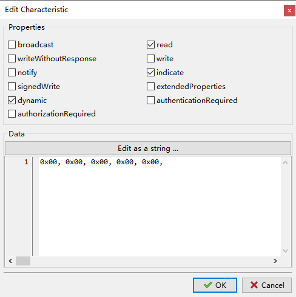

Figure 3.19: 编辑温度测量

### 3.3.3 代码编写 {#代码编写}

项目创建完成后，在IDE中打开 `profile.c` ，由 `Wizard` 自动生成温度测量特征处理函数 `att_read_callback` 。

```c
static uint16_t att_read_callback(hci_con_handle_t connection_handle,
                                  uint16_t att_handle, uint16_t offset,
                                  uint8_t * buffer, uint16_t buffer_size)
{
    switch (att_handle)
    {
    case HANDLE_TEMPERATURE_MEASUREMENT:
        if (buffer)
        {
            // add your code
            return buffer_size;
        }
        else
            return 1; // TODO: return required buffer size

    default:

        return 0;
    }
}
```

当APP读取一个具有 `dynamic` 特点的特性， `att_read_callback` 会被调用两次或更多:一次用于查询所需的缓冲区大小， 一次用于读取数据。如果数据很大， `att_read_callback` 可能会被调用更多次，每次读取由 `offset` 指定的部分数据。

如上所述，定义一种温度测量类型:

```c
typedef __packed struct gatt_temperature_meas
{
     uint8 flags;
    sint32 mantissa:24;
    sint32 exponent:8;
} gatt_temperature_meas_t;

static gatt_temperature_meas_t temperature_meas = {0};
```

现在，我们可以完善上面的 `case HANDLE_TEMPERATURE_MEASUREMENT` 语句:

```c
    case HANDLE_TEMPERATURE_MEASUREMENT:
        if (buffer)
        {
            // simulate an "accurate" thermometer
            temperature_meas.mantissa = rand() % 100;
            // output data
            memcpy(buffer, ((uint8 *)&temperature_meas) + offset, buffer_size);
            return buffer_size;
        }
        else
            return sizeof(gatt_temperature_meas_t);
```

构建并下载项目，然后在 `INGdemo` app中连接到”AccurateOne”设备。检查每次按下 `Refresh` 按钮时温度是否随机变化 (图 [3.20](https://ingchips.github.io/user_guide_cn/tutorial.html#fig:ch1-ingtemp)).

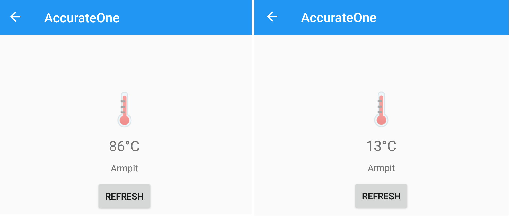

Figure 3.20: 刷新温度测量

温度计(服务器)可以使用通知或指示过程来通知(不需要确认)或指示(需要确认)一个特征值，参见[带通知的温度计]。在本例中，“AccurateOne”不使用这两个过程，而是被动地发送其测量结果。

### 3.3.4 通知 {#通知}

## 3.4 FOTA温度计 {#fota温度计}

在本教程中，我们将在我们的温度计中添加无线固件升级（FOTA）功能。此SDK提供了一个可开箱即用的FOTA设计参考。要使FOTA工作，至少需要涉及三个部分，一个设备、一个APP和一个HTTP服务器。 `INGdemo` 应用已经有了，所以在本教程中，我们将重点关注设备和HTTP服务器。

### 3.4.1 FOTA设备 {#fota设备}

按照与前面温度计示例相同的步骤创建一个新项目，命名为”ota”。

当编辑广播数据时，我们可以通过单击在编辑器中的 `Open File…` 按钮，来导入在前面例子中创建的数据。广播数据存储在 `$(ProjectPath)/data/advertising.adv` .让我们将设备命名为”clickty Click”。

当编辑GATT协议数据库时，我们可以通过单击在编辑器中的打开文件 `Open File…` 按钮来导入在前面例子中创建的数据。GATT协议的数据存储在 `$(ProjectPath)/data/gatt.profile` .中。在 `Add Service` 按钮的下拉菜单中选择 `INGChips Service` ，添加”INGChips FOTA Service”，接下来，编辑该服务的特征值:

1. FOTA Version:

   FOTA Version确定了我们项目的完整版本号。如flash downloader所示，整个项目由两个二进制文件组成，一个来自SDK 软件包，称为平台二进制文件；另一个来自我们的项目，称为APP二进制文件。FOTA版本包含两个子版本，它们分别对应一个二进制文件。每个子版本包含三个字段:

   - Major: A 16-bit field.
   - Minor: A 8-bit field.
   - Patch: Another 8-bit field.

   每个软件包都有自己的版本(同平台二进制文件版本)，使用相同的编号方案，可以在 `SDK` 页面的 `Environment Options` 对话框中找到(使用菜单项 `Tools` -> `Environment Options` 打开此对话框)。假设平台版本为1.0.1，我们想要的APP版本为1.0.0，那么我们将该特征值设为(图 [3.21](https://ingchips.github.io/user_guide_cn/tutorial.html#fig:ch1-ota-version)):

   ```c
   0x0001, 0, 1  // platform version
   0x0001, 0, 0, // app version
   ```
2. FOTA Control

   这是升级期间的控制点。将其值设置为 `0` (即 `OTA_STATUS_DISABLED` )，这是FOTA的初始状态。

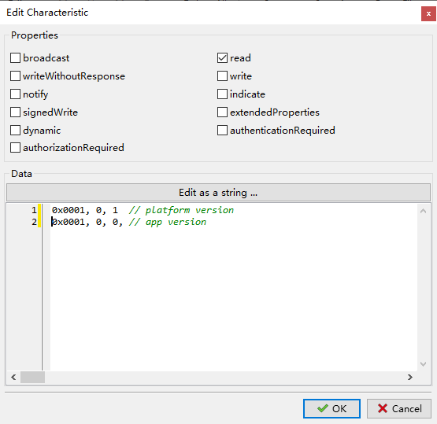

Figure 3.21: FOTA版本设置

单击 `OK` 关闭 `GATT` 协议编辑器。(注意:不要点击 `Save` ，除非你想改变已经在编辑器中打开的 `$(ProjectPath)/data/gatt.profile` 。)

回到项目向导，按下 `Next` 继续下一页的 `Firmare Over-The-Air` 。在这页上，我们勾选 `FOTA` 。注意，与FOTA相关的特征句柄是通过检查GATT协议自动生成的。然后在项目向导上完成其余步骤。

打开我们新的项目”ota”，从上一个例子复制代码来使我们的温度计在 `INGdemo` APP中可以响应 `Refresh` 。

接下来，让我们制作一个新版本。

### 3.4.2 创建一个新版本 {#创建一个新版本}

我们”ota”的新版本命名为”Barba Trick”，APP版本号将升级到 `2.0.0` 。这些数据分别保存在广播数据和协议数据中，右键单击项目并使用编辑器更新它。数据升级以后，使用 `Save As ...` 将数据保存在相同路径下的另一个文件中。例如，更新广播数据并将其保存到 `$(ProjectPath)/data/advertising_2.adv` 。并更新GATT配置文件到 `$(ProjectPath)/data/gatt_2.profile` 。

用一个宏 `V2` 来控制实际用到的广播数据和协议数据：

```c
const static uint8_t adv_data[] = {
#ifndef V2
    #include "../data/advertising.adv"
#else
    #include "../data/advertising_2.adv"
#endif
};

......

const static uint8_t profile_data[] = {
#ifndef V2
    #include "../data/gatt.profile"
#else
    #include "../data/gatt_2.profile"
#endif
};
```

用定义的 `V2` 宏重新编译项目，将 `ota.bin` 和 `platform.bin` (在 `SDK_DIR/sdk/bundles/typical` 中)复制到一个空路径下，`如ota_app_v2` 。

在 `ota_app_v2` 创建一个名为 `manifest.json` 的文件，包含以下数据:

```javascript
{
    "platform": {
                "version": [1,0,1],
                "name": "platform.bin",
                "address": 16384
    },
    "app": {
                "version": [2,0,0],
                "name": "ota.bin",
                "address": 163840
    },
    "entry": 16384,
    "bins":[]
}
```

这些地址可以在 `Environment Options` . `entry` 中找到。地址值固定为 `0x4000` ，即 `16384` 。注意 `json` 不识别常规的 `0xabcd` 十六进制文字。 `INGdemo` 可以下载其他 `bin` 指定的二进制文件到设备。在本例中，我们没有这样的二进制文件，所以这个字段作为空数组保留。

然后为这个更新创建一个 `readme` 文件，其中包含一些关于本次更新的信息。

现在FOTA包已经准备好了。为整个 `ota_app_v2` 路径制作一个 `ota_app_v2.zip` 的ZIP压缩包。注意，不应该将 `ota_app_v2` 设置为 `ota_app_v2.zip` 中的子目录。表 [3.2](https://ingchips.github.io/user_guide_cn/tutorial.html#tab:ch1-ota-package) 给出了压缩文件中的文件清单。

*Table 3.2: FOTA包文件清单*
| File Name | Notes |
| --- | --- |
| readme | Some information about this update |
| manifest.json | Meta information |
| platform.bin | Platform binary |
| ota.bin | App binary |

回到IDE，在没有定义宏 `V2` 的情况下重新构建项目，然后下载该项目到开发板。

### 3.4.3 FOTA服务器 {#fota服务器}

`INGdemo` APP需要一个FOTA服务器URL，定义在 `class Thermometer.FOTA_SERVERr` 。将 `ota_app_v2.zip` 移动到HTTP服务器的文档目录，并创建一个 `latest.json` 文件，它包含最新版本的信息。内容是:

```javascript
{
    "app": [2,0,0],
    "platform": [1,0,1],
    "package": "ota_app_v2.zip"
}
```

确保这两个文件可以通过 `(FOTA_SERVER + latest.json)` 和 `(FOTA_SERVER + ota_app_v2.zip)` 访问.

### 3.4.4 尝试应用 {#尝试应用-1}

在 `INGdemo` 中连接”Clickety Click”，点击 `Update` (图 [3.22](https://ingchips.github.io/user_guide_cn/tutorial.html#fig:ch1-fota-update)). 由于 `platform.bin` 是最新的，所以只需要升级 `app.bin` 就可以了，整个升级过程在很短的时间内完成。回到主页，再次扫描并检查我们的新版本是否起作用，有了一个名为”Barba Trick”的设备。连接到”Barba Trick”，可以看到现在固件是最新的。

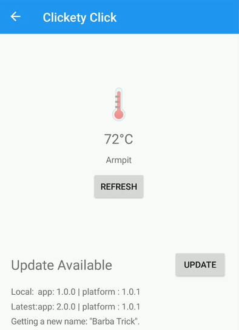

Figure 3.22: “Clickety Click”升级可用

本教程给出了一个实现FOTA的例子。用户可以自由设计新的FOTA解决方案，从版本定义到FOTA服务和特性。也可以为FOTA开发一个专用的第二APP。

*安全性* 是必须要考虑的。

## 3.5 iBeacon扫描设备 {#ibeacon扫描设备}

我们已经知道如何配置iBeacon设备。在本教程中，我们将创建一个iBeacon扫描器。

扫描器在蓝牙微距网络中起着核心作用。和之前一样，我们在 `Wizard` 中创建一个名为”iscanner”的新项目 (图 [3.23](https://ingchips.github.io/user_guide_cn/tutorial.html#fig:ch1-proj-iscanner)). 在 `Role of Your Device` 页面，选择*Central*。中心设备会一直扫描其他设备然后这些设备执行其相应的动作，我们的新项目向导自动添加代码开始扫描。


Figure 3.23: 创建IAR Embedded Workbench的“iscanner”

在IDE中打开这个新项目，并找到函数 `user_packet_handler` 。我们可以看到有一个名为 `HCI_SUBEVENT_LE_EXTENDED_ADVERTISING_REPORT` 的事件:

```c
    case HCI_SUBEVENT_LE_EXTENDED_ADVERTISING_REPORT:
        {
            const le_ext_adv_report_t *report = decode_hci_le_meta_event(packet,
                      le_meta_event_ext_adv_report_t)->reports;
            // ...
        }
        break;
```

每次接收到这个事件时，我们可以检查广播报告是否包含 `0xFF - «Manufacturer Specific Data»`，以及它是否是一个iBeacon包。有了制作iBeacon设备的知识，就可以直接用 `C` 语言定义一个iBeacon数据包的类型。

```c
typedef __packed struct ibeacon_adv
{
    uint16_t apple_id;
    uint16_t id;
    uint8_t  uuid[16];
    uint16_t major;
    uint16_t minor;
    int8_t   ref_power;
} ibeacon_adv_t;

#define APPLE_COMPANY_ID        0x004C
#define IBEACON_ID              0x1502
```

`__packed` 是一个扩展关键字，用于指定数据类型使用第一种数据对齐方式。幸运的是， *ARM* 和 *IAR* 编译器都支持它。或者可以使用 `#pragma pack` 指令:

```c
#pragma pack (push, 1)
typedef struct ibeacon_adv
{
    ...
} ibeacon_adv_t;
#pragma pack (pop)
```

在继续之前，让我们创建一个将UUID转换为字符串的辅助函数。

```c
const char *format_uuid(char *buffer, uint8_t *uuid)
{
    sprintf(buffer, "{%02X%02X%02X%02X-%02X%02X-%02X%02X-"
                    "%02X%02X-%02X%02X%02X%02X%02X%02X}",
           uuid[0], uuid[1], uuid[2], uuid[3],
           uuid[4], uuid[5], uuid[6], uuid[7], uuid[8], uuid[9],
           uuid[10], uuid[11], uuid[12], uuid[13], uuid[14], uuid[15]);
    return buffer;
}
```

### 3.5.1 估算距离 {#估算距离}

接收到的信号强度指示(RSSI)与广播数据一起播报。一般来说，点源辐射出的电磁波强度与信号源距离的平方成反比。著名的自由空间损失方程为:

Loss = 32.45 + 20log(d) + 20log(f)

其中 d 的单位是km, f 的单位是MHz, Loss 的单位是dB。通过比较RSSI和1米距离下的测量功率(`ref_power`)，我们可以利用自由空间损失方程大致估计出扫描仪和信标之间的距离:

```c
double estimate_distance(int8_t ref_power, int8_t rssi)
{
    return pow(10, (ref_power - rssi) / 20.0);
}
```

现在，我们用不到20行代码就可以实现一个功能完整的iBeancon扫描器:

```c
    uint8_t length;
    ibeacon_adv_t *p_ibeacon;
    char str_buffer[80];
    const le_ext_adv_report_t *report;
    ......
    case HCI_SUBEVENT_LE_EXTENDED_ADVERTISING_REPORT:
        report = decode_hci_le_meta_event(packet,
                        le_meta_event_ext_adv_report_t)->reports;
        p_ibeacon = (ibeacon_adv_t *)ad_data_from_type(report->data_len,
                        (uint8_t *)report->data, 0xff, &length);

        if ((length != sizeof(ibeacon_adv_t))
            || (p_ibeacon->apple_id != APPLE_COMPANY_ID)
            || (p_ibeacon->id != IBEACON_ID))
            break;

        printf("%s %04X,%04X, %.1fm\n",
                format_uuid(str_buffer, p_ibeacon->uuid),
                p_ibeacon->major, p_ibeacon->minor,
                estimate_distance(p_ibeacon->ref_power, report->rssi));
        break;
```

使用 `Locate` 应用程序发送iBeacon信号，并查看我们的设备是否能找到它 (图 [3.24](https://ingchips.github.io/user_guide_cn/tutorial.html#fig:ch1-iscanner)). 最后，由于RSSI值是波动的，可以在RSSI上增加一个低通滤波器使估算值更加稳定。


Figure 3.24: iBeacon扫描结果

需要注意该APP的二进制文件的大小会急剧增加。这主要是因为Cortex-M3没有硬件浮点单元，浮点操作都是由库函数执行的。使用浮点运算前请 *仔细考虑一下* 。

### 3.5.2 并发广播&扫描 {#并发广播扫描}

作为一个练习，我们可以合并这个iBeacon项目，并检查我们的设备是否可以在发送iBeacon信号的同时继续扫描其他iBeacon设备。

蓝牙无线电采用TDD (Time Division Duplex)拓扑结构，该结构要求同一时刻的数据发送在一个方向上进行，数据接收在另一个方向上进行，设备不能 接收到自己的iBeacon信号。

## 3.6 通知&指示 {#通知指示}

服务器可以使用通知或指示过程来通知(不需要确认)或指示(需要确认)一个特征值。现在，让我们将通知和指示功能添加到我们在之前教程中创建的温度计中。

我们分别使用 `att_server_notify` 和 `att_server_indicate` 来通知或指示一个特征值。这些 `API` 必须在蓝牙协议栈 (`Host`) 任务中调用。

主动产生的通知和指示可以由定时器或中断触发，例如蓝牙任务栈之外的源。SDK 提供了基于 RTOS 消息的任务间通信机制以便调用这些蓝牙协议栈 API。

### 3.6.1 任务间通信 {#inter-task-comm}

可使用 `btstack_push_user_msg` 发送消息到蓝牙协议栈:

```c
uint32_t  btstack_push_user_msg(uint32_t msg_id, void *data, const uint16_t len);
```

这个消息将被传递到你的 `user_packet_handler` 下的事件ID `BTSTACK_EVENT_USER_MSG` :

```c
static void user_packet_handler(uint8_t packet_type, uint16_t channel,
                                uint8_t *packet, uint16_t size)
{
    uint8_t event = hci_event_packet_get_type(packet);
    btstack_user_msg_t *p_user_msg;
    if (packet_type != HCI_EVENT_PACKET) return;

    switch (event)
    {
    // ......
    case BTSTACK_EVENT_USER_MSG:
        p_user_msg = hci_event_packet_get_user_msg(packet);
        user_msg_handler(p_user_msg->msg_id, p_user_msg->data,
                         p_user_msg->len);
        break;
    // ......
    }
}
```

在这里，我们将用户消息的处理传递给另一个叫 `user_msg_handler` 的函数。注意 `user_msg_handler` 是在蓝牙协议栈任务的上下文中运行的，现在我们可以调用那些蓝牙栈APIs了。

事件 `BTSTACK_EVENT_USER_MSG` 被广播到所有 `HCI` 事件回调函数。

### 3.6.2 定时器 {#定时器}

现在让我们让温度计”AccurateOne”每秒钟更新一次它的值。首先，在初始化时创建一个定时器，例如在 `app_main` 或 `setup_profile` 中。

```c
TimerHandle_t app_timer = 0;

uint32_t setup_profile(void *data, void *user_data)
{
    app_timer = xTimerCreate("app",
                                pdMS_TO_TICKS(1000),
                                pdTRUE,
                                NULL,
                                app_timer_callback);
        // ...
}
```

定时器回调函数可以被定义为：

```c
#define USER_MSG_ID_REQUEST_SEND            1
static void app_timer_callback(TimerHandle_t xTimer)
{
    if (temperture_notify_enable | temperture_indicate_enable)
        btstack_push_user_msg(USER_MSG_ID_REQUEST_SEND, NULL, 0);
}
```

当我们在 `HCI_EVENT_LE_META` 中得到 `HCI_SUBEVENT_LE_ENHANCED_CONNECTION_COMPLETE` 时，定时器开始计时，并在我们得到 `HCI_EVENT_DISCONNECTION_COMPLETE` 时定时器停止。

这里的 `temperture_notify_enable` 和 `temperture_indicate_enable` 是两个初始化为 `0s` 的标志，并在 `att_write_callback` 中设置为 `1` :

```c
static int att_write_callback(hci_con_handle_t connection_handle,
                              uint16_t att_handle, uint16_t transaction_mode,
                              uint16_t offset, uint8_t *buffer, uint16_t buffer_size)
{
    switch (att_handle)
    {
    case HANDLE_TEMPERATURE_MEASUREMENT + 1:
        handle_send = connection_handle;
        switch (*(uint16_t *)buffer)
        {
        case GATT_CLIENT_CHARACTERISTICS_CONFIGURATION_INDICATION:
            temperture_indicate_enable = 1;
            break;
        case GATT_CLIENT_CHARACTERISTICS_CONFIGURATION_NOTIFICATION:
            temperture_notify_enable = 1;
            break;
        }
        return 0;
    // ...
    }
}
```

在这里，我们将 `connection_handle` 存储到一个全局变量 `handle_send` ，并在之后会使用该变量。最后一段代码是在 `user_msg_handler` 中处理消息 `USER_MSG_ID_REQUEST_SEND` :

```c
static void user_msg_handler(uint32_t msg_id, void *data, uint16_t size)
{
    switch (msg_id)
    {
    case USER_MSG_ID_REQUEST_SEND:
        att_server_request_can_send_now_event(handle_send);
        break;
    }
}
```

并在 `ATT_EVENT_CAN_SEND_NOW`中报告温度值：

```c
...
case ATT_EVENT_CAN_SEND_NOW:
    temperature_meas.mantissa = rand() % 100;
    if (temperture_notify_enable)
    {
        att_server_notify(handle_send,
                          HANDLE_TEMPERATURE_MEASUREMENT,
                          (uint8_t*)&temperature_meas,
                          sizeof(temperature_meas));
    }

    if (temperture_indicate_enable)
    {
        att_server_indicate(handle_send,
                          HANDLE_TEMPERATURE_MEASUREMENT,
                          (uint8_t*)&temperature_meas,
                          sizeof(temperature_meas));
    }
    break;
...
```

尝试重新构建并下载项目，并检查 `INGdemo` 中显示的温度值是否每秒变化一次。

有一个完整功能的温度计示例，即`thermoota`，它支持FOTA，通知和指示。

## 3.7 吞吐量 {#吞吐量}

BLE 5.0介绍了一种新的采样率为2M的非编码PHY。

### 3.7.1 理论峰值吞吐量 {#理论峰值吞吐量}

数据物理通道PDU的最大有效载荷长度为251字节。采用2M PHY，传输时间为1048 μs。一个空的数据物理通道PDU的传输时间为44 μs。

为了实现一个方向上的最大吞吐量，该方向上所有pdu的长度应该为251字节，而另一个方向上所有pdu的长度应该为空。所以，251个字节总的传输时间为：

1048 + 44 + 150 * 2 = 1392 (\mu s)

因此，链路层提供的理论峰值吞吐量为：

251 * 8 / 1392 * 1000000 \approx 1442.528 (kbps)

对于一个运行在GATT之上的应用程序，I2CAP和ATT都有它们自己的开销。通常，GATT的最大有效负载为(251 - 7 =)244字节。因此，GATT可以提供的理论上的峰值吞吐量为：

244 * 8 / 1392 * 1000000 \approx 1402.298 (kbps)

### 3.7.2 测试吞吐量 {#测试吞吐量}

在SDK中有一对用于吞吐量测试的示例 （图 [3.25](https://ingchips.github.io/user_guide_cn/tutorial.html#fig:ch1-tpt)）.

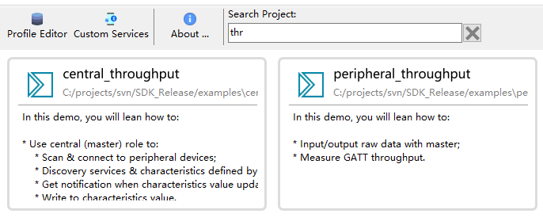

Figure 3.25: 吞吐量测试示例

#### 3.7.2.1 对 INGdemo 进行测试 {#对-ingdemo-进行测试}

下载 `peripheral_throughput`. 使用 `INGdemo` 连接到 `ING Tpt` , 打开吞吐量测试页面。在这个页面上，我们可以测试从主到从、从到主或同时在两个方向上的吞吐量。

图中 （图 [3.26](https://ingchips.github.io/user_guide_cn/tutorial.html#fig:ch1-tpt-app)）显示，使用支持2M PHY的普通Android手机，我们可以实现1M+ bps的空中传输吞吐量。


Figure 3.26: Android手机上的吞吐量

#### 3.7.2.2 对我们的APP进行测试 {#对我们的app进行测试}

示例 `central_throughput` 演示了BLE中心设备的一般工作过程:

1. 扫描并连接到在其广播中声明了吞吐量服务的设备;
2. 发现吞吐量服务;
3. 发现服务的特性;
4. 发现特性描述。

`INGChips Throughput Service` 有两个特点。

- 通用输出

  通过这一特性，外围设备向中心设备发送数据。

  这个特性有一个 `Client Characteristic Configuration` 描述符。
- 通用输入

  通过这个特性，中心设备向外围设备发送数据。

下载 `central_throughput` 到另一块板。这个应用程序有一个UART命令行接口给到主机。连接到主机，输入”?“以查看所支持的命令。这个APP自动连接到 `peripheral_throughput` 。输入命令 `start s->m` 或 `start m->s` 开始测试从外设到中心设备的吞吐量，或从中心设备到外设的。


Figure 3.27: 指令接口

图中（图 [3.28](https://ingchips.github.io/user_guide_cn/tutorial.html#fig:ch1-board-tpt)）显示，使用两块板，我们在空中实现了1.2M+ bps的稳定数据传输。


Figure 3.28: 板间吞吐量

这个吞吐量是在空中测试的，比理论峰值略低，但真实性更高。

## 3.8 双角色 & BLE网关 {#双角色-ble网关}

在本教程中，我们将创建一个BLE网关，它从几个外设收集数据并将数据报告给一个中心设备。在收集数据时，这个网关是一个中心设备，而报告数据时，它是一个外设，也就是说，我们的APP能够扮演双角色。

具体而言，我们的网关只支持从温度计收集数据。我们称之为 `smart_meter` 。

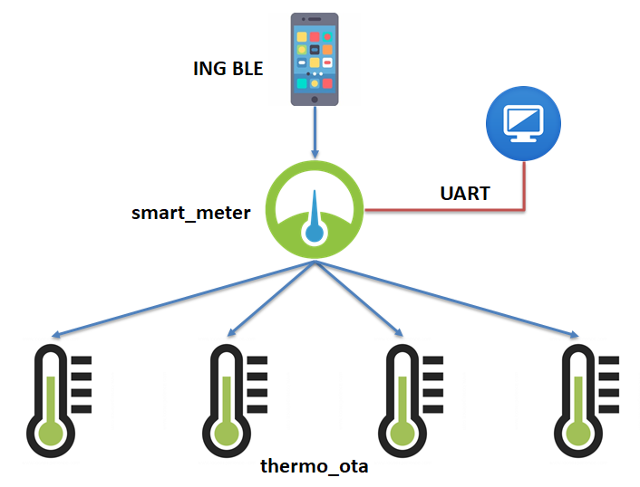

Figure 3.29: Smart Meter架构

`smart_meter` 使用一个通用型基于字符串的输出服务将数据报告到中心设备，比如运行在智能手机上的 `INGdemo` 。它还拥有可以连接到主机的UART控制接口。

检查示例 `peripheral_console` 以了解如何进行字符串输入和输出。

我们同样提供了完整功能的 `smart_meter` app作为示例。在创建您自己的示例时，请参考此示例。

现在，让我们创建这个BLE网关。

### 3.8.1 用 Wizard 创建一个外设APP {#用-wizard-创建一个外设app}

使用GUI编辑器编辑广播数据，命名我们的应用程序为”ING Smart Meter”。

使用GUI编辑器编辑GATT配置文件。将 `INGChips Console Service` 添加到GATT配置文件 （图 [3.30](https://ingchips.github.io/user_guide_cn/tutorial.html#fig:ch1-smart-meter-gatt)）.

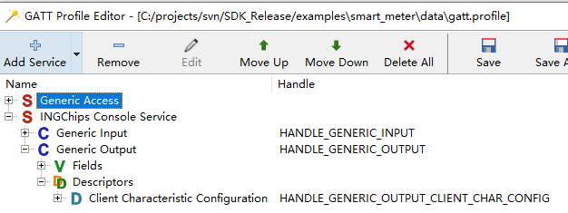

Figure 3.30: Smart Meter GATT配置文件

### 3.8.2 定义温度计数据 {#定义温度计数据}

温度计由它的设备地址和id来识别。每个温度计使用由 `conn_handle` 来显示自己的连接状态。

```c
typedef struct slave_info
{
    uint8_t     id;
    bd_addr_t   addr;
    uint16_t    conn_handle;
    gatt_client_service_t                   service_thermo;
    gatt_client_characteristic_t            temp_char;
    gatt_client_characteristic_descriptor_t temp_desc;
    gatt_client_notification_t              temp_notify;
} slave_info_t;
```

设定了4个温度计。

### 3.8.3 扫描温度计 {#扫描温度计}

调用两个GAP API接口开始扫描。一旦找到一个设备，会检查它的设备地址是否是温度计。如果是，停止扫描并调用 `gap_ext_create_connection` 进行连接。 连接建立后，如果有温度计未连接，则重新开始扫描。

### 3.8.4 发现服务 {#发现服务}

连接建立后，调用 `gatt_client` API接口来发现它的服务。 这些 API 接口遵循类似 Android 和 iOS 的逻辑。

### 3.8.5 数据处理 {#数据处理}

预定温度计的 `Temperature Measurement` 特性。当接收到一个新的测量值时，将该值转换为一个字符串并将其报告给主机。如果我们的应用程序已经连接到一个中心设备，通过GATT特性将该信息转发给它。

### 3.8.6 鲁棒性 {#鲁棒性}

为了让我们的应用更稳健:

- 如果与温度计断开连接，则开始扫描;
- 如果与中心设备断开连接，则开始广播。

### 3.8.7 准备温度计 {#准备温度计}

我们可以将示例 `thermo_ota` 用做温度计。但是我们需要为每一个温度计配置不同的地址。

我们可以写一个简单的脚本为下载程序自动生成这些地址:

```pascal
procedure OnStartBin(const BatchCounter, BinIndex: Integer;
                     var Data: TBytes; var Abort: Boolean);
begin
  if BinIndex <> 6 then Exit;
  Data[0] := BatchCounter;
end;
```

有关下载脚本的更多信息，请参见 [Scripting & Mass Production](https://ingchips.github.io/user_guide_cn/core-tools.html#script-mass-prod).

### 3.8.8 测试 {#测试}

在主机上输入 `start` 命令来启动我们的应用程序(开始扫描并广播)。使用 `INGdemo` 连接到名为”ING Smart Meter”的设备，检查温度测量结果。

关闭和打开一个或多个温度计，我们的应用程序应该能够重新连接到它们。

## 3.9 从示例开始 {#从示例开始}

`Wizard` 主界面展示了 SDK 附带的所有示例，开发者直接可以直接修改例子，查看效果。当重新安装 SDK 时，这些修改会被覆盖。 如果需要基于示例开发项目，开发者可以在快捷菜单选择 “Copy this Example …” 将示例完整复制到其它位置。


Figure 3.31: 复制 SDK 示例

---

1. <a id="fn13"></a>[https://developer.apple.com/ibeacon/](https://developer.apple.com/ibeacon/)[↩︎](https://ingchips.github.io/user_guide_cn/tutorial.html#fnref13)
2. <a id="fn14"></a>Note that UUID is not allowed to be all 0s in final products.[↩︎](https://ingchips.github.io/user_guide_cn/tutorial.html#fnref14)
3. <a id="fn15"></a>`Makefile` follows the syntax of GNU `make`.[↩︎](https://ingchips.github.io/user_guide_cn/tutorial.html#fnref15)
4. <a id="fn16"></a>[https://www.bluetooth.com/specifications/gatt/viewer?attributeXmlFile=org.bluetooth.service.health_thermometer.xml](https://www.bluetooth.com/specifications/gatt/viewer?attributeXmlFile=org.bluetooth.service.health_thermometer.xml)[↩︎](https://ingchips.github.io/user_guide_cn/tutorial.html#fnref16)